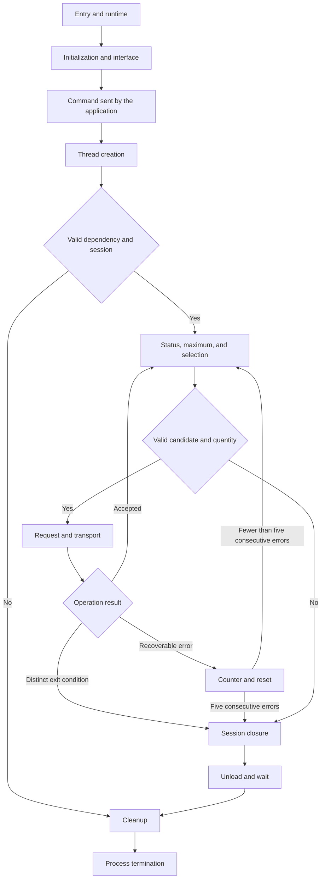

# Dispenser NO_TOKEN — Static Reverse Engineering

**[EN](/dispenser-no-token-analysis-en/)** · [ES](/dispenser-no-token-analysis/)

**Author:** Gino Aldair Maihuiri Romero (Sv-chost)  
**Preparation date:** October 23, 2026  
**Sample identifier in the project:** `f6609bb3c3197ace26ebdeb372ba657ac84b05a3e9e265b5211e1ea42da70dbe`  
**Tools:** Ghidra and Python 3; 319 cataloged functions.  
**Scope:** static investigation checked against assembly and isolated Python reproductions. It is not presented as execution of the binary or physical validation of the device.

## Contents

- [1. Introduction and scope of the investigation](#1-introduction-and-scope-of-the-investigation)
  - [1.1. Identification and static scope](#11-identification-and-static-scope)
  - [1.2. Following the references and reconstructions](#12-following-the-references-and-reconstructions)
  - [1.3. The first difficulty: the pseudocode loses useful information](#13-the-first-difficulty-the-pseudocode-loses-useful-information)
  - [1.4. Order of study](#14-order-of-study)
  - [1.5. What the reproductions verify](#15-what-the-reproductions-verify)
  - [1.6. External documentation and attribution](#16-external-documentation-and-attribution)
- [2. Sample structure and coverage criteria](#2-sample-structure-and-coverage-criteria)
  - [Before interpreting the behavior](#before-interpreting-the-behavior)
  - [The five PE sections and the analysis memory blocks](#the-five-pe-sections-and-the-analysis-memory-blocks)
  - [The manifest and startup privileges](#the-manifest-and-startup-privileges)
  - [Reconstructing the imports](#reconstructing-the-imports)
  - [The exports and the directory's internal name](#the-exports-and-the-directorys-internal-name)
  - [Separating application logic from the runtime library](#separating-application-logic-from-the-runtime-library)
  - [Library helpers that do affect the interpretation](#library-helpers-that-do-affect-the-interpretation)
  - [Three groups of artifacts that can mislead the analysis](#three-groups-of-artifacts-that-can-mislead-the-analysis)
  - [What the catalog covers and what lies outside its numbering](#what-the-catalog-covers-and-what-lies-outside-its-numbering)
- [3. From the entry point to the interface: reconstructing the initial path](#3-from-the-entry-point-to-the-interface-reconstructing-the-initial-path)
  - [`entry`, at `00403fb8`: what the runtime prepares and where it transfers control](#entry-at-00403fb8-what-the-runtime-prepares-and-where-it-transfers-control)
  - [Two ways to reach the same application](#two-ways-to-reach-the-same-application)
  - [`00402d5b`: numeric preparation and window registration](#00402d5b-numeric-preparation-and-window-registration)
  - [`00402896`: the window procedure and control creation](#00402896-the-window-procedure-and-control-creation)
  - [Digit entry: what it does and what it does not establish](#digit-entry-what-it-does-and-what-it-does-not-establish)
  - [The `ENTER` branch and a start that does not wait for a keystroke](#the-enter-branch-and-a-start-that-does-not-wait-for-a-keystroke)
  - [`004026cd`: reading without validation, removing controls, and creating the thread](#004026cd-reading-without-validation-removing-controls-and-creating-the-thread)
  - [From keypad to status panel](#from-keypad-to-status-panel)
  - [Message loop, shutdown, and effective return values](#message-loop-shutdown-and-effective-return-values)
  - [An inert reproduction of event order](#an-inert-reproduction-of-event-order)
  - [What this path establishes](#what-this-path-establishes)
  - [Win32 sources used in this chapter](#win32-sources-used-in-this-chapter)
- [4. Internal calculations: identifying the hash and following its result](#4-internal-calculations-identifying-the-hash-and-following-its-result)
  - [First clue: a state of four words](#first-clue-a-state-of-four-words)
  - [Reconstructing the context](#reconstructing-the-context)
  - [`FUN_00403058`: accumulating data and completing blocks](#fun_00403058-accumulating-data-and-completing-blocks)
  - [`FUN_0040316e`: reading sixteen words and executing the rounds](#fun_0040316e-reading-sixteen-words-and-executing-the-rounds)
  - [`FUN_004030f9`: closing the message and producing sixteen bytes](#fun_004030f9-closing-the-message-and-producing-sixteen-bytes)
  - [`FUN_00403866`: serialization and its usage constraint](#fun_00403866-serialization-and-its-usage-constraint)
  - [Returning to `FUN_00402f54`: resolving what Ghidra leaves open](#returning-to-fun_00402f54-resolving-what-ghidra-leaves-open)
  - [Where the value comes from: the clock and the runtime generator](#where-the-value-comes-from-the-clock-and-the-runtime-generator)
  - [What happens to the digest on return to startup](#what-happens-to-the-digest-on-return-to-startup)
  - [A verifiable reproduction of the MD5 primitive](#a-verifiable-reproduction-of-the-md5-primitive)
  - [What this block establishes](#what-this-block-establishes)
- [5. Core interaction with the dispenser](#5-core-interaction-with-the-dispenser)
  - [From the main thread to a specific dependency](#from-the-main-thread-to-a-specific-dependency)
  - [The table of eight functions and a result valid only in AL](#the-table-of-eight-functions-and-a-result-valid-only-in-al)
  - [The shared argument block](#the-shared-argument-block)
  - [Opening: a string built from integers](#opening-a-string-built-from-integers)
  - [Parameters lost in the decompiled view](#parameters-lost-in-the-decompiled-view)
  - [Lock, query, unlock](#lock-query-unlock)
  - [The parser: from delimited text to an 8,192-byte table](#the-parser-from-delimited-text-to-an-8192-byte-table)
  - [Finding a key and returning its value](#finding-a-key-and-returning-its-value)
  - [MAX_NOTES and the default maximum of twenty](#max_notes-and-the-default-maximum-of-twenty)
  - [The cassette selector: status, value, and quantity](#the-cassette-selector-status-value-and-quantity)
  - [A reproduction with synthetic data](#a-reproduction-with-synthetic-data)
  - [The selection wrapper and preservation of the result](#the-selection-wrapper-and-preservation-of-the-result)
  - [The operation and its three actual arguments](#the-operation-and-its-three-actual-arguments)
  - [The thread loop and its actual exit conditions](#the-thread-loop-and-its-actual-exit-conditions)
  - [Findings for this subsystem](#findings-for-this-subsystem)
- [6. Removal of traces and selected files](#6-removal-of-traces-and-selected-files)
  - [String normalization: `00401000`](#string-normalization-00401000)
  - [Pattern selection: `00401037`](#pattern-selection-00401037)
  - [Overwriting and deletion: `004010eb`](#overwriting-and-deletion-004010eb)
  - [Directory traversal: `004011b6`](#directory-traversal-004011b6)
  - [Enabling a token privilege: `0040137a`](#enabling-a-token-privilege-0040137a)
  - [Building and assigning permissions: `00401407`](#building-and-assigning-permissions-00401407)
  - [Recursive key deletion: `00401510`](#recursive-key-deletion-00401510)
  - [Targeted cleanup objectives: `0040165d`](#targeted-cleanup-objectives-0040165d)
  - [Traversing drive letters: `0040189f`](#traversing-drive-letters-0040189f)
  - [Verifiable reproduction with strings and in-memory buffers](#verifiable-reproduction-with-strings-and-in-memory-buffers)
  - [What this block establishes](#what-this-block-establishes-1)
- [7. Reconstructing the behavior and assessing the evidence](#7-reconstructing-the-behavior-and-assessing-the-evidence)
  - [7.1. The path connecting the components](#71-the-path-connecting-the-components)
  - [7.2. What cleanup on a failure path means](#72-what-cleanup-on-a-failure-path-means)
  - [7.3. Observed techniques and labels requiring care](#73-observed-techniques-and-labels-requiring-care)
  - [7.4. Indicators and artifacts in context](#74-indicators-and-artifacts-in-context)
  - [7.5. Detection opportunities and validation limits](#75-detection-opportunities-and-validation-limits)
  - [7.6. Final capability matrix](#76-final-capability-matrix)
  - [7.7. Questions that remain open](#77-questions-that-remain-open)
  - [7.8. Conclusion of the investigation](#78-conclusion-of-the-investigation)
- [Appendix A. Complete catalog of the 319 functions](#appendix-a-complete-catalog-of-the-319-functions)
- [Appendix B. Identified static imports](#appendix-b-identified-static-imports)
- [Appendix C. Complete reproductions and results](#appendix-c-complete-reproductions-and-results)
- [Appendix D. Primary references](#appendix-d-primary-references)
- [Appendix E. Reproducibility and continuity](#appendix-e-reproducibility-and-continuity)
- [Copyright and attribution](#copyright-and-attribution)

---

## 1. Introduction and scope of the investigation

When beginning the analysis in Ghidra, it helps to connect two views of the same sample: the pseudocode in Decompiler and the instructions in Listing. The first makes structures easier to recognize. The second lets us check that reading by following the values passed through registers, the stack arguments, and the instructions behind each decision.

The project identifies the sample as `f6609bb3c3197ace26ebdeb372ba657ac84b05a3e9e265b5211e1ea42da70dbe`. Its export directory also contains the internal name `dispenser_NO_TOKEN.exe`, at `00415e72`. We will use that name as a descriptive reference. On its own, it does not establish what the file was called on a system or which family a security vendor would assign it to.

The behavior being reconstructed relates to a cash dispenser. There is an explicit dependency on `cscwcng.dll`, eight functions resolved by name, status queries, processing of cassette information, and a sequence of requests to dispense and transport banknotes. Alongside that core is another group of functions that changes Registry key permissions, attempts to remove device information, and overwrites files before requesting their deletion. Both groups converge in the main thread. [Ghidra: `004019ee`, `00402430`, `004010eb`–`0040189f`]

The purpose of this investigation is to reconstruct that relationship in enough detail to verify it in each function. This includes studying the interface, hash calculations, argument structures, return values, file filters, exit conditions, and errors that may limit the outcome. When an operation depends on an external library, we follow the code to that dependency boundary and distinguish what is observed from the contract that still needs confirmation.

### 1.1. Identification and static scope

The image is analyzed at base `00400000`, using the language `x86:LE:32:default`. The catalog contains 319 functions identified by Ghidra. Addresses throughout the report use that base and locate functions, instructions, global variables, and tables in the project.

The MD5 associated with the sample in the project metadata is `c4234c5a9817a7db447c042aa92f5186`. The 64-character identifier under which the program appears has the format of a SHA-256 value. Both are retained as recorded identification data; this report does not present them as hashes recalculated during the investigation.

The scope is static: reading pseudocode, checking it against assembly, and running isolated checks in Python. Entropy measurements, digital signature verification, and dynamic validation of the device are outside the results documented here. Memory-map sizes are distinguished from physical sizes on disk and from fields that require a specific header check.

### 1.2. Following the references and reconstructions

References use addresses. An indication such as `Ghidra: 00402430` identifies the function being followed; an `ASM` reference locates the instructions that resolve a question about parameters, return values, or control flow. Original names and addresses remain alongside the proposed working names so that each interpretation can be checked in the project.

Fragments marked as **original Ghidra pseudocode** retain the names and types shown by Decompiler. **Descriptive reconstructions** rearrange what is necessary to make verified behavior visible. They are not recovered original source code. The proposed names express the observed role of each routine.

The evidence tables distinguish three states. **Confirmed** means that an operation, a data item, or a control-flow link is visible in the code. **Inferred** means that an explanation brings together several clues, although a component is still missing for direct proof. **Undetermined** identifies a question the analysis does not resolve. Confirming that the code requests an operation also does not confirm that the operating system or device completed it.

This distinction is necessary for the destructive functions. We can verify that a branch calls `WriteFile` and then `DeleteFileW`; the outcome for a particular file depends on permissions, handles, and API responses. We can also follow a call through the pointer resolved as `CscCngDispense`; physical delivery of banknotes requires execution and device evidence.

### 1.3. The first difficulty: the pseudocode loses useful information

One of the findings that most affects this investigation appears before any algorithm is studied: Ghidra declares several functions as `void`, although their callers use the value left in `EAX` or `AL`. In other routines, arguments also disappear from the pseudocode even though they are still passed through `ECX` or `EDX`. Reading only the displayed signatures would lead us to invent variables with no origin or conclude that a function uses a result it never produces.

To resolve this, we follow the entire exchange. Before a `CALL`, we examine how the registers and stack are prepared. Inside the routine, we look for the reads that consume those values. At the exit, we check how the result is constructed and which instructions preserve it. Finally, we return to the caller to see whether it performs a `TEST`, comparison, store, or conversion using that result.

This matters, for example, in `FUN_00401037`, whose result is tested as a boolean; in `FUN_00402378`, which obtains a banknote limit; and in `FUN_00401e09`, which distinguishes success from two error exits. The relevant chapter shows the instructions used to reconstruct these contracts. Replacing `void` with `int` throughout the code is insufficient: each return value needs its own justification.

The calling convention also needs review. Ghidra's `__fastcall` label points us toward register-based arguments, but some internal functions end in a plain `RET` and leave stack adjustment to the caller. We describe that combination as it appears. Treating it as an exact match for a public convention can reintroduce errors when counting arguments or interpreting register state.

The prefixes `extraout_ECX`, `extraout_EDX`, and `undefined4` belong to Ghidra's analysis. They are not names written by the program's developer. `undefined4` indicates a four-byte quantity without a more precise type. An `extraout_` value requires tracing the register state through a call; by itself, it does not demonstrate an obfuscation layer, a hidden key, or data received from outside the process.

### 1.4. Order of study

The physical layout starts with cleanup routines and continues with the dispenser interface. Execution begins elsewhere. To explain the program, we will first follow its entry point, then application startup and interface creation. Within startup, we will study the calculations that produce the initial values. Next comes the transition to the thread, its dependencies, queries, and decisions. Cleanup is developed afterward because it is a common destination for several exits from that thread.

The presence of 319 functions does not mean there are 319 distinct capabilities. Many implement library operations, initialization, memory management, formatting, or error handling. Classification nevertheless follows their bodies and relationships. The final catalog retains one row for each identified function, its reported size, category, classification rationale, and confidence level. A function involved in relevant logic receives an explanation even when its implementation comes from a library.

The substring search used by the filters illustrates the difference. Its vectorized body implements a reusable text operation; its **use** determines which files are selected and which paths are excluded. Omitting that relationship would lose a central part of the behavior. By contrast, developing every branch of a runtime monetary-formatting routine would not add to the explanation of the dispenser.

### 1.5. What the reproductions verify

The Python scripts accompany results that can be isolated and checked without executing the sample: byte transformations, hash primitives, field parsing, decisions using synthetic data, and overwrites of buffers in memory. Each reproduction states what it represents, which inputs it uses, and how it differs from the executable.

A correct result in those scripts shows that the model produces the expected output for its test cases. It does not certify external DLL signatures, the response of a Windows system, or the physical behavior of an ATM. This precision lets us use the reproductions as technical evidence without presenting them as a simulation of an execution that did not take place.

The scripts do not load `cscwcng.dll`, open devices, modify the Registry, or overwrite user files. MD5 verification uses public test messages; it does not generate device-operation credentials.

### 1.6. External documentation and attribution

Evidence about this sample comes from following functions, data, and references in Ghidra. Microsoft documentation and the RFCs provide a comparison for API contracts, formats, and algorithms. A page describing what an API can do does not demonstrate that the executable uses all those possibilities. Each case returns to the specific sequence of arguments and calls.

For the same reason, the analysis does not start from a previously assigned family or use an external report to fill in missing capabilities. The internal name, exports, and strings are data belonging to this sample; further attribution remains outside the confirmed findings until sufficient independent evidence exists.

This report was prepared on **23 October 2026**. That is not presented as the compilation, first-seen, or infection date. The work combines Ghidra, x86 assembly reading, and Python 3 for data checks and isolated models.

## 2. Sample structure and coverage criteria

### Before interpreting the behavior

To begin the structural review, we examine the memory map, headers, and PE directories in Ghidra. Connecting these regions to their references locates code, tables, and data before assigning them a role in the sample's behavior.

The structural review keeps the data visible in each region separate from properties that require further checks. Physical sizes, compilation markers, entropy, and digital signatures need their own verification; they cannot be deduced from the appearance of the code or the name of a section.

The program appears in the project under the identifier `f6609bb3c3197ace26ebdeb372ba657ac84b05a3e9e265b5211e1ea42da70dbe`. The MD5 associated with it in the metadata is `c4234c5a9817a7db447c042aa92f5186`. We retain these values as recorded identifiers, without attributing an integrity check to them that is outside the report's results.

Several matching elements support the architecture identification. Listing specifies `x86:LE:32:default`, the header structure is identified as `IMAGE_NT_HEADERS32`, and the first visible bytes after the PE signature include `4C 01`, corresponding to the x86 machine type. Pointers in the import table and global data occupy four bytes. We therefore work with a 32-bit, little-endian PE image at analysis base `00400000`.

An address such as `00402430` is a virtual address at that base. Its RVA is `0x2430`, obtained by subtracting `0x400000`. This does not directly give us the offset in the file on disk: converting an RVA to a physical offset requires the physical layout of its section. Nor does it imply that every execution must place the image at the same base. To avoid ambiguity, addresses in this report follow the Ghidra map. The distinction between VA, RVA, and physical offset is described in Microsoft's [PE Format](https://learn.microsoft.com/en-us/windows/win32/debug/pe-format) specification.

### The five PE sections and the analysis memory blocks

The Listing memory map contains seven blocks. Counting them as seven PE sections would be incorrect. One represents the headers, five correspond to executable sections, and another is the `tdb` block. The count of five sections is also visible in the COFF header bytes `05 00` and the five consecutive `IMAGE_SECTION_HEADER` structures. **Reference: ASM: memory map, `004000f8`–`00400290`**

| Region | Start | Inclusive end | Block size in Listing | Permissions |
|---|---|---|---|---|
| Headers | `00400000` | `004003ff` | `0x400` / 1 024 bytes | `R--` |
| `.text` | `00401000` | `004103ff` | `0xf400` / 62 464 bytes | `R-X` |
| `.rdata` | `00411000` | `004169ff` | `0x5a00` / 23 040 bytes | `R--` |
| `.data` | `00417000` | `0041c33f` | `0x5340` / 21 312 bytes | `RW-` |
| `.rsrc` | `0041d000` | `0041d1ff` | `0x200` / 512 bytes | `R--` |
| `.reloc` | `0041e000` | `0041f1ff` | `0x1200` / 4 608 bytes | `R--` |
| `tdb`, analysis-model block | `ffdff000` | `ffdfffff` | `0x1000` / 4 096 bytes | `RW-` |

These sizes come from Ghidra's memory map. They are not presented as `SizeOfRawData` values or physical section sizes on disk. Adding the rows would not establish the original executable's size either: physical alignment, possible gaps, complete headers, and any data outside the listed regions would remain unresolved.

The `.text` section contains the 319 identified functions. The represented permissions are read and execute, without write access. This map shows no PE section marked both writable and executable. That observation describes the static project's state and cannot exclude protection changes during execution. Demonstrating such changes would require locating calls that request them or obtaining dynamic evidence.

In `.rdata`, we find import pointers and tables of names, format strings, extensions, and application constants, alongside a considerable amount of runtime data. The export table is also in this region. Conventional section names therefore do not define a single type of content: we need to follow directories and references rather than expect every import to reside in a section named `.idata`.

The `.data` region contains mutable variables, status buffers, window handles, resolved dispenser-library pointers, and runtime internals. Not everything in a writable region represents protected configuration. In this sample, references from functions distinguish interface buffers, runtime structures, and tables used by the application.

The `.reloc` region retains entries that the analyzer identified as relocation information. Its presence alone is insufficient to conclude that ASLR is enabled: that requires checking the corresponding header fields as well. Likewise, the Rich Header at `00400080` records that Ghidra recognized it, but this section does not develop a decoding of all its records. **Reference: ASM: `00400080`, `0041d1ff`**

The `tdb` block needs a separate explanation because it lies far outside the PE's address range. Its contents include `ExceptionList`, `StackBase`, `StackLimit`, `ThreadLocalStoragePointer`, and `ProcessEnvironmentBlock`, at positions compatible with x86 thread-environment structures. There is no PE section header for `tdb`. It is the block the project uses to represent that environment and give meaning to references such as `ExceptionList`, rather than an additional 4 KiB payload within the malware. The zeros in that representation are not a memory dump from a victim either. **Reference: ASM: `ffdff000`–`ffdff034`**

### The manifest and startup privileges

The `.rsrc` section contains a manifest resource. The directory identifies it as resource `1`, language `0x409`, with length `0x17d`, and its data starts at `0041d060`. The relevant part is:

```xml
<requestedPrivileges>
  <requestedExecutionLevel level='asInvoker' uiAccess='false' />
</requestedPrivileges>
```

The requested level is `asInvoker`. The manifest asks to run the application in its initiator's context; it does not itself request elevation to administrator. The ability to modify protected keys or system files depends on the effective token and the permissions of the environment in which the process starts. If the process already starts elevated, it may have broader capabilities; if it lacks them, the manifest does not grant them. **Reference: ASM: `0041d000`–`0041d060`**

This connects directly to the cleanup functions. Later we will see a request for `SeTakeOwnershipPrivilege`, DACL changes, and an attempt to change ownership. None of these operations demonstrates privilege escalation merely by being present. The code may request enabling a privilege already held by the token, and the operation may fail when the context does not permit it. The relationship between the manifest and these calls needs to remain visible throughout the analysis.

### Reconstructing the imports

To review the imports, we follow the three descriptors visible at `00415f0c`, `00415f20`, and `00415f34`. Each points to a library, its lookup table, and its IAT. The lookup tables contain RVAs to import-by-name structures; resolving them gives the full names represented as strings in Listing. **Reference: ASM: `00415f0c`–`00415f51`**

| Imported library | Reconstructed named entries | Functions relevant to this study |
|---|---:|---|
| `KERNEL32.dll` | 72 | Files, enumeration, memory, threads, library loading, time, and runtime support |
| `USER32.dll` | 25 | Windows, controls, messages, repainting, and graphical interaction |
| `ADVAPI32.dll` | 12 | Tokens, SIDs, ACLs, and Registry key operations |
| **Total** | **109** | Every reconstructed entry has a visible name |

The `importaciones.csv` catalog retains the name, library, lookup-thunk address, and string address. These are positions in the image's tables. The destinations Windows assigns to those APIs during execution belong to a different level of observation.

File-related calls include `FindFirstFileW`, `FindNextFileW`, `CreateFileW`, `WriteFile`, `GetFileSizeEx`, `FlushFileBuffers`, and `DeleteFileW`. Their role is confirmed by the cleanup and overwrite path studied later. The combined imports provide useful orientation, but the capability is demonstrated by following their calls and arguments.

The same criterion applies to `IsDebuggerPresent`. Three uses are visible: in the security-failure reporting of `___raise_securityfailure`, in the runtime exception construction at `00404271`, and in the compatible error display at `0040b206`. These paths belong to library error and failure support. Within them, we do not find an application condition that detects an analyst and redirects the dispenser logic. Presenting them as three actor-controlled evasion mechanisms would change the meaning of the evidence. **Reference: Ghidra: `00404139`, `00404271`, `0040b206`**

There is also no Winsock or WinHTTP import descriptor in the reconstructed tables. This establishes that those libraries are absent from the visible static imports; it does not establish that all communication through external components is impossible. The exports named `WNet...`, reviewed next, should not be counted as network calls either, because they point to an empty implementation within the sample itself.

### The exports and the directory's internal name

The export table starts at `00415df0`. Its library name points to the string `dispenser_NO_TOKEN.exe` at `00415e72`. That text belongs to the export directory. We record it as an internal name retained in the image, without turning it into an installation path, a guaranteed original filename, or a family attribution. The `NO_TOKEN` portion may guide a hypothesis, but the actual flow must be established through the functions that read the interface and decide to start the thread. **Reference: ASM: `00415df0`–`00415ee1`**

| Displayed ordinal | Exported name | Destination |
|---:|---|---|
| 1 | `ChooseColorA` | `00402f3b` |
| 2 | `ChooseFontA` | `00402f3b` |
| 3 | `Dispense` | `00402f3e` |
| 4 | `FindTextA` | `00402f3b` |
| 5 | `GetOpenFileNameA` | `00402f3b` |
| 6 | `GetSaveFileNameA` | `00402f3b` |
| 7 | `PrintDlgA` | `00402f3b` |
| 8 | `WNetAddConnection2A` | `00402f3b` |
| 9 | `WNetCancelConnection2A` | `00402f3b` |

The eight names sharing `00402f3b` do not represent eight different implementations. The assembly at that destination is:

```asm
00402f3b  XOR EAX,EAX
00402f3d  RET
```

The return value is zero, and the routine shows no further work. The pseudocode signature `ChooseColorA(LPCHOOSEFONTA)`, which also combines a name with a structure type from another API, is not a declaration recovered from original source. It is the analyzer's interpretation of a shared destination. The three instruction bytes and their references in the table are enough to understand this function.

The existence of these names does not demonstrate that the file was loaded through DLL hijacking, replaced a particular library, or implemented the original Windows APIs. Those possibilities would require evidence from the calling module and its loading chain. What can be verified here is an export surface with eight stubs and a `Dispense` export that enters the graphical application. **Reference: Ghidra: `00402f3b`–`00402f3e`; ASM: `00402f30`–`00402f5d`**

### Separating application logic from the runtime library

The index lists 319 functions. Before developing the capabilities, we need to classify that set, because a build with a linked library can contain much more code than the application itself requires. The catalog retains one row per address, with the size reported by Ghidra, original name, proposed name, category, confidence, rationale, and references to the corresponding functions and instructions in Ghidra.

| Functional catalog group | Count | Treatment in the analysis |
|---|---:|---|
| Application | 34 | Development of the interface, device interaction, parser, selection, and cleanup |
| Hash construction and associated primitives | 6 | Development of state, update, compression, finalization, and use of the result |
| Library support | 278 | Functional identification; expanded explanation where it affects application behavior |
| CRT startup | 1 | Path from `entry` to the main function |
| **Total** | **319** | One row for each decompiled function and its function heading in Listing |

These groups express the role each routine plays in the sample; they do not certify authorship of the source code. The MD5 implementation, for example, may come from reused code. Its category separates it to explain the transformation and its use, without attributing its invention to the malware developer.

In 95 functions, Decompiler includes the comment `Library Function - Single Match`. This is useful evidence from Ghidra's signature recognition, particularly when the body and its relationships agree with the identification. It does not establish an exact Visual Studio version for the entire executable. Some signatures are shared across versions, and six entries carry the `FID_conflict` prefix, preserving an ambiguous match. For these, we retain the verifiable semantics and avoid presenting the suggested name as a settled source-level identity.

Classification follows what each routine does. Functions managing `_ptiddata`, `errno`, locales, multibyte tables, `FILE`, lowio descriptors, termination callbacks, and exception frames form a coherent runtime-support network. Functions that load `cscwcng.dll`, read response fields, modify the interface, or traverse paths to delete files depend on application-specific data. Nearby addresses help with orientation, but proximity is not the criterion that determines membership.

### Library helpers that do affect the interpretation

Several support functions deserve explanation before they are used in later chapters. Their implementations are common, but their semantics determine what a condition in the malware means.

At `0040397f`, we find a counter-limited copy of 16-bit units. The routine returns the destination, stops reading when it copies a NUL, and zero-fills the remaining positions. If the source reaches the limit without a NUL, the body itself does not guarantee termination. We propose the name `crt_copia_wide_limitada`, with behavior compatible with `wcsncpy`. The [wcsncpy](https://learn.microsoft.com/en-us/cpp/c-runtime-library/reference/strncpy-strncpy-l-wcsncpy-wcsncpy-l-mbsncpy-mbsncpy-l?view=msvc-170) documentation describes those properties. When analyzing names, we will need to distinguish array capacity from the number of characters the call requests to copy. **Reference: Ghidra: `0040397f`**

At `00403a6b`, the code searches for one wide string within another. Its scalar path compares the pattern at each candidate position and returns the beginning of a match, or zero if it finds none. The SIMD paths apply the same purpose to groups of units and include checks against crossing page boundaries during vector reads. The 16-byte array types, `pcmpistri`, and extraction expressions in the pseudocode arise from those instructions; they are insufficient evidence of obfuscation. **Reference: Ghidra: `00403a6b`**

The difference between searching and comparing is decisive. Testing this function's return value for nonzero means the pattern occurs somewhere. It does not mean the entire string equals the pattern or that the pattern necessarily occurs at the end of a name. If a table contains `.JPG`, a substring search can recognize a name with additional text after those characters. The function's interface and behavior match [wcsstr](https://learn.microsoft.com/en-us/cpp/c-runtime-library/reference/strstr-wcsstr-mbsstr-mbsstr-l?view=msvc-170).

At `00403d86`, a wide character is converted to uppercase. The simple case works with ASCII letters and subtracts the distance between lowercase and uppercase; locale-dependent cases use tables or mapping through the system API. `00403e3d` is the wrapper using the current locale. Although Ghidra declares it as `void`, callers consume the result preserved in the return register. Its effect on the name filter needs to be explained with that signature correction. **Reference: Ghidra: `00403d86`–`00403e3d`**

The routines at `004038ab`, `004039bf`, `00403e4e`, and `004052bf` are formatting entry points. They construct or delegate through a synthetic `FILE` describing an in-memory buffer, its current pointer, capacity, and flags. `004038ab` uses a capacity in wide characters and adjusts the count to bytes; `004039bf` limits narrow bytes; `00403e4e` provides formatting without a small explicit limit at that layer; `004052bf` receives an already-prepared argument list. Not all variable arguments appear in the signatures Ghidra displays. When a call shows only `"%s\\%s"`, we need to inspect the values pushed onto the stack, because those strings are format templates requiring further arguments. **Reference: Ghidra: `004038ab`, `004039bf`, `00403e4e`, `004052bf`–`004052da`**

`00408690` is a memory-fill primitive. It repeats the supplied byte over a range whose length comes from a parameter, taking different paths according to size and alignment. The application uses it to zero-initialize buffers and structures. The existence of the routine alone does not demonstrate secure erasure: that effect depends on the specific destination, size, and point at which a caller invokes it. **Reference: Ghidra: `00408690`**

The two large routines at `0040cee0` and `0040e770` implement memory copying with paths for overlapping ranges and alignment adjustments. Their initial code detects `origen < destino < origen + longitud` and copies backward to preserve data that has yet to be read. Ghidra warns about instructions it could not represent correctly in some paths of these implementations. We do not turn that warning into supposed malware protection: we first retain their copying semantics and restrict claims about the exact path to the blocks we can verify. **Reference: Ghidra: `0040cee0`, `0040e770`**

### Three groups of artifacts that can mislead the analysis

The day, month, and date-format strings in `.rdata` connect to the runtime's locale structures. Their presence does not prove operational timers, payment deadlines, or activation windows. Demonstrating such a use would require locating the application call that consumes those structures for that purpose.

This can be checked even more directly with `ja-JP`, `zh-CN`, `ko-KR`, and `zh-TW`. The `CPtoLocaleName` function at `004064e3` returns those strings when it receives `0x3a4`, `0x3a8`, `0x3b5`, and `0x3b6`, respectively: 932, 936, 949, and 950 in decimal. Its consumer configures multibyte tables. This is a mapping from code page to locale name, rather than a comparison against a victim's region or a list of excluded countries. **Reference: Ghidra: `004064e3`, `004069ca`**

Finally, `0040815b` resolves names such as `FlsAlloc`, `FlsFree`, threadpool functions, and `LCMapStringEx`, storing their addresses combined with the global cookie. Following the consumers reveals wrappers that use FLS when available and TLS as a fallback, along with compatibility support for other APIs. This group belongs to the runtime's compatibility layer. The application resolver relevant to the dispenser is at `004019ee` and looks up the eight `CscCng...` names. Keeping the groups separate avoids treating every instance of dynamic resolution as the same technique or attributing threadpool capabilities to the actor when they appear only in linked support code. **Reference: Ghidra: `0040804c`–`0040815b`, `004019ee`**

The structural review provides a concrete starting point: a Win32 application with an interface, dispenser dependencies resolved by name, and a cleanup component, surrounded by Microsoft runtime support. From here, we can follow each behavior without assigning library functions to the sample as additional capabilities, while retaining the helpers whose semantics do change how the code is read.

### What the catalog covers and what lies outside its numbering

The catalog's 319 rows correspond to functions identified as such in Ghidra. Turning that number into a claim of exhaustive coverage of every byte in `.text` would be incorrect. The reported function sizes total 60 280 bytes, while the `.text` block occupies 62 464. The numerical difference is 2 184 bytes, but it is not a direct measurement of omitted code.

The reason becomes clear when following the actual assembly boundaries. A function may contain blocks separated by a funclet that Ghidra lists as another function. For example, `00406822` jumps to `004069c2` after invoking the unlock helper at `00406994`. The interval from its start to its start plus the reported size does not adequately describe all its blocks. Creating contiguous intervals with that formula produces both overlaps and apparent gaps that mix continuations, data, and padding. **Reference: ASM: `00406976`–`004069c9`**

We also find blocks without an independently decompiled function. To distinguish them from possible hidden payloads, we follow their jumps and check the x86 instructions in each region. Bytes marked as untyped data are interpreted in that context; the following table preserves the observations and their limits.

| Region or address | Verified observation | Interpretation and limit |
|---|---|---|
| `00403eef` | One `CC` byte between `_atol` and `_strcspn` | Isolated padding compatible with alignment; not a new function |
| `0040699f`–`004069c9` | Code that checks and frees a block, sets `errno`, and exits through the SEH epilogue | Continuation of the multibyte subsystem; proximity alone does not make it part of the preceding small funclet |
| `00406c3a`–`00406d56` | Frees thread-block fields, adjusts locale references, and ends in `RET 4` | Runtime-data cleanup; exact source name remains unsettled, and the entry is outside the 319 listed functions |
| `0040a810`–`0040a843` | Word-sized multiplications and addition of cross-products, returning a result in `EDX:EAX` | A 64-bit multiplication helper compatible with CRT arithmetic support; bytes originally marked `??` |
| `0040a844`–`0040a895` | Changes the global locale under lock 12 and includes an unlock helper | Locale-state cleanup or reset; no exact source name recovered |
| `0040b3ec`–`0040b4b3` | Replicates a byte in `XMM0` and writes aligned blocks; reached by a jump from `004086cc` | SIMD branch of the memory-fill primitive, physically separated from its entry |
| `0040b4b4`–`0040b550` | Traverses the `FILE` table, closes entries, and frees structures | Global runtime stream cleanup with SEH helpers |
| `0040e203`–`0040e279` | Validates `FILE`, locks it, calls `__fclose_nolock`, and unlocks | Stream closing with locking, compatible with a library `fclose` entry |
| `00410352`–`004103ff` | All 174 visible bytes are zero | Section tail; not interpreted as executed code |

These examples extend the review beyond the function index and identify library paths that reading only the pseudocode would leave unexplained. No new dispenser-specific routine or second application cleanup chain appears in the additional regions reviewed. This conclusion is limited to the examined regions; it does not replace a full reconstruction of the Ghidra project with exact ownership of every block or verification through execution.

## 3. From the entry point to the interface: reconstructing the initial path

To begin following the sample, it helps to separate two stages that appear within the same call chain in the decompiler: the preparation performed by the C/C++ runtime and the point at which application-specific logic begins. If we treated every startup call as a capability implemented by the malware, we would end up attributing operations to it that also appear in legitimate programs compiled with the same runtime. The aim here is to follow that path until we locate the function that organizes the interface and prepares the work that follows.

The addresses let us return to each block inside Ghidra. The reconstructed signatures I propose are working descriptions for the analysis; they are not symbols recovered from the source code.

### `entry`, at `00403fb8`: what the runtime prepares and where it transfers control

The entry point identified by Ghidra is `entry`, at `00403fb8`, with a recorded size of 300 bytes. The beginning of Listing shows two particularly simple instructions:

```asm
00403fb8  CALL 0x00407ee3
00403fbd  JMP  0x00403fc2
```

The first call corresponds to `___security_init_cookie`, a library function that prepares the security cookie used to detect certain forms of stack corruption. The following jump reaches the instruction immediately after the jump itself: its displacement is zero. Its presence alone does not prove obfuscation or change the effective startup destination. What matters here is that the cookie is established before control enters functions that consult it in their prologues and epilogues.

Throughout the decompiled code, we will repeatedly encounter assignments such as `local_c = DAT_00417000 ^ (uint)&local_6c` and final calls to `FUN_0040389c`. The assignments derive a check value from the global cookie and a stack address; the final function checks its consistency. Relating these operations to startup prevents us from treating them as a cryptographic operation specific to the sample. They are part of a protection mechanism inserted by the compiler, even though they execute inside the program's own functions.

After establishing the exception frame, startup obtains a window display value through `004080ca`. This helper calls `GetStartupInfoW` and checks the `STARTF_USESHOWWINDOW` bit, with value `1`, in `dwFlags`. If the process did not receive an explicit display mode in its startup information, it uses `10`, corresponding to `SW_SHOWDEFAULT`. The same value appears later in the `Dispense` export; its role is to determine how the window is displayed, rather than a banknote quantity or retry count. [Ghidra: `00403fb8`–`00404112`, `004080ca`; ASM: `00403fb8`–`004040da`]

Listing also contains an examination of the loaded image: it checks `MZ`, then `PE\0\0`, the optional-header value `0x10b`, and whether a CLR directory entry is nonzero. That examination determines a variable that influences how the program exits after the main function. The decompiler removes some of its paths as unreachable blocks. Because these checks apply to the image itself and belong to CRT startup, they do not, on their own, constitute an actor-specific anti-analysis check. Ghidra's removal of those paths likewise does not, by itself, demonstrate a code transformation.

The next part of startup prepares runtime resources. `004076a3` obtains the process heap with `GetProcessHeap`; `00406ea9` prepares thread-associated storage and data; `004076b8` builds structures for input and output descriptors; `0040796c` prepares the arguments; and `00407b9b` organizes the environment variables. Their accompanying error calls stop startup if those preparations fail. This explains the concentration of memory, per-thread storage, formatting, and error-handling functions in the sample without turning each one into a separate malicious feature.

Two specific assignments help us follow the data flow. The result of `GetCommandLineA` is stored at `0041c33c`, and the environment block prepared by `00407fbf` is stored at `00419280`. Farther along, `__wincmdln`, at `0040842d`, advances past the executable name while accounting for quotes and multibyte characters, then returns the remainder of the command line. This function belongs to the adaptation required by a `WinMain`-style entry point; reading the command line in this context does not prove that the sample interprets configuration supplied through arguments.

The important transfer appears at `004040ac`–`004040ba`:

```asm
004040ac  CALL 0x0040842d
004040b1  PUSH ESI
004040b2  PUSH EAX
004040b3  PUSH 0x0
004040b5  PUSH 0x400000
004040ba  CALL 0x00402d5b
004040bf  MOV  ESI,EAX
```

Here the arguments are placed on the stack in reverse order. The function receives the image base `00400000` as its instance, zero as the previous instance, the pointer to the useful portion of the command line, and the display mode preserved in `ESI`. That arrangement fits the main function of a Windows application. The following `MOV ESI,EAX` demonstrates something that Ghidra's signature obscures: `00402d5b` produces a return value that its caller uses as the exit code.

In other words, the representation `void FUN_00402d5b(...)` does not accurately describe the contract visible in assembly. The analysis must retain the value in `EAX`, because the CRT eventually passes it to the exit mechanism. The more useful conceptual signature is a function with four arguments and an integer result. The `RET 0x10` at `00402f38` confirms that this function removes sixteen bytes of arguments from the stack when it returns. [ASM:004040ac–004040c9 y 00402f23–00402f38.]

### Two ways to reach the same application

The startup path above is not the only visible route to `00402d5b`. The export table also exposes `Dispense`, whose destination is `00402f3e`. It is worth pausing over this function because its name could suggest a direct device call, whereas its body performs a different task.

```asm
00402f3e  PUSH 0xa
00402f40  XOR  EAX,EAX
00402f42  PUSH EAX
00402f43  PUSH EAX
00402f44  PUSH EAX
00402f45  CALL dword ptr [0x00411060]
00402f4b  PUSH EAX
00402f4c  CALL 0x00402d5b
00402f51  XOR  EAX,EAX
00402f53  RET
```

The destination at `00411060` is `GetModuleHandleW`. The three zeros placed on the stack before that call do not form three arguments to this API: the last zero serves as its sole argument, while the preceding ones remain prepared for the next call. Because the module is requested with a null name, the result is a handle to the process executable. [MS-UI-8] That result is added to the stack, and control calls the same application function we followed from `entry`.

The export therefore reuses the interface and startup path of `00402d5b`. Its four effective arguments are the returned handle, two zeros, and the display value `10`. When the function returns, `Dispense` explicitly sets `EAX = 0`. It neither propagates the application's exit code nor reports through its return value whether the interaction with the dispenser succeeded. [Ghidra: `00402f3e`; ASM: `00402f3e`–`00402f54`]

Context matters: the existence of an export does not demonstrate that an external program invokes it, that the image was loaded through a particular technique, or that it was used as a replacement for another library. The analyzed functions establish the export's destination and internal behavior. The external chain that calls it remains outside what has been observed.

Alongside `Dispense`, eight other exported names share `00402f3b`: `ChooseColorA`, `ChooseFontA`, `FindTextA`, `GetOpenFileNameA`, `GetSaveFileNameA`, `PrintDlgA`, `WNetAddConnection2A`, and `WNetCancelConnection2A`. Their shared code consists of only three bytes:

```asm
00402f3b  XOR EAX,EAX
00402f3d  RET
```

Each name therefore leads to a routine that returns zero and exits. The visible name does not mean that this body contains a color selector, a network connection, or a print dialog. This is a small observation, but it prevents an incorrect attribution of capabilities based on names. Nor should the official signature of each API automatically be applied to this routine: the plain `RET` removes no parameters, and the names combine functions with different contracts and return-value meanings. The demonstrated behavior is that of a shared minimal export. [Ghidra: `00402f3b`; ASM: `00402f3b`–`00402f3d`]

### `00402d5b`: numeric preparation and window registration

Once inside the application function, before window creation we find calls to `00403f67`, `00403f57`, and four calls to `00403f36`. These three functions correspond, respectively, to obtaining time converted to seconds, assigning a seed to the thread's pseudorandom state, and updating the CRT's congruential generator. The update in `00403f36` is:

```c
uVar2 = p_Var1->_holdrand * 0x343fd + 0x269ec3;
p_Var1->_holdrand = uVar2;
return uVar2 >> 0x10 & 0x7fff;
```

The relevant detail in the caller is that it retains only the low byte of each result. Those four bytes are written successively into a four-byte local integer. Four calls do not create four concatenated integers; they form one value through four one-byte writes. On little-endian x86, the first write occupies the least significant byte. That integer is reduced modulo `0x540be3ff`, incremented by one, and stored at `0041b254`.

The program then prepares a decimal representation and calls `00402f54`, whose hash logic is examined separately. For the interface path, the relevant outcome is that a derived value is stored at `0041b238`. Following its references in Listing reveals no read of that global inside the window procedure or the routine that starts the thread. The calculation is present; an access check based on it is not demonstrated by this flow. Both observations should be retained, because they describe this build more accurately than a conclusion based only on the keypad's appearance. [Ghidra: `00402d5b`, `00403f36`–`00403f67`; ASM:00402d75–00402df4.]

The `WNDCLASSEXW` structure prepared next measures `0x30`, or 48 bytes in this 32-bit application. Its fields contain the received instance, icon and cursor handles, the background brush, the `win32app` class, and, most significantly, address `00402896` as the window procedure. This last field supplies the link we need to continue: Windows will send that function the messages associated with the window created under the registered class.

The `style = 3` field combines the horizontal and vertical class redraw values. The zero values of `cbClsExtra` and `cbWndExtra` indicate that neither mechanism reserves additional bytes. Resource identifier `0x7f00` appears in the icon and cursor requests. None of these details implies a concealment mechanism. They are the visible configuration of a conventional window.

If `RegisterClassExW` returns zero, the function displays `Call to RegisterClassEx failed!` under the title `Win32 Guided Tour` and returns `1`. Listing shows the failure return at `00402e6c`–`00402e6f`, even though the decompiler again presents it as a simple `return` from a `void` function. If registration succeeds, it creates a window with the class described above, the title stored at `004189d0`, and dimensions `0x280 × 0x1e0`, equivalent to 640 × 480 pixels for the requested window size. The title visible in the data is `le meme about cutting cookie dough`. Interpreting that phrase is unnecessary for understanding the logic; preserving it as an artifact of this build is useful.

The two position values of `-0x80000000` are the `CW_USEDEFAULT` marker. Style `0xcf0000` combines familiar elements such as a frame, caption, system menu, and minimize and maximize controls. If `CreateWindowExW` returns a null handle, the function displays `Call to CreateWindow failed!` and reaches the same exit with result `1`. The interface's error paths are therefore present, and they occur before the thread logic begins. [Ghidra: `00402d5b`; ASM:00402df9–00402ebe.]

### `00402896`: the window procedure and control creation

The procedure receives four arguments: window, message identifier, `wParam`, and `lParam`. Ghidra recognizes their Win32 types but marks the function as `void`. Assembly again supplies the missing information: it ends with `RET 0x10`, preserves the result of `DefWindowProcW` in delegated branches, and returns zero in several branches it handles itself. The appropriate working contract is therefore a `WNDPROC` returning `LRESULT`, rather than a function with no result. That contract matches the API definition. [MS-UI-1]

At entry, four messages are selected: `1`, `2`, `0x0f`, and `0x111`. They mean `WM_CREATE`, `WM_DESTROY`, `WM_PAINT`, and `WM_COMMAND`. Other messages are passed to the default window procedure. This selection organizes almost all of the sample's graphical logic. [Ghidra: `00402896`; ASM: `00402896`–`00402d2d`]

Within `WM_CREATE`, the first controls are a `STATIC` control that receives the prepared numeric text and an initially empty `EDIT` control. The first is stored at `0041b244`; the second at `0041b25c`. The static control is requested at `(10, 10)` with size `150 × 20`; the edit field at `(170, 10)`, also with size `150 × 20`. These sizes and positions describe the creation arguments, without claiming a screenshot or a result observed by executing the program.

The edit field then has its procedure changed through `SetWindowLongW` with index `-4`, or `GWL_WNDPROC`. The new address is `004027a0`, and the API's result, representing the previous procedure, is stored at `0041b260`. We will later see that this global is used to forward messages to the control's previous behavior. The modification is confined to this application control; it does not install a system-wide keyboard-capture mechanism. [MS-UI-6]

Twelve buttons are then built through `0040286d`. The names of the globals receiving their handles do not express their purpose; their text and command identifiers let us reconstruct it:

| Text | Identifier | Requested position | Window-handle global |
| --- | --- | --- | --- |
| `1` | `0x2001` | `(0, 50)` | `0041b268` |
| `2` | `0x2002` | `(100, 50)` | `0041b23c` |
| `3` | `0x2003` | `(200, 50)` | `0041b230` |
| `4` | `0x2004` | `(0, 150)` | `0041b274` |
| `5` | `0x2005` | `(100, 150)` | `0041b258` |
| `6` | `0x2006` | `(200, 150)` | `0041b264` |
| `7` | `0x2007` | `(0, 250)` | `0041b250` |
| `8` | `0x2008` | `(100, 250)` | `0041b240` |
| `9` | `0x2009` | `(200, 250)` | `0041b234` |
| `CLR` | `0x200a` | `(0, 350)` | `0041b270` |
| `0` | `0x2000` | `(100, 350)` | `0041b278` |
| `ENTER` | `0x200b` | `(200, 350)` | `0041b248` |

They all request size `100 × 100`. The helper centralizes a `CreateWindowExA` call with class `BUTTON` and style `0x50800000`. We can separate that value into `WS_CHILD` (`0x40000000`), `WS_VISIBLE` (`0x10000000`), and `WS_BORDER` (`0x00800000`). The parent comes from `ECX`, the horizontal coordinate from `EDX`, and the other three values from the stack frame.

Here we find a useful example of reviewing Ghidra's types. `0040286d` is shown as `void`, but after calling `CreateWindowExA` it executes only `POP EBP; RET`. The handle returned by the API remains in `EAX`, and callers copy it into each global in the table. The function effectively returns an `HWND`. Keeping its `void` type would lose precisely the relationship between each button and its later destruction.

The calling convention also needs a qualification. Although the decompiler labels it `__fastcall`, the function uses a plain `RET`, and the caller reclaims stack arguments in groups: `ADD ESP,0x48` at `00402c6f`, then again at `00402d12`. Each group combines six calls with three four-byte arguments: `6 × 3 × 4 = 72`, which is `0x48`. The evidence therefore shows arguments passed through registers with stack cleanup in the caller. Observing `ECX` and `EDX` alone does not establish full compliance with Microsoft's public `__fastcall` convention. This combination is compatible with an internal convention adjusted by the compiler. The documentation for `__fastcall` states that its public x86 form assigns stack-argument cleanup to the callee. [MS-UI-7; ASM: `0040286d`–`00402895`, `00402b74`–`00402d2d`]

### Digit entry: what it does and what it does not establish

Function `004027e6` receives a pointer to text; the numeric buttons supply single-character strings from `"0"` to `"9"`. It first sends `WM_GETTEXT`, with value `0x0d`, to the `EDIT` control, providing capacity `0x20`, or 32 bytes, and a local destination address. It then counts characters up to the terminating zero. If the current length is less than ten, it locates the end of the string and copies the received string there, including its terminator, before sending `WM_SETTEXT`, with value `0x0c`.

The two copy loops shown by the decompiler are not two data transformations. The first moves as many four-byte units as the length permits, and the second copies the remaining bytes. This is a compiled form of memory copying used to append text. The specific button arguments add one digit at a time, so the limit of ten is understood as an input-length limit for those observed calls.

That limit is checked before appending text and belongs to the button helper. It does not, by itself, prove that the `EDIT` control prevents all other ways of entering additional characters. This block contains no `EM_SETLIMITTEXT` message or character-by-character check of text entered directly into the control. Nor does the observed control style include password behavior. We should avoid turning the appearance of a numeric keypad into a claim that the program implements a protected PIN.

The `CLR` branch, at `004029ae`–`004029d0`, prepares a zero byte and passes it as text to `WM_SETTEXT`. Its intended effect is to empty the field. The value `1` used as `wParam` in calls to that message does not represent a digit stored in the control: in this context, the text is supplied through `lParam`.

Helper `004027a0`, installed as the field's procedure, identifies `WM_KEYDOWN`, with value `0x100`, and the `VK_RETURN` key, with value `0x0d`. When both match, it sends the parent a `WM_COMMAND` with identifier `0x200b`. It then forwards the original message to the previous procedure through `CallWindowProcW`. The value returned by this API remains in `EAX` until the function returns. Again, its `void` signature in Ghidra must be corrected to reflect an `LRESULT` result. [Ghidra: `004027a0`–`004027e6`; ASM: `004027a0`–`0040286c`]

This path explains the controls' functional roles: the buttons modify text, `CLR` erases it, and `ENTER` requests a phase change. The next question is whether that phase change depends on the entered text. Looking at the keypad does not answer that question; we need to follow the command branch.

### The `ENTER` branch and a start that does not wait for a keystroke

Within `WM_COMMAND`, the procedure compares the low part of `wParam` with the control identifiers. The selection uses `AX`, corresponding to the low sixteen bits of the value. It does not examine the high part here to distinguish notification codes, nor require `lParam` to contain a particular control handle. That separation between identifier, notification, and message origin matches the documented organization of `WM_COMMAND`. [MS-UI-2] For identifier `0x200b`, the sequence is short:

```asm
004028df  MOV  EAX,dword ptr [EBP + 0x10]
004028e2  MOV  ECX,0x200b
004028e7  CMP  AX,CX
004028ea  JNZ  0x004028f6
004028ec  CALL 0x004026cd
004028f1  JMP  0x00402d1a
```

Between the identifier comparison and the call, there is no read of the edit field, comparison against `0041b238`, or string validation. For this path, the demonstrated condition is receipt of the command. This distinction matters because the main function calculates and displays numeric data, yet the path that starts the work does not use it as proof of access.

The clearest evidence appears when we return to `00402d5b`, immediately after creating and displaying the window:

```c
ShowWindow(DAT_0041b22c, param_4);
UpdateWindow(DAT_0041b22c);
SetFocus(DAT_0041b25c);
SendMessageW(DAT_0041b22c, 0x111, 0x200b, 0);
```

The last message is the same command associated with `ENTER`. The application function sends it before entering the `GetMessageW` loop. Because the recipient belongs to the same thread, `SendMessageW` delivers the message synchronously to the window procedure. Passing through `004026cd` therefore does not need to wait for a user to press a button or for the loop to remove an event from its queue. Successful window creation leads to that automatic request. [Ghidra: `00402d5b`; ASM:00402ebe–00402ef7; MS-UI-3.]

This still does not establish effective cash dispensing from that call alone. What has been demonstrated so far is that the program attempts to start the worker thread without a condition based on the numeric input. Dependency loading, connection to the device, and responses to its calls are examined in the corresponding chapter.

### `004026cd`: reading without validation, removing controls, and creating the thread

The routine called from `ENTER` has a sequence worth following without skipping its first operation. Before removing the controls, it sends `WM_GETTEXT` to the field and places up to 31 characters plus the terminator into a 32-byte local buffer. The buffer exists and the read is real. The decisive point is that the rest of the body does not consume that content: it neither converts it to an integer, compares it, nor passes it as the thread parameter.

It then invokes `DestroyWindow` for the `EDIT` field, the `STATIC` label, and the twelve buttons whose handles we reconstructed. The main window remains. The next change is `DAT_0041b26c = 1`, a one-byte write enabling the status-painting branch. The window is then invalidated through `RedrawWindow`, and preparation for `CreateThread` begins:

```asm
00402781  PUSH ESI
00402782  PUSH ESI
00402783  PUSH ESI
00402784  PUSH 0x402430
00402789  PUSH ESI
0040278a  PUSH ESI
0040278b  CALL dword ptr [0x00411048]
```

At that point, `ESI` is zero. The six arguments describe default security attributes, default stack size, starting address `00402430`, a null parameter, no additional flags, and no destination for receiving the thread identifier. The text read from the keypad does not appear in this list. The zero flags value also does not request a suspended thread.

The `HANDLE` result returned by `CreateThread` is neither stored nor checked. The call is followed by the cookie-checking epilogue and return. This observation has two static consequences: there is no specific interface path here for a thread-creation failure, and no `CloseHandle` is applied to the returned handle. Process termination may release its resources, but that does not change the fact that this function abandons the handle without local tracking. We have not executed the program, so this missing check should not be turned into a failure rate or an observed hang.

The variable enabling painting also does not act as an exclusion condition in this routine. It is set to `1`, but it is not consulted before the thread is created. The main function sends the command once during its normal path. The routine's body, however, contains no check guaranteeing a single creation if the same command is delivered again later. This distinction describes the scope of the visible conditions without claiming that an additional concurrent execution was reproduced. [Ghidra: `004026cd`; ASM: `004026cd`–`0040279f`]

### From keypad to status panel

With `0041b26c` nonzero, the `WM_PAINT` branch changes role. It obtains a drawing context through `BeginPaint`, prepares a `640 × 480` rectangle, fills the background, and draws four global strings:

| Address | Visible initial text | Role in the panel |
| --- | --- | --- |
| `00418a18` | `No status` | General status |
| `004181d0` | `No error` | Last prepared error |
| `00418e40` | `No device status` | Device status or response |
| `004185d0` | `No cassetes` | Prepared cassette information |

Before each `DrawTextW` call, the program traverses the UTF-16 string until it finds a zero-valued word. It divides the byte distance between the beginning and the terminator by two to obtain 16-bit units. In the decompiler, this subtraction becomes awkward expressions, such as adding a pointer to a negative constant. Listing exposes the simple operation behind it: subtract the initial address and shift right by one bit.

The `DrawTextW` value `0x2010` decomposes into `0x2000 | 0x10`: `DT_EDITCONTROL` and `DT_WORDBREAK`. This indicates text treatment resembling an edit control and word wrapping within the rectangle. The constant should not be read as indicating that the string content is modified: `DT_MODIFYSTRING` has a different value. [MS-UI-5; MS-UI-9] Each area's rectangle changes, but the text source is always one of the globals listed above. Finally, `EndPaint` closes the cycle begun by `BeginPaint`. While the phase byte is still zero, the message is passed to the default procedure.

Control removal and the phase change are coordinated so that the same window remains available as a message area. The text initially visible in the globals is not a historical record of an execution: these are initial file data that the helpers can modify in memory. `No error` should not be presented as evidence that operations completed without error on a real machine.

Helper `00402d30` updates the third area. Its decompiled signature, `void FUN_00402d30(void)`, hides an important argument. Listing begins with `PUSH ECX`, and that value becomes a variable argument to a formatting call to `004038ab`, whose format at `004159d4` is `%S` in a wide string. The destination is `00418e40`, and the limit is `0x1ff`. It then requests a window redraw. The useful functional description is therefore a helper that receives a string through `ECX`, incorporates it into the status buffer, and marks the window for painting. [Ghidra: `00402d30`; ASM: `00402d30`–`00402d5a`]

This example explains why counting the arguments printed by the decompiler is insufficient. In a variadic call, the types of the values following the format depend on the format itself. If Ghidra also fails to recover the parameter of the helper preparing them, the entire string can appear to be generated without any input. `PUSH ECX` restores the link between a response prepared by a caller and the text that ends up in the panel.

### Message loop, shutdown, and effective return values

After the automatic start request, `00402d5b` obtains messages through `GetMessageW` and, while the result is nonzero, calls `TranslateMessage` and `DispatchMessageW`. The first translates certain keyboard messages into character messages; the second delivers messages to the corresponding procedure. This is the usual interface loop of a Win32 application.

There is a robustness detail that assembly lets us describe precisely. After `GetMessageW`, the program executes `TEST EAX,EAX` and repeats if the result is nonzero. This condition distinguishes exit through `WM_QUIT`, whose return is zero, but does not separate the documented error return `-1`. [MS-UI-4] That result would also proceed into the loop body. This is a specific absence of error handling, rather than proof that the error occurs during normal use.

Message `WM_DESTROY`, handled at `00402b58`, calls `PostQuitMessage(0)`. When the loop ends through the quit message, the application takes `MSG.wParam` at `00402f23` and returns it in `EAX`. Registration or window-creation failure branches return `1`; exiting through `PostQuitMessage(0)` yields zero. This reconstruction resolves the initial contradiction between Ghidra's printed `void` type and the consumption of the return value from `entry`.

The worker thread also has paths that call `ExitProcess`, so shutdown is not necessarily confined to the `WM_DESTROY` and `WM_QUIT` path. The statically supported effect is that the thread has a mechanism for terminating the entire process, including its interface. The exact point depends on its internal branches and is developed when examining `00402430`.

### An inert reproduction of event order

The difference between the keypad's appearance and the actual start condition can be represented without executing any Windows call. In this reproduction, each operation becomes a state change and a recorded event. `hilo_solicitado` means only that the path reaches the request; the script creates no threads and loads no libraries.

The model retains the two points established in Listing: the command is delivered inside the startup function, and the start path reads the text without comparing it. We use three different strings to check that the modeled path does not depend on that content. The inputs are fixed in the model instance to examine that dependency; they represent neither three executions of the binary nor three inputs that a user had time to type into its window.

```python
#!/usr/bin/env python3
"""Modelo inerte del orden de eventos de la interfaz; no usa Win32."""
from dataclasses import dataclass, field


@dataclass
class ModeloInterfaz:
    texto: str
    controles_presentes: bool = True
    panel_estados: bool = False
    hilo_solicitado: bool = False
    eventos: list[str] = field(default_factory=list)

    def comando(self, identificador: int) -> None:
        if identificador != 0x200B:
            return
        self.eventos.append("WM_COMMAND ENTER")
        self.inicio()

    def inicio(self) -> None:
        leido = self.texto[:31]  # Representa el buffer de WM_GETTEXT.
        self.eventos.append("texto leido sin comparacion")
        del leido  # La ruta modelada no vuelve a utilizarlo.
        self.controles_presentes = False
        self.eventos.append("controles retirados")
        self.panel_estados = True
        self.eventos.append("panel de estados habilitado")
        self.hilo_solicitado = True
        self.eventos.append("solicitud de hilo con parametro nulo")

    def arranque(self) -> None:
        self.eventos.append("ventana creada y mostrada")
        self.comando(0x200B)  # Representa entrega sincronica del mismo hilo.
        self.eventos.append("entrada al bucle de mensajes")


def comprobar() -> None:
    trazas = []
    for texto in ("", "1234567890", "texto de prueba"):
        modelo = ModeloInterfaz(texto)
        modelo.arranque()
        assert modelo.hilo_solicitado
        assert modelo.panel_estados
        assert not modelo.controles_presentes
        trazas.append(modelo.eventos)
    assert trazas[0] == trazas[1] == trazas[2]
    print("Casos comprobados: 3")
    print("Trazas iguales: si")
    print("Orden modelado:")
    for numero, evento in enumerate(trazas[0], 1):
        print(f"{numero}. {evento}")


if __name__ == "__main__":
    comprobar()
```

Running the script produced:

```text
Casos comprobados: 3
Trazas iguales: si
Orden modelado:
1. ventana creada y mostrada
2. WM_COMMAND ENTER
3. texto leido sin comparacion
4. controles retirados
5. panel de estados habilitado
6. solicitud de hilo con parametro nulo
7. entrada al bucle de mensajes
```

The last recorded event appears after the thread request because the message triggering that request is delivered before the message loop begins. The equal traces verify the modeled path's independence from the `texto` variable. Its correspondence to the sample rests on the assembly blocks explained above, rather than on executing the script alone. A state reproduction helps make the relationship explicit; it does not replace analysis of the original branches.

### What this path establishes

Reconstructing entry and interface fixes several points before examining the device. `entry` prepares the CRT and transfers control to a main function also accessible through the `Dispense` export. Eight additional exports share a minimal routine returning zero. The application prepares numeric data, constructs input controls, and presents a keypad, but sends the start command itself after creating the window.

The branch receiving that command does not compare the entered data against a calculated result. It reads the field, stops using its content, removes the controls, and requests a thread at `00402430` without passing that data. The remaining window then changes to a status-painting phase. These conclusions follow from calls, memory accesses, and branches visible in Listing; they do not require assumptions about how this sample was used outside the file.

The chapter also corrects four typing issues that affect the later analysis: the application function returns an integer; the button helper returns a window handle; the window procedures return a message result; and `00402d30` receives a string through `ECX`. With those links reconstructed, we can follow the worker thread without confusing the interface's appearance with its actual start conditions.

### Win32 sources used in this chapter

[MS-UI-1] Microsoft Learn, [WNDPROC callback function](https://learn.microsoft.com/en-us/windows/win32/api/winuser/nc-winuser-wndproc). Window-procedure contract and `LRESULT` return.

[MS-UI-2] Microsoft Learn, [WM_COMMAND message](https://learn.microsoft.com/en-us/windows/win32/menurc/wm-command). Identifier and notification-code layout in `wParam`, and the meaning of `lParam`.

[MS-UI-3] Microsoft Learn, [SendMessageW function](https://learn.microsoft.com/en-us/windows/win32/api/winuser/nf-winuser-sendmessagew). Synchronous delivery to a window procedure in the same thread.

[MS-UI-4] Microsoft Learn, [GetMessageW function](https://learn.microsoft.com/en-us/windows/win32/api/winuser/nf-winuser-getmessagew). Results for a normal message, `WM_QUIT`, and error.

[MS-UI-5] Microsoft Learn, [DrawTextW function](https://learn.microsoft.com/en-us/windows/win32/api/winuser/nf-winuser-drawtextw). Semantics of `DT_EDITCONTROL` and `DT_WORDBREAK`.

[MS-UI-6] Microsoft Learn, [SetWindowLongW function](https://learn.microsoft.com/en-us/windows/win32/api/winuser/nf-winuser-setwindowlongw). `GWL_WNDPROC` index, previous procedure returned, and chaining through `CallWindowProc`.

[MS-UI-7] Microsoft Learn, [__fastcall](https://learn.microsoft.com/en-us/cpp/cpp/fastcall?view=msvc-170). Register arguments and responsibility for removing arguments on x86.

[MS-UI-8] Microsoft Learn, [GetModuleHandleW function](https://learn.microsoft.com/en-us/windows/win32/api/libloaderapi/nf-libloaderapi-getmodulehandlew). Meaning of a null argument.

[MS-UI-9] Raymond Chen, Microsoft, [Notes on DrawText and tab stops](https://devblogs.microsoft.com/oldnewthing/20181010-00/?p=99935). Published definition of the `DT_EDITCONTROL` value.

## 4. Internal calculations: identifying the hash and following its result

While reviewing startup, we encounter a calculation worth examining before moving into the interaction with the device. `FUN_00402d5b` obtains a value from the clock, initializes a number generator, constructs a four-byte integer, and calls `FUN_00402f54`. That function contains several hash operations and XOR combinations. The result returns to the startup function and is stored in a global variable. Finding this code alongside the interface's numeric keypad suggests a validation mechanism, but that interpretation requires locating the comparison that performs it. We will follow the two questions separately: what the code actually calculates, and how it uses that calculation.

In this section, we follow function addresses and their calls in Ghidra. Each proposed name remains tied to the original address and to the instructions that support its interpretation.

### First clue: a state of four words

`FUN_00403034`, at `00403034`, provides a clearer starting point than the function that uses it. Its body contains only six writes. Two clear counters, while the other four establish an initial state:

```c
param_1[5] = 0;
param_1[4] = 0;
*param_1 = 0x67452301;
param_1[1] = 0xefcdab89;
param_1[2] = 0x98badcfe;
param_1[3] = 0x10325476;
```

The initial reading is straightforward: `param_1` points to writable memory, and each of its first six elements occupies four bytes. The first four words form a 128-bit state. The remaining two total 64 bits. These constants are consistent with MD5 initialization, but they also share a history with other algorithms; on their own, they would not be sufficient to identify it. Completing the identification requires checking the block size, padding, Boolean functions, round constants, and rotations.

The assembly confirms the six writes through `ECX`, without accessing another argument:

```asm
00403034  AND dword ptr [ECX + 0x14],0x0
00403038  AND dword ptr [ECX + 0x10],0x0
0040303c  MOV dword ptr [ECX],0x67452301
00403042  MOV dword ptr [ECX + 0x4],0xefcdab89
00403049  MOV dword ptr [ECX + 0x8],0x98badcfe
00403050  MOV dword ptr [ECX + 0xc],0x10325476
00403057  RET
```

Here, `AND value, 0` has the effect of writing zero. Those two instructions do not conceal a special transformation. Another detail will become useful when we return to the higher-level function: this routine does not change `ECX` or `EDX`. It uses the first as a memory base and leaves both registers holding their incoming values. This helps resolve some of the `extraout_*` variables that appear in the pseudocode.

I would propose the name `md5_init` for `FUN_00403034`. The identification will rest on the analysis of the rest of the primitive, rather than these four constants alone. [Ghidra: `00403034`; ASM: `00403034`–`00403057`]

### Reconstructing the context

The functions that receive the same pointer allow us to reconstruct an 88-byte structure:

| Offset | Size | Observed use |
|---|---:|---|
| `+0x00` | 4 bytes | First state word, conventionally `A`. |
| `+0x04` | 4 bytes | Second state word, `B`. |
| `+0x08` | 4 bytes | Third state word, `C`. |
| `+0x0c` | 4 bytes | Fourth state word, `D`. |
| `+0x10` | 4 bytes | Low part of the number of bits received. |
| `+0x14` | 4 bytes | High part of the number of bits received. |
| `+0x18` | 64 bytes | Buffer used to assemble a block before compression. |

The total comes from adding 16 bytes of state, 8 bytes of counter, and 64 bytes of buffer. The `local_98[23]` array that Ghidra shows in the higher-level function reserves 92 bytes, but the size of that local allocation does not change the structure demonstrated by its accesses. There may be additional space within the reserved stack area; we do not need to turn it into a new field without finding a read or write that justifies doing so.

For the same reason, the `undefined8 *` type assigned to some buffers does not mean that the algorithm uses 64-bit words in its rounds. Compression uses 32-bit words. The size of the type Ghidra assigns to a pointer and the size of the operations performed on its data are separate questions.

### `FUN_00403058`: accumulating data and completing blocks

`FUN_00403058`, at `00403058`, receives the context, a data pointer, and a length in bytes. The assembly places the context in `ECX`, the data in `EDX`, and the length on the stack. In these internal calls, the caller is responsible for removing the stack arguments. It is therefore useful to describe the observed argument layout, rather than treating the decompiler's `__fastcall` label as a complete account of the calling convention. [Ghidra: `00403058`; ASM: `00403058`–`004030f7`]

The first operation recovers the number of occupied bytes in the current block:

```c
uVar1 = (uint)param_1[4] >> 3 & 0x3f;
```

`param_1[4]` counts bits. Shifting right by three is equivalent to dividing by eight and gives the byte count. The `0x3f` mask retains the lowest six bits: the remainder after division by 64. The result lies between 0 and 63 and represents a position within the buffer. The low part of the counter is sufficient for this position, because the remainder modulo 64 depends only on those bits.

The length counter is then updated:

```c
uVar2 = param_1[4] + param_3 * 8;
param_1[4] = uVar2;
if (uVar2 < param_3 << 3) {
    param_1[5] = param_1[5] + 1;
}
param_1[5] = param_1[5] + (param_3 >> 0x1d);
```

Multiplication by eight converts the input length to bits. Since the low part has 32 bits, an addition can exceed its capacity and wrap around. The comparison detects that carry and adds one to the high part. The final expression adds the bits that would be lost when a 32-bit length is shifted left by three positions: shifting right by 29 recovers that contribution. This maintains the 64-bit counter using two 32-bit words.

Next, the code calculates how many bytes are needed to complete the block:

```c
uVar2 = -uVar1 + 0x40;
```

If the buffer holds 20 bytes, 44 remain. If it is empty, 64 remain. When the input is shorter than that amount, the function skips compression and copies the data after the pending content. If it can complete the block, it copies exactly what is needed, calls `FUN_0040316e` on the context buffer, and continues processing full blocks directly from the input.

The expression Ghidra presents as `uVar1 = -uVar1 + 0x7f` becomes less unusual when related to the loop condition. `0x7f` is 127 bytes: the amount needed to finish a pending block plus the 63 bytes used to determine whether another full block remains. It does not indicate a 127-byte block size. The length advanced inside the loop is always `0x40`, or 64 bytes.

After the full blocks have been consumed, the final copy preserves the input tail in the buffer. That remainder will be processed when a later update completes the block or when finalization occurs. The calls to `FUN_0040cee0` serve as memory copies here. Their appearance inside the hash does not require assigning them an additional cryptographic operation.

An example makes the state easier to follow without relying on temporary variables. An update of 20 bytes leaves 20 pending. A subsequent update of 50 bytes uses 44 to complete and compress the block, then retains the remaining 6. The buffer position ends at 6, and the counter represents 70 bytes, or 560 bits. This is the behavior reproduced later with synthetic messages.

### `FUN_0040316e`: reading sixteen words and executing the rounds

The compression function occupies 1784 bytes between `0040316e` and `00403865`. Its larger size comes from the steps being laid out consecutively. There is no 64-iteration loop for the rounds: each operation has its own instruction sequence. This explains the length of the decompiled function without requiring us to assume an obfuscation layer. [Ghidra: `0040316e`; ASM: `0040316e`–`00403864`]

On entry, the routine copies the four state words into working variables. Ghidra's names, such as `uVar8`, `uVar4`, and `uVar6`, change with register reconstruction and temporary reuse. To understand the algorithm, it is more useful to follow the roles of `a`, `b`, `c`, and `d`, while retaining their correspondence to specific instructions when examining a step.

The first loop does have 16 iterations and reads the 64-byte block as sixteen 32-bit words. The order can be checked in the `MOVZX`, `SHL`, and `OR` sequence from `004031a3` to `004031c4`. If the four input bytes were `01 23 45 67`, the reconstructed word would be `0x67452301`. The first byte occupies the least significant position: this is a little-endian interpretation.

In the pseudocode, Ghidra expresses some of this assembly through `CONCAT31` and `CONCAT21`. These names do not represent functions called by the program at runtime. They are internal decompiler operators for joining pieces of different sizes. Similarly, the use of `undefined2 *` for the read pointer does not imply that the block consists of two-byte words: the combining instructions ultimately construct four-byte values.

The temporaries `local_48[4]`, `local_38`, `local_34`, and those that follow form the area holding those sixteen words. Splitting them into several declarations is a presentation choice made by Ghidra. Their consecutive positions and the loop that fills them allow us to treat the area as an `M[16]` table when reconstructing the logic.

The first step contains this expression:

```c
uVar3 = iVar1 + -0x28955b88
      + (~uVar4 & uVar6 | uVar8 & uVar4)
      + local_48[0];
uVar3 = (uVar3 * 0x80 | uVar3 >> 0x19) + uVar4;
```

The negative constant `-0x28955b88`, reduced to a 32-bit word, is equivalent to `0xd76aa478`. We can also check this in the assembly: `004031dd` adds that hexadecimal constant directly. The two representations do not describe different algorithms; they print the same word differently.

The combination `(~b & d) | (c & b)` is the first Boolean function of MD5. For each bit, it selects the bit from `c` when the corresponding bit of `b` is one, and the bit from `d` when it is zero. The result is added to a message word, the step constant, and a state word. All of these operations work modulo `2^32`.

The next expression joins a seven-bit left shift with a 25-bit right shift. In a 32-bit word, this is equivalent to rotating left by seven positions. The assembly resolves the question: `004031f4` contains `ROL EDX,0x7`. After the rotation, the word `b` is added. This is the form of an MD5 step:

```text
nuevo_b = b + ROL32(a + función(b,c,d) + M[g] + T[i], s)
```

The result is retained within 32 bits. The roles of the four words rotate for the next step. Ghidra shows this progression through temporaries that overwrite one another; a structured reproduction can express the same behavior by reassigning `a, b, c, d` after each step.

The complete compression has four groups of sixteen steps. The following table describes all of them; `i` is the step number from 0 to 63, and `g` determines which block word is used.

| Steps | Boolean combination of the working words | Index `g` | Left rotations, repeated four times |
|---|---|---|---|
| `0–15` | `(b & c) \| (~b & d)` | `i` | `7, 12, 17, 22` |
| `16–31` | `(b & d) \| (c & ~d)` | `(5*i + 1) % 16` | `5, 9, 14, 20` |
| `32–47` | `b ^ c ^ d` | `(3*i + 5) % 16` | `4, 11, 16, 23` |
| `48–63` | `c ^ (b \| ~d)` | `(7*i) % 16` | `6, 10, 15, 21` |

The second group changes which bits are selected and the order in which the message words are visited. In the third, XOR combines the three working words directly. In the fourth, OR, complement, and XOR introduce the final Boolean form. The data access order is as useful for recognizing the primitive as the initialization constants.

Some rotations appear as `ROR` in the assembly. A right rotation by 15 positions is equivalent to a left rotation by 17, because both operate on a 32-bit word. Thus, `ROR ...,0xf` and Ghidra's expression involving multiplication by `0x20000` describe the same movement. For the automated comparison, each `ROR n` is normalized to `ROL (32-n)`.

Within this function, all 64 MD5 constants and the order of all 64 rotations are checked. The two constants with leading zeros, `0x02441453` and `0x04881d05`, may appear in Listing without that leading zero; comparing them as integers avoids counting them as missing. The presence of constants does not replace an analysis of their operands, but it reinforces the identification obtained by following the four rounds.

At the end, the routine adds the four working words to the state it received. The beginning of this update is visible at `00403827–00403833`; the remainder ends at `00403855`. This final addition chains the result of each block into the next. The complete digest is not returned in `EAX`: the context is modified through the pointer. A register's final visible value on return should not be mistaken for a semantic result when the caller uses the modified memory.

The matching initialization, block size, Boolean functions, constants, rotations, and accumulation identify the primitive as MD5. [RFC 1321](https://www.rfc-editor.org/rfc/rfc1321.html) was used for the formal comparison and public test vectors. This finding applies to this implementation and the observed calls; it does not establish file encryption or communication protection on its own.

### `FUN_004030f9`: closing the message and producing sixteen bytes

The finalization function begins by copying eight bytes of the bit counter into a local variable. This copy must precede padding, because calling the update function to append bytes will also increase the counter in the context. The value inserted at the end must represent the original message length. [Ghidra: `004030f9`; ASM: `004030f9`–`0040316c`]

It then recovers the buffer position and calculates the padding length:

```c
uVar2 = (uint)param_1[4] >> 3 & 0x3f;
uVar1 = 0x78 - uVar2;
if (uVar2 < 0x38) {
    uVar1 = 0x38 - uVar2;
}
```

`0x38` represents 56 bytes, and `0x78` represents 120. The aim is to place the message, after the initial padding, eight bytes before the end of a block. If the current position is below 56, that position can be reached within the current block. If it is 56 or higher, the code must advance to position 56 in the next block.

The exact case of 56 bytes is worth examining. Although the message is already eight bytes from the end, the first padding byte still has to be added. That is why the condition is strict, `position < 56`, and a position of 56 requires 64 bytes of initial padding before the length. Finalization then produces two blocks. At 55 bytes, one initial padding byte and the eight length bytes are enough to complete the block.

The padding comes from `DAT_00419240`. Listing shows an initial `0x80` byte followed by zeros. At the bit level, that byte adds a one and seven zeros; the remaining bytes fill the required space. It is neither a key nor a file marker. The next update incorporates the eight bytes of the original counter, and the final copy serializes the four state words into a 16-byte result. [ASM: `00419240`–`0041927f`]

The four words are stored in little-endian order. To distinguish the bytes from their textual representation, a 16-byte digest can be printed as 32 hexadecimal characters, but the sample retains the binary result here. Reading only one word from that buffer later does not change the size of the MD5 output; it is a decision made by the code consuming the result.

The function does not erase the context or local buffers after using them. Its final instructions check the stack cookie through `FUN_0040389c`, part of the compiler's stack protection mechanism. That check is not part of the hash and adds no cryptographic verification of the message.

### `FUN_00403866`: serialization and its usage constraint

`FUN_00403866` copies groups of four bytes from source to destination, preserving their order. In this 32-bit little-endian executable, the operation serializes the state words and the counter. Its loop does not reverse byte order. [Ghidra: `00403866`; ASM: `00403866`–`0040389b`]

There is an important detail in its length handling. When the third argument is nonzero, the number of groups is:

```text
((longitud - 1) >> 2) + 1
```

This rounds the length up to four-byte groups. A length of five would produce two groups, or eight bytes. The function should not be described as a general copy operation that always respects an exact byte count. In the finalization calls we have followed, the lengths are 8 and 16, both multiples of four, so rounding produces no extra copying. At length zero, the function returns without copying.

This reading distinguishes a helper routine's constraint from a fault triggered by a specific execution. The code permits incorrect use with other lengths, but the calls documented here satisfy the assumption on which it depends.

### Returning to `FUN_00402f54`: resolving what Ghidra leaves open

With the helpers identified, we can return to the body of `FUN_00402f54`, which occupies 224 bytes. Ghidra presents three arguments and several `extraout_ECX` and `extraout_EDX` temporaries. Accepting that output without checking it would make the first update appear to receive a context or input whose origin could not be determined. The assembly lets us reconstruct it. [Ghidra: `00402f54`; ASM: `00402f54`–`00403032`]

Before initialization, the code does the following:

```asm
00402f6b  LEA ECX,[EBP + 0xffffff6c]
00402f73  MOV EDX,0x4180d0
...
00402f81  CALL 0x00403034
00402f86  PUSH 0x100
00402f8b  CALL 0x00403058
```

`ECX` points to the local context, while `EDX` points to the data area beginning at `004180d0`. The initialization routine already examined executes between the preparation of these registers and the update. Since it does not modify them, the arguments remain available. The size `0x100` is 256 bytes.

Before this call, sixteen bytes from the start of that area are also copied to a local buffer. However, the update we have just followed reads all 256 bytes from the global address, rather than sixteen bytes from the local buffer. The initial copy preserves values that the later finalization will replace; the relevant effect for the hash is reading the 256 input bytes. Confusing that local copy with the message length would change the result of the entire reconstruction.

The result of the first finalization occupies 16 bytes in the local area formed by `local_2c`, `uStack_28`, `uStack_24`, and `uStack_20`. As with the sixteen compression words, these four separate declarations can be treated as a single buffer by following their addresses.

The code then iterates over those sixteen bytes to produce two buffers:

```c
local_1c[uVar1] = *(byte *)((int)&local_2c + uVar1) ^ 0x36;
local_3c[uVar1] = *(byte *)((int)&local_2c + uVar1) ^ 0x5c;
```

The `uVar1 < 0x10` bound confirms a length of 16. The first buffer is combined with four bytes from `DAT_0041b254` through two successive updates, after which another MD5 is finalized. The second buffer is then combined with that intermediate digest to calculate the final output. Successive updates are equivalent to concatenating their inputs because they share the same context without reinitializing it between calls.

The constants `0x36` and `0x5c` resemble the HMAC construction, but the observed length prevents identifying this directly as standard HMAC-MD5. In [RFC 2104](https://www.rfc-editor.org/rfc/rfc2104.html), the inner and outer masks are applied to a key adjusted to the hash function's block size; for MD5, that size is 64 bytes. Here, each prefix contains 16 bytes. The description supported by the sample is therefore a custom nested-hash construction with two XOR masks. Sharing those two constants does not make the constructions equivalent.

Reproducing internal material is unnecessary to demonstrate the difference: the call lengths `0x10`, `4`, and `0x10`, and the loop bound, are visible in the code. This chapter retains the structure and the roles of the buffers; the accompanying scripts check only the general primitive with public messages.

We can also clarify the three arguments shown for `FUN_00402f54`. The code reads `[EBP + 0x10]` and retains it in `EBX` as the output pointer. It does not read `[EBP + 0x08]` or `[EBP + 0x0c]`. Only the third argument slot therefore has a demonstrated effect. The previous two are prepared by the caller but do not contribute to the observed calculation. Presenting them as secret parameters, cryptographic states, or mode selectors would assign a meaning unsupported by the instructions.

### Where the value comes from: the clock and the runtime generator

The application function first obtains a value through `FUN_00403f67` and passes its low part to `FUN_00403f57`. In the decompiled view, the former appears as `void`, yet the caller uses its return value. Examining the assembly reveals a 64-bit result in `EDX:EAX`; Ghidra's signature needs correcting. [Ghidra: `00403f67`–`00403fb8`; ASM: `00403f67`–`00403fc4`; ASM: `00402d77`–`00402d84`]

`FUN_00403f67` calls `GetSystemTimeAsFileTime`. The [FILETIME](https://learn.microsoft.com/en-us/windows/win32/api/minwinbase/ns-minwinbase-filetime) documentation defines its unit as 100-nanosecond intervals since January 1, 1601, in UTC. The routine adds the 64-bit constant `0xfe624e212ac18000`, which represents `-116444736000000000` in two's complement, to that integer, then divides by `10000000`. The effect is to obtain seconds since the start of 1970.

The 64-bit operation is split across two registers. `ADD ECX,0x2ac18000` modifies the low part, and `ADC EAX,0xfe624e21` adds the high part with the carry included. These are not two independent timestamps. Division uses the `__aulldiv` helper, which handles 64-bit integers in this 32-bit executable. A range limit is then applied, with `-1` used for an out-of-range case. If the input pointer is non-null, the routine also writes the result to that address; the caller under examination passes zero and uses the return value.

`FUN_00403f57` stores the seed in the `_holdrand` field of the runtime's per-thread data. Its small size does not mean it is empty code: it establishes the state consumed by the following calls. `FUN_00403f36` advances that state with a 32-bit multiplication and addition, then returns fifteen bits of the new word. The `0x7fff` mask explains the 0–32767 range, consistent with Microsoft's runtime [rand function](https://learn.microsoft.com/en-us/cpp/c-runtime-library/reference/rand?view=msvc-170). [Ghidra: `00403f36`–`00403f57`; ASM: `00403f36`–`00403f65`]

Startup calls the generator four times and retains only `AL`, the low byte of each return value, in consecutive positions of a local variable. The integer's four bytes therefore come from four state advances, rather than a single 32-bit output. The result is reduced to a range through division and stored in `DAT_0041b254`. Decimal formatting in the interface does not change those four bytes: the hash function reads the global integer, rather than its textual representation. [ASM: `00402d85`–`00402dc7`]

The use of a clock and a deterministic generator allows us to classify the value source as pseudorandom. The reviewed code does not use a system cryptographic generation API at this point. This observation describes the mechanism; it does not establish an evasion technique or require assigning a specific intention to that choice.

### What happens to the digest on return to startup

After `FUN_00402f54`, the caller prepares a remainder operation through the 64-bit `__allrem` helper. The high part of the dividend is set to zero, and its low part comes from the first word of the digest. The divisor is constructed from a high part of `2` and a low part of `0x540be3ff`, giving `9999999999`. [ASM: `00402dc8`–`00402df4`]

An unsigned 32-bit word lies between zero and `4294967295`. That entire range is below the divisor. In this call, the remainder therefore retains the same numeric value as the first output word. The remainder calculation adds no information and does not mix in the other twelve bytes of the digest. This conclusion follows from the sizes and values prepared for the call; it does not require executing the sample.

The result is written to `DAT_0041b238`. Following its references in Ghidra shows that address as a write destination and a global data item, but we do not find a later read that compares it with the keypad text. The routine handling ENTER proceeds to thread creation without that comparison, and startup sends the same command message itself. The interface analysis follows this path in more detail.

This limits the interpretation of the whole construction. We can demonstrate that an internal MD5-based calculation exists and that its result is stored. The reviewed sample does not support the claim that this result enforces authentication along the documented main path. The appearance of an access interface and the existence of a derived value are clues that must be checked against an effective control condition; no such condition was found in the functions and references analyzed here.

### A verifiable reproduction of the MD5 primitive

The file `work/scripts/verificar_md5.py` contains an independent model of the identified primitive. Its scope is MD5 calculation with public and synthetic messages. It contains none of the executable's 256 internal bytes, the complete higher-level construction, credentials, or calls to `cscwcng.dll`.

The central part retains the elements just followed: reading sixteen little-endian words, performing 64 steps with 32-bit arithmetic, and adding back into the state. The update method accepts messages split across multiple calls, while finalization appends `0x80`, the required zeros, and the original length in bits. The script's `T` table lists all 64 constants, and `S` lists their shifts, so the reproduction does not depend on floating-point operations to calculate them.

```python
def rol32(value, count):
    value &= 0xffffffff
    return ((value << count) | (value >> (32 - count))) & 0xffffffff

# Fragmento del modelo; T contiene las constantes y S las rotaciones.
for i in range(64):
    if i < 16:
        f, g = (b & c) | ((~b) & d), i
    elif i < 32:
        f, g = (b & d) | (c & (~d)), (5 * i + 1) % 16
    elif i < 48:
        f, g = b ^ c ^ d, (3 * i + 5) % 16
    else:
        f, g = c ^ (b | (~d)), (7 * i) % 16
    nuevo_b = (b + rol32(a + f + T[i] + palabras[g], S[i])) & 0xffffffff
    a, b, c, d = d, nuevo_b, b, c
```

The masks matter because Python integers can grow beyond 32 bits. In addition, `~b` produces a negative integer under Python's mathematical representation. Reducing the sum and rotation to 32 bits reproduces the word space used by the executable's instructions.

To check padding, the model includes messages of lengths 55, 56, 57, 63, 64, 65, 119, 120, and other boundaries. These positions exercise the transition between one and two final blocks. The same messages are supplied in chunks of 1, 7, 16, 63, 64, 65, and 127 bytes to check that the distribution of updates does not change the result.

Running the model produced the following public results:

| Message | Calculated MD5 |
|---|---|
| Empty string | `d41d8cd98f00b204e9800998ecf8427e` |
| `a` | `0cc175b9c0f1b6a831c399e269772661` |
| `abc` | `900150983cd24fb0d6963f7d28e17f72` |
| `message digest` | `f96b697d7cb7938d525a2f31aaf161d0` |
| `abcdefghijklmnopqrstuvwxyz` | `c3fcd3d76192e4007dfb496cca67e13b` |

In total, seven public vectors and 140 synthetic length-and-chunking cases were checked. Every model output matches `hashlib.md5`. Repeatedly requesting the digest was also checked to ensure it did not alter the model object. This model's finalization works on a copy to make that check possible; the native function, by contrast, modifies its context when adding padding. These details are distinguished so that a design choice in the reproduction is not presented as a property of the executable.

Comparing the body of `FUN_0040316e` with the identified primitive confirmed all 64 constants and the normalized order of all 64 rotations. The Python model independently verifies the MD5 results with known inputs. Together, these checks strengthen the identification without amounting to execution of the compiled function.

### What this block establishes

The findings support the proposed names `md5_init`, `md5_update`, `md5_final`, `md5_transform`, and `md5_encode_words` for the five helpers examined. `FUN_00402f54` can be described as a nested-hash construction with 16-byte XOR prefixes, keeping it distinct from a standard HMAC-MD5 implementation. The clock and runtime generator explain the origin of one of its inputs; references to the result bound its effect within this compilation.

We can now move toward the main thread with a specific distinction: identifying MD5 does not establish that the malware encrypts files, and finding a calculation associated with the interface does not establish that validation is required before proceeding. Both claims would need operations and conditions connecting them to those effects. Along the documented path, the cryptographic work ends in a global value for which no validation read is observed.

## 5. Core interaction with the dispenser

### From the main thread to a specific dependency

Device operations converge in `FUN_00402430`, at `00402430`. This function runs as the body of a thread created by the interface. We should therefore distinguish two responsibilities from the outset: the window handles presentation and starts the operation; the thread brings together library loading, queries, cassette decisions, and shutdown. The deletion functions are reached afterward, including when communication cannot be established. That relationship matters when we interpret the effects of a failed execution.

The first external requirement appears directly in the code:

```c
DAT_0041b228 = LoadLibraryA("cscwcng.dll");
```

If the call returns zero, two full paths are tried: first `C:\CSCW32\DLL\cscwcng.dll`, then `C:\DLL\cscwcng.dll`. Their order is confirmed between `00402487` and `004024e5`. All three attempts write to the same global, `DAT_0041b228`, which retains the module later used to resolve the functions. At this point there is no custom communication structure or network protocol. What the code demonstrates is a dependency on a local DLL whose name is exposed in the program's data. Assigning a manufacturer or hardware version requires additional documentation or access to the loaded library.

The first call uses a name without a directory. Its actual result depends on the Windows loading environment and the process configuration. The two later calls use explicit paths. That difference describes how the program searches for its dependency; by itself, it does not establish how the malware reached the machine or whether another application loads its executable.

If none of the paths works, the thread displays the failure message, waits 5,000 milliseconds, calls `FUN_0040189f`, and terminates the process through `ExitProcess(0)`. Cleanup does not depend on cash having been delivered. This branch is reachable before even one device function has been resolved. [Ghidra: `00402378`–`00402430`; ASM: `00402430`–`0040254b`]

### The table of eight functions and a result valid only in AL

`FUN_004019ee`, at `004019ee`, implicitly uses the global module handle and requests eight addresses with `GetProcAddress`. It neither hashes names nor decrypts strings: the names are in cleartext. The pattern is conventional dynamic resolution applied to a specific dependency.

| Storage address | Requested name | Use observed in this sample |
|---|---|---|
| `0041b220` | `CscCngOpen` | Starts the session and reads the identifier returned in the argument block. |
| `0041b21c` | `CscCngClose` | Closes the session. |
| `0041b218` | `CscCngLock` | Requests exclusive access before a query or operation. |
| `0041b224` | `CscCngUnlock` | Releases access after that operation. |
| `0041b208` | `CscCngDispense` | Call associated with the dispensing message. |
| `0041b20c` | `CscCngTransport` | Two consecutive calls associated with transporting the cash. |
| `0041b210` | `CscCngStatusRead` | Queries that populate the buffers processed by the program. |
| `0041b214` | `CscCngReset` | Reset requested after certain errors and when the cycle ends. |

After resolving them, the function checks that all eight are nonzero. This is a joint condition: a single missing address prevents the normal branch from continuing. Loading a DLL with the expected name is insufficient; it must provide the eight exports the program requests.

The decompiler expresses the return value through `CONCAT31` and shifts. The assembly allows a precise simplification:

```asm
00401ac9  MOV AL,0x1
00401acb  RET
00401acc  XOR AL,AL
00401ace  RET
```

The function guarantees a Boolean in `AL`, the low byte of `EAX`. The upper 24 bits are not normalized. Its caller handles this correctly with `TEST AL,AL` at `0040253c`. Reconstructing the condition as `EAX != 0` without reducing the result to its low byte would be incorrect: on the negative branch, bits from an earlier address could remain in the upper portion of the register. This may look like a small distinction, but it affects any reconstruction of the control flow. [Ghidra: `00401985`–`004019ee`; ASM: `004019ee`–`00401ace`]

### The shared argument block

The resolved functions are invoked with a single pointer on the stack. That pointer addresses ten contiguous four-byte fields, initially cleared to zero. Ghidra splits them between a variable such as `local_30` and an array such as `local_2c[9]`; physically, they form a 40-byte block. The same initialization pattern appears in the locking, query, reset, and operation functions.

For analysis, we will assign working names by offset. These are analytical labels, not recovered declarations from the library's original header.

| Offset | Confirmed content or use |
|---|---|
| `+0x00` | Session identifier. During opening it is initialized to zero, then read as a result. |
| `+0x04` | Operation selector or option; its value changes with the function called. |
| `+0x08` | Input length in cases that provide input. |
| `+0x0c` | Pointer to the input. |
| `+0x10` | Response-buffer capacity in queries and the dispensing operation. |
| `+0x14` | Pointer to the response buffer. |
| `+0x18` | Reserved field in the inspected blocks; no specific meaning is assigned to it. |
| `+0x1c` | Field compared with `0x2800f003` after the dispensing call. |
| `+0x20` | Field compared with `0x2800e000` after a transport call. |
| `+0x24` | Field initially zero, with no further confirmed interpretation. |

The repeated offsets let us reconstruct the relationship between a call and its response. They do not justify assigning concrete SDK types to every field. In particular, the names and full semantics of the status fields require the DLL's contract. The code establishes which values are written, which bits are examined, and which branches are taken; we will keep our conclusions at that level of certainty.

### Opening: a string built from integers

Before loading the DLL, the thread prepares three consecutive locals:

```c
local_14 = 0x43435343;
local_10 = 0x474e;
local_e = 0;
```

Interpreted as bytes in the sample's little-endian order, these produce `43 53 43 43 4e 47 00`, or `CSCCNG\0`. The later use confirms that their address is supplied as the opening input. This is a stack string built through integer-sized writes. Its presence alone does not establish string encryption: each character is contained directly in the instruction constants.

The opening request sets `+0x04 = 0x80000000`, `+0x08 = 7`, and `+0x0c = address of CSCCNG`. Seven includes the six characters and their terminator. The response fields `+0x10` and `+0x14` are left at zero. After calling the pointer stored at `0041b220`, the thread tests bit `0x8000` of the return value. If set, it records the opening failure and proceeds to unload the library and clean up. If clear, it reads the block's first field and retains it in `ESI` as the session.

The condition is `(resultado & 0x8000) == 0`. The entire result does not have to equal zero. For that reason, the remaining values should not be interpreted as a Windows Boolean or an `HRESULT` merely because of their size. The same bit-15 criterion recurs in several device calls. [Ghidra: `00402430`; ASM: `00402446`–`0040246c`, `0040257a`–`004025f4`]

### Parameters lost in the decompiled view

Before following the operations, we need to correct a limitation in Ghidra's pseudocode. Several signatures omit arguments that the assembly does use. In `FUN_00401c90`, for example, the pseudocode shows a parameterless function and leaves the block's first field at zero. Listing contains the assignment that establishes the actual relationship:

```asm
00401c9e  MOV ESI,ECX
...
00401cc8  MOV dword ptr [EBP + -0x2c],ESI
00401cd2  CALL dword ptr [0x0041b218]
```

The session arrives through `ECX`, is preserved in `ESI`, and is written to the block's first field before the external function is invoked. The same occurs in the unlock function `00401ce5` and reset function `00401dc4`. The thread restores `ECX = ESI` before calling them. Describing these routines as global operations without a session would discard information that the instructions retain.

The following table collects the relevant corrections. Descriptive names help us follow the discussion without replacing the original addresses.

| Function | Effective interface established by Listing |
|---|---|
| `00401c90` | Receives the session in `ECX`; returns success in `AL`. |
| `00401ce5` | Receives the session in `ECX`; its caller does not use a separate result. |
| `00401d1f` | Receives the session in `ECX`, selector in `EDX`, and response buffer on the stack; returns success in `AL`. |
| `00401dc4` | Receives the session in `ECX`; requests a reset and does not evaluate the external result. |
| `00401c1b` | Receives text in `ECX`; retains in `EAX` the pointer found for `MAX_NOTES`, or zero. |
| `00402378` | Receives the session in `ECX`; returns a positive maximum, with twenty as the default. |
| `00401fe9` | Receives text in `ECX`, maximum in `EDX`, and an output pointer on the stack; returns cassette one through nine or `-1`. |
| `004022fd` | Receives the session in `ECX`, maximum in `EDX`, and output on the stack; returns a valid selection or `-1`. |
| `00401e09` | Receives the session in `ECX`, cassette number in `EDX`, and quantity on the stack; returns `0`, `-1`, or `-2`. |

The decompiler's `void` return type does not mean that these functions produce no result. The stack-cookie check also preserves the result on the normal path: `0040389c` compares `ECX` against the global cookie and returns without modifying `EAX` when they match. This explains why several results reach the caller even though no `return` appears in Ghidra's pseudocode. [ASM: `00401c1b`–`00401d7d`, `00401dc4`–`00401e08`, `00401fba`–`00401fe8`, `004022d1`–`0040242f`, `0040389c`–`004038a6`]

### Lock, query, unlock

`FUN_00401c90` creates the shared block and an additional variable containing decimal `120000`, or `0x1d4c0`. The block receives the session at `+0x00`, zero at `+0x04`, four at `+0x08`, and a pointer to that integer at `+0x0c`. The call targets `CscCngLock`, and the function converts bit 15 of the return value into the success byte:

```asm
SHR EAX,0xf
NOT AL
AND AL,0x1
```

The sequence is equivalent to `exito = 1 ^ ((resultado >> 15) & 1)`. It does not change the DLL's semantics; it only inverts the bit that the program treats as a failure signal. The four-byte input could represent a timeout, but neither its unit nor its exact meaning follows from the literal `120000` alone. That interpretation therefore remains subject to confirmation from the library's contract.

`FUN_00401ce5` prepares the same block, copies the session, and calls `CscCngUnlock`. It does not test bit 15 again. Consequently, the flow assumes that unlocking needs no recovery branch of its own. Continuing after the call does not confirm that the release succeeded.

`FUN_00401d1f` generalizes queries. Its first argument is the session, the second selects the query, and the third is the buffer expected to receive the response. It builds a two-byte input consisting of an ASCII space and a null terminator, and records the length including that terminator. It sets a capacity of `10000` bytes at `+0x10` and places the output pointer at `+0x14`. After invoking `CscCngStatusRead`, it reduces the result to the same one-byte Boolean.

A status query alone is not a money transfer. This program uses its results in three distinct ways. Selector `0x44` feeds the status displayed by the interface; `0x4b` is used before looking for `MAX_NOTES`; and `0x43` produces the numbered fields examined by the cassette selector. These relationships follow from the callers and the response consumers, without assigning official vendor names to the selectors.

`FUN_00401d7e` reserves a 10,004-byte buffer, queries with `0x44`, and passes the response to `FUN_00402d30` only if `AL` indicates success. Ghidra also omits the latter function's argument from its signature; `LEA ECX` at `00401dab` shows the pointer being supplied. The buffer should not be interpreted as being prepared and then ignored.

`FUN_00401dc4` requests a reset with the session and second field set to zero. Its preceding and following messages are `Resetting csccng` and `Resetted csccng`. Because no check occurs between the external call and the second message, that final text establishes the path taken by the program, not a successful device reset. [Ghidra: `00401c90`–`00401e09`; ASM: `00401c90`–`00401e08`]

### The parser: from delimited text to an 8,192-byte table

The queries are not processed as complex binary structures. `FUN_00401acf`, at `00401acf`, receives the text through `ECX` and the destination table through `EDX`. The table holds 128 records of 64 bytes:

```text
registro n:
  +0x00 .. +0x1f  nombre, hasta 31 bytes más terminador
  +0x20 .. +0x3f  valor, hasta 31 bytes más terminador
```

The limit is checked with `CMP ESI,0x2000`, with an exit when the offset reaches 8,192. Because `ESI` grows by `0x40` per element, the last possible position starts at `0x1fc0`. This agrees with the callers' initialization: an initial thirty-two bytes cleared to zero, followed by another `0x1fe0` bytes cleared by the memory routine, for a total of `0x2000`.

The parser stops at `;`, a null byte, or exhausted capacity. At the beginning of each step, it skips comma, space, tab, carriage return, and line feed. On another character, it uses `_strcspn` to measure the segment before the next comma or semicolon. It then searches for the first `=` from that position in the text.

The checks require at least one name character, some content to the right of the sign, and lengths below 32 bytes for both name and value. If the lengths satisfy those conditions, the function copies the two segments into their halves of the record and writes their terminators. It does not trim a trailing space from the name or a space within the value. For example, `CLAVE =10` retains the space at the end of its name and does not match an exact search for `CLAVE`.

There is an important detail: the record offset advances even when a segment fails the checks. Such elements leave empty positions in the previously cleared table. The later search scans all 128 positions rather than stopping at the first empty one, so a malformed segment does not necessarily hide valid entries that follow it.

The call that locates `=` is not explicitly bounded to the delimited segment's length. The subsequent validation rejects a sign found too far away. In practice, the program depends on the response text being a correctly terminated string; the parser receives no independent length that protects all its reads. This identifies an input assumption. Without an actual DLL response or a controlled test, we cannot assert that the assumption is violated in a particular execution. [Ghidra: `004019ee`–`00401bbf`; ASM: `00401acf`–`00401bbe`]

### Finding a key and returning its value

`FUN_00401bbf`, at `00401bbf`, receives the table and requested name. It compares bytes, processing two characters per iteration. Although Ghidra exposes several temporary pointers, they all contribute to an exact comparison of null-terminated strings. The function is case-sensitive: it does not pass through the routine that converts filenames to uppercase in the deletion subsystem.

On an equal comparison, it computes `base + indice * 0x40 + 0x20`. The final 32-byte offset puts the result at the start of the value. If all 128 positions are exhausted without finding the name, it returns zero. With duplicate names, the first match wins because the function returns immediately. This matters when reproducing the parser: converting the table directly into a Python dictionary that overwrites keys would change the result for duplicate entries. [Ghidra: `00401bbf`; ASM: `00401bbf`–`00401c1a`]

### MAX_NOTES and the default maximum of twenty

`FUN_00402378`, at `00402378`, provides one of the clearest examples of information lost in pseudocode. Decompiler shows queries, tables, and conversions but no return value. Listing begins by initializing `ESI` to twenty:

```asm
00402392  PUSH 0x14
00402394  POP ESI
```

It then retains the session in `EBX`, requests the lock, and queries with selector `0x4b`. If locking or querying fails, `ESI` remains unchanged. If the query succeeds, it processes the text and calls `FUN_00401c1b` to find `MAX_NOTES`. When that result exists, it passes it to the decimal conversion at `00403ed2`. Otherwise, it uses `-1` as its working result.

The replacement is decided by `CMOVG ESI,EAX` at `00402413`, after `TEST EAX,EAX`. This is a signed comparison: only a strictly positive value replaces the initial twenty. Zero, negative values, a missing field, and earlier failures preserve the default. Finally, `MOV EAX,ESI` at `00402420` returns the effective maximum.

The parser block executed directly inside `00402378` is not the one used for the final search. `00401c1b` reserves its own table, processes the text again, and looks for `MAX_NOTES`. That duplication is visible in the code, but it does not add a second selection policy. We should explain it once as repeated work rather than assign an additional validation layer to it.

There is also a lifetime issue hidden by the pseudocode. `00401c1b` returns in `EAX` an address inside its local stack table. It then restores `ESP` and returns. The caller therefore receives a pointer to bytes in a frame that has already ended and consumes it immediately through the decimal conversion. The content may physically remain there until overwritten, but the function does not return memory with a lifetime of its own. This observation does not establish a runtime crash: it describes the fragility of the returned address and explains why a high-level reconstruction should not turn it into a stable pointer. [Ghidra: `00401c1b`, `00402378`; ASM: `00401c1b`–`00401c8f`, `00402378`–`0040242f`]

### The cassette selector: status, value, and quantity

`FUN_00401fe9`, at `00401fe9`, combines three effective arguments. It receives the text response in `ECX`, the per-operation maximum in `EDX`, and an output pointer on the stack. Its first step builds the table of 128 pairs again. It then creates two related sets: nine scores and nine available quantities.

Ghidra splits the second set into an array of eight integers and another adjacent local. The assembly establishes the actual size: the initial pointer addresses `EBP-0x4d0`, advances four bytes per iteration, and the counter performs nine iterations. Similarly, each score occupies eight bytes and its pointer advances eight per iteration. Ghidra's local declarations should not be treated as the actual boundaries of these sets.

The visible cassette number starts at one. `INC ESI` at `00402110` establishes it before the first iteration. The code then generates `1STA`, `1VAL`, and `1ACT`, repeating the same sequence up to number nine. This numbering is not inferred from a format string alone: it is confirmed by the values pushed before each formatting call and the increment at the end of the loop.

The initial condition is strict. The value of `nSTA` must exist and contain exactly `R` followed by a null terminator. `READY`, `R `, and `r` fail that criterion. We can describe `R` as the state this sample accepts when evaluating a cassette; determining its official state name requires vendor documentation.

Once that state is accepted, the code looks for `nVAL`, converts it to an integer, and then does the same for `nACT`. Their uses support interpreting `VAL` as a unit value and `ACT` as the available quantity: the former multiplies the quantity, while the latter bounds availability and is retained for the caller. The messages `CAS%d: %d, %d` also support that reading, but the calculation establishes the relationship.

The working value is obtained as follows:

```text
cantidad_para_puntuar = mínimo_sin_signo(maximo, cantidad_disponible)
puntuación = (cantidad_para_puntuar × valor_unitario) reducida a 32 bits
```

The minimum comparison is unsigned, as shown by `CMOVC` after `CMP` at `004021ce`–`004021d5`. The multiplication uses `IMUL EAX,EDX` and retains only the low 32 bits of the product. It then writes zero to the score's high dword. Although the later maximum search compares high/low pairs as 64-bit quantities, the product has already been reduced to 32 bits. There is no full 64-bit multiplication at this point.

That distinction affects extreme inputs and negative conversion results: their bits may enter the unsigned logic or yield a large score after reduction. The program does not explicitly validate currency, sign, or the range of each field here. We do not need to assume that the device will send such values to document the absence of those checks.

After processing the nine candidates, it displays the summary in the interface and scans the scores for one strictly greater than zero and the previous maximum. The strict comparison means that a tie retains the first cassette found. If all scores remain zero, it returns `-1`; it does not automatically select the first merely because it occupies index zero.

When a candidate exists, the returned value is `indice + 1`, a cassette number from one to nine. The output argument receives the selected cassette's full available quantity, not the quantity already capped by `MAX_NOTES`. That difference is confirmed at `004022db`–`004022e5`. The limit is applied again later in the thread, before the operation function is called. [Ghidra: `00401fe9`–`004022fd`; ASM: `00401fe9`–`004022fc`]

### A reproduction with synthetic data

To check the table and selection criterion, I prepared `modelo_casetes.py`. The script loads no libraries and has no device interface. It builds text records in memory and reproduces the decisions described above, including the first duplicate value, invalid records consuming positions, unsigned comparison, reduction of the product to 32 bits, and ties.

The test input uses four candidates:

```text
1STA=R,1VAL=10,1ACT=8,
2STA=R,2VAL=20,2ACT=3,
3STA=R,3VAL=5,3ACT=30,
4STA=R,4VAL=20,4ACT=3;
```

With a maximum of five, the scores are 50, 60, 25, and 60. The second and fourth candidates tie, so the result retains the second. The output quantity is three, matching its availability. In another input, a cassette has thirty units available and the maximum is five: selection returns thirty as the availability, and the thread uses five as the quantity for the next operation. That separation checks two values that are easy to confuse when reading the decompiled view.

The parser's core reproduces the limits and the position consumed by each segment. We keep a list of records rather than a dictionary because searches in the binary retain the first match when names repeat:

```python
def parsear(texto):
    texto = texto.split("\0", 1)[0]
    tabla = []
    pos = 0
    while pos < len(texto) and texto[pos] != ";" and len(tabla) < 128:
        if texto[pos] in ", \t\r\n":
            pos += 1
            continue
        resto = texto[pos:]
        limites = [i for c in ",;" if (i := resto.find(c)) >= 0]
        longitud = min(limites, default=len(resto))
        if longitud < 1:
            pos += 1
            continue
        igual = resto.find("=")
        if igual < 0:
            igual = len(resto)
        largo_valor = longitud - igual - 1
        entrada = None
        if 0 < igual < longitud - 1 and igual < 32 and largo_valor < 32:
            entrada = (resto[:igual], resto[igual + 1:longitud])
        tabla.append(entrada)
        pos += longitud
    return tabla + [None] * (128 - len(tabla))


def buscar(tabla, nombre):
    for entrada in tabla:
        if entrada is not None and entrada[0] == nombre:
            return entrada[1]
    return None
```

Advancing `pos` and increasing the length of `tabla` serve different purposes. Skipping a separator advances only the text position; processing a segment appends a position even if `entrada` remains `None`. An invalid record therefore consumes capacity without preventing the search from scanning subsequent positions. The final padding represents records that the callers had left at zero.

In the selection logic, the `R` check applies to the complete value. The calculation uses the unsigned minimum and keeps only the low 32 bits of the product. The following fragment reproduces those operations using the bounded decimal conversion in the complete script:

```python
MASK32 = (1 << 32) - 1

tabla = parsear(texto)
puntuaciones = [0] * 9
disponibles = [0] * 9
for n in range(1, 10):
    if buscar(tabla, f"{n}STA") != "R":
        continue
    valor = buscar(tabla, f"{n}VAL")
    cantidad = buscar(tabla, f"{n}ACT")
    if valor is None or cantidad is None:
        continue
    val32 = decimal_acotado(valor) & MASK32
    act32 = decimal_acotado(cantidad) & MASK32
    puntuaciones[n - 1] = (min(maximo & MASK32, act32) * val32) & MASK32
    disponibles[n - 1] = act32

mejor = -1
puntuacion_mejor = 0
for indice, puntuacion in enumerate(puntuaciones):
    if puntuacion > puntuacion_mejor:
        mejor = indice
        puntuacion_mejor = puntuacion
```

The `>` reproduces the tie in favor of the first candidate. Initializing `puntuacion_mejor` to zero also reproduces rejection of a table containing only zeros. The final mask prevents Python from retaining precision that the sample's `IMUL` does not keep. The complete script's `decimal_acotado` function confines the tests to signed 32-bit integers; it does not attempt to establish the library routine's behavior for decimal inputs outside that range.

Running the script produced:

```text
Empate: Seleccion(casete=2, disponibilidad=3, puntuaciones=(50, 60, 25, 60, 0, 0, 0, 0, 0))
Disponibilidad sin limitar: 30
Cantidad limitada en el hilo: 5
Máximos efectivos: [7, 20, 20, 20]
Éxito por bit 15: [1, 0, 1]
Cadena reconstruida: b'CSCCNG\x00'
Comprobaciones completadas; solo datos sintéticos en memoria.
```

The program also checks that `1STA=R ` is rejected, a zero score produces no selection, fields after the first semicolon are ignored, and a 32-byte name occupies a position without being copied. The complete outputs and checks accompany the script. This reproduction confirms the calculation's interpretation for constructed inputs; it does not confirm an actual hardware response.

### The selection wrapper and preservation of the result

`FUN_004022fd`, at `004022fd`, combines locking, query `0x43`, and the preceding selector. It initially retains `-1` in `EDI`. If locking fails, it exits with that value. If locking succeeds, it issues the query and, on success, passes the text, maximum, and output to `00401fe9`. The selector's result is copied into `EDI` before unlocking.

This save has a specific purpose: the unlock call can change `EAX`. The wrapper subsequently restores the result with `MOV EAX,EDI`. Thus, although the decompiler shows a function without a return value, the thread consistently receives the cassette number or `-1`. The output quantity is written only when the selector finds a candidate. The thread sets it to zero before each query, so failed paths do not reuse an earlier quantity. [Ghidra: `004022fd`–`00402378`; ASM: `004022fd`–`00402377`]

### The operation and its three actual arguments

`FUN_00401e09`, at `00401e09`, is where the decompiled view loses the argument most important to interpreting the formats. Its visible signature contains two parameters; Listing shows a third at `[EBP+8]`. The session arrives through `ECX`, the cassette number through `EDX`, and the quantity on the stack. The formatting call pushes both values before the format `"%d,%02d;"`.

The `%02d` modifier sets a minimum width of two characters with leading zeros. It does not impose a maximum of two digits. The local formatting buffer is sixteen bytes. In the reconstructed path, the cassette is between one and nine and the quantity is capped by a positive signed 32-bit maximum. Even a ten-digit quantity, together with the cassette, comma, semicolon, and terminator, produces fourteen bytes: the formatted input fits that buffer. We should not infer an overflow simply because the formatting routine has no explicit length argument.

The function initializes `EBX` to zero as its local result and saves the session in `ESI`. If locking fails, it updates the status and sets the result to `-1`; that path does not unlock because it never acquired the lock. If locking succeeds, it clears a `0x1000`-byte buffer, prepares the text, and queries the device status before the main operation.

It then builds the shared block with the session, selector `0x53`, text length including the terminator, text pointer, and 4,096-byte response buffer. The call targets the `CscCngDispense` pointer. Continuation is allowed when bit 15 is clear or, even if that bit is set, when the field at `+0x1c` contains `0x2800f003`. This is an explicit exception to the general interpretation of the return value. The proprietary code's name cannot be recovered from the instructions; what is established is that it permits continuation to the transport stage.

The first `CscCngTransport` call changes the selector to `0x57`. Its associated failure message contains `transport waitpos failed`. The second changes the selector to `0x50`, uses the bytes `"100\0"` as input, and declares a length of four. Its associated text is `Transporting to customer...`, followed by `transport offer failed` on the negative branch. These messages support interpreting the purpose of both stages without turning the selectors into a protocol specification.

The block is not cleared between the three calls. Fields are reused, and the ones needed for each stage are changed. The status fields examined afterward therefore hold values that the DLL may have updated. Claiming that they always retain the first operation's result would require the dependency's contract.

After the second transport, a field at `+0x20` equal to `0x2800e000` triggers the message `money not taken` and a return of `-2`. The relationship between comparison and message is confirmed; the full description of the hardware state remains unresolved. General dispensing or transport failures produce `-1`. The accepted path without those conditions retains the initial zero.

On every path that acquired the lock, the function unlocks before returning. Its result is preserved in `EBX` during that call and copied into `EAX` at the end:

```asm
00401fd9  MOV EAX,EBX
```

The instructions therefore define three useful results: zero, general failure `-1`, and the distinct condition `-2`. This analysis describes the existing calls; it does not reproduce the controller or interact with a device. [Ghidra: `00401e09`; ASM: `00401e09`–`00401fe8`]

### The thread loop and its actual exit conditions

After opening, `00402430` queries the status, obtains the maximum, and saves it in a local position that Listing shows being retained throughout the cycle. Before each selection, it sets the output quantity to zero. The selection wrapper receives the session and maximum; if it returns a cassette below one or availability remains zero, the thread announces completion, queries the status, waits five seconds, and leaves the loop.

When a candidate exists, the thread computes the unsigned minimum of availability and maximum at `004025f8`–`004025fe`. That result is pushed as the third argument to `00401e09`. This is the effective quantity limit, distinct from the limit's use in scoring candidates. Ghidra's decompiled view omits both the argument and this quantity selection from the visible call; the assembly resolves the discrepancy.

The operation's return is interpreted as signed. If nonnegative, the error counter returns to zero. If it is `-2`, the thread records `User left, cleaning up.`, waits one second, queries the status, and exits the cycle. For another negative value, it increments the counter, requests a reset, queries the status, and retries while the counter is below five.

The limit of five applies to consecutive operation errors. It does not limit the entire execution to five iterations or five accumulated calls: any nonnegative result resets the counter. The loop also ends when no candidate is found or the quantity is zero, even if no operation error has yet occurred.

Once outside the cycle, it requests another reset, announces disconnection, and calls `CscCngClose` with the session. It tests bit `0x8000` again to choose the closing message. It then unloads the DLL, waits five seconds, and calls the cleanup routine. The process ends with code zero. That exit code does not summarize operational success; it also appears on failure paths.

The overall structure supports two conclusions with different scopes. The program is confirmed to attempt cassette selection and issue operations related to cash delivery through a local library. It is not established that execution on a particular machine achieves physical delivery: that would require a compatible dependency, valid session, accepted states, coherent responses, and the necessary environment. The available code allows us to study each prerequisite, transition, and exit without presenting intent as an observed result. [Ghidra: `00402430`; ASM: `004025d7`–`0040272e`]

### Findings for this subsystem

The device logic depends on a table of eight pointers, a shared 40-byte block, and text responses converted into a table of 128 pairs. The thread uses that information to retrieve a maximum, score nine cassettes, cap a quantity, and coordinate several external calls. Errors take two different forms: a Boolean in `AL` for certain wrappers and signed integers in `EAX` for the operations that govern the cycle.

The main difficulty in this block is reconstructing what the decompiler omitted: session parameters, a third quantity argument, return values, contiguous tables, and the lifetime of a local pointer. Contrasting these points with Listing gives several apparently resultless operations a precise role within the complete flow.

## 6. Removal of traces and selected files

The main thread's path eventually reaches `FUN_0040189f`. This call introduces a second set of effects on the host: changes to permissions and deletion of Registry keys, processing of directories associated with diagnostics and system activity, and searches for particular file names across drive letters. This block deserves a separate analysis because its effects extend beyond controlling the dispenser. An execution that fails to operate the device may still reach the cleanup stage, depending on the exit branch taken by the thread.

To organize these functions, I will use the following descriptive names. They are working names for the analysis; the original addresses remain available so that we can return to Listing without depending on those names.

| Address | Working name | Verified role |
|---|---|---|
| `00401000` | `mw_uppercase_wide_in_place` | Converts each character of a wide string through an uppercase conversion helper. |
| `00401037` | `mw_name_matches_patterns` | Searches for 47 patterns in a normalized copy of the name. Returns a boolean in `AL`. |
| `004010eb` | `mw_overwrite_then_delete` | Attempts to overwrite the content in blocks of up to 4096 bytes, then calls `DeleteFileW`. |
| `004011b6` | `mw_walk_directory` | Enumerates a tree; applies name selection or a mode that processes every file found. |
| `0040137a` | `mw_enable_take_ownership` | Attempts to enable `SeTakeOwnershipPrivilege` in the current token. |
| `00401407` | `mw_adjust_registry_permissions` | Builds an ACL and attempts to assign it to a key; on access denied, attempts to change its owner. |
| `00401510` | `mw_delete_registry_tree` | Deletes a key and, when necessary, traverses its subkeys. |
| `0040165d` | `mw_cleanup_system_artifacts` | Coordinates the specific Registry and system file targets. |
| `0040189f` | `mw_cleanup_and_scan_drives` | Performs the targeted cleanup, then traverses drive letters `A:` through `Z:`. |

The signatures that present several of these functions as `void` do not correctly describe all their effects on registers. The case of `00401037` is straightforward: `XOR AL,AL` at `004010d5` produces false, whereas `MOV AL,0x1` at `004010d9` produces true. The caller executes `TEST AL,AL` at `0040133d`. The function does return a result that determines whether a file is processed. The stack cookie check at the end does not destroy it: `0040389c` compares `ECX` with the global cookie and returns without writing to `EAX` when the check succeeds. [Ghidra: `00401037`; ASM: `00401037`–`004010ea`, `0040130f`–`00401379`, `0040389c`–`004038a6`]

### String normalization: `00401000`

The first component of this block receives a pointer in `ECX`. The prologue preserves it in `EBX` and uses `ESI` to walk the string's elements. Each read is two bytes, and the pointer advances two memory positions per character. Ghidra's `short` values therefore represent units of a Windows wide string here. The `short *` in the pseudocode does not imply that the program is processing a list of separate integers.

```c
psVar2 = param_1;
do {
    sVar1 = *psVar2;
    psVar2 = psVar2 + 1;
} while (sVar1 != 0);
iVar3 = (int)psVar2 - (int)(param_1 + 1) >> 1;
```

The condition is evaluated after the read, so the pointer is already two bytes beyond the terminator when the loop exits. Subtracting `param_1 + 1` removes precisely that additional step; the one-bit shift converts the distance measured in bytes into a count of two-byte elements. An empty string produces a length of zero and skips the second loop. A string without a terminator in the accessible region has no local safeguard: the function keeps reading until it finds zero or causes a memory fault. [Ghidra: `00401000`; ASM: `00401000`–`00401036`]

The next traversal takes each unit, promotes it to an unsigned integer, and calls `00403e3d`. It then writes the result from `AX` back to the same position. The wrapper appears as `void` in the decompiler, but its assembly calls `00403d86` and returns with `EAX` preserved; `MOV word ptr [EBX + EDI*2],AX` at `00401029` confirms that the caller consumes that value.

The nature of the transformation becomes visible in `00403d86`. In the C locale branch, it calculates `character - 0x61`, checks whether the result lies between zero and `0x19`, and subtracts `0x20` from the original character. This converts `a`–`z` into `A`–`Z`. Other branches consult locale tables or call the wide-character conversion with flag `0x200`, which requests uppercase conversion. The interpretation of `00401000` as an uppercase normalizer is therefore supported by its helper's implementation, as well as by the strings compared afterward. [Ghidra: `00403d86`–`00403e4e`; ASM: `00403d86`–`00403e4e`]

This normalization allows uppercase patterns to be found even when the original name uses a different case combination. The function modifies its input. The name selector avoids changing the enumeration data by making a local copy first; directory traversal does the same with the path. The global containing the Windows directory, by contrast, is normalized directly once it receives the result of `GetWindowsDirectoryW`.

### Pattern selection: `00401037`

The function receives a name, copies it to `local_210`, an area of 260 two-byte elements, and normalizes that copy. The copy helper `0040397f` receives `0x103`, or a maximum of 259 elements. Its behavior corresponds to a bounded wide-character copy: when it encounters a terminator before exhausting the limit, it fills the remainder of that span with zeros; when the input reaches the limit, it does not add another terminator on its own. This detail matters when assessing buffer robustness. [Ghidra: `00401037`, `0040397f`; ASM: `00401037`–`004010ea`, `0040397f`–`004039c0`]

Three traversals follow. Their indices advance four bytes because each entry is a 32-bit pointer. The bounds let us count the elements without relying solely on the pseudocode's appearance: `0x80 / 4 = 32`, `0x28 / 4 = 10`, and `0x14 / 4 = 5`. These are three tables containing 32, 10, and 5 pointers, respectively.

| Table | Table address | Count | Patterns in lookup order |
|---|---|---:|---|
| First | `004154e0` | 32 | `.AAF`, `.3GP`, `.ASF`, `.AVCHD`, `.AVI`, `.BIK`, `.CAM`, `.COLLAB`, `.DSH`, `.FLV`, `.MPEG`, `.MPG`, `.MPE`, `.MP2`, `.MP4`, `.M4V`, `.FLA`, `.MKV`, `.WRAP`, `.MNG`, `.MOV`, `.MXF`, `.NSV`, `.RM`, `.SVI`, `.SMI`, `.SMK`, `.SWF`, `.WMV`, `.WTV`, `.YUV`, `.WEBM` |
| Second | `00415560` | 10 | `.JPG`, `.JPEG`, `.JNG`, `.BMP`, `.TIFF`, `.JP2`, `.JPS`, `.GIF`, `.PNG`, `.TGA` |
| Third | `004154c0` | 5 | `.PF`, `.DB.TRX`, `.DMP`, `.EVT`, `.EVTX` |

The first two groups contain names commonly associated with video and images; the third includes patterns that may match activity artifacts, diagnostics, and event logs. These categories help interpret the targets, but the program does not validate the files' internal formats. It neither obtains a MIME type nor examines a header. It checks only the name. [ASM: `00414e48`–`0041508e`, `004154ba`–`00415584`]

Two strings in the table require reconstruction from individual bytes because they do not appear as recognized strings in Listing. At `00414f64`, the pairs `2e 00 52 00 4d 00 00 00` form `.RM`; at `00415044`, `2e 00 50 00 46 00 00 00` forms `.PF`. Discarding them because they lack the `unicode` label would incorrectly reduce the documented coverage.

The most important aspect of this filter lies in helper `00403a6b`: it performs a wide substring search. Its optimized and scalar branches return the address of the match or zero. It does not check whether the pattern appears at the end of the name. The caller's comparison asks only whether the result is nonzero.

```asm
0040107d  CALL 0x00403a6b
00401084  TEST EAX,EAX
00401086  JNZ  0x004010d9
...
004010d5  XOR  AL,AL
004010d7  JMP  0x004010db
004010d9  MOV  AL,0x1
```

Consequently, `imagen.jpg.bak` satisfies pattern `.JPG`, even though its final suffix is `.bak`. Likewise, `copia.evtx.old` already satisfies `.EVT` before reaching the `.EVTX` entry. The final entry is redundant under this matching criterion: every string containing `.EVTX` also contains `.EVT`. This is a property of the implemented comparison, not a claim about the author's intent. [Ghidra: `00403a6b`; ASM: `00403a6b`–`00403d37`]

The name this function receives from traversal is `cFileName`. The normal filter therefore operates on the base name returned by enumeration, whereas the Windows directory exclusion applies to the full path elsewhere in the flow. Preserving this distinction prevents us from attributing parent-directory name matches to a file filter that never receives those names as arguments.

### Overwriting and deletion: `004010eb`

A match eventually passes the full path to `004010eb`. This function groups two actions that must be distinguished: first it attempts to write over the content; afterward it requests deletion of the file. The second request also occurs when the first phase fails.

```c
hFile = CreateFileW(param_1, 0x40000000, 0, NULL,
                    3, 0x88000080, NULL);
```

The first argument is the wide-character path. `0x40000000` requests generic write access; the zero sharing mode disallows sharing that handle with other incompatible accesses. `3` means opening an existing file: the program is not creating a filler file. The final combination breaks down as `0x80000000 | 0x08000000 | 0x80`: write-through behavior, a sequential-access hint, and the normal attribute. The sample does not set `FILE_FLAG_NO_BUFFERING` here. The `CreateFileW` documentation lets us separate these flags and their effects without assigning additional properties to them. [MS-CREATEFILE]

The handle is compared with `0xffffffff`, the failure value for this call in the observed architecture. If opening fails, control jumps to `004011a8`, where `DeleteFileW` is called anyway. If opening succeeds but `GetFileSizeEx` fails, the program closes the handle and requests deletion, skipping the overwrite. [Ghidra: `004010eb`; ASM: `004010eb`–`004011b5`]

`local_14` holds the size as a 64-bit integer. Ghidra alternately displays it as `HighPart`, `LowPart`, and `QuadPart` because the 32-bit implementation compares and subtracts that value in two halves. The high half is interpreted as signed when checking whether the size is nonnegative. Positive sizes with a nonzero high half lead to requests for blocks of `0x1000` bytes. When the high half is zero, the low half is compared with `0x1000`, and the smaller size is used. The final block can therefore contain fewer than 4096 bytes without writing beyond the remaining count.

The source of every write is always the same address: `0041a208`. Listing contains exactly 4096 individual zero-valued bytes from `0041a208` through `0041b207`, inclusive. Verification of the range does not rely on a sample of its beginning: all 4096 addresses were checked. The decompiler's direct references show no other routine filling or transforming this buffer before use. With this evidence, the static interpretation is an overwrite with zeros from an initialized global buffer, rather than a write of bytes generated separately for each file. This observation retains the limits of static analysis: a modification through an alias that did not appear in the direct references would require an additional check. [ASM: `0041a208`–`0041b207`]

The loop does more than subtract the requested count. After `WriteFile`, it obtains the number of bytes actually written from `local_8`. If the API signals failure or reports zero bytes, the loop exits. If it reports a positive count, that count is subtracted from the remaining size. This distinction allows progress after a short write without treating bytes the API did not confirm as already processed.

```asm
00401167  TEST EAX,EAX
00401169  JZ   0x0040119a
0040116b  MOV  EDX,dword ptr [EBP-0x4]
0040116e  TEST EDX,EDX
00401170  JZ   0x0040119a
...
00401182  SUB  EAX,EDX
00401184  MOV  dword ptr [EBP-0x10],EAX
00401187  SBB  ECX,EBX
00401189  MOV  dword ptr [EBP-0xc],ECX
```

`EBX` is zero in this function. `SUB` subtracts from the low half and sets the borrow flag; `SBB ECX,EBX` subtracts that borrow from the high half. If `0x00000001_00000100` bytes remained and `0x1000` were confirmed, the low half needs a borrow, and the result is `0x00000000_fffff100`. The 64-bit integer still represents the remaining count. Ghidra expresses the same operation through a boolean comparison and several temporary variables, but the `SUB/SBB` pair makes the pattern easier to recognize directly.

There is no observed call to move the file pointer between iterations. Opening the file places the pointer at the beginning, and synchronous writes advance it. The routine attempts to cover the size obtained initially, sequentially and in a single pass. This function shows no encryption, key table, or writes to sectors of a physical device.

At the end of the write phase, it calls `FlushFileBuffers`, closes the handle, and executes `DeleteFileW`. The results of those three actions do not trigger another attempt or reach the caller. A partial write may therefore be followed by a deletion request for a file whose remaining content was never overwritten. A deletion failure also allows traversal to advance to the next item.

This behavior supports a conclusion of attempted overwriting and deletion. It does not prove that every file disappeared on a real host or that its data became unrecoverable. Files open with incompatible sharing modes, insufficient permissions, read-only attributes, and storage errors can prevent parts of the process. A logical write also does not establish what happened to copies, snapshots, file-system records, or storage that remaps blocks. The code does not verify those outcomes or provide evidence of them on its own.

### Directory traversal: `004011b6`

The function receives a path in `ECX` and preserves the second argument, which arrives in `DL`, in `BL`. This byte controls two traversal restrictions. Zero excludes the Windows path and applies the name filter. A nonzero value skips both restrictions. The working name `modo_total` summarizes those decisions within this traversal; it does not mean the process can delete every system object.

First the path is copied and normalized, then searched for global `0041a000`:

```c
pauVar3 = FUN_00403a6b(copia_ruta, &DAT_0041a000);
if ((pauVar3 == NULL) || (param_2 != 0)) {
    /* Enumeración del directorio. */
}
```

That global will later receive the Windows directory in uppercase. When the mode is zero and this string appears in the path, traversal stops for that directory. Again, this uses a substring search. It does not check path identity, require the match to begin at the first position, or demand a following separator. With a global value of `C:\WINDOWS`, a path such as `C:\WINDOWS.OLD` also satisfies the exclusion. This broader scope follows from the string operation used. [Ghidra: `004011b6`; ASM: `004011b6`–`00401379`]

Paths are constructed with two wide formats in `.rdata`: `%s\*` for enumeration and `%s\%s` for composing each entry. In the pseudocode, the incomplete signature of `004038ab` hides the variable arguments. Assembly recovers them: `00401232` pushes the parent path for the first format; `00401281–0040129a` pushes the found name, parent path, format, limit, and destination for the second. The apparent call without values for `%s` is a flaw in the reconstructed prototype, not evidence that the executable uses missing parameters.

`local_97c` is the `WIN32_FIND_DATAW` structure. The function zeros its initial attributes field and then clears `0x24c` bytes from the following field, completing the structure's `0x250`-byte area. `FindFirstFileW` receives the pattern and the structure's address. If it returns a valid handle, the sample processes the first result and then uses `FindNextFileW` until it returns zero. Finally, it closes the enumeration handle with `FindClose`.

Before deciding what to do with each result, it compares `cFileName` with `.` and `..`. The lengthy two-character loops shown by Ghidra are wide-string comparisons; they do not transform the names. Skipping both entries prevents traversal from re-entering the current directory and its parent through those two special names.

The next branch examines `dwFileAttributes & 0x10`. That bit identifies a directory. When set, the function calls itself with the constructed path and the same mode byte. When clear, it decides whether to consult the selector. If the mode is zero, `00401037` must return true; if nonzero, `004010eb` is called directly.

The reviewed block contains no `RemoveDirectoryW`, check for `FILE_ATTRIBUTE_REPARSE_POINT`, or set of previously visited directories. The code attempts to process files within the trees but does not subsequently remove empty folders. Junctions and other reparse points also require care: the directory bit alone does not distinguish an ordinary subdirectory from an entry with additional semantics. This function contains no explicit policy to prevent that kind of traversal.

The path buffers follow the 260-character scheme. Some calls use a limit of 259, and others use 260. The count bounds the copy or formatting operation but is not enough to establish that every resulting path is valid and terminated. In particular, the 259-element copy performed by `0040397f` lacks an additional write forcing a terminator into the next element if the source reaches the limit. That path is then passed to the normalizer, which searches for zero without receiving a length. This is a specific robustness limitation; establishing a particular consequence would require control over the inputs and observation of execution.

Failure handling is brief: if enumeration cannot start, that call ends; if `FindNextFileW` fails, enumeration closes without distinguishing normal completion from another error in this block. A failure on one file does not stop the other entries, because the file routine does not return a status that traversal uses for that purpose.

### Enabling a token privilege: `0040137a`

The Registry block begins by obtaining the current process token. `OpenProcessToken` receives `0x20`, the right to adjust privileges. `LookupPrivilegeValueW` then looks up the LUID of `SeTakeOwnershipPrivilege`. The LUID is not a user identifier; it identifies the requested privilege within the Windows security mechanism.

The `TOKEN_PRIVILEGES` structure contains a count of one, the recovered LUID, and attributes `2`, which enable that privilege. `AdjustTokenPrivileges` receives an area of `0x10` bytes, consistent with the count and one LUID-plus-attributes entry. The code maintains a boolean status in `EBX`, converts it to `AL` on exit, and closes the handle if opening succeeded. Ghidra omits this return from the signature, although assembly sets it at `004013f8`. [Ghidra: `0040137a`; ASM: `0040137a`–`00401406`]

The distinction between requesting enablement and obtaining a new capability must be maintained. `AdjustTokenPrivileges` can modify only privileges already present in the token. A nonzero return also requires checking the last error to determine whether all privileges were assigned. This function does not make that check after the adjustment. Its boolean therefore records the immediate result of the call without proving that the requested privilege became enabled. There is no creation of another user's token or privilege-escalation mechanism here either. [MS-ADJUSTTOKEN]

The cleanup coordinator calls the helper and continues without using its return. Failure during this preparation does not prevent the subsequent permission and deletion attempts. Their eventual success depends on the process's rights and the restrictions on each object.

### Building and assigning permissions: `00401407`

This function receives a key path and the current user's SID obtained from the token. It preserves both parameters because it may need them again after a failure. It initializes two pointers to zero: one will receive the locally constructed SID, and the other the ACL created by the API.

The SID authority consists of bytes `00 00 00 00 00 01`. With one subauthority of value zero, `AllocateAndInitializeSid` constructs the well-known SID `S-1-1-0`, corresponding to Everyone. The code is neither enumerating users nor creating an account. It constructs an identifier that it will use as the trustee of a permissions entry. [Ghidra: `00401407`; ASM: `00401407`–`0040150f`]

The next loop zeros eight DWORDs, or 32 bytes, corresponding to the `EXPLICIT_ACCESS_W` area observed in this 32-bit build. Ghidra shows an unusual increment of a structure pointer because it has lost the original shape of the initialized block. Assembly is clearer: `STOSD.REP` writes those eight consecutive zeros.

| Observed field | Value | Interpretation in this block |
|---|---:|---|
| `grfAccessPermissions` | `0x10000000` | Generic full permission requested for the object. |
| `grfAccessMode` | `2` | `SET_ACCESS`. |
| `grfInheritance` | `0` | These flags do not request propagation to children. |
| `TrusteeForm` | `0` | The trustee is expressed as a SID. |
| `TrusteeType` | `5` | Well-known group. |
| `ptstrName` | Pointer to the constructed SID | Identifies Everyone; Ghidra's textual pointer type does not mean it is a string. |

`SetEntriesInAclW` receives one entry and a null previous ACL. If construction succeeds, the program calls `SetNamedSecurityInfoW` with type `SE_REGISTRY_KEY` and information mask `4` to assign the constructed DACL to the specified key. The API documentation is needed to interpret the two pushed values of `4` as belonging to different parameters: object type and security information selection. [MS-SETSECURITY]

If that assignment succeeds, the helper sets true and finishes. If it fails with `5`, access denied, it takes a specific branch: it attempts to set the received user's SID as the owner, using information mask `1`. If that change succeeds, it retries assigning the DACL. Other error codes do not lead to this ownership attempt.

The sequence prepares permissions so that protected keys can be deleted, with success dependent on effective rights. It does not prove that any key can be made writable. The helper itself records false when it cannot complete the steps. The function returns that status in `EAX`, through `MOV EAX,EBX` at `00401501`, although caller `00401510` does not use it to cancel deletion.

On exit, `FreeSid` releases the SID created by this function, and `LocalFree` releases the ACL returned by `SetEntriesInAclW`. The user's SID received as an argument has a different ownership relationship: it points into the token information managed by the higher-level routine and is not released with `FreeSid` here.

### Recursive key deletion: `00401510`

The signature can be interpreted as a boolean function with four arguments: user SID, root handle, root name for the security API, and relative key path. The first two arrive in registers; the others arrive on the stack. The function constructs a textual path with `%s\%s`, for example `MACHINE\SYSTEM\CurrentControlSet\Enum\USB`, for the security helper. Deletion instead uses the root handle and relative path. These are two representations of the same target for APIs with different contracts.

It first attempts to prepare permissions and then calls `RegDeleteKeyW`. If deletion succeeds, it sets `AL=1` and returns. On failure, it opens the key with `0x20019`, read access used for querying and enumeration. `RegDeleteKeyW` does not remove an entire subkey hierarchy by itself; that limitation explains the traversal that follows. [Ghidra: `00401510`; ASM: `00401510`–`0040165c`; MS-REGDELETE]

Assembly retains a branch omitted by the signature and simplified pseudocode. If opening fails, it compares the error with `2` and uses `SETZ AL`. A key that no longer exists is treated as a satisfied objective; another opening failure returns false. That choice matters when interpreting recursion: the boolean expresses that the target has been resolved or is absent, rather than necessarily deleted by that call.

Once the key is open, `dwIndex` starts at zero. Before every `RegEnumKeyExW`, the available name length is reset to `0x104`. The function builds the child's path and calls itself again with the same root and SID. It then examines `AL`.

```asm
004015f1  CALL 0x00401510
004015f8  TEST AL,AL
004015fa  JNZ  0x004015fd
004015fc  INC  EBX
```

If the child was deleted or no longer exists, the index is retained. As an element disappears, the following elements may occupy the same enumeration position; always incrementing the index could skip one. When the child is not resolved, the function increments the index to move to the next entry rather than repeating the same failed attempt indefinitely. Index control is therefore part of the deletion logic and depends on a return that the decompiler had lost.

Any nonzero value returned by `RegEnumKeyExW` ends the traversal. This block does not distinguish the end-of-enumeration code from other errors. The function closes the key and retries `RegDeleteKeyW` on the original target. At the end, it converts success to one and failure to zero with `NEG EAX; SBB AL,AL; INC AL`. It neither counts subkeys that could not be deleted nor produces a report of them.

### Targeted cleanup objectives: `0040165d`

The coordinating function calls the `SeTakeOwnershipPrivilege` preparation helper and opens the token again, this time with access `8`, for querying. `GetTokenInformation` is first invoked with a null buffer and zero size. That initial call determines the required size: this path continues only if the last error is `0x7a`, insufficient buffer.

The sample allocates the indicated size on the process heap with flag `8`, requesting zero initialization, and queries `TokenUser` again. The first field of the resulting structure is a pointer to the user's SID. That value is passed to the four recursive-deletion calls. No administrator or SYSTEM SID is fabricated; the SID of the current token is reused. [Ghidra: `0040165d`; ASM: `0040165d`–`0040189e`]

| Root | Requested relative path | Target's relationship to the system |
|---|---|---|
| `HKEY_LOCAL_MACHINE` | `SYSTEM\CurrentControlSet\Enum\STORAGE\RemovableMedia` | Removable-media enumeration. |
| `HKEY_LOCAL_MACHINE` | `SYSTEM\CurrentControlSet\Enum\USB` | USB device enumeration. |
| `HKEY_LOCAL_MACHINE` | `SYSTEM\CurrentControlSet\Enum\USBSTOR` | USB storage enumeration. |
| `HKEY_LOCAL_MACHINE` | `SYSTEM\CurrentControlSet\Control\DeviceClasses` | Registration of device interface classes. |

The first three paths support an interpretation of trace removal related to removable devices. The fourth covers a broader configuration area. Describing the block solely as deletion of USB history would therefore be insufficient: the requests may affect device configuration data as well as evidence of device use. The actual extent of changes depends on permissions and the result of each call.

The routine then frees the token information and closes its handle. The file phase lies outside those preceding success conditions. If the token could not be opened, memory allocation failed, or the query failed, control still reaches the first `ExpandEnvironmentStringsW`.

The first four file paths are expanded into a wide-character buffer and passed to traversal with `DL=1`:

| Source string | Requested processing |
|---|---|
| `%SystemRoot%\Prefetch` | Traverse the tree and process every file found. |
| `%Windir%\Minidump` | The same traversal mode. |
| `%ProgramData%\Microsoft\Windows\WER` | The same traversal mode. |
| `%LocalAppData%\Microsoft\Windows\WER` | The same traversal mode. |

The value one bypasses both the pattern filter and the Windows path exclusion. The request on `Prefetch` therefore does not depend on finding `.PF` in each name; any regular file enumerated in that branch may be passed to the overwrite-and-delete helper. The same applies to the diagnostic directories. Directories remain because traversal does not remove them.

The next six paths are expanded and passed directly to `004010eb`:

| Source string | Call following expansion |
|---|---|
| `%Windir%\setupapi.log` | `mw_overwrite_then_delete` |
| `%Windir%\setupapi.log.old` | `mw_overwrite_then_delete` |
| `%Windir%\inf\setupapi.app.log` | `mw_overwrite_then_delete` |
| `%Windir%\inf\setupapi.dev.log` | `mw_overwrite_then_delete` |
| `%Windir%\inf\setupapi.offline.log` | `mw_overwrite_then_delete` |
| `%Windir%\inf\setupapi.upgrade.log` | `mw_overwrite_then_delete` |

The names indicate an interest in device installation and configuration logs. The presence of all these paths does not prove they all exist on every Windows version. The sample attempts them sequentially and does not record their availability here. It also does not check the length returned by `ExpandEnvironmentStringsW` before using the buffer. Its capacity is `0x104` characters, so an expansion requiring more space is not explicitly handled by this block.

### Traversing drive letters: `0040189f`

The final coordinator executes `0040165d` first. Only afterward does it obtain the Windows directory in global `0041a000` and convert it to uppercase. This order explains why targeted cleanup relies on mode one to bypass exclusion; the normal exclusion is prepared for the subsequent drive-traversal phase. [Ghidra: `0040189f`; ASM: `0040189f`–`0040191b`]

The decompiler omits the character used in the format. Assembly shows a letter counter in `ESI`, initialized to `0x41`, and an iteration counter in `EDI`, initialized to `0x1a`. Each iteration pushes `ESI`, formats the path, calls traversal with `DL=0`, increments the letter, and decreases the iteration count.

```asm
004018d3  PUSH 0x41
004018d5  POP  ESI
004018d6  PUSH 0x1a
004018d8  POP  EDI
...
004018f5  XOR  DL,DL
004018f7  CALL 0x004011b6
004018fc  INC  ESI
004018fd  DEC  EDI
004018fe  JNZ  0x004018d9
```

The bytes at `004154ac` reconstruct the wide string `%c:`. The intermediate result is `A:`, `B:`, `C:`, and so on through `Z:`. In isolation, a path of the form `C:` is relative to that drive's current directory in Windows, so its use must be followed before concluding the traversal's scope. In this case, `004011b6` appends `\*` through `%s\*`: the pattern passed to `FindFirstFileW` is `A:\*`, `B:\*`, and so forth. Construction of each entry also adds `\` between the drive letter and name. The complete composition therefore does begin searching at the root of each attempted drive letter. This detail is established by relating both formats; reading `%c:` alone would have produced an incomplete interpretation. [ASM: `004154ac`–`004154b9`; ASM:00401232–00401270; MS-NAMING]

The block contains no query to `GetLogicalDrives`, `GetDriveType`, or an equivalent API. The sample does not distinguish fixed disks, removable drives, or nonexistent letters here. It simply attempts to start each traversal; enumeration failures return from the call. These functions also show no search for UNC resources through network discovery. An accessible mapped drive letter could fall within the general drive-letter scheme, but that does not demonstrate network discovery or propagation.

After the final iteration, it calls `Sleep(5000)`. The wait delays continuation by five seconds; it does not rerun cleanup by itself. The return leads back to the thread that terminates the process on the path described in the device chapter.

### Verifiable reproduction with strings and in-memory buffers

To check the conditions without acting on the host's files, `modelo_limpieza.py` reproduces three bounded components: pattern searches over ASCII names, the substring exclusion condition, and write accounting over a `bytearray`. It does not enumerate directories, open Windows handles, or modify the Registry.

Selection reduces to an ordered search after normalizing ASCII characters:

```python
def patron_observado(nombre):
    normalizado = mayusculas_ascii(nombre)
    return next((patron for patron in PATRONES if patron in normalizado), None)
```

The function returns the pattern to make the test case easier to inspect. The sample returns a boolean; finding a pattern and converting that result to true is equivalent for the examples used. The script's normalization is limited to ASCII because these cases do not attempt to reproduce every locale rule of the CRT library.

```text
Patrones: 47 (32 + 10 + 5)
Filtro: camara.mp4 -> .MP4
Filtro: imagen.jpg.bak -> .JPG
Filtro: notas.txt -> None
Filtro: archivo.db.trx -> .DB.TRX
Filtro: copia.evtx.old -> .EVT
Entrar: C:\Windows -> False
Entrar: C:\Windows.old -> False
Entrar: D:\Datos -> True
Modo total en Windows: True
```

The second case confirms the difference between searching for a pattern and validating a final extension. The `.EVTX` case confirms that `.EVT` matches first. The Windows path with suffix `.old` demonstrates the exclusion's scope without requiring a real folder. The script also shows the two drive-path stages: `A:` as the intermediate value and `A:\*` as the final search pattern.

The 64-bit subtraction is expressed separately to make the borrow visible:

```python
low, high = pendiente & 0xffffffff, pendiente >> 32
borrow = int(low < escritos)
resultado_low = (low - escritos) & 0xffffffff
resultado_high = (high - borrow) & 0xffffffff
restante = (resultado_high << 32) | resultado_low
```

When the model is applied to a synthetic 9000-byte buffer, the three complete requests are 4096, 4096, and 808 bytes. The final content is all zeros. With a first write of 4096 followed by failure, 4904 bytes remain unprocessed; the model preserves that portion of the content. From that point, the real function continues with the flushing, closing, and deletion request described earlier.

```text
Buffer completo: solicitudes= [(4096, True, 4096), (4096, True, 4096), (808, True, 808)] pendiente= 0
Buffer con fallo: solicitudes= [(4096, True, 4096), (4096, False, 0)] pendiente= 4904
Resta de 64 bits: 0x100000100 - 0x1000 = 0xfffff100 préstamo= 1
```

These results were obtained by running the included script. They verify the model of the conditions and operations studied, without replacing a dynamic observation of the executable or claiming that the APIs produced these results on a victim's host.

### What this block establishes

The evidence supports the presence of a targeted cleanup phase and a name-search phase in the sample. The first requests changes and deletion in four Registry branches, processes four file trees without a name filter, and attempts six specific installation-log files. The second traverses drive letters `A:` through `Z:` with a 47-pattern filter and a Windows-directory exclusion implemented through a substring search.

The file function attempts to overwrite from the beginning with a global buffer of 4096 zeros, uses a 64-bit remaining count, flushes, and requests deletion even after certain failures. The Registry routines attempt to prepare permissions, use the current user's SID, and retain success returns that the pseudocode had hidden. These capabilities are present in the code. Their effective outcome depends on context, and the block does not include a global verification that proves cleanup completed.

The breadth of the video and image patterns also prevents this phase from being reduced to deletion of the application's own logs. Selected names may correspond to user content or material from other programs. The precise intent behind each category cannot be determined from extensions; the programmed effect is to pass matches to the same overwrite-and-delete routine.

API references used in this chapter: [MS-CREATEFILE](https://learn.microsoft.com/en-us/windows/win32/api/fileapi/nf-fileapi-createfilew), [MS-ADJUSTTOKEN](https://learn.microsoft.com/en-us/windows/win32/api/securitybaseapi/nf-securitybaseapi-adjusttokenprivileges), [MS-SETSECURITY](https://learn.microsoft.com/en-us/windows/win32/api/aclapi/nf-aclapi-setnamedsecurityinfow), [MS-REGDELETE](https://learn.microsoft.com/en-us/windows/win32/api/winreg/nf-winreg-regdeletekeyw), and [MS-NAMING](https://learn.microsoft.com/en-us/windows/win32/fileio/naming-a-file).

## 7. Reconstructing the behavior and assessing the evidence

### 7.1. The path connecting the components

After studying each subsystem, we can return to the entry point and follow the program without relying on Ghidra's incomplete types. The entry prepares the runtime and transfers control to application startup. There, values are initialized, MD5-based calculations run, and a window with numeric controls is created. Without waiting for the user to complete a validation step, startup itself sends that window the command that leads to creation of the main thread.

That thread attempts to load the dispenser dependency and resolve its eight functions. If it opens the session, it queries status, obtains the effective maximum, and begins a selection loop. Each iteration processes information about nine cassettes, selects the highest-scoring candidate, and limits the quantity for the next request. Distinct return values allow the loop to continue, retry, or stop. When communication ends, and also on several paths where it is never established, execution reaches the cleanup routines.



The diagram summarizes the transitions developed in the preceding chapters; it does not replace their specific conditions. Loading the DLL and resolving its exports, for example, are independent steps. Nor does every failure close a session: closure only makes sense after an accepted open operation. A path that fails earlier proceeds through its release and cleanup sequence without a session to close. [Ghidra: `00402430`; ASM: `00402430`–`0040272e`]

One consequence needs to remain visible. The presence of the interface does not mean the program stays paused waiting for a code. The MD5-based calculation does not mean its result controls the operation either. A relationship between a variable and a decision must be demonstrated by a later read and a condition that changes the flow. In this build, the observed startup path sends the operation command before the message loop, and its handler does not compare the entered text.

### 7.2. What cleanup on a failure path means

An investigation focused only on the external dependency might classify a test without `cscwcng.dll` as an execution with no relevant effects. The control flow shows a different situation. When the thread cannot load the library, it displays messages, waits, and calls `0040189f`. That function directs cleanup of system information and file traversal. Absence of the device does not remove those branches from the executable.

This remains a static conclusion: a reachable path exists in the program. It does not mean every deletion call succeeds. Key modification depends on the token and its permissions; overwriting depends on opening the file and completing writes; traversal depends on valid, accessible paths. The cleanup chapter retains these conditions and distinguishes each exit.

The manifest adds another detail consistent with those limits: it declares `requestedExecutionLevel level='asInvoker'` and `uiAccess='false'`. Through that manifest, the image does not request elevation at startup. Its effective level depends on the context in which it starts, and the later `AdjustTokenPrivileges` call attempts to enable an existing privilege. A routine containing steps to take ownership of a key does not establish that the required rights will be available in every execution. [ASM: `0041d060`; Ghidra: `0040137a`]

There is also no visible final check aggregating all those outcomes to determine the process exit code. `ExitProcess(0)` appears at the end of the thread even after failure paths. A zero exit code, if obtained in a later observation, would therefore be insufficient to conclude that dispenser operations or trace removal completed. [Ghidra: `00402430`; ASM: `0040252a`–`0040254b`, `004026f2`–`0040272e`]

### 7.3. Observed techniques and labels requiring care

Dynamic resolution of eight functions is confirmed, but it uses visible names and `GetProcAddress`. It should not be recast as hash-based resolution. The opaque pointer in the pseudocode describes the absence of a recovered signature for the external function; it does not demonstrate that a complex technique obtains its address.

The opening string `CSCCNG` is constructed from constants on the stack. Little-endian order allows direct reconstruction. Its fragmented representation makes a linear string reading less straightforward, but there is no decryption transformation applied to its characters. The precise explanation is more useful than assigning encryption to every string that does not appear as a C literal.

Exports bearing familiar function names are data within the executable. Eight names converge on a routine that zeros `EAX` and returns. That behavior does not implement the original APIs whose names it uses. The table and internal name justify examining how the file presents itself; they do not establish that this sample ran through DLL sideloading or that a particular process loaded it.

The MD5 core is identified through its initial state, rounds, constants, and test results. Its use inside a construction with two sixteen-byte pads does not make it standard HMAC-MD5. The program also does not use that core to encrypt the selected files: the file subsystem writes a zero buffer and requests deletion. The coexistence of hashing and data destruction does not by itself constitute ransomware.

Finally, the functions the runtime resolves for compatibility, language locales, and debugger checks in error handling must retain their context. Within those components, no actor-controlled decision was identified that blocks dispenser flow by region or uses those calls as a separate anti-analysis barrier. The catalog documents the functions and the evidence separating them from the sample's own logic.

### 7.4. Indicators and artifacts in context

An indicator becomes useful when we know what it identifies. The following table separates the executable's recorded identity, its internal traits, and the legitimate dependencies or paths it uses.

| Data | Evidence | Interpretation and limit |
|---|---|---|
| `f6609bb3c3197ace26ebdeb372ba657ac84b05a3e9e265b5211e1ea42da70dbe` | Project metadata | Identifier of the analyzed program, in SHA-256 format; not recalculated over the PE in this investigation. |
| `c4234c5a9817a7db447c042aa92f5186` | Project metadata | MD5 associated with the sample in the project metadata. |
| `dispenser_NO_TOKEN.exe` | Address `00415e72` | Internal export-directory name; does not establish the filename on disk. |
| `Dispense` export at `00402f3e` | Export table and function | Additional entry leading to application startup. |
| Eight exports converging at `00402f3b` | Table at `00415e18` | Structural pattern of this image; the names individually are common. |
| `cscwcng.dll` | `00402430`, strings at `00415798` | Requested external dependency; its presence alone does not identify a malicious file. |
| `C:\CSCW32\DLL\cscwcng.dll` and `C:\DLL\cscwcng.dll` | `00402430` | Alternative search paths. These files are not created by this code. |
| Set of `CscCngOpen`, `Close`, `Lock`, `Unlock`, `Dispense`, `Transport`, `StatusRead`, and `Reset` with prefix `CscCng` | `004019ee` | Names requested through dynamic resolution; they must be assessed with the rest of the behavior. |
| `MAX_NOTES`, numbered fields `STA`, `VAL`, `ACT` | Parser and selector | Textual schema consumed by the program, without confirmation of the vendor's complete contract. |
| `le meme about cutting cookie dough` | Window data at `004189d0` | Title built into the interface; useful as a contextual trait of this sample, but changeable in another build. |
| Messages `money not taken`, `User left, cleaning up.` | Operation and exit branches | Strings linked to specific decisions; they do not prove the described event occurred. |
| Prefetch, Minidump, WER, and SetupAPI paths | `0040165d` | Cleanup targets; these are legitimate Windows components. |
| Removable-device keys and `DeviceClasses` | `0040165d` | Targets for deletion and permission changes; their normal existence is not evidence of compromise. |

The combination is more discriminating than a single DLL name or API. A legitimate maintenance tool may load a device library; another may delete temporary files. In this sample, the relevant relationship connects an interface that starts the thread, the dispenser-operation loop, and the cleanup reached through its exit paths.

### 7.5. Detection opportunities and validation limits

From a static-analysis perspective, a detection focused on this build could combine the internal export name, the presence of `Dispense`, the dependency's group of names, specific messages, and the shared-stub pattern. Validation requires the original PE and comparison samples. No detection rate or rule tested against a comparison corpus is presented here.

In an investigation with endpoint telemetry, relevant observations would include module loads from the indicated paths, the function-resolution sequence, and subsequent activity against the keys and directories described. Exact visibility depends on the available logging sources. A call to `GetProcAddress` or a user-mode DLL function does not necessarily appear in a standard log, whereas a specific sensor may record more information. An API name alone cannot justify promising complete observability.

| Relationship to investigate | Evidence needed | Interpretation caution |
|---|---|---|
| Executed image and loaded dependency | Process identity, module, and effective path | The file with that name may be legitimate; correlate context and content. |
| Main-thread start | Execution trace or memory showing the start address | Creating a local thread is not injection into another process. |
| Changes to target keys | Before/after state or Registry telemetry | A failed request does not have the same effect as a completed deletion. |
| File writes and deletions | Events associated with the same process, paths, and results | Distinguish the attempt, partial writing, and final deletion. |
| Dispenser operation | Process evidence, DLL evidence, and device records | Text displayed by the program is insufficient to confirm physical delivery. |

These opportunities are derived from the code. They are not results from a laboratory capture. The package retains the addresses needed to prepare later validation without conflating the current analysis with that phase.

### 7.6. Final capability matrix

| Capability or question | Status | Basis |
|---|---|---|
| Native 32-bit x86 application | Confirmed | Language and image base, instructions, and visible PE structures. |
| Interface with numeric keypad and status panels | Confirmed | Control creation and message processing. |
| Automatic thread initiation during startup | Confirmed | `WM_COMMAND` sent with the identifier that activates `004026cd`. |
| Validation of the entered text as a prerequisite for that path | Not identified in the reconstructed path | The handler enters `004026cd` without performing an authentication comparison. |
| MD5-based calculations | Confirmed | State, 64 steps, constants, rotations, and checks. |
| Standard HMAC-MD5 | Ruled out for the construction studied | The composition uses 16-byte pads, without the full-block expansion required by HMAC. |
| Loading and resolution of the local dependency | Confirmed | `LoadLibraryA`, alternative paths, and eight `GetProcAddress` calls. |
| Selection among nine cassettes | Confirmed | Fields, scores, and the return value recovered in Listing. |
| Dispensing and transport requests | Confirmed as program logic | Calls through resolved pointers, arguments, results, and branches. |
| Physical delivery of cash on a system | Undetermined | The sample has not been executed, and the device has not been inspected. |
| Zero overwriting and deletion requests | Confirmed as program logic | Buffer, `WriteFile`, remaining size, and `DeleteFileW`. |
| Cleanup of Registry and system information | Confirmed as intent and calls | Documented routines, paths, and permission handling. |
| Complete and irreversible removal of evidence | Not demonstrated | Possible errors, storage behavior, and effects beyond static scope. |
| Privilege escalation through a vulnerability | Not identified in the studied flow | The observed routine attempts to enable a privilege in the existing token. |
| C2, exfiltration, or propagation implemented by the sample | Not identified in the reconstructed functions | No flow implementing them was located in the analyzed code. The external DLL's contents are unavailable. |
| Persistence implemented by the sample | Not identified in the reconstructed functions | The key deletion analyzed does not install an autorun mechanism. |
| Initial arrival mechanism on the system | Undetermined | The distribution chain and initiating process have not been established. |
| Family, operational author, or campaign | Undetermined | The internal name and capabilities do not provide sufficient attribution. |

The status “not identified” avoids turning a static search into a guarantee of absence. The scope is bounded by functions recognized in the project and dependencies whose internal behavior has not been verified.

### 7.7. Questions that remain open

The main unresolved dependency is the DLL itself. Its types, units, status codes, and operational rules would allow official names to be assigned to the reconstructed fields. Until that contract is available, observed offsets and comparisons are more reliable than a structure invented from console messages.

Further header and integrity review would extend the study of timestamps, tool versions, flags, and signatures, as well as allow hashes to be recalculated and rules checked against the sample. Those tasks form a specific validation phase and are not presented as results already obtained in this report.

Controlled execution would answer different questions: the effective load path, which cleanup calls work with the available token, the effects of failed accesses, and how the environment responds to the documented buffers and pointers. The observed weaknesses—such as a stack address returned after its frame ends or a length-limited copy without termination at the boundary—are code findings; their specific consequence must be measured before describing it as an observed crash or corruption.

Identifying a family would require comparing the sample against independent evidence. This report retains the technical traits needed for that comparison rather than replacing it with a name match.

### 7.8. Conclusion of the investigation

The sample organizes its behavior around a graphical application that starts a thread dedicated to a local dispensing library. That thread transforms textual responses into cassette decisions, establishes quantities, and coordinates external operations. It then converges on a cleanup sequence that is also reachable when the initial dependency fails.

Reverse engineering establishes that architecture, but doing so required correcting a literal reading of the pseudocode. Return values in `AL`, register arguments, structures divided across locals, and values preserved during the cookie check explain portions that Ghidra presents incompletely. Listing is more than an additional illustration: it resolves differences that change the interpretation of the program.

The result is an analysis of capabilities and limitations reconstructed from the code. Python tests verify isolated components using known data, and the catalog retains the treatment of every identified function. Physical operation, family identity, and successful deletion remain separate from what the code can confirm.

## Appendix A. Complete catalog of the 319 functions

Each row retains a function identified in Ghidra. Proposed names are analytical labels and use the same identifiers in both language editions. A library classification may rely on a recognized signature or a functional reading of the body; the confidence column distinguishes those situations. Library code with no additional application-specific effect is documented here without reproducing every instruction.

| Address | Bytes | Original name | Proposed name | Category | Confidence | Classification basis | Rationale | References |
| --- | --- | --- | --- | --- | --- | --- | --- | --- |
| 00401000 | 55 | FUN_00401000 | normalizar_wide_mayusculas | application | high functional confidence; medium confidence in exact origin | application-specific body and references | Walks through 16-bit units up to NUL and applies the uppercase-conversion wrapper. | Ghidra: `00401000`; ASM: `00401000`–`00401036` |
| 00401037 | 180 | FUN_00401037 | seleccionar_nombre_por_subcadena | application | high functional confidence; medium confidence in exact origin | application-specific body and references | Copies and normalizes a name, then searches three pattern tables using wide-string substring matching. | Ghidra: `00401037`; ASM: `00401037`–`004010ea` |
| 004010eb | 203 | FUN_004010eb | sobrescribir_y_eliminar_archivo | application | high functional confidence; medium confidence in exact origin | application-specific body and references | Opens an existing file, queries its 64-bit size, writes blocks and then attempts to delete the path. | Ghidra: `004010eb`; ASM: `004010eb`–`004011b5` |
| 004011b6 | 452 | FUN_004011b6 | recorrer_directorio_y_procesar_archivos | application | high functional confidence; medium confidence in exact origin | application-specific body and references | Enumerates wide-character entries, skips dot and double dot, recurses into directories and applies either the filter or full mode. | Ghidra: `004011b6`; ASM: `004011b6`–`00401379` |
| 0040137a | 141 | FUN_0040137a | habilitar_privilegio_tomar_propiedad | application | high functional confidence; medium confidence in exact origin | application-specific body and references | Opens the token and requests that SeTakeOwnershipPrivilege be enabled; the body does not create privileges absent from the token. | Ghidra: `0040137a`; ASM: `0040137a`–`00401406` |
| 00401407 | 265 | FUN_00401407 | ajustar_seguridad_clave_registro | application | high functional confidence; medium confidence in exact origin | application-specific body and references | Builds a SID and ACL and modifies the DACL; on access denied, attempts to change the owner and retry. | Ghidra: `00401407`; ASM: `00401407`–`0040150f` |
| 00401510 | 333 | FUN_00401510 | eliminar_arbol_registro | application | high functional confidence; medium confidence in exact origin | application-specific body and references | Adjusts security, attempts to delete the key and enumerates subkeys for recursive processing when needed. | Ghidra: `00401510`; ASM: `00401510`–`0040165c` |
| 0040165d | 578 | FUN_0040165d | limpiar_rastros_dispositivos_y_sistema | application | high functional confidence; medium confidence in exact origin | application-specific body and references | Obtains TokenUser and invokes cleanup of device keys and Prefetch, WER and setupapi files. | Ghidra: `0040165d`; ASM: `0040165d`–`0040189e` |
| 0040189f | 125 | FUN_0040189f | limpiar_rastros_y_recorrer_unidades | application | high functional confidence; medium confidence in exact origin | application-specific body and references | Invokes cleanup of fixed targets, obtains the Windows directory and walks through 26 drive letters before a final wait. | Ghidra: `0040189f`; ASM: `0040189f`–`0040191b` |
| 0040191c | 105 | FUN_0040191c | actualizar_estado_interfaz | application | high functional confidence; medium confidence in exact origin | application-specific body and references | Formats text, updates a global wide-character buffer and requests a window repaint. | Ghidra: `0040191c`; ASM: `0040191c`–`00401984` |
| 00401985 | 105 | FUN_00401985 | actualizar_error_interfaz | application | high functional confidence; medium confidence in exact origin | application-specific body and references | Uses the same update pattern as the status routine, targeting the global error buffer. | Ghidra: `00401985`; ASM: `00401985`–`004019ed` |
| 004019ee | 225 | FUN_004019ee | resolver_exportaciones_csccng | application | high functional confidence; medium confidence in exact origin | application-specific body and references | Obtains eight CscCng addresses through GetProcAddress and checks that they are available. | Ghidra: `004019ee`; ASM: `004019ee`–`00401ace` |
| 00401acf | 240 | FUN_00401acf | parsear_pares_clave_valor | application | high functional confidence; medium confidence in exact origin | application-specific body and references | Extracts delimiter-separated pairs into 64-byte records containing two 32-byte fields. | Ghidra: `00401acf`; ASM: `00401acf`–`00401bbe` |
| 00401bbf | 92 | FUN_00401bbf | buscar_valor_por_clave | application | high functional confidence; medium confidence in exact origin | application-specific body and references | Compares keys across up to 128 records and returns the value field at offset 0x20. | Ghidra: `00401bbf`; ASM: `00401bbf`–`00401c1a` |
| 00401c1b | 117 | FUN_00401c1b | consultar_campo_max_notes | application | high functional confidence; medium confidence in exact origin | application-specific body and references | Prepares a local table, parses the response and searches for MAX_NOTES; the incorrectly typed return requires assembly inspection. | Ghidra: `00401c1b`; ASM: `00401c1b`–`00401c8f` |
| 00401c90 | 85 | FUN_00401c90 | bloquear_csccng | application | high functional confidence; medium confidence in exact origin | application-specific body and references | Prepares a request structure and an input value of 120000 that may represent a wait, invokes the resolved pointer and reduces the status to success or failure. | Ghidra: `00401c90`; ASM: `00401c90`–`00401ce4` |
| 00401ce5 | 58 | FUN_00401ce5 | desbloquear_csccng | application | high functional confidence; medium confidence in exact origin | application-specific body and references | Initializes a structure and calls the global unlock pointer. | Ghidra: `00401ce5`; ASM: `00401ce5`–`00401d1e` |
| 00401d1f | 95 | FUN_00401d1f | consultar_estado_csccng | application | high functional confidence; medium confidence in exact origin | application-specific body and references | Prepares a request with the supplied code and response buffer, then calls CscCngStatusRead. | Ghidra: `00401d1f`; ASM: `00401d1f`–`00401d7d` |
| 00401d7e | 70 | FUN_00401d7e | consultar_y_mostrar_estado_dispositivo | application | high functional confidence; medium confidence in exact origin | application-specific body and references | Reserves a local response buffer, queries status and updates the interface when the operation reports success. | Ghidra: `00401d7e`; ASM: `00401d7e`–`00401dc3` |
| 00401dc4 | 69 | FUN_00401dc4 | reiniciar_csccng | application | high functional confidence; medium confidence in exact origin | application-specific body and references | Prepares a reset structure and reports status in the interface. | Ghidra: `00401dc4`; ASM: `00401dc4`–`00401e08` |
| 00401e09 | 480 | FUN_00401e09 | secuencia_dispensa_y_transporte | application | high functional confidence; medium confidence in exact origin | application-specific body and references | Coordinates locking, the dispense request, transport calls, error states and unlocking. | Ghidra: `00401e09`; ASM: `00401e09`–`00401fe8` |
| 00401fe9 | 788 | FUN_00401fe9 | evaluar_casetes_y_seleccionar | application | high functional confidence; medium confidence in exact origin | application-specific body and references | Parses the status, value and count of nine positions and selects one according to the calculated value and supplied limit. | Ghidra: `00401fe9`; ASM: `00401fe9`–`004022fc` |
| 004022fd | 123 | FUN_004022fd | consultar_casetes_bajo_bloqueo | application | high functional confidence; medium confidence in exact origin | application-specific body and references | Locks, obtains a status response, evaluates cassettes and unlocks. | Ghidra: `004022fd`; ASM: `004022fd`–`00402377` |
| 00402378 | 184 | FUN_00402378 | consultar_limite_notas | application | high functional confidence; medium confidence in exact origin | application-specific body and references | Queries a configuration response and converts MAX_NOTES to an integer after parsing it. | Ghidra: `00402378`; ASM: `00402378`–`0040242f` |
| 00402430 | 669 | FUN_00402430 | hilo_principal_dispositivo | application | high functional confidence; medium confidence in exact origin | application-specific body and references | Loads a library through three paths, resolves functions, connects, queries, iterates operations and finally cleans up and terminates. | Ghidra: `00402430`; ASM: `00402430`–`004026c8` |
| 004026cd | 211 | FUN_004026cd | iniciar_hilo_y_cambiar_interfaz | application | high functional confidence; medium confidence in exact origin | application-specific body and references | Reads the input control, destroys controls, changes global state and creates the main worker thread. | Ghidra: `004026cd`; ASM: `004026cd`–`0040279f` |
| 004027a0 | 70 | FUN_004027a0 | procedimiento_control_edicion | application | high functional confidence; medium confidence in exact origin | application-specific body and references | Interprets Enter as a window command and delegates to the control's previous procedure. | Ghidra: `004027a0`; ASM: `004027a0`–`004027e3` |
| 004027e6 | 135 | FUN_004027e6 | anexar_digito_interfaz | application | high functional confidence; medium confidence in exact origin | application-specific body and references | Reads the control text, checks its length and appends the specified digit. | Ghidra: `004027e6`; ASM: `004027e6`–`0040286c` |
| 0040286d | 41 | FUN_0040286d | crear_boton_interfaz | application | high functional confidence; medium confidence in exact origin | application-specific body and references | Wraps CreateWindowExA with the BUTTON class and fixed dimensions and styles. | Ghidra: `0040286d`; ASM: `0040286d`–`00402895` |
| 00402896 | 1178 | FUN_00402896 | procedimiento_ventana_principal | application | high functional confidence; medium confidence in exact origin | application-specific body and references | Handles creation, repainting, closing and interface button commands. | Ghidra: `00402896`; ASM: `00402896`–`00402d2d` |
| 00402d30 | 43 | FUN_00402d30 | actualizar_estado_dispositivo_interfaz | application | high functional confidence; medium confidence in exact origin | application-specific body and references | Formats the global device-status text and forces a repaint. | Ghidra: `00402d30`; ASM: `00402d30`–`00402d5a` |
| 00402d5b | 480 | FUN_00402d5b | aplicacion_ventana_principal | application | high functional confidence; medium confidence in exact origin | application-specific body and references | Generates initial data, computes a digest, registers the window and maintains the message loop. | Ghidra: `00402d5b`; ASM: `00402d5b`–`00402f38` |
| 00402f3b | 3 | ChooseColorA | exportaciones_retorno_cero | application | high functional confidence; medium confidence in exact origin | application-specific body and references | Eight public names share XOR EAX,EAX and RET; they do not implement the APIs with those names. | Ghidra: `00402f3b`; ASM: `00402f3b`–`00402f3d` |
| 00402f3e | 22 | Dispense | exportacion_dispense | application | high functional confidence; medium confidence in exact origin | application-specific body and references | Obtains the current module and enters the same graphical application. | Ghidra: `00402f3e`; ASM: `00402f3e`–`00402f53` |
| 00402f54 | 224 | FUN_00402f54 | construccion_hash_anidada | hash | high functional confidence; medium confidence in exact origin | algorithm structure and calls; possible reused implementation | Combines digests and the 0x36 and 0x5c masks with a global value; exact identification is explained in the hash chapter. | Ghidra: `00402f54`; ASM: `00402f54`–`00403033` |
| 00403034 | 36 | FUN_00403034 | md5_inicializar_estado | hash | high functional confidence; medium confidence in exact origin | algorithm structure and calls; possible reused implementation | Initializes four characteristic MD5 words and clears the counters. | Ghidra: `00403034`; ASM: `00403034`–`00403057` |
| 00403058 | 161 | FUN_00403058 | md5_actualizar | hash | high functional confidence; medium confidence in exact origin | algorithm structure and calls; possible reused implementation | Updates counters, accumulates bytes in a buffer and processes 64-byte blocks. | Ghidra: `00403058`; ASM: `00403058`–`004030f8` |
| 004030f9 | 117 | FUN_004030f9 | md5_finalizar | hash | high functional confidence; medium confidence in exact origin | algorithm structure and calls; possible reused implementation | Adds padding and length, then serializes the digest through a copy helper. | Ghidra: `004030f9`; ASM: `004030f9`–`0040316d` |
| 0040316e | 1784 | FUN_0040316e | md5_compresion | hash | high functional confidence; medium confidence in exact origin | algorithm structure and calls; possible reused implementation | Performs the additions, bit combinations and rotations of the MD5 compression function. | Ghidra: `0040316e`; ASM: `0040316e`–`00403865` |
| 00403866 | 54 | FUN_00403866 | copiar_palabras_en_grupos_cuatro | hash | high functional confidence; medium confidence in exact origin | algorithm structure and calls; possible reused implementation | Copies units in groups of four bytes; used when serializing the hash state. | Ghidra: `00403866`; ASM: `00403866`–`0040389b` |
| 0040389c | 15 | FUN_0040389c | crt_comprobar_cookie | library | high functional confidence; medium confidence in exact origin | body, data and library dependency network; analytical name | Compares the supplied cookie with the global cookie and branches to security failure if they differ. | Ghidra: `0040389c`; ASM: `0040389c`–`004038a6` |
| 004038ab | 212 | FUN_004038ab | crt_formato_wide_limitado | library | high functional confidence; medium confidence in exact origin | body, data and library dependency network; analytical name | Builds a synthetic FILE, limits the byte count to twice the character count and calls the wide-character formatting engine. | Ghidra: `004038ab`; ASM: `004038ab`–`0040397e` |
| 0040397f | 64 | FUN_0040397f | crt_copia_wide_limitada | library | high functional confidence; medium confidence in exact origin | body, data and library dependency network; analytical name | Copies up to the limit and pads with zeros after NUL; behavior is compatible with wcsncpy. | Ghidra: `0040397f`; ASM: `0040397f`–`004039be` |
| 004039bf | 172 | FUN_004039bf | crt_formato_ansi_limitado | library | high functional confidence; medium confidence in exact origin | body, data and library dependency network; analytical name | Builds a synthetic FILE and limits its capacity before calling the narrow-character formatting engine. | Ghidra: `004039bf`; ASM: `004039bf`–`00403a6a` |
| 00403a6b | 659 | FUN_00403a6b | crt_buscar_subcadena_wide | library | high functional confidence; medium confidence in exact origin | body, data and library dependency network; analytical name | Searches for the first match of a wide-character sequence through scalar and SIMD paths; behavior resembles wcsstr. | Ghidra: `00403a6b`; ASM: `00403a6b`–`00403cfd` |
| 00403cfe | 136 | FUN_00403cfe | crt_guardar_contexto_locale | library | high functional confidence; medium confidence in exact origin | body, data and library dependency network; analytical name | Obtains the thread's locale and multibyte data and marks temporary usage state. | Ghidra: `00403cfe`; ASM: `00403cfe`–`00403d83` |
| 00403d86 | 183 | FUN_00403d86 | crt_towupper_locale | library | high functional confidence; medium confidence in exact origin | body, data and library dependency network; analytical name | Converts to uppercase through a locale table or LCMapStringW and preserves WEOF. | Ghidra: `00403d86`; ASM: `00403d86`–`00403e3c` |
| 00403e3d | 17 | FUN_00403e3d | crt_towupper | library | high functional confidence; medium confidence in exact origin | body, data and library dependency network; analytical name | Wide-character conversion wrapper using the current locale; the decompiled void signature loses its return value. | Ghidra: `00403e3d`; ASM: `00403e3d`–`00403e4d` |
| 00403e4e | 132 | FUN_00403e4e | crt_formato_ansi | library | high functional confidence; medium confidence in exact origin | body, data and library dependency network; analytical name | Builds a synthetic FILE without an explicit practical limit and calls the formatting engine. | Ghidra: `00403e4e`; ASM: `00403e4e`–`00403ed1` |
| 00403ed2 | 9 | FUN_00403ed2 | crt_convertir_decimal_int | library | high functional confidence; medium confidence in exact origin | body, data and library dependency network; analytical name | Wrapper around _atol; the caller consumes EAX although the pseudocode declares the routine void. | Ghidra: `00403ed2`; ASM: `00403ed2`–`00403ed6` |
| 00403edb | 20 | _atol | crt_atol | library | high semantic confidence; matching library signature | Ghidra signature and compatible body | Converts a string to an integer through the internal converter using decimal base 10. | Ghidra: `00403edb`; ASM: `00403edb`–`00403eef` |
| 00403ef0 | 70 | _strcspn | crt_strcspn | library | high semantic confidence; matching library signature | Ghidra signature and compatible body | Builds a bitmap of 256 characters and counts the prefix up to a delimiter or NUL. | Ghidra: `00403ef0`; ASM: `00403ef0`–`00403f35` |
| 00403f36 | 33 | FUN_00403f36 | crt_rand | library | high functional confidence; medium confidence in exact origin | body, data and library dependency network; analytical name | Updates per-thread state with 0x343fd and 0x269ec3 and returns 15 bits. | Ghidra: `00403f36`; ASM: `00403f36`–`00403f56` |
| 00403f57 | 16 | FUN_00403f57 | crt_srand | library | high functional confidence; medium confidence in exact origin | body, data and library dependency network; analytical name | Assigns the seed to the thread's pseudorandom state. | Ghidra: `00403f57`; ASM: `00403f57`–`00403f66` |
| 00403f67 | 81 | FUN_00403f67 | crt_tiempo_epoch | library | high functional confidence; medium confidence in exact origin | body, data and library dependency network; analytical name | Converts FILETIME to seconds using 64-bit arithmetic and handles a range limit and an optional output. | Ghidra: `00403f67`; ASM: `00403f67`–`00403fb7` |
| 00403fb8 | 300 | entry | crt_entrada_ejecutable | crt_startup | high functional confidence; medium confidence in exact origin | CRT sequence and call into the application | Initializes the cookie, heap, TLS, stdio, arguments and environment, then calls the graphical application. | Ghidra: `00403fb8`; ASM: `00403fb8`–`00404111` |
| 00404112 | 39 | fast_error_exit | crt_error_salida_temprana | library | high semantic confidence; matching library signature | Ghidra signature and compatible body | Displays the runtime error heading and message, then terminates the process. | Ghidra: `00404112`; ASM: `00404112`–`00404138` |
| 00404139 | 61 | ___raise_securityfailure | crt_raise_securityfailure | library | high semantic confidence; matching library signature | Ghidra signature and compatible body | Checks for a debugger within the exception-reporting path and terminates with status 0xc0000409. | Ghidra: `00404139`; ASM: `00404139`–`00404175` |
| 00404176 | 251 | ___report_gsfailure | crt_report_gsfailure | library | high semantic confidence; matching library signature | Ghidra signature and compatible body | Builds the cookie-failure context and uses fail-fast or the security-reporting path. | Ghidra: `00404176`; ASM: `00404176`–`00404270` |
| 00404271 | 293 | FUN_00404271 | crt_generar_fallo | library | high functional confidence; medium confidence in exact origin | body, data and library dependency network; analytical name | Prepares an exception context and record and uses the runtime failure-reporting path. | Ghidra: `00404271`; ASM: `00404271`–`00404395` |
| 00404396 | 13 | FUN_00404396 | crt_asignar_manejador_parametro | library | high functional confidence; medium confidence in exact origin | body, data and library dependency network; analytical name | Assigns the global invalid-parameter handler pointer. | Ghidra: `00404396`; ASM: `00404396`–`004043a2` |
| 004043a3 | 42 | FUN_004043a3 | crt_manejar_parametro_invalido | library | high functional confidence; medium confidence in exact origin | body, data and library dependency network; analytical name | Decodes and dispatches the configured handler or calls Watson. | Ghidra: `004043a3`; ASM: `004043a3`–`004043cd` |
| 004043ce | 16 | FUN_004043ce | crt_parametro_invalido_sininfo | library | high functional confidence; medium confidence in exact origin | body, data and library dependency network; analytical name | Invokes the parameter handler with null fields. | Ghidra: `004043ce`; ASM: `004043ce`–`004043dd` |
| 004043de | 43 | __invoke_watson | crt_invoke_watson | library | high semantic confidence; matching library signature | Ghidra signature and compatible body | Raises an invalid-parameter exception or performs fail-fast termination according to processor support. | Ghidra: `004043de`; ASM: `004043de`–`00404408` |
| 00404409 | 335 | FUN_00404409 | crt_flushbuf_caracter | library | high functional confidence; medium confidence in exact origin | body, data and library dependency network; analytical name | Handles FILE writes and flushing, including validation, buffers and errors. | Ghidra: `00404409`; ASM: `00404409`–`00404557` |
| 00404558 | 3044 | FUN_00404558 | crt_motor_formato_wide | library | high functional confidence; medium confidence in exact origin | body, data and library dependency network; analytical name | Interprets wide-character formats, widths, precisions and conversions over FILE. | Ghidra: `00404558`; ASM: `00404558`–`00405158` |
| 0040515c | 54 | write_char | crt_emitir_caracter_wide | library | high semantic confidence; matching library signature | Ghidra signature and compatible body | Writes a wide-character unit to FILE or delegates to the flush helper. | Ghidra: `0040515c`; ASM: `0040515c`–`00405191` |
| 00405192 | 44 | write_multi_char | crt_repetir_caracter_wide | library | high semantic confidence; matching library signature | Ghidra signature and compatible body | Repeats write_char according to the specified count. | Ghidra: `00405192`; ASM: `00405192`–`004051bd` |
| 004051be | 121 | FUN_004051be | crt_emitir_cadena_wide_formato | library | high functional confidence; medium confidence in exact origin | body, data and library dependency network; analytical name | Emits a character sequence through the write_char helper and updates the count. | Ghidra: `004051be`; ASM: `004051be`–`00405236` |
| 00405237 | 19 | ___doserrno | crt_doserrno | library | high semantic confidence; matching library signature | Ghidra signature and compatible body | Returns the address of the system-error field in thread data. | Ghidra: `00405237`; ASM: `00405237`–`00405249` |
| 0040524a | 33 | FID_conflict:__dosmaperr | crt_dosmaperr | library | high confidence in library semantics; ambiguous FID match | body, data and library dependency network; analytical name | Stores the system error and translates its value to errno through a table. | Ghidra: `0040524a`; ASM: `0040524a`–`0040526a` |
| 0040526b | 19 | __errno | crt_errno | library | high semantic confidence; matching library signature | Ghidra signature and compatible body | Returns the address of the thread's errno field or a fallback global. | Ghidra: `0040526b`; ASM: `0040526b`–`0040527d` |
| 0040527e | 65 | __get_errno_from_oserr | crt_traducir_error_sistema | library | high semantic confidence; matching library signature | Ghidra signature and compatible body | Searches a table for a Windows code and applies translation ranges to errno. | Ghidra: `0040527e`; ASM: `0040527e`–`004052be` |
| 004052bf | 27 | FUN_004052bf | crt_vsnprintf_wrapper | library | high functional confidence; medium confidence in exact origin | body, data and library dependency network; analytical name | Delegates narrow-character formatting with an argument list and a null locale. | Ghidra: `004052bf`; ASM: `004052bf`–`004052d9` |
| 004052da | 172 | FUN_004052da | crt_vsnprintf_locale | library | high functional confidence; medium confidence in exact origin | body, data and library dependency network; analytical name | Prepares a bounded FILE and runs the narrow-character formatting engine. | Ghidra: `004052da`; ASM: `004052da`–`00405385` |
| 00405386 | 2912 | FUN_00405386 | crt_motor_formato_ansi | library | high functional confidence; medium confidence in exact origin | body, data and library dependency network; analytical name | Interprets narrow-character formats with numbers, strings, widths and locale conversions. | Ghidra: `00405386`; ASM: `00405386`–`00405f02` |
| 00405f06 | 72 | write_char | crt_emitir_caracter_ansi | library | high semantic confidence; matching library signature | Ghidra signature and compatible body | Writes a byte to FILE or delegates to the flush helper. | Ghidra: `00405f06`; ASM: `00405f06`–`00405f4d` |
| 00405f4e | 44 | write_multi_char | crt_repetir_caracter_ansi | library | high semantic confidence; matching library signature | Ghidra signature and compatible body | Repeats byte-oriented write_char according to the specified count. | Ghidra: `00405f4e`; ASM: `00405f4e`–`00405f79` |
| 00405f7a | 120 | FUN_00405f7a | crt_emitir_cadena_ansi_formato | library | high functional confidence; medium confidence in exact origin | body, data and library dependency network; analytical name | Emits bytes through write_char and maintains the output count. | Ghidra: `00405f7a`; ASM: `00405f7a`–`00405ff1` |
| 00405ff2 | 377 | FUN_00405ff2 | crt_detectar_isa | library | high functional confidence; medium confidence in exact origin | body, data and library dependency network; analytical name | Queries CPUID and CPU features to select SSE and AVX implementations. | Ghidra: `00405ff2`; ASM: `00405ff2`–`0040616a` |
| 0040616b | 149 | FUN_0040616b | crt_decrementar_referencias_locale | library | high functional confidence; medium confidence in exact origin | body, data and library dependency network; analytical name | Decrements shared references to locale tables through synchronized operations. | Ghidra: `0040616b`; ASM: `0040616b`–`004061ff` |
| 00406200 | 346 | FUN_00406200 | crt_liberar_locale | library | high functional confidence; medium confidence in exact origin | body, data and library dependency network; analytical name | Releases locale tables and strings when their references end. | Ghidra: `00406200`; ASM: `00406200`–`00406359` |
| 0040635a | 160 | FUN_0040635a | crt_incrementar_referencias_locale | library | high functional confidence; medium confidence in exact origin | body, data and library dependency network; analytical name | Increments references to shared locale structures and tables. | Ghidra: `0040635a`; ASM: `0040635a`–`004063f9` |
| 004063fa | 116 | FUN_004063fa | crt_actualizar_locale_hilo | library | high functional confidence; medium confidence in exact origin | body, data and library dependency network; analytical name | Synchronizes the thread locale with the global locale under a lock. | Ghidra: `004063fa`; ASM: `004063fa`–`00406470` |
| 00406471 | 9 | FUN_00406471 | crt_unlock_locale_12 | library | high functional confidence; medium confidence in exact origin | body, data and library dependency network; analytical name | Releases runtime lock index 12. | Ghidra: `00406471`; ASM: `00406471`–`00406479` |
| 0040647a | 75 | __updatetlocinfoEx_nolock | crt_actualizar_locale_sinlock | library | high semantic confidence; matching library signature | Ghidra signature and compatible body | Exchanges the locale context and adjusts references while releasing the previous context. | Ghidra: `0040647a`; ASM: `0040647a`–`004064c4` |
| 004064c5 | 30 | ___initmbctable | crt_initmbctable | library | high semantic confidence; matching library signature | Ghidra signature and compatible body | Initializes multibyte tables using the default code page. | Ghidra: `004064c5`; ASM: `004064c5`–`004064e2` |
| 004064e3 | 58 | CPtoLocaleName | crt_codepage_a_locale | library | high semantic confidence; matching library signature | Ghidra signature and compatible body | Maps 932,936,949 and 950 to ja-JP,zh-CN,ko-KR and zh-TW; does not query the computer's location. | Ghidra: `004064e3`; ASM: `004064e3`–`0040651c` |
| 0040651d | 110 | FUN_0040651d | crt_resolver_codepage | library | high functional confidence; medium confidence in exact origin | body, data and library dependency network; analytical name | Interprets special code-page identifiers and queries ACP or OEMCP. | Ghidra: `0040651d`; ASM: `0040651d`–`0040658a` |
| 0040658b | 95 | FUN_0040658b | crt_inicializar_tablas_multibyte | library | high functional confidence; medium confidence in exact origin | body, data and library dependency network; analytical name | Fills character-classification and conversion tables. | Ghidra: `0040658b`; ASM: `0040658b`–`004065e9` |
| 004065ea | 402 | setSBUpLow | crt_setSBUpLow | library | high semantic confidence; matching library signature | Ghidra signature and compatible body | Builds letter-classification and conversion tables according to the code page. | Ghidra: `004065ea`; ASM: `004065ea`–`0040677b` |
| 0040677c | 154 | FUN_0040677c | crt_actualizar_multibyte_hilo | library | high functional confidence; medium confidence in exact origin | body, data and library dependency network; analytical name | Synchronizes per-thread multibyte information and releases previous resources when appropriate. | Ghidra: `0040677c`; ASM: `0040677c`–`00406818` |
| 00406819 | 9 | FUN_00406819 | crt_unlock_multibyte_13 | library | high functional confidence; medium confidence in exact origin | body, data and library dependency network; analytical name | Releases runtime lock index 13. | Ghidra: `00406819`; ASM: `00406819`–`00406821` |
| 00406822 | 410 | FUN_00406822 | crt_establecer_codepage | library | high functional confidence; medium confidence in exact origin | body, data and library dependency network; analytical name | Obtains the code page, allocates a multibyte structure and updates the shared tables. | Ghidra: `00406822`; ASM: `00406822`–`00406993` |
| 00406994 | 9 | FUN_00406994 | crt_unlock_multibyte_13_b | library | high functional confidence; medium confidence in exact origin | body, data and library dependency network; analytical name | Exit helper that releases the multibyte lock. | Ghidra: `00406994`; ASM: `00406994`–`004069c9` |
| 004069ca | 491 | FUN_004069ca | crt_configurar_codepage_tablas | library | high functional confidence; medium confidence in exact origin | body, data and library dependency network; analytical name | Queries CPINFO and initializes lead/trail ranges and tables for the code page. | Ghidra: `004069ca`; ASM: `004069ca`–`00406bb4` |
| 00406bb5 | 86 | FUN_00406bb5 | crt_clasificar_wide | library | high functional confidence; medium confidence in exact origin | body, data and library dependency network; analytical name | Queries GetStringTypeW and applies a classification mask to a wide character. | Ghidra: `00406bb5`; ASM: `00406bb5`–`00406c0a` |
| 00406c0b | 47 | ___crtLCMapStringW | crt_lcmap_wide | library | high semantic confidence; matching library signature | Ghidra signature and compatible body | Adjusts the length to NUL and delegates wide-character mapping. | Ghidra: `00406c0b`; ASM: `00406c0b`–`00406d59` |
| 00406d5a | 9 | FUN_00406d5a | crt_unlock_multibyte_13_c | library | high functional confidence; medium confidence in exact origin | body, data and library dependency network; analytical name | Exit helper that releases lock index 13. | Ghidra: `00406d5a`; ASM: `00406d5a`–`00406d65` |
| 00406d66 | 9 | FUN_00406d66 | crt_unlock_locale_12_b | library | high functional confidence; medium confidence in exact origin | body, data and library dependency network; analytical name | Exit helper that releases lock index 12. | Ghidra: `00406d66`; ASM: `00406d66`–`00406d6e` |
| 00406d6f | 24 | __getptd | crt_getptd | library | high semantic confidence; matching library signature | Ghidra signature and compatible body | Obtains thread data and terminates through a runtime error if it cannot allocate it. | Ghidra: `00406d6f`; ASM: `00406d6f`–`00406d86` |
| 00406d87 | 111 | __getptd_noexit | crt_getptd_noexit | library | high semantic confidence; matching library signature | Ghidra signature and compatible body | Obtains TLS/FLS, allocates thread data if absent and preserves GetLastError. | Ghidra: `00406d87`; ASM: `00406d87`–`00406df5` |
| 00406df6 | 155 | FUN_00406df6 | crt_inicializar_datos_hilo | library | high functional confidence; medium confidence in exact origin | body, data and library dependency network; analytical name | Initializes the thread's _ptiddata, locale and multibyte fields. | Ghidra: `00406df6`; ASM: `00406df6`–`00406e96` |
| 00406e97 | 9 | FUN_00406e97 | crt_unlock_multibyte_13_d | library | high functional confidence; medium confidence in exact origin | body, data and library dependency network; analytical name | Exit helper that releases lock index 13. | Ghidra: `00406e97`; ASM: `00406e97`–`00406e9f` |
| 00406ea0 | 9 | FUN_00406ea0 | crt_unlock_locale_12_c | library | high functional confidence; medium confidence in exact origin | body, data and library dependency network; analytical name | Exit helper that releases lock index 12. | Ghidra: `00406ea0`; ASM: `00406ea0`–`00406ea8` |
| 00406ea9 | 118 | FUN_00406ea9 | crt_inicializar_multihilo | library | high functional confidence; medium confidence in exact origin | body, data and library dependency network; analytical name | Initializes compatibility support, TLS/FLS, locks and current-thread data. | Ghidra: `00406ea9`; ASM: `00406ea9`–`00406f1e` |
| 00406f1f | 29 | __mtterm | crt_mtterm | library | high semantic confidence; matching library signature | Ghidra signature and compatible body | Releases TLS/FLS and removes global runtime locks. | Ghidra: `00406f1f`; ASM: `00406f1f`–`00406f37` |
| 00406f3c | 550 | FUN_00406f3c | crt_strtoentero_locale | library | high functional confidence; medium confidence in exact origin | body, data and library dependency network; analytical name | Processes the sign, base, digits and overflows of text-to-integer conversion. | Ghidra: `00406f3c`; ASM: `00406f3c`–`00407161` |
| 00407162 | 42 | FUN_00407162 | crt_strtol_wrapper | library | high functional confidence; medium confidence in exact origin | body, data and library dependency network; analytical name | Selects a locale context and delegates conversion using the specified base. | Ghidra: `00407162`; ASM: `00407162`–`0040718f` |
| 00407190 | 104 | __aulldiv | crt_dividir_u64 | library | high semantic confidence; matching library signature | Ghidra signature and compatible body | Implements unsigned 64-bit division with quotient adjustments. | Ghidra: `00407190`; ASM: `00407190`–`004071f5` |
| 004071f8 | 65 | __CxxUnhandledExceptionFilter | crt_filtro_cpp_no_manejada | library | high semantic confidence; matching library signature | Ghidra signature and compatible body | Recognizes a C++ exception code and branches to terminate when appropriate. | Ghidra: `004071f8`; ASM: `004071f8`–`00407246` |
| 00407247 | 347 | FUN_00407247 | crt_filtro_excepciones | library | high functional confidence; medium confidence in exact origin | body, data and library dependency network; analytical name | Associates exception codes with runtime actions and handlers. | Ghidra: `00407247`; ASM: `00407247`–`004073a1` |
| 004073a2 | 52 | FUN_004073a2 | crt_salir_managed_si_presente | library | high functional confidence; medium confidence in exact origin | body, data and library dependency network; analytical name | Looks for an already loaded mscoree and CorExitProcess to support CLR-compatible termination. | Ghidra: `004073a2`; ASM: `004073a2`–`004073d5` |
| 004073d6 | 21 | ___crtExitProcess | crt_exitprocess | library | high semantic confidence; matching library signature | Ghidra signature and compatible body | Attempts the CLR-compatible path and terminates through ExitProcess. | Ghidra: `004073d6`; ASM: `004073d6`–`004073eb` |
| 004073ec | 28 | __amsg_exit | crt_amsg_exit | library | high semantic confidence; matching library signature | Ghidra signature and compatible body | Emits a runtime error message and performs a fatal exit. | Ghidra: `004073ec`; ASM: `004073ec`–`00407416` |
| 00407417 | 15 | __cexit | crt_cexit | library | high semantic confidence; matching library signature | Ghidra signature and compatible body | Invokes runtime termination with cleanup without the usual immediate exit. | Ghidra: `00407417`; ASM: `00407417`–`00407425` |
| 00407426 | 132 | FUN_00407426 | crt_inicializar_tablas | library | high functional confidence; medium confidence in exact origin | body, data and library dependency network; analytical name | Validates a pointer in a nonwritable image region and walks through C/C++ initializers. | Ghidra: `00407426`; ASM: `00407426`–`004074a9` |
| 004074aa | 20 | __exit | crt_exit | library | high semantic confidence; matching library signature | Ghidra signature and compatible body | Delegates to doexit with exit-mode and cleanup settings. | Ghidra: `004074aa`; ASM: `004074aa`–`004074bd` |
| 004074be | 56 | FUN_004074be | crt_inicializar_punteros_codificados | library | high functional confidence; medium confidence in exact origin | body, data and library dependency network; analytical name | Encodes NULL and initializes global handlers and compatibility functions. | Ghidra: `004074be`; ASM: `004074be`–`004074f1` |
| 004074f6 | 54 | FUN_004074f6 | crt_recorrer_inicializadores | library | high functional confidence; medium confidence in exact origin | body, data and library dependency network; analytical name | Walks through a pointer interval and calls nonnull entries. | Ghidra: `004074f6`; ASM: `004074f6`–`0040752b` |
| 0040752c | 34 | __initterm_e | crt_initterm_e | library | high semantic confidence; matching library signature | Ghidra signature and compatible body | Walks through initialization pointers and stops on a nonzero error. | Ghidra: `0040752c`; ASM: `0040752c`–`0040754d` |
| 0040754e | 9 | FUN_0040754e | crt_lock_exit_8 | library | high functional confidence; medium confidence in exact origin | body, data and library dependency network; analytical name | Acquires runtime lock index 8. | Ghidra: `0040754e`; ASM: `0040754e`–`00407556` |
| 00407557 | 9 | FUN_00407557 | crt_unlock_exit_8 | library | high functional confidence; medium confidence in exact origin | body, data and library dependency network; analytical name | Releases runtime lock index 8. | Ghidra: `00407557`; ASM: `00407557`–`0040755f` |
| 00407560 | 288 | doexit | crt_doexit | library | high semantic confidence; matching library signature | Ghidra signature and compatible body | Runs termination callbacks and destructor tables under a lock and exits according to flags. | Ghidra: `00407560`; ASM: `00407560`–`00407675` |
| 0040767a | 15 | FUN_0040767a | crt_unlock_exit_condicional | library | high functional confidence; medium confidence in exact origin | body, data and library dependency network; analytical name | Exit helper that releases a lock according to the termination context. | Ghidra: `0040767a`; ASM: `0040767a`–`0040768e` |
| 0040768f | 20 | _exit | crt_exit_inmediato | library | high semantic confidence; matching library signature | Ghidra signature and compatible body | Invokes doexit in a mode that omits part of normal cleanup. | Ghidra: `0040768f`; ASM: `0040768f`–`004076a2` |
| 004076a3 | 21 | FUN_004076a3 | crt_inicializar_heap | library | high functional confidence; medium confidence in exact origin | body, data and library dependency network; analytical name | Obtains the process heap and preserves its global handle. | Ghidra: `004076a3`; ASM: `004076a3`–`004076b7` |
| 004076b8 | 683 | FUN_004076b8 | crt_inicializar_stdio | library | high functional confidence; medium confidence in exact origin | body, data and library dependency network; analytical name | Prepares process descriptor structures and standard handles. | Ghidra: `004076b8`; ASM: `004076b8`–`00407962` |
| 00407963 | 9 | FUN_00407963 | crt_unlock_stdio_11 | library | high functional confidence; medium confidence in exact origin | body, data and library dependency network; analytical name | Exit helper that releases lock index 11. | Ghidra: `00407963`; ASM: `00407963`–`0040796b` |
| 0040796c | 179 | FUN_0040796c | crt_inicializar_argv | library | high functional confidence; medium confidence in exact origin | body, data and library dependency network; analytical name | Obtains the module path, counts and allocates arguments and processes the command line. | Ghidra: `0040796c`; ASM: `0040796c`–`00407a1e` |
| 00407a1f | 380 | FUN_00407a1f | crt_parsear_linea_comandos | library | high functional confidence; medium confidence in exact origin | body, data and library dependency network; analytical name | Processes quotation marks, separators and multibyte characters to construct argc and argv. | Ghidra: `00407a1f`; ASM: `00407a1f`–`00407b9a` |
| 00407b9b | 224 | FUN_00407b9b | crt_inicializar_entorno | library | high functional confidence; medium confidence in exact origin | body, data and library dependency network; analytical name | Copies and structures the environment-variable block for the runtime. | Ghidra: `00407b9b`; ASM: `00407b9b`–`00407c7b` |
| 00407c7c | 57 | __FF_MSGBANNER | crt_ff_msgbanner | library | high semantic confidence; matching library signature | Ghidra signature and compatible body | Decides whether to display an error banner according to application type and mode. | Ghidra: `00407c7c`; ASM: `00407c7c`–`00407cb4` |
| 00407cb5 | 36 | __GET_RTERRMSG | crt_buscar_mensaje_error | library | high semantic confidence; matching library signature | Ghidra signature and compatible body | Looks up an error number in a table and returns the corresponding runtime string. | Ghidra: `00407cb5`; ASM: `00407cb5`–`00407cd8` |
| 00407cd9 | 444 | FUN_00407cd9 | crt_mostrar_error_runtime | library | high functional confidence; medium confidence in exact origin | body, data and library dependency network; analytical name | Builds a Runtime Error message and sends it to the console or a message box. | Ghidra: `00407cd9`; ASM: `00407cd9`–`00407e95` |
| 00407e96 | 13 | FUN_00407e96 | crt_establecer_tipo_aplicacion | library | high functional confidence; medium confidence in exact origin | body, data and library dependency network; analytical name | Preserves a global value that controls runtime error reporting. | Ghidra: `00407e96`; ASM: `00407e96`–`00407ea2` |
| 00407ea3 | 64 | __set_error_mode | crt_set_error_mode | library | high semantic confidence; matching library signature | Ghidra signature and compatible body | Queries or changes the error mode and validates its range. | Ghidra: `00407ea3`; ASM: `00407ea3`–`00407ee2` |
| 00407ee3 | 156 | ___security_init_cookie | crt_security_init_cookie | library | high semantic confidence; matching library signature | Ghidra signature and compatible body | Mixes time, identifiers and the performance counter to initialize the stack cookie. | Ghidra: `00407ee3`; ASM: `00407ee3`–`00407f7e` |
| 00407f7f | 32 | FUN_00407f7f | crt_inicializadores_tempranos | library | high functional confidence; medium confidence in exact origin | body, data and library dependency network; analytical name | Walks through an initializer table; the inspected range is empty in the project. | Ghidra: `00407f7f`; ASM: `00407f7f`–`00407fbe` |
| 00407fbf | 141 | FUN_00407fbf | crt_obtener_entorno_ansi | library | high functional confidence; medium confidence in exact origin | body, data and library dependency network; analytical name | Converts the wide-character environment block to a multibyte representation. | Ghidra: `00407fbf`; ASM: `00407fbf`–`0040804b` |
| 0040804c | 30 | FUN_0040804c | crt_flsalloc_o_tlsalloc | library | high functional confidence; medium confidence in exact origin | body, data and library dependency network; analytical name | Uses the resolved FlsAlloc if available, with TlsAlloc as a fallback. | Ghidra: `0040804c`; ASM: `0040804c`–`00408064` |
| 0040806a | 31 | FUN_0040806a | crt_flsfree_o_tlsfree | library | high functional confidence; medium confidence in exact origin | body, data and library dependency network; analytical name | Uses the resolved FlsFree if available, with TlsFree as a fallback. | Ghidra: `0040806a`; ASM: `0040806a`–`00408088` |
| 00408089 | 31 | FUN_00408089 | crt_flsget_o_tlsget | library | high functional confidence; medium confidence in exact origin | body, data and library dependency network; analytical name | Uses the resolved FlsGetValue if available, with TlsGetValue as a fallback. | Ghidra: `00408089`; ASM: `00408089`–`004080a7` |
| 004080a8 | 34 | FUN_004080a8 | crt_flsset_o_tlsset | library | high functional confidence; medium confidence in exact origin | body, data and library dependency network; analytical name | Uses the resolved FlsSetValue if available, with TlsSetValue as a fallback. | Ghidra: `004080a8`; ASM: `004080a8`–`004080c9` |
| 004080ca | 35 | FUN_004080ca | crt_obtener_showwindow | library | high functional confidence; medium confidence in exact origin | body, data and library dependency network; analytical name | Obtains STARTUPINFO and returns the display mode or the default value 10. | Ghidra: `004080ca`; ASM: `004080ca`–`004080ec` |
| 004080ed | 46 | FUN_004080ed | crt_inicializar_seccion_critica | library | high functional confidence; medium confidence in exact origin | body, data and library dependency network; analytical name | Uses InitializeCriticalSectionEx if available or its spin-count alternative. | Ghidra: `004080ed`; ASM: `004080ed`–`0040811a` |
| 0040811b | 64 | FUN_0040811b | crt_detectar_paquete_actual | library | high functional confidence; medium confidence in exact origin | body, data and library dependency network; analytical name | Queries the resolved GetCurrentPackageId and caches the response. | Ghidra: `0040811b`; ASM: `0040811b`–`0040815a` |
| 0040815b | 651 | FUN_0040815b | crt_resolver_compatibilidad_winapi | library | high functional confidence; medium confidence in exact origin | body, data and library dependency network; analytical name | Resolves compatibility APIs and encodes pointers with the cookie; their consumers belong to the runtime. | Ghidra: `0040815b`; ASM: `0040815b`–`004083e5` |
| 004083e6 | 14 | FUN_004083e6 | crt_asignar_filtro_excepciones | library | high functional confidence; medium confidence in exact origin | body, data and library dependency network; analytical name | Direct wrapper around SetUnhandledExceptionFilter. | Ghidra: `004083e6`; ASM: `004083e6`–`004083f3` |
| 004083f4 | 14 | FUN_004083f4 | crt_esperar | library | high functional confidence; medium confidence in exact origin | body, data and library dependency network; analytical name | Sleep wrapper used by runtime allocator retries. | Ghidra: `004083f4`; ASM: `004083f4`–`00408401` |
| 00408402 | 21 | ___crtTerminateProcess | crt_terminateprocess | library | high semantic confidence; matching library signature | Ghidra signature and compatible body | Terminates the current process through TerminateProcess. | Ghidra: `00408402`; ASM: `00408402`–`00408416` |
| 00408417 | 22 | ___crtUnhandledException | crt_unhandled_exception | library | high semantic confidence; matching library signature | Ghidra signature and compatible body | Removes the top-level filter and delegates to UnhandledExceptionFilter. | Ghidra: `00408417`; ASM: `00408417`–`0040842c` |
| 0040842d | 95 | __wincmdln | crt_wincmdln | library | high semantic confidence; matching library signature | Ghidra signature and compatible body | Skips the executable name and spaces to obtain the remainder of the command line. | Ghidra: `0040842d`; ASM: `0040842d`–`0040848f` |
| 00408490 | 69 | __SEH_prolog4 | crt_seh_prolog4 | library | high semantic confidence; matching library signature | Ghidra signature and compatible body | Establishes the SEH registration frame and handler cookie. | Ghidra: `00408490`; ASM: `00408490`–`004084d4` |
| 004084d5 | 20 | __SEH_epilog4 | crt_seh_epilog4 | library | high semantic confidence; matching library signature | Ghidra signature and compatible body | Restores the SEH frame, registers and stack when leaving the function. | Ghidra: `004084d5`; ASM: `004084d5`–`004084ef` |
| 004084f0 | 404 | FUN_004084f0 | crt_manejador_excepciones_eh4 | library | high functional confidence; medium confidence in exact origin | body, data and library dependency network; analytical name | Validates the cookie and dispatches EH4 filters and exception unwinding. | Ghidra: `004084f0`; ASM: `004084f0`–`00408683` |
| 00408684 | 8 | FUN_00408684 | crt_resetear_estado_fallo | library | high functional confidence; medium confidence in exact origin | body, data and library dependency network; analytical name | Clears a global before failure reporting. | Ghidra: `00408684`; ASM: `00408684`–`0040868f` |
| 00408690 | 341 | FUN_00408690 | crt_memset | library | high functional confidence; medium confidence in exact origin | body, data and library dependency network; analytical name | Replicates the specified byte and fills memory through size- and alignment-dependent paths. | Ghidra: `00408690`; ASM: `00408690`–`004087b9` |
| 004087ba | 6 | FUN_004087ba | crt_obtener_tabla_stdio | library | high functional confidence; medium confidence in exact origin | body, data and library dependency network; analytical name | Returns a pointer to the runtime's global FILE table. | Ghidra: `004087ba`; ASM: `004087ba`–`004087bf` |
| 004087c0 | 63 | __lock_file | crt_lock_file | library | high semantic confidence; matching library signature | Ghidra signature and compatible body | Acquires a FILE lock through a global index or the associated critical section. | Ghidra: `004087c0`; ASM: `004087c0`–`004087fe` |
| 004087ff | 48 | __lock_file2 | crt_lock_file2 | library | high semantic confidence; matching library signature | Ghidra signature and compatible body | FILE-locking variant using a supplied index. | Ghidra: `004087ff`; ASM: `004087ff`–`0040882e` |
| 0040882f | 58 | __unlock_file | crt_unlock_file | library | high semantic confidence; matching library signature | Ghidra signature and compatible body | Releases a FILE lock through an index or the associated critical section. | Ghidra: `0040882f`; ASM: `0040882f`–`00408868` |
| 00408869 | 45 | __unlock_file2 | crt_unlock_file2 | library | high semantic confidence; matching library signature | Ghidra signature and compatible body | FILE-unlocking variant using a supplied index. | Ghidra: `00408869`; ASM: `00408869`–`00408895` |
| 00408896 | 36 | __fileno | crt_fileno | library | high semantic confidence; matching library signature | Ghidra signature and compatible body | Validates FILE and returns its integer descriptor. | Ghidra: `00408896`; ASM: `00408896`–`004088b9` |
| 004088ba | 84 | FUN_004088ba | crt_comprobar_descriptor | library | high functional confidence; medium confidence in exact origin | body, data and library dependency network; analytical name | Validates a descriptor and queries lowio table flags. | Ghidra: `004088ba`; ASM: `004088ba`–`0040890d` |
| 0040890e | 225 | FUN_0040890e | crt_write_con_bloqueo | library | high functional confidence; medium confidence in exact origin | body, data and library dependency network; analytical name | Validates a descriptor, acquires its lock and delegates low-level writing. | Ghidra: `0040890e`; ASM: `0040890e`–`004089d4` |
| 004089d5 | 8 | FUN_004089d5 | crt_unlock_descriptor_esi | library | high functional confidence; medium confidence in exact origin | body, data and library dependency network; analytical name | Exit helper that releases the lock for the descriptor preserved in ESI. | Ghidra: `004089d5`; ASM: `004089d5`–`004089fc` |
| 004089fd | 2149 | FUN_004089fd | crt_write_nolock | library | high functional confidence; medium confidence in exact origin | body, data and library dependency network; analytical name | Handles binary or text writes, console output and multibyte conversions. | Ghidra: `004089fd`; ASM: `004089fd`–`00409261` |
| 00409262 | 235 | FUN_00409262 | crt_seek64_con_bloqueo | library | high functional confidence; medium confidence in exact origin | body, data and library dependency network; analytical name | Validates a descriptor, locks it and delegates the 64-bit seek operation. | Ghidra: `00409262`; ASM: `00409262`–`00409333` |
| 00409334 | 8 | FUN_00409334 | crt_unlock_descriptor_edi | library | high functional confidence; medium confidence in exact origin | body, data and library dependency network; analytical name | Exit helper that releases the lock for the descriptor preserved in EDI. | Ghidra: `00409334`; ASM: `00409334`–`0040935d` |
| 0040935e | 115 | FUN_0040935e | crt_seek64_nolock | library | high functional confidence; medium confidence in exact origin | body, data and library dependency network; analytical name | Obtains the descriptor's handle and calls SetFilePointerEx. | Ghidra: `0040935e`; ASM: `0040935e`–`004093d0` |
| 004093d1 | 70 | __getbuf | crt_getbuf | library | high semantic confidence; matching library signature | Ghidra signature and compatible body | Allocates a FILE buffer or uses its fallback field if allocation fails. | Ghidra: `004093d1`; ASM: `004093d1`–`00409416` |
| 00409417 | 58 | FUN_00409417 | crt_clasificar_caracter_locale | library | high functional confidence; medium confidence in exact origin | body, data and library dependency network; analytical name | Obtains a locale context and queries the classification table. | Ghidra: `00409417`; ASM: `00409417`–`00409450` |
| 00409451 | 17 | FUN_00409451 | crt_clasificar_caracter | library | high functional confidence; medium confidence in exact origin | body, data and library dependency network; analytical name | Classification wrapper using the current locale. | Ghidra: `00409451`; ASM: `00409451`–`0040946f` |
| 00409470 | 139 | _strlen | crt_strlen | library | high semantic confidence; matching library signature | Ghidra signature and compatible body | Walks through bytes using word-sized accesses and returns the length up to NUL. | Ghidra: `00409470`; ASM: `00409470`–`004094fa` |
| 004094fb | 21 | FUN_004094fb | crt_comprobar_flag_formato | library | high functional confidence; medium confidence in exact origin | body, data and library dependency network; analytical name | Compares a global flag with a cookie-derived value to determine formatting behavior. | Ghidra: `004094fb`; ASM: `004094fb`–`0040950f` |
| 00409510 | 390 | FUN_00409510 | crt_emitir_wide_a_file | library | high functional confidence; medium confidence in exact origin | body, data and library dependency network; analytical name | Emits a wide character to FILE and handles multibyte text or a binary buffer. | Ghidra: `00409510`; ASM: `00409510`–`00409695` |
| 00409696 | 245 | FUN_00409696 | crt_multibyte_a_wide_locale | library | high functional confidence; medium confidence in exact origin | body, data and library dependency network; analytical name | Converts a multibyte sequence to wide characters with validation and a locale context. | Ghidra: `00409696`; ASM: `00409696`–`00409786` |
| 0040978b | 24 | FUN_0040978b | crt_multibyte_a_wide | library | high functional confidence; medium confidence in exact origin | body, data and library dependency network; analytical name | Conversion wrapper using the current locale. | Ghidra: `0040978b`; ASM: `0040978b`–`004097a2` |
| 004097a3 | 56 | FID_conflict:_free | crt_free | library | high confidence in library semantics; ambiguous FID match | body, data and library dependency network; analytical name | Releases the block with HeapFree and translates the last error on failure. | Ghidra: `004097a3`; ASM: `004097a3`–`004097da` |
| 004097db | 72 | FUN_004097db | crt_calloc_con_reintento | library | high functional confidence; medium confidence in exact origin | body, data and library dependency network; analytical name | Invokes calloc and retries with bounded waits when memory is unavailable. | Ghidra: `004097db`; ASM: `004097db`–`00409822` |
| 00409823 | 71 | FUN_00409823 | crt_malloc_con_reintento | library | high functional confidence; medium confidence in exact origin | body, data and library dependency network; analytical name | Invokes malloc and retries with bounded waits when memory is unavailable. | Ghidra: `00409823`; ASM: `00409823`–`00409869` |
| 0040986a | 74 | FUN_0040986a | crt_realloc_con_reintento | library | high functional confidence; medium confidence in exact origin | body, data and library dependency network; analytical name | Invokes realloc and retries with bounded waits when memory is unavailable. | Ghidra: `0040986a`; ASM: `0040986a`–`004098bf` |
| 004098c0 | 149 | __aulldvrm | crt_udivrem64 | library | high semantic confidence; matching library signature | Ghidra signature and compatible body | Implements unsigned 64-bit division producing a quotient and remainder. | Ghidra: `004098c0`; ASM: `004098c0`–`00409952` |
| 00409955 | 31 | FUN_00409955 | crt_inicializar_tabla_punteros | library | high functional confidence; medium confidence in exact origin | body, data and library dependency network; analytical name | Fills a global pointer table with encoded NULL. | Ghidra: `00409955`; ASM: `00409955`–`00409973` |
| 00409974 | 292 | FUN_00409974 | crt_wide_a_multibyte_locale | library | high functional confidence; medium confidence in exact origin | body, data and library dependency network; analytical name | Converts a wide character to multibyte and validates capacity and code page. | Ghidra: `00409974`; ASM: `00409974`–`00409a93` |
| 00409a98 | 27 | FUN_00409a98 | crt_wide_a_multibyte | library | high functional confidence; medium confidence in exact origin | body, data and library dependency network; analytical name | Conversion wrapper using the current locale. | Ghidra: `00409a98`; ASM: `00409a98`–`00409ab2` |
| 00409ab3 | 52 | __lock | crt_lock | library | high semantic confidence; matching library signature | Ghidra signature and compatible body | Validates or creates a critical section and acquires it according to the table index. | Ghidra: `00409ab3`; ASM: `00409ab3`–`00409ae6` |
| 00409ae7 | 84 | __mtdeletelocks | crt_mtdeletelocks | library | high semantic confidence; matching library signature | Ghidra signature and compatible body | Deletes critical sections and releases dynamically allocated ones. | Ghidra: `00409ae7`; ASM: `00409ae7`–`00409b3a` |
| 00409b3b | 160 | FUN_00409b3b | crt_crear_bloqueo | library | high functional confidence; medium confidence in exact origin | body, data and library dependency network; analytical name | Allocates and initializes a critical section for the runtime lock index. | Ghidra: `00409b3b`; ASM: `00409b3b`–`00409bda` |
| 00409bdb | 9 | FUN_00409bdb | crt_unlock_creacion_bloqueo_10 | library | high functional confidence; medium confidence in exact origin | body, data and library dependency network; analytical name | Helper that releases lock index 10. | Ghidra: `00409bdb`; ASM: `00409bdb`–`00409be3` |
| 00409be4 | 57 | FUN_00409be4 | crt_inicializar_bloqueos | library | high functional confidence; medium confidence in exact origin | body, data and library dependency network; analytical name | Initializes the runtime critical-section table. | Ghidra: `00409be4`; ASM: `00409be4`–`00409c1c` |
| 00409c1d | 21 | FUN_00409c1d | crt_unlock | library | high functional confidence; medium confidence in exact origin | body, data and library dependency network; analytical name | Releases the critical section at the specified index in the runtime table. | Ghidra: `00409c1d`; ASM: `00409c1d`–`00409c31` |
| 00409c32 | 252 | FID_conflict:___acrt_locale_free_monetary | crt_liberar_locale_monetario | library | high confidence in library semantics; ambiguous FID match | body, data and library dependency network; analytical name | Releases monetary fields and tables associated with the locale. | Ghidra: `00409c32`; ASM: `00409c32`–`00409d2d` |
| 00409d2e | 103 | FID_conflict:___free_lconv_num | crt_liberar_locale_numerico | library | high confidence in library semantics; ambiguous FID match | body, data and library dependency network; analytical name | Releases locale numeric separators and grouping data. | Ghidra: `00409d2e`; ASM: `00409d2e`–`00409d94` |
| 00409d95 | 896 | ___free_lc_time | crt_liberar_locale_temporal | library | high semantic confidence; matching library signature | Ghidra signature and compatible body | Releases locale day names, month names and time formats. | Ghidra: `00409d95`; ASM: `00409d95`–`0040a114` |
| 0040a115 | 516 | FUN_0040a115 | crt_lcmap_ansi_impl | library | high functional confidence; medium confidence in exact origin | body, data and library dependency network; analytical name | Converts ANSI text to wide characters, applies locale mapping and converts it back to multibyte. | Ghidra: `0040a115`; ASM: `0040a115`–`0040a318` |
| 0040a319 | 70 | FUN_0040a319 | crt_lcmap_ansi_locale | library | high functional confidence; medium confidence in exact origin | body, data and library dependency network; analytical name | Wrapper that establishes a locale context for ANSI mapping. | Ghidra: `0040a319`; ASM: `0040a319`–`0040a35e` |
| 0040a35f | 30 | FUN_0040a35f | crt_liberar_buffer_temporal | library | high functional confidence; medium confidence in exact origin | body, data and library dependency network; analytical name | Checks a temporary-allocation marker and releases the base block. | Ghidra: `0040a35f`; ASM: `0040a35f`–`0040a37c` |
| 0040a37d | 248 | FUN_0040a37d | crt_tipo_caracter_ansi_impl | library | high functional confidence; medium confidence in exact origin | body, data and library dependency network; analytical name | Converts a multibyte sequence to wide characters and queries GetStringTypeW. | Ghidra: `0040a37d`; ASM: `0040a37d`–`0040a474` |
| 0040a475 | 64 | FUN_0040a475 | crt_tipo_caracter_ansi_locale | library | high functional confidence; medium confidence in exact origin | body, data and library dependency network; analytical name | Wrapper that establishes a locale context for ANSI classification. | Ghidra: `0040a475`; ASM: `0040a475`–`0040a4b4` |
| 0040a4b5 | 31 | _wcsnlen | crt_wcsnlen | library | high semantic confidence; matching library signature | Ghidra signature and compatible body | Counts wide-character units up to NUL without exceeding the limit. | Ghidra: `0040a4b5`; ASM: `0040a4b5`–`0040a4d3` |
| 0040a4d4 | 78 | FID_conflict:GetTableIndexFromLocaleName | crt_buscar_indice_locale | library | high confidence in library semantics; ambiguous FID match | body, data and library dependency network; analytical name | Searches a sorted locale-name table using a case-insensitive wide-character comparison. | Ghidra: `0040a4d4`; ASM: `0040a4d4`–`0040a521` |
| 0040a522 | 42 | FID_conflict:_AtlDownlevelLocaleNameToLCID | crt_locale_a_lcid | library | high confidence in library semantics; ambiguous FID match | body, data and library dependency network; analytical name | Converts a locale-name index to an LCID through a table. | Ghidra: `0040a522`; ASM: `0040a522`–`0040a54b` |
| 0040a54c | 76 | FUN_0040a54c | crt_lcmap_wide_compat | library | high functional confidence; medium confidence in exact origin | body, data and library dependency network; analytical name | Uses the resolved LCMapStringEx or translates the locale for LCMapStringW. | Ghidra: `0040a54c`; ASM: `0040a54c`–`0040a597` |
| 0040a598 | 110 | __wcsnicmp | crt_wcsnicmp | library | high semantic confidence; matching library signature | Ghidra signature and compatible body | Compares up to the wide-character-unit limit while normalizing ASCII letters. | Ghidra: `0040a598`; ASM: `0040a598`–`0040a605` |
| 0040a606 | 177 | FUN_0040a606 | crt_clasificar_multibyte | library | high functional confidence; medium confidence in exact origin | body, data and library dependency network; analytical name | Classifies characters and multibyte sequences according to the locale. | Ghidra: `0040a606`; ASM: `0040a606`–`0040a6b6` |
| 0040a6b7 | 164 | FUN_0040a6b7 | crt_parsear_numero_flotante_locale | library | high functional confidence; medium confidence in exact origin | body, data and library dependency network; analytical name | Prepares a context and delegates text-to-floating-point conversion. | Ghidra: `0040a6b7`; ASM: `0040a6b7`–`0040a75a` |
| 0040a75b | 142 | FUN_0040a75b | crt_parsear_numero_flotante_precision | library | high functional confidence; medium confidence in exact origin | body, data and library dependency network; analytical name | Prepares the context and parameters for runtime numeric conversion. | Ghidra: `0040a75b`; ASM: `0040a75b`–`0040a7e8` |
| 0040a7e9 | 24 | FUN_0040a7e9 | crt_parsear_flotante_wrapper | library | high functional confidence; medium confidence in exact origin | body, data and library dependency network; analytical name | Delegates number conversion with a null additional output parameter. | Ghidra: `0040a7e9`; ASM: `0040a7e9`–`0040a895` |
| 0040a896 | 23 | FUN_0040a896 | crt_inicializar_flotantes | library | high functional confidence; medium confidence in exact origin | body, data and library dependency network; analytical name | Registers conversion helpers and configures the floating-point environment. | Ghidra: `0040a896`; ASM: `0040a896`–`0040a8ac` |
| 0040a8ad | 96 | FUN_0040a8ad | crt_registrar_conversiones_float | library | high functional confidence; medium confidence in exact origin | body, data and library dependency network; analytical name | Assigns global pointers to formatting and numeric-conversion helpers. | Ghidra: `0040a8ad`; ASM: `0040a8ad`–`0040a90c` |
| 0040a90d | 44 | terminate | crt_terminate | library | high semantic confidence; matching library signature | Ghidra signature and compatible body | Invokes the thread termination handler and then abort if it returns. | Ghidra: `0040a90d`; ASM: `0040a90d`–`0040a940` |
| 0040a941 | 17 | FUN_0040a941 | crt_inicializar_terminate | library | high functional confidence; medium confidence in exact origin | body, data and library dependency network; analytical name | Preserves an encoded pointer to the terminate handler. | Ghidra: `0040a941`; ASM: `0040a941`–`0040a95f` |
| 0040a960 | 67 | __FindPESection | crt_find_pe_section | library | high semantic confidence; matching library signature | Ghidra signature and compatible body | Walks through PE headers to locate the section containing an RVA. | Ghidra: `0040a960`; ASM: `0040a960`–`0040a9af` |
| 0040a9b0 | 164 | __IsNonwritableInCurrentImage | crt_is_nonwritable_image | library | high semantic confidence; matching library signature | Ghidra signature and compatible body | Validates the image, locates the section containing a pointer and queries the writable flag. | Ghidra: `0040a9b0`; ASM: `0040a9b0`–`0040aa6f` |
| 0040aa70 | 49 | __ValidateImageBase | crt_validate_image_base | library | high semantic confidence; matching library signature | Ghidra signature and compatible body | Checks the image's MZ, PE and 0x10b magic values. | Ghidra: `0040aa70`; ASM: `0040aa70`–`0040aacf` |
| 0040aad0 | 59 | FUN_0040aad0 | crt_registrar_onexit_bloqueado | library | high functional confidence; medium confidence in exact origin | body, data and library dependency network; analytical name | Acquires a lock and delegates insertion of a termination callback. | Ghidra: `0040aad0`; ASM: `0040aad0`–`0040ab0d` |
| 0040ab0e | 6 | FUN_0040ab0e | crt_unlock_onexit | library | high functional confidence; medium confidence in exact origin | body, data and library dependency network; analytical name | Wrapper around the termination-unlock operation. | Ghidra: `0040ab0e`; ASM: `0040ab0e`–`0040ab13` |
| 0040ab14 | 184 | FUN_0040ab14 | crt_registrar_onexit | library | high functional confidence; medium confidence in exact origin | body, data and library dependency network; analytical name | Decodes table boundaries, expands memory and inserts an exit callback. | Ghidra: `0040ab14`; ASM: `0040ab14`–`0040abcb` |
| 0040abcc | 21 | FUN_0040abcc | crt_atexit | library | high functional confidence; medium confidence in exact origin | body, data and library dependency network; analytical name | Converts the callback-registration result into success or failure status. | Ghidra: `0040abcc`; ASM: `0040abcc`–`0040abe0` |
| 0040abe1 | 38 | __callnewh | crt_callnewh | library | high semantic confidence; matching library signature | Ghidra signature and compatible body | Decodes and calls the new handler if one is installed. | Ghidra: `0040abe1`; ASM: `0040abe1`–`0040ac06` |
| 0040ac07 | 13 | FUN_0040ac07 | crt_asignar_new_handler | library | high functional confidence; medium confidence in exact origin | body, data and library dependency network; analytical name | Assigns a global pointer used by allocation handling. | Ghidra: `0040ac07`; ASM: `0040ac07`–`0040ac13` |
| 0040ac14 | 13 | FUN_0040ac14 | crt_asignar_handler_global | library | medium; subsystem function identified, exact source name undetermined | body, data and library dependency network; analytical name | Assigns a global runtime-handler pointer; the exact source name remains undetermined. | Ghidra: `0040ac14`; ASM: `0040ac14`–`0040ac20` |
| 0040ac21 | 13 | FUN_0040ac21 | crt_obtener_handler_abort | library | high functional confidence; medium confidence in exact origin | body, data and library dependency network; analytical name | Decodes the handler preserved in the signal table. | Ghidra: `0040ac21`; ASM: `0040ac21`–`0040ac2d` |
| 0040ac2e | 28 | FUN_0040ac2e | crt_inicializar_handlers_senales | library | high functional confidence; medium confidence in exact origin | body, data and library dependency network; analytical name | Initializes several global handlers with a supplied encoded pointer. | Ghidra: `0040ac2e`; ASM: `0040ac2e`–`0040ac49` |
| 0040ac4a | 421 | FUN_0040ac4a | crt_raise | library | high functional confidence; medium confidence in exact origin | body, data and library dependency network; analytical name | Looks up and dispatches signal handlers or applies termination according to the signal. | Ghidra: `0040ac4a`; ASM: `0040ac4a`–`0040adca` |
| 0040adcb | 13 | FUN_0040adcb | crt_unlock_senal_condicional | library | high functional confidence; medium confidence in exact origin | body, data and library dependency network; analytical name | Releases the signal lock if it was acquired. | Ghidra: `0040adcb`; ASM: `0040adcb`–`0040ae04` |
| 0040ae05 | 58 | FUN_0040ae05 | crt_buscar_excepcion_en_tabla | library | high functional confidence; medium confidence in exact origin | body, data and library dependency network; analytical name | Walks through table entries until it finds a matching code. | Ghidra: `0040ae05`; ASM: `0040ae05`–`0040ae3e` |
| 0040ae3f | 13 | FUN_0040ae3f | crt_asignar_handler_signal_extra | library | medium; subsystem function identified, exact source name undetermined | body, data and library dependency network; analytical name | Preserves an additional runtime-handler pointer. | Ghidra: `0040ae3f`; ASM: `0040ae3f`–`0040ae4f` |
| 0040ae50 | 144 | __local_unwind4 | crt_local_unwind4 | library | high semantic confidence; matching library signature | Ghidra signature and compatible body | Walks through frames and tables to unwind local exception handlers. | Ghidra: `0040ae50`; ASM: `0040ae50`–`0040af25` |
| 0040af26 | 28 | FUN_0040af26 | crt_unwind_desde_contexto | library | high functional confidence; medium confidence in exact origin | body, data and library dependency network; analytical name | Extracts context parameters and calls local EH4 unwinding. | Ghidra: `0040af26`; ASM: `0040af26`–`0040af3f` |
| 0040af42 | 23 | _EH4_CallFilterFunc | crt_eh4_callfilter | library | high semantic confidence; matching library signature | Ghidra signature and compatible body | Adjusts registers and calls the exception filter. | Ghidra: `0040af42`; ASM: `0040af42`–`0040af58` |
| 0040af59 | 25 | _EH4_TransferToHandler | crt_eh4_transfer_handler | library | high semantic confidence; matching library signature | Ghidra signature and compatible body | Transfers control to the handler using the stack of the corresponding context. | Ghidra: `0040af59`; ASM: `0040af59`–`0040af70` |
| 0040af72 | 25 | _EH4_GlobalUnwind2 | crt_eh4_globalunwind | library | high semantic confidence; matching library signature | Ghidra signature and compatible body | Wraps RtlUnwind with register restoration. | Ghidra: `0040af72`; ASM: `0040af72`–`0040af8a` |
| 0040af8b | 23 | _EH4_LocalUnwind | crt_eh4_localunwind | library | high semantic confidence; matching library signature | Ghidra signature and compatible body | Adapts parameters and calls local EH4 unwinding. | Ghidra: `0040af8b`; ASM: `0040af8b`–`0040af9f` |
| 0040afa2 | 90 | FUN_0040afa2 | crt_consultar_tabla_multibyte | library | high functional confidence; medium confidence in exact origin | body, data and library dependency network; analytical name | Checks the character's multibyte flags using the thread context. | Ghidra: `0040afa2`; ASM: `0040afa2`–`0040affb` |
| 0040affc | 22 | __ismbblead | crt_ismbblead | library | high semantic confidence; matching library signature | Ghidra signature and compatible body | Queries the lead-byte mask in the current multibyte table. | Ghidra: `0040affc`; ASM: `0040affc`–`0040b011` |
| 0040b012 | 85 | _strcpy_s | crt_strcpy_s | library | high semantic confidence; matching library signature | Ghidra signature and compatible body | Validates capacity and pointers and copies up to NUL, setting errno on failure. | Ghidra: `0040b012`; ASM: `0040b012`–`0040b065` |
| 0040b067 | 108 | _wcscat_s | crt_wcscat_s | library | high semantic confidence; matching library signature | Ghidra signature and compatible body | Validates capacity and appends a wide-character string to the existing one. | Ghidra: `0040b067`; ASM: `0040b067`–`0040b0d1` |
| 0040b0d3 | 92 | _wcscpy_s | crt_wcscpy_s | library | high semantic confidence; matching library signature | Ghidra signature and compatible body | Validates capacity and copies a NUL-terminated wide-character string. | Ghidra: `0040b0d3`; ASM: `0040b0d3`–`0040b12d` |
| 0040b12f | 25 | _wcslen | crt_wcslen | library | high semantic confidence; matching library signature | Ghidra signature and compatible body | Counts wide-character units up to the NUL terminator. | Ghidra: `0040b12f`; ASM: `0040b12f`–`0040b147` |
| 0040b148 | 190 | FUN_0040b148 | crt_copiar_wide_con_limites | library | high functional confidence; medium confidence in exact origin | body, data and library dependency network; analytical name | Copies wide-character units with capacity checks and validation; used for error messages. | Ghidra: `0040b148`; ASM: `0040b148`–`0040b204` |
| 0040b206 | 486 | FUN_0040b206 | crt_messagebox_compatible | library | high functional confidence; medium confidence in exact origin | body, data and library dependency network; analytical name | Resolves USER32, MessageBoxW and helpers to display runtime failures. | Ghidra: `0040b206`; ASM: `0040b206`–`0040b550` |
| 0040b551 | 70 | FUN_0040b551 | crt_fflush | library | high functional confidence; medium confidence in exact origin | body, data and library dependency network; analytical name | Flushes FILE or delegates global flushing and manages error flags. | Ghidra: `0040b551`; ASM: `0040b551`–`0040b596` |
| 0040b597 | 100 | FUN_0040b597 | crt_flush_file_buffer | library | high functional confidence; medium confidence in exact origin | body, data and library dependency network; analytical name | Sends pending FILE bytes to the lowio descriptor. | Ghidra: `0040b597`; ASM: `0040b597`–`0040b603` |
| 0040b604 | 187 | flsall | crt_flushall | library | high semantic confidence; matching library signature | Ghidra signature and compatible body | Walks through global FILE entries, locks each one and flushes its buffers. | Ghidra: `0040b604`; ASM: `0040b604`–`0040b6ab` |
| 0040b6ac | 17 | FUN_0040b6ac | crt_unlock_file_indice | library | high functional confidence; medium confidence in exact origin | body, data and library dependency network; analytical name | Helper that releases the FILE lock selected by index. | Ghidra: `0040b6ac`; ASM: `0040b6ac`–`0040b6de` |
| 0040b6df | 9 | FUN_0040b6df | crt_unlock_stdio_1 | library | high functional confidence; medium confidence in exact origin | body, data and library dependency network; analytical name | Releases stdio table lock index 1. | Ghidra: `0040b6df`; ASM: `0040b6df`–`0040b6e7` |
| 0040b6e8 | 130 | FUN_0040b6e8 | crt_lock_descriptor | library | high functional confidence; medium confidence in exact origin | body, data and library dependency network; analytical name | Initializes the lowio descriptor's critical section if necessary and acquires it. | Ghidra: `0040b6e8`; ASM: `0040b6e8`–`0040b76c` |
| 0040b76d | 9 | FUN_0040b76d | crt_unlock_lowio_tabla_10 | library | high functional confidence; medium confidence in exact origin | body, data and library dependency network; analytical name | Exit helper for the lowio table lock. | Ghidra: `0040b76d`; ASM: `0040b76d`–`0040b775` |
| 0040b776 | 134 | FUN_0040b776 | crt_liberar_handle_descriptor | library | high functional confidence; medium confidence in exact origin | body, data and library dependency network; analytical name | Validates the entry, adjusts the standard handle when appropriate and marks the descriptor free. | Ghidra: `0040b776`; ASM: `0040b776`–`0040b7fb` |
| 0040b7fc | 103 | FUN_0040b7fc | crt_obtener_handle_descriptor | library | high functional confidence; medium confidence in exact origin | body, data and library dependency network; analytical name | Validates the descriptor and returns the system handle or an error. | Ghidra: `0040b7fc`; ASM: `0040b7fc`–`0040b862` |
| 0040b863 | 38 | FUN_0040b863 | crt_unlock_descriptor | library | high functional confidence; medium confidence in exact origin | body, data and library dependency network; analytical name | Releases the critical section for the supplied lowio descriptor. | Ghidra: `0040b863`; ASM: `0040b863`–`0040b888` |
| 0040b889 | 67 | __putwch_nolock | crt_putwch_nolock | library | high semantic confidence; matching library signature | Ghidra signature and compatible body | Initializes console output and writes a wide-character unit through WriteConsoleW. | Ghidra: `0040b889`; ASM: `0040b889`–`0040b8cf` |
| 0040b8d0 | 43 | __alloca_probe | crt_alloca_probe | library | high semantic confidence; matching library signature | Ghidra signature and compatible body | Probes stack pages while expanding the stack reservation, using accesses spaced by 0x1000. | Ghidra: `0040b8d0`; ASM: `0040b8d0`–`0040b8f9` |
| 0040b8fb | 354 | FUN_0040b8fb | crt_flushbuf_wide | library | high functional confidence; medium confidence in exact origin | body, data and library dependency network; analytical name | Handles flushing and wide-character writes to FILE. | Ghidra: `0040b8fb`; ASM: `0040b8fb`–`0040ba5c` |
| 0040ba5d | 146 | _malloc | crt_malloc | library | high semantic confidence; matching library signature | Ghidra signature and compatible body | Allocates a heap block and queries the new handler when memory is unavailable. | Ghidra: `0040ba5d`; ASM: `0040ba5d`–`0040baee` |
| 0040baef | 171 | _realloc | crt_realloc | library | high semantic confidence; matching library signature | Ghidra signature and compatible body | Reallocates a block through HeapReAlloc and handles zero size and failure. | Ghidra: `0040baef`; ASM: `0040baef`–`0040bb98` |
| 0040bb9a | 122 | __calloc_impl | crt_calloc | library | high semantic confidence; matching library signature | Ghidra signature and compatible body | Validates the product of sizes and allocates zero-initialized heap memory. | Ghidra: `0040bb9a`; ASM: `0040bb9a`–`0040bc1f` |
| 0040bc20 | 22 | __alloca_probe_16 | crt_alloca_probe_16 | library | high semantic confidence; matching library signature | Ghidra signature and compatible body | Adjusts stack alignment to 16 bytes and branches to stack probing. | Ghidra: `0040bc20`; ASM: `0040bc20`–`0040bc31` |
| 0040bc36 | 22 | __alloca_probe_8 | crt_alloca_probe_8 | library | high semantic confidence; matching library signature | Ghidra signature and compatible body | Adjusts stack alignment to 8 bytes and branches to stack probing. | Ghidra: `0040bc36`; ASM: `0040bc36`–`0040bc4f` |
| 0040bc50 | 1394 | FUN_0040bc50 | crt_convertir_palabras_numero_a | library | medium; subsystem function identified, exact source name undetermined | body, data and library dependency network; analytical name | Mantissa and exponent operations that feed text-to-floating-point conversion. | Ghidra: `0040bc50`; ASM: `0040bc50`–`0040c1c1` |
| 0040c1c2 | 1394 | FUN_0040c1c2 | crt_convertir_palabras_numero_b | library | medium; subsystem function identified, exact source name undetermined | body, data and library dependency network; analytical name | Mantissa/exponent conversion variant used by the numeric parser. | Ghidra: `0040c1c2`; ASM: `0040c1c2`–`0040c733` |
| 0040c734 | 1912 | FUN_0040c734 | crt_parser_flotante | library | high functional confidence; medium confidence in exact origin | body, data and library dependency network; analytical name | Processes the sign, digits, exponent and state for numeric conversion. | Ghidra: `0040c734`; ASM: `0040c734`–`0040cedf` |
| 0040cee0 | 1427 | FUN_0040cee0 | crt_copiar_memoria | library | high confidence in overlap-aware copying; limited in blocks with warnings | body, data and library dependency network; analytical name | Copies memory according to size and alignment and handles overlap; exact source identity remains undetermined. | Ghidra: `0040cee0`; ASM: `0040cee0`–`0040d51f` |
| 0040d524 | 33 | __cfltcvt | crt_cfltcvt | library | high semantic confidence; matching library signature | Ghidra signature and compatible body | Floating-point conversion wrapper using the current locale. | Ghidra: `0040d524`; ASM: `0040d524`–`0040d544` |
| 0040d545 | 134 | __cfltcvt_l | crt_cfltcvt_locale | library | high semantic confidence; matching library signature | Ghidra signature and compatible body | Dispatches floating-point formats according to the supplied specifier. | Ghidra: `0040d545`; ASM: `0040d545`–`0040d5ca` |
| 0040d5cb | 860 | FUN_0040d5cb | crt_formato_float_fijo | library | medium; subsystem function identified, exact source name undetermined | body, data and library dependency network; analytical name | Converts a numeric value to text using a locale context and precision. | Ghidra: `0040d5cb`; ASM: `0040d5cb`–`0040d926` |
| 0040d927 | 30 | FUN_0040d927 | crt_formato_float_wrapper | library | high functional confidence; medium confidence in exact origin | body, data and library dependency network; analytical name | Delegates to the conversion routine with a null locale. | Ghidra: `0040d927`; ASM: `0040d927`–`0040d944` |
| 0040d945 | 336 | FUN_0040d945 | crt_formato_float_exponencial | library | high functional confidence; medium confidence in exact origin | body, data and library dependency network; analytical name | Builds a mantissa and exponent and inserts the locale's decimal separator. | Ghidra: `0040d945`; ASM: `0040d945`–`0040da95` |
| 0040da96 | 206 | FUN_0040da96 | crt_formato_float_seleccionar | library | medium; subsystem function identified, exact source name undetermined | body, data and library dependency network; analytical name | Prepares conversion and selects representation and rounding according to the parameters. | Ghidra: `0040da96`; ASM: `0040da96`–`0040db63` |
| 0040db64 | 236 | FUN_0040db64 | crt_formato_float_decimal | library | high functional confidence; medium confidence in exact origin | body, data and library dependency network; analytical name | Builds a decimal string and handles the decimal-point position and padding. | Ghidra: `0040db64`; ASM: `0040db64`–`0040dc4f` |
| 0040dc50 | 193 | FUN_0040dc50 | crt_formato_float_general | library | medium; subsystem function identified, exact source name undetermined | body, data and library dependency network; analytical name | Selects the decimal-formatting path and handles precision parameters. | Ghidra: `0040dc50`; ASM: `0040dc50`–`0040dd10` |
| 0040dd11 | 255 | FUN_0040dd11 | crt_formato_float_adaptativo | library | medium; subsystem function identified, exact source name undetermined | body, data and library dependency network; analytical name | Selects fixed or exponential format according to the exponent and precision. | Ghidra: `0040dd11`; ASM: `0040dd11`–`0040de0f` |
| 0040de10 | 17 | FUN_0040de10 | crt_recortar_ceros_wrapper | library | high functional confidence; medium confidence in exact origin | body, data and library dependency network; analytical name | Delegates decimal-text postprocessing using the current locale. | Ghidra: `0040de10`; ASM: `0040de10`–`0040de20` |
| 0040de21 | 128 | FUN_0040de21 | crt_recortar_ceros_float | library | high functional confidence; medium confidence in exact origin | body, data and library dependency network; analytical name | Locates the decimal separator and adjusts zeros and the exponent in the representation. | Ghidra: `0040de21`; ASM: `0040de21`–`0040dea0` |
| 0040dea1 | 24 | FUN_0040dea1 | crt_convertir_float_wrapper | library | high functional confidence; medium confidence in exact origin | body, data and library dependency network; analytical name | Delegates numeric conversion using the current locale. | Ghidra: `0040dea1`; ASM: `0040dea1`–`0040deb8` |
| 0040deb9 | 66 | FUN_0040deb9 | crt_convertir_float_impl | library | high functional confidence; medium confidence in exact origin | body, data and library dependency network; analytical name | Chooses numeric conversion according to the data and context. | Ghidra: `0040deb9`; ASM: `0040deb9`–`0040defa` |
| 0040defb | 17 | FUN_0040defb | crt_normalizar_exponente_wrapper | library | high functional confidence; medium confidence in exact origin | body, data and library dependency network; analytical name | Delegates numeric-representation postprocessing using the current locale. | Ghidra: `0040defb`; ASM: `0040defb`–`0040df0b` |
| 0040df0c | 116 | FUN_0040df0c | crt_normalizar_exponente | library | high functional confidence; medium confidence in exact origin | body, data and library dependency network; analytical name | Processes digits and the exponent letter and normalizes the textual representation. | Ghidra: `0040df0c`; ASM: `0040df0c`–`0040df7f` |
| 0040df80 | 26 | __positive | crt_positive | library | high semantic confidence; matching library signature | Ghidra signature and compatible body | Checks the sign bit and NaN condition of a floating-point value. | Ghidra: `0040df80`; ASM: `0040df80`–`0040df99` |
| 0040df9a | 40 | __shift | crt_shift_texto | library | high semantic confidence; matching library signature | Ghidra signature and compatible body | Moves the string using its length and an overlap-aware copy. | Ghidra: `0040df9a`; ASM: `0040df9a`–`0040dfc1` |
| 0040dfc2 | 38 | FUN_0040dfc2 | crt_configurar_precision_fp | library | high functional confidence; medium confidence in exact origin | body, data and library dependency network; analytical name | Sets floating-point control and handles invalid-parameter failure. | Ghidra: `0040dfc2`; ASM: `0040dfc2`–`0040dfe8` |
| 0040dfe9 | 67 | _abort | crt_abort | library | high semantic confidence; matching library signature | Ghidra signature and compatible body | Dispatches the abort signal and terminates through the fatal path if the handler returns. | Ghidra: `0040dfe9`; ASM: `0040dfe9`–`0040e02b` |
| 0040e02c | 49 | FUN_0040e02c | crt_msize | library | high functional confidence; medium confidence in exact origin | body, data and library dependency network; analytical name | Queries the heap-block size and translates errors to errno. | Ghidra: `0040e02c`; ASM: `0040e02c`–`0040e05f` |
| 0040e060 | 32 | __global_unwind2 | crt_global_unwind2 | library | high semantic confidence; matching library signature | Ghidra signature and compatible body | Invokes RtlUnwind while preserving the caller's context. | Ghidra: `0040e060`; ASM: `0040e060`–`0040e0c4` |
| 0040e0c5 | 132 | __local_unwind2 | crt_local_unwind2 | library | high semantic confidence; matching library signature | Ghidra signature and compatible body | Walks through the handler registration and runs local exit blocks. | Ghidra: `0040e0c5`; ASM: `0040e0c5`–`0040e174` |
| 0040e175 | 31 | __NLG_Notify | crt_nlg_notify | library | high semantic confidence; matching library signature | Ghidra signature and compatible body | Updates nonlocal-jump notification state and preserves registers. | Ghidra: `0040e175`; ASM: `0040e175`–`0040e191` |
| 0040e194 | 3 | FUN_0040e194 | crt_llamar_funclet | library | high functional confidence; medium confidence in exact origin | body, data and library dependency network; analytical name | Invokes the pointer supplied in EAX as an exception-unwinding helper. | Ghidra: `0040e194`; ASM: `0040e194`–`0040e196` |
| 0040e197 | 108 | __fclose_nolock | crt_fclose_nolock | library | high semantic confidence; matching library signature | Ghidra signature and compatible body | Flushes FILE, closes the descriptor and releases its buffer and associated resources. | Ghidra: `0040e197`; ASM: `0040e197`–`0040e279` |
| 0040e27a | 219 | FUN_0040e27a | crt_commit | library | high functional confidence; medium confidence in exact origin | body, data and library dependency network; analytical name | Validates the descriptor, locks it and calls FlushFileBuffers on its handle. | Ghidra: `0040e27a`; ASM: `0040e27a`–`0040e341` |
| 0040e342 | 8 | FUN_0040e342 | crt_unlock_commit | library | high functional confidence; medium confidence in exact origin | body, data and library dependency network; analytical name | Helper that releases the descriptor lock after commit. | Ghidra: `0040e342`; ASM: `0040e342`–`0040e379` |
| 0040e37a | 31 | ___dcrt_lowio_initialize_console_output | crt_abrir_conout | library | high semantic confidence; matching library signature | Ghidra signature and compatible body | Opens CONOUT$ for runtime console output. | Ghidra: `0040e37a`; ASM: `0040e37a`–`0040e398` |
| 0040e399 | 480 | FUN_0040e399 | crt_acumular_digitos_float | library | high functional confidence; medium confidence in exact origin | body, data and library dependency network; analytical name | Processes digits in extended-precision words for numeric conversion. | Ghidra: `0040e399`; ASM: `0040e399`–`0040e578` |
| 0040e579 | 82 | FUN_0040e579 | crt_clasificar_digito_locale | library | high functional confidence; medium confidence in exact origin | body, data and library dependency network; analytical name | Queries the digit mask through tables and a locale context. | Ghidra: `0040e579`; ASM: `0040e579`–`0040e5ca` |
| 0040e5cb | 43 | _isdigit | crt_isdigit | library | high semantic confidence; matching library signature | Ghidra signature and compatible body | Queries digit classification through the locale or a fast ASCII table. | Ghidra: `0040e5cb`; ASM: `0040e5cb`–`0040e5f5` |
| 0040e5f6 | 323 | FUN_0040e5f6 | crt_tolower_locale | library | high functional confidence; medium confidence in exact origin | body, data and library dependency network; analytical name | Converts a character to lowercase using locale tables and code page. | Ghidra: `0040e5f6`; ASM: `0040e5f6`–`0040e738` |
| 0040e739 | 44 | _tolower | crt_tolower | library | high semantic confidence; matching library signature | Ghidra signature and compatible body | Converts uppercase ASCII to lowercase or delegates locale-aware conversion. | Ghidra: `0040e739`; ASM: `0040e739`–`0040e76f` |
| 0040e770 | 1427 | FUN_0040e770 | crt_mover_memoria | library | high confidence in overlap-aware copying; limited in blocks with warnings | body, data and library dependency network; analytical name | Copies memory with overlap handling and size- and alignment-dependent paths. | Ghidra: `0040e770`; ASM: `0040e770`–`0040edbf` |
| 0040edc0 | 311 | FUN_0040edc0 | crt_buscar_byte | library | high functional confidence; medium confidence in exact origin | body, data and library dependency network; analytical name | Searches a string for a byte through scalar and SIMD paths; returns its position or NULL. | Ghidra: `0040edc0`; ASM: `0040edc0`–`0040eef6` |
| 0040eef7 | 176 | FUN_0040eef7 | crt_formato_entero_decimal | library | medium; subsystem function identified, exact source name undetermined | body, data and library dependency network; analytical name | Validates a buffer and represents an integer as text with padding or sign according to the parameters. | Ghidra: `0040eef7`; ASM: `0040eef7`–`0040efa6` |
| 0040efa7 | 200 | FUN_0040efa7 | crt_convertir_float_palabras | library | medium; subsystem function identified, exact source name undetermined | body, data and library dependency network; analytical name | Decomposes the numeric representation into words for subsequent conversion. | Ghidra: `0040efa7`; ASM: `0040efa7`–`0040f06e` |
| 0040f06f | 141 | FUN_0040f06f | crt_ecvt_preparar | library | medium; subsystem function identified, exact source name undetermined | body, data and library dependency network; analytical name | Prepares the numeric-conversion buffer and result and handles special cases. | Ghidra: `0040f06f`; ASM: `0040f06f`–`0040f0ff` |
| 0040f100 | 223 | __alldvrm | crt_divrem64_signo | library | high semantic confidence; matching library signature | Ghidra signature and compatible body | Implements 64-bit division and remainder with sign handling. | Ghidra: `0040f100`; ASM: `0040f100`–`0040f1df` |
| 0040f1e0 | 31 | __aullshr | crt_shr64 | library | high semantic confidence; matching library signature | Ghidra signature and compatible body | Shifts an unsigned 64-bit integer right according to the count. | Ghidra: `0040f1e0`; ASM: `0040f1e0`–`0040f1fe` |
| 0040f1ff | 93 | __controlfp_s | crt_controlfp_s | library | high semantic confidence; matching library signature | Ghidra signature and compatible body | Validates masks and queries or modifies floating-point control. | Ghidra: `0040f1ff`; ASM: `0040f1ff`–`0040f25b` |
| 0040f25c | 205 | FUN_0040f25c | crt_close_con_bloqueo | library | high functional confidence; medium confidence in exact origin | body, data and library dependency network; analytical name | Validates and locks the descriptor before lowio close. | Ghidra: `0040f25c`; ASM: `0040f25c`–`0040f30e` |
| 0040f30f | 8 | FUN_0040f30f | crt_unlock_close | library | high functional confidence; medium confidence in exact origin | body, data and library dependency network; analytical name | Helper that releases the descriptor lock after close. | Ghidra: `0040f30f`; ASM: `0040f30f`–`0040f336` |
| 0040f337 | 154 | FUN_0040f337 | crt_close_nolock | library | high functional confidence; medium confidence in exact origin | body, data and library dependency network; analytical name | Closes the system handle and updates the descriptor table and errors. | Ghidra: `0040f337`; ASM: `0040f337`–`0040f3d0` |
| 0040f3d1 | 48 | __freebuf | crt_freebuf | library | high semantic confidence; matching library signature | Ghidra signature and compatible body | Releases the allocated FILE buffer and resets its fields. | Ghidra: `0040f3d1`; ASM: `0040f3d1`–`0040f400` |
| 0040f401 | 2515 | FUN_0040f401 | crt_float_a_decimal | library | high functional confidence; medium confidence in exact origin | body, data and library dependency network; analytical name | Converts a numeric representation to text and handles INF, QNAN, IND and SNAN. | Ghidra: `0040f401`; ASM: `0040f401`–`0040fdd4` |
| 0040fdd5 | 169 | ___hw_cw_sse2 | crt_hw_cw_sse2 | library | high semantic confidence; matching library signature | Ghidra signature and compatible body | Reads and transforms the SSE control word for the CRT interface. | Ghidra: `0040fdd5`; ASM: `0040fdd5`–`0040fe7d` |
| 0040fe7e | 770 | FUN_0040fe7e | crt_control_fp | library | high functional confidence; medium confidence in exact origin | body, data and library dependency network; analytical name | Combines SSE and x87 control state and applies the requested masks. | Ghidra: `0040fe7e`; ASM: `0040fe7e`–`0041017f` |
| 00410180 | 151 | __hw_cw | crt_hw_cw_x87 | library | high semantic confidence; matching library signature | Ghidra signature and compatible body | Reads and transforms the x87 control word for the runtime interface. | Ghidra: `00410180`; ASM: `00410180`–`00410216` |
| 00410217 | 72 | ___set_fpsr_sse2 | crt_set_fpsr_sse2 | library | high semantic confidence; matching library signature | Ghidra signature and compatible body | Updates the SSE control/status register according to the runtime mask. | Ghidra: `00410217`; ASM: `00410217`–`0041028d` |
| 0041028e | 6 | IsProcessorFeaturePresent | thunk_IsProcessorFeaturePresent | library | high functional confidence; medium confidence in exact origin | body, data and library dependency network; analytical name | Jumps to the imported IsProcessorFeaturePresent entry; does not implement the API itself. | Ghidra: `0041028e`; ASM: `0041028e` |
| 00410294 | 6 | RtlUnwind | thunk_RtlUnwind | library | high functional confidence; medium confidence in exact origin | body, data and library dependency network; analytical name | Jumps to the imported RtlUnwind entry for exception support. | Ghidra: `00410294`; ASM: `00410294`–`0041029f` |
| 004102a0 | 178 | __allrem | crt_resto64_signo | library | high semantic confidence; matching library signature | Ghidra signature and compatible body | Calculates the remainder of a 64-bit division with sign adjustment. | Ghidra: `004102a0`; ASM: `004102a0`–`ffdfffff` |

## Appendix B. Identified static imports

Static imports are distinct from the eight CscCng functions resolved during the main flow. The presence of an import is assessed together with its consumers; it does not establish an actor capability on its own.

| DLL | Name | Thunk | Name address | References |
| --- | --- | --- | --- | --- |
| KERNEL32.dll | CloseHandle | 00415f90 | 004161e0 | ASM: `00415f90` |
| KERNEL32.dll | GetWindowsDirectoryW | 00415f94 | 004161ee | ASM: `00415f94` |
| KERNEL32.dll | DeleteFileW | 00415f98 | 00416206 | ASM: `00415f98` |
| KERNEL32.dll | LocalFree | 00415f9c | 00416214 | ASM: `00415f9c` |
| KERNEL32.dll | ExpandEnvironmentStringsW | 00415fa0 | 00416220 | ASM: `00415fa0` |
| KERNEL32.dll | CreateThread | 00415fa4 | 0041623c | ASM: `00415fa4` |
| KERNEL32.dll | ExitProcess | 00415fa8 | 0041624c | ASM: `00415fa8` |
| KERNEL32.dll | lstrlenA | 00415fac | 0041625a | ASM: `00415fac` |
| KERNEL32.dll | FreeLibrary | 00415fb0 | 00416266 | ASM: `00415fb0` |
| KERNEL32.dll | GetProcAddress | 00415fb4 | 00416274 | ASM: `00415fb4` |
| KERNEL32.dll | LoadLibraryA | 00415fb8 | 00416286 | ASM: `00415fb8` |
| KERNEL32.dll | GetModuleHandleW | 00415fbc | 00416296 | ASM: `00415fbc` |
| KERNEL32.dll | HeapReAlloc | 00415fc0 | 004168b4 | ASM: `00415fc0` |
| KERNEL32.dll | WriteConsoleW | 00415fc4 | 004168a4 | ASM: `00415fc4` |
| KERNEL32.dll | SetStdHandle | 00415fc8 | 00416894 | ASM: `00415fc8` |
| KERNEL32.dll | OutputDebugStringW | 00415fcc | 0041687e | ASM: `00415fcc` |
| KERNEL32.dll | RtlUnwind | 00415fd0 | 00416872 | ASM: `00415fd0` |
| KERNEL32.dll | LoadLibraryExW | 00415fd4 | 00416860 | ASM: `00415fd4` |
| KERNEL32.dll | FindNextFileW | 00415fd8 | 004161d0 | ASM: `00415fd8` |
| KERNEL32.dll | LCMapStringW | 00415fdc | 00416850 | ASM: `00415fdc` |
| KERNEL32.dll | SetFilePointerEx | 00415fe0 | 0041683c | ASM: `00415fe0` |
| KERNEL32.dll | GetConsoleMode | 00415fe4 | 0041682a | ASM: `00415fe4` |
| KERNEL32.dll | GetConsoleCP | 00415fe8 | 0041681a | ASM: `00415fe8` |
| KERNEL32.dll | LeaveCriticalSection | 00415fec | 00416802 | ASM: `00415fec` |
| KERNEL32.dll | EnterCriticalSection | 00415ff0 | 004167ea | ASM: `00415ff0` |
| KERNEL32.dll | TlsFree | 00415ff4 | 004167e0 | ASM: `00415ff4` |
| KERNEL32.dll | TlsSetValue | 00415ff8 | 004167d2 | ASM: `00415ff8` |
| KERNEL32.dll | TlsGetValue | 00415ffc | 004167c4 | ASM: `00415ffc` |
| KERNEL32.dll | FindClose | 00416000 | 004161c4 | ASM: `00416000` |
| KERNEL32.dll | GetLastError | 00416004 | 004161b4 | ASM: `00416004` |
| KERNEL32.dll | GetFileSizeEx | 00416008 | 004161a4 | ASM: `00416008` |
| KERNEL32.dll | FlushFileBuffers | 0041600c | 00416190 | ASM: `0041600c` |
| KERNEL32.dll | CreateFileW | 00416010 | 00416182 | ASM: `00416010` |
| KERNEL32.dll | Sleep | 00416014 | 0041617a | ASM: `00416014` |
| KERNEL32.dll | WriteFile | 00416018 | 0041616e | ASM: `00416018` |
| KERNEL32.dll | GetProcessHeap | 0041601c | 0041615c | ASM: `0041601c` |
| KERNEL32.dll | HeapFree | 00416020 | 00416150 | ASM: `00416020` |
| KERNEL32.dll | GetCurrentProcess | 00416024 | 0041613c | ASM: `00416024` |
| KERNEL32.dll | HeapAlloc | 00416028 | 00416130 | ASM: `00416028` |
| KERNEL32.dll | FindFirstFileW | 0041602c | 0041611e | ASM: `0041602c` |
| KERNEL32.dll | GetSystemTimeAsFileTime | 00416030 | 00416540 | ASM: `00416030` |
| KERNEL32.dll | GetCommandLineA | 00416034 | 0041655a | ASM: `00416034` |
| KERNEL32.dll | IsDebuggerPresent | 00416038 | 0041656c | ASM: `00416038` |
| KERNEL32.dll | IsProcessorFeaturePresent | 0041603c | 00416580 | ASM: `0041603c` |
| KERNEL32.dll | EncodePointer | 00416040 | 0041659c | ASM: `00416040` |
| KERNEL32.dll | DecodePointer | 00416044 | 004165ac | ASM: `00416044` |
| KERNEL32.dll | IsValidCodePage | 00416048 | 004165bc | ASM: `00416048` |
| KERNEL32.dll | GetACP | 0041604c | 004165ce | ASM: `0041604c` |
| KERNEL32.dll | GetOEMCP | 00416050 | 004165d8 | ASM: `00416050` |
| KERNEL32.dll | GetCPInfo | 00416054 | 004165e4 | ASM: `00416054` |
| KERNEL32.dll | GetStringTypeW | 00416058 | 004165f0 | ASM: `00416058` |
| KERNEL32.dll | SetLastError | 0041605c | 00416602 | ASM: `0041605c` |
| KERNEL32.dll | GetCurrentThreadId | 00416060 | 00416612 | ASM: `00416060` |
| KERNEL32.dll | GetModuleHandleExW | 00416064 | 00416628 | ASM: `00416064` |
| KERNEL32.dll | MultiByteToWideChar | 00416068 | 0041663e | ASM: `00416068` |
| KERNEL32.dll | WideCharToMultiByte | 0041606c | 00416654 | ASM: `0041606c` |
| KERNEL32.dll | GetStdHandle | 00416070 | 0041666a | ASM: `00416070` |
| KERNEL32.dll | GetFileType | 00416074 | 0041667a | ASM: `00416074` |
| KERNEL32.dll | DeleteCriticalSection | 00416078 | 00416688 | ASM: `00416078` |
| KERNEL32.dll | GetStartupInfoW | 0041607c | 004166a0 | ASM: `0041607c` |
| KERNEL32.dll | GetModuleFileNameA | 00416080 | 004166b2 | ASM: `00416080` |
| KERNEL32.dll | GetModuleFileNameW | 00416084 | 004166c8 | ASM: `00416084` |
| KERNEL32.dll | QueryPerformanceCounter | 00416088 | 004166de | ASM: `00416088` |
| KERNEL32.dll | GetCurrentProcessId | 0041608c | 004166f8 | ASM: `0041608c` |
| KERNEL32.dll | GetEnvironmentStringsW | 00416090 | 0041670e | ASM: `00416090` |
| KERNEL32.dll | FreeEnvironmentStringsW | 00416094 | 00416728 | ASM: `00416094` |
| KERNEL32.dll | UnhandledExceptionFilter | 00416098 | 00416742 | ASM: `00416098` |
| KERNEL32.dll | SetUnhandledExceptionFilter | 0041609c | 0041675e | ASM: `0041609c` |
| KERNEL32.dll | InitializeCriticalSectionAndSpinCount | 004160a0 | 0041677c | ASM: `004160a0` |
| KERNEL32.dll | TerminateProcess | 004160a4 | 004167a4 | ASM: `004160a4` |
| KERNEL32.dll | TlsAlloc | 004160a8 | 004167b8 | ASM: `004160a8` |
| KERNEL32.dll | HeapSize | 004160ac | 004168c2 | ASM: `004160ac` |
| USER32.dll | EndPaint | 004160b4 | 00416430 | ASM: `004160b4` |
| USER32.dll | DestroyWindow | 004160b8 | 00416420 | ASM: `004160b8` |
| USER32.dll | GetMessageW | 004160bc | 00416412 | ASM: `004160bc` |
| USER32.dll | PostQuitMessage | 004160c0 | 00416400 | ASM: `004160c0` |
| USER32.dll | FillRect | 004160c4 | 004163f4 | ASM: `004160c4` |
| USER32.dll | DrawTextW | 004160c8 | 004163e8 | ASM: `004160c8` |
| USER32.dll | LoadCursorW | 004160cc | 004163da | ASM: `004160cc` |
| USER32.dll | SetFocus | 004160d0 | 004163ce | ASM: `004160d0` |
| USER32.dll | SendMessageA | 004160d4 | 004163be | ASM: `004160d4` |
| USER32.dll | BeginPaint | 004160d8 | 004163b0 | ASM: `004160d8` |
| USER32.dll | TranslateMessage | 004160dc | 0041639c | ASM: `004160dc` |
| USER32.dll | RegisterClassExW | 004160e0 | 00416388 | ASM: `004160e0` |
| USER32.dll | LoadIconW | 004160e4 | 0041637c | ASM: `004160e4` |
| USER32.dll | SetRect | 004160e8 | 00416372 | ASM: `004160e8` |
| USER32.dll | CreateWindowExA | 004160ec | 00416360 | ASM: `004160ec` |
| USER32.dll | SetWindowLongW | 004160f0 | 0041634e | ASM: `004160f0` |
| USER32.dll | RedrawWindow | 004160f4 | 0041633e | ASM: `004160f4` |
| USER32.dll | ShowWindow | 004160f8 | 00416330 | ASM: `004160f8` |
| USER32.dll | CreateWindowExW | 004160fc | 0041631e | ASM: `004160fc` |
| USER32.dll | MessageBoxW | 00416100 | 00416310 | ASM: `00416100` |
| USER32.dll | SendMessageW | 00416104 | 00416300 | ASM: `00416104` |
| USER32.dll | UpdateWindow | 00416108 | 004162f0 | ASM: `00416108` |
| USER32.dll | CallWindowProcW | 0041610c | 004162de | ASM: `0041610c` |
| USER32.dll | DefWindowProcW | 00416110 | 004162cc | ASM: `00416110` |
| USER32.dll | DispatchMessageW | 00416114 | 004162b8 | ASM: `00416114` |
| ADVAPI32.dll | RegCloseKey | 00415f5c | 00416524 | ASM: `00415f5c` |
| ADVAPI32.dll | AdjustTokenPrivileges | 00415f60 | 0041650c | ASM: `00415f60` |
| ADVAPI32.dll | RegEnumKeyExW | 00415f64 | 004164fc | ASM: `00415f64` |
| ADVAPI32.dll | RegOpenKeyExW | 00415f68 | 004164ec | ASM: `00415f68` |
| ADVAPI32.dll | FreeSid | 00415f6c | 004164e2 | ASM: `00415f6c` |
| ADVAPI32.dll | SetEntriesInAclW | 00415f70 | 004164ce | ASM: `00415f70` |
| ADVAPI32.dll | AllocateAndInitializeSid | 00415f74 | 004164b2 | ASM: `00415f74` |
| ADVAPI32.dll | LookupPrivilegeValueW | 00415f78 | 0041649a | ASM: `00415f78` |
| ADVAPI32.dll | SetNamedSecurityInfoW | 00415f7c | 00416482 | ASM: `00415f7c` |
| ADVAPI32.dll | RegDeleteKeyW | 00415f80 | 00416472 | ASM: `00415f80` |
| ADVAPI32.dll | GetTokenInformation | 00415f84 | 0041645c | ASM: `00415f84` |
| ADVAPI32.dll | OpenProcessToken | 00415f88 | 00416448 | ASM: `00415f88` |

## Appendix C. Complete reproductions and results

The package retains the verification scripts and their results. Run them from the package root using Python 3 and its standard library. Code listings and recorded output preserve their original identifiers, literals, and comments; the surrounding text explains them in English.

| Script | Scope | Recorded result |
|---|---|---|
| `work/scripts/verificar_md5.py` | Generic MD5, seven public vectors and 140 partitioning cases | `work/evidence/verificar_md5_resultados.json` |
| `work/scripts/modelo_interfaz.py` | Event order and three synthetic inputs | `work/evidence/modelo_interfaz_salida.txt` |
| `work/scripts/modelo_casetes.py` | Parser, states, selection and limits with synthetic data | `work/evidence/modelo_casetes_salida.txt` |
| `work/scripts/modelo_limpieza.py` | Patterns, path construction and in-memory writes | `work/evidence/modelo_limpieza_salida.txt` |

```bash
python3 work/scripts/verificar_md5.py
python3 work/scripts/modelo_interfaz.py
python3 work/scripts/modelo_casetes.py
python3 work/scripts/modelo_limpieza.py
```

The four scripts represent isolated analysis components and retain their documented limits. The catalog references lead back to the corresponding functions and instructions in Ghidra.

## Appendix D. Primary references

Consulted on 23 October 2026. These documents provide a comparison for formats, APIs, and algorithms against the functions and instructions studied in Ghidra.

| Identifier | Document | Use |
|---|---|---|
| MS-PE | [PE Format](https://learn.microsoft.com/en-us/windows/win32/debug/pe-format) | VA, RVA, image, import/export directories |
| MS-SEND | [SendMessageW](https://learn.microsoft.com/en-us/windows/win32/api/winuser/nf-winuser-sendmessagew) | Synchronous delivery and immediate call within the same thread |
| MS-WND | [WNDPROC](https://learn.microsoft.com/en-us/windows/win32/api/winuser/nc-winuser-wndproc) | Callback contract and LRESULT return value |
| MS-CMD | [WM_COMMAND](https://learn.microsoft.com/en-us/windows/win32/menurc/wm-command) | Identifier 0x0111 and command |
| MS-GET | [GetMessageW](https://learn.microsoft.com/en-us/windows/win32/api/winuser/nf-winuser-getmessagew) | Positive, zero, and error return values |
| MS-THREAD | [CreateThread](https://learn.microsoft.com/en-us/windows/win32/api/processthreadsapi/nf-processthreadsapi-createthread) | Thread within the process and creation without suspension |
| MS-LOAD | [LoadLibraryA](https://learn.microsoft.com/en-us/windows/win32/api/libloaderapi/nf-libloaderapi-loadlibrarya) | Loading, paths, and failures |
| MS-PROC | [GetProcAddress](https://learn.microsoft.com/en-us/windows/win32/api/libloaderapi/nf-libloaderapi-getprocaddress) | Obtaining pointers by name |
| MS-FILE | [CreateFileW](https://learn.microsoft.com/en-us/windows/win32/api/fileapi/nf-fileapi-createfilew) | Access, sharing, opening, and flags |
| MS-DEL | [DeleteFileW](https://learn.microsoft.com/en-us/windows/win32/api/fileapi/nf-fileapi-deletefilew) | Requested deletion and failure conditions |
| MS-FLUSH | [FlushFileBuffers](https://learn.microsoft.com/en-us/windows/win32/api/fileapi/nf-fileapi-flushfilebuffers) | Flushing write buffers |
| MS-PATH | [Naming Files, Paths, and Namespaces](https://learn.microsoft.com/en-us/windows/win32/fileio/naming-a-file) | Path and separator semantics |
| MS-TOKEN | [AdjustTokenPrivileges](https://learn.microsoft.com/en-us/windows/win32/api/securitybaseapi/nf-securitybaseapi-adjusttokenprivileges) | Enabling existing privileges and partial failure |
| MS-ACL | [SetNamedSecurityInfoW](https://learn.microsoft.com/en-us/windows/win32/api/aclapi/nf-aclapi-setnamedsecurityinfow) | DACL, owner, and required rights |
| MS-REG | [RegDeleteKeyW](https://learn.microsoft.com/en-us/windows/win32/api/winreg/nf-winreg-regdeletekeyw) | Requirement to delete subkeys before the parent |
| RFC-1321 | [The MD5 Message-Digest Algorithm](https://www.rfc-editor.org/rfc/rfc1321.html) | Original description of the primitive and public test vectors |
| RFC-2104 | [HMAC: Keyed-Hashing for Message Authentication](https://www.rfc-editor.org/rfc/rfc2104.html) | Structural comparison with full-block pads |

The historical MD5 and HMAC references are used to recognize the construction. Their historical assessments are not adopted as current security recommendations.

## Appendix E. Reproducibility and continuity

The package includes both complete reports, separate chapters, CSV catalogs, reproduction scripts and their results. The `CONTINUAR.md` record retains the completed scope and the criteria for further work.

To review or extend the work in another session, use the integrated report and the package files as the starting point. The continuity record identifies what has been completed, the technical limitations, and the evidence needed to resolve them.

---

## Copyright and attribution

© 2026 Gino Aldair Maihuiri Romero (Sv-chost). All rights reserved.

The original writing, analytical structure, explanations, interpretations and original supporting material in this report are attributed to the author. Linking to the publication and quoting brief excerpts for educational, academic or research purposes are permitted with clear attribution and a link to the original publication.

Full reproduction, substantial redistribution, republication or adaptation of this original material requires prior authorization from the author. Sample code excerpts, cited documentation and other third-party material retain their respective rights and attribution; this notice does not extend the author’s ownership to them.

**Author:** Gino Aldair Maihuiri Romero (Sv-chost)  
**Website:** https://aldairmaihuiri-svchost.github.io/  
**Publication:** 2026
