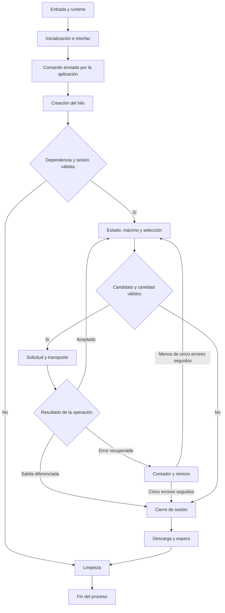

# Dispenser NO_TOKEN — Ingeniería inversa estática

[EN](/dispenser-no-token-analysis-en/) · **[ES](/dispenser-no-token-analysis/)**

**Autor:** Gino Aldair Maihuiri Romero (Sv-chost)  
**Fecha de preparación:** 23 de octubre de 2026  
**Identificador de la muestra en el proyecto:** `f6609bb3c3197ace26ebdeb372ba657ac84b05a3e9e265b5211e1ea42da70dbe`  
**Herramientas:** Ghidra y Python 3; 319 funciones catalogadas.  
**Alcance:** investigación estática contrastada con ensamblador y reproducciones aisladas en Python. No se presenta como ejecución del binario ni validación física del dispositivo.

## Índice

- [1. Introducción y alcance de la investigación](#1-introducción-y-alcance-de-la-investigación)
  - [1.1. Identificación y alcance estático](#11-identificación-y-alcance-estático)
  - [1.2. Cómo seguir las referencias y las reconstrucciones](#12-cómo-seguir-las-referencias-y-las-reconstrucciones)
  - [1.3. La primera dificultad: el pseudocódigo pierde información útil](#13-la-primera-dificultad-el-pseudocódigo-pierde-información-útil)
  - [1.4. El orden de estudio](#14-el-orden-de-estudio)
  - [1.5. Qué verifican las reproducciones](#15-qué-verifican-las-reproducciones)
  - [1.6. Documentación externa y atribución](#16-documentación-externa-y-atribución)
- [2. Estructura de la muestra y criterio de cobertura](#2-estructura-de-la-muestra-y-criterio-de-cobertura)
  - [Antes de interpretar el comportamiento](#antes-de-interpretar-el-comportamiento)
  - [Las cinco secciones PE y los bloques del análisis](#las-cinco-secciones-pe-y-los-bloques-del-análisis)
  - [El manifiesto y los privilegios de inicio](#el-manifiesto-y-los-privilegios-de-inicio)
  - [Reconstrucción de las importaciones](#reconstrucción-de-las-importaciones)
  - [Las exportaciones y el nombre interno del directorio](#las-exportaciones-y-el-nombre-interno-del-directorio)
  - [Separar la lógica de la aplicación de la biblioteca de ejecución](#separar-la-lógica-de-la-aplicación-de-la-biblioteca-de-ejecución)
  - [Auxiliares de biblioteca que sí influyen en la interpretación](#auxiliares-de-biblioteca-que-sí-influyen-en-la-interpretación)
  - [Tres grupos de artefactos que pueden inducir a error](#tres-grupos-de-artefactos-que-pueden-inducir-a-error)
  - [Qué cubre el catálogo y qué queda fuera de su numeración](#qué-cubre-el-catálogo-y-qué-queda-fuera-de-su-numeración)
- [3. Del punto de entrada a la interfaz: reconstrucción del recorrido inicial](#3-del-punto-de-entrada-a-la-interfaz-reconstrucción-del-recorrido-inicial)
  - [`entry`, en `00403fb8`: qué prepara el runtime y dónde entrega el control](#entry-en-00403fb8-qué-prepara-el-runtime-y-dónde-entrega-el-control)
  - [Dos formas de llegar a la misma aplicación](#dos-formas-de-llegar-a-la-misma-aplicación)
  - [`00402d5b`: preparación numérica y registro de la ventana](#00402d5b-preparación-numérica-y-registro-de-la-ventana)
  - [`00402896`: el procedimiento de ventana y la creación de los controles](#00402896-el-procedimiento-de-ventana-y-la-creación-de-los-controles)
  - [Entrada de dígitos: qué hace y qué no demuestra](#entrada-de-dígitos-qué-hace-y-qué-no-demuestra)
  - [La rama `ENTER` y el inicio que no espera una pulsación](#la-rama-enter-y-el-inicio-que-no-espera-una-pulsación)
  - [`004026cd`: lectura sin validación, retirada de controles y creación del hilo](#004026cd-lectura-sin-validación-retirada-de-controles-y-creación-del-hilo)
  - [De teclado a panel de estados](#de-teclado-a-panel-de-estados)
  - [Bucle de mensajes, cierre y retornos efectivos](#bucle-de-mensajes-cierre-y-retornos-efectivos)
  - [Reproducción inerte del orden de los eventos](#reproducción-inerte-del-orden-de-los-eventos)
  - [Qué queda demostrado en este recorrido](#qué-queda-demostrado-en-este-recorrido)
  - [Fuentes Win32 utilizadas en este capítulo](#fuentes-win32-utilizadas-en-este-capítulo)
- [4. Cálculos internos: identificar el hash y seguir el resultado](#4-cálculos-internos-identificar-el-hash-y-seguir-el-resultado)
  - [Primer indicio: un estado de cuatro palabras](#primer-indicio-un-estado-de-cuatro-palabras)
  - [Reconstrucción del contexto](#reconstrucción-del-contexto)
  - [`FUN_00403058`: acumular datos y completar bloques](#fun_00403058-acumular-datos-y-completar-bloques)
  - [`FUN_0040316e`: leer dieciséis palabras y ejecutar las rondas](#fun_0040316e-leer-dieciséis-palabras-y-ejecutar-las-rondas)
  - [`FUN_004030f9`: cerrar el mensaje y producir dieciséis bytes](#fun_004030f9-cerrar-el-mensaje-y-producir-dieciséis-bytes)
  - [`FUN_00403866`: serialización y límite de uso](#fun_00403866-serialización-y-límite-de-uso)
  - [Volver a `FUN_00402f54`: resolver lo que Ghidra deja abierto](#volver-a-fun_00402f54-resolver-lo-que-ghidra-deja-abierto)
  - [El origen del valor: reloj y generador del runtime](#el-origen-del-valor-reloj-y-generador-del-runtime)
  - [Qué ocurre con el digest al regresar al arranque](#qué-ocurre-con-el-digest-al-regresar-al-arranque)
  - [Reproducción verificable de la primitiva MD5](#reproducción-verificable-de-la-primitiva-md5)
  - [Lo que queda establecido en este bloque](#lo-que-queda-establecido-en-este-bloque)
- [5. Núcleo de interacción con el dispensador](#5-núcleo-de-interacción-con-el-dispensador)
  - [Del hilo principal a una dependencia específica](#del-hilo-principal-a-una-dependencia-específica)
  - [La tabla de ocho funciones y un resultado válido únicamente en AL](#la-tabla-de-ocho-funciones-y-un-resultado-válido-únicamente-en-al)
  - [El bloque común de argumentos](#el-bloque-común-de-argumentos)
  - [Apertura: una cadena construida con enteros](#apertura-una-cadena-construida-con-enteros)
  - [Los parámetros que el decompilado perdió](#los-parámetros-que-el-decompilado-perdió)
  - [Bloquear, consultar, desbloquear](#bloquear-consultar-desbloquear)
  - [El parser: de texto delimitado a una tabla de 8.192 bytes](#el-parser-de-texto-delimitado-a-una-tabla-de-8192-bytes)
  - [Buscar una clave y devolver el valor](#buscar-una-clave-y-devolver-el-valor)
  - [MAX_NOTES y el máximo de veinte por defecto](#max_notes-y-el-máximo-de-veinte-por-defecto)
  - [El selector de casetes: estado, valor y cantidad](#el-selector-de-casetes-estado-valor-y-cantidad)
  - [Una reproducción con datos sintéticos](#una-reproducción-con-datos-sintéticos)
  - [El envoltorio de selección y la preservación del resultado](#el-envoltorio-de-selección-y-la-preservación-del-resultado)
  - [La operación y sus tres argumentos reales](#la-operación-y-sus-tres-argumentos-reales)
  - [El ciclo del hilo y las condiciones reales de salida](#el-ciclo-del-hilo-y-las-condiciones-reales-de-salida)
  - [Resultado del análisis de este subsistema](#resultado-del-análisis-de-este-subsistema)
- [6. Eliminación de rastros y archivos seleccionados](#6-eliminación-de-rastros-y-archivos-seleccionados)
  - [Normalización de cadenas: `00401000`](#normalización-de-cadenas-00401000)
  - [Selección por patrones: `00401037`](#selección-por-patrones-00401037)
  - [Sobrescritura y eliminación: `004010eb`](#sobrescritura-y-eliminación-004010eb)
  - [Recorrido de directorios: `004011b6`](#recorrido-de-directorios-004011b6)
  - [Habilitación de un privilegio del token: `0040137a`](#habilitación-de-un-privilegio-del-token-0040137a)
  - [Construcción y asignación de permisos: `00401407`](#construcción-y-asignación-de-permisos-00401407)
  - [Eliminación recursiva de claves: `00401510`](#eliminación-recursiva-de-claves-00401510)
  - [Objetivos de limpieza dirigida: `0040165d`](#objetivos-de-limpieza-dirigida-0040165d)
  - [Recorrido de letras de unidad: `0040189f`](#recorrido-de-letras-de-unidad-0040189f)
  - [Reproducción verificable con cadenas y buffers en memoria](#reproducción-verificable-con-cadenas-y-buffers-en-memoria)
  - [Qué queda demostrado en este bloque](#qué-queda-demostrado-en-este-bloque)
- [7. Reconstrucción del comportamiento y evaluación de la evidencia](#7-reconstrucción-del-comportamiento-y-evaluación-de-la-evidencia)
  - [7.1. El recorrido que une las piezas](#71-el-recorrido-que-une-las-piezas)
  - [7.2. Qué significa que la limpieza esté en una ruta de fallo](#72-qué-significa-que-la-limpieza-esté-en-una-ruta-de-fallo)
  - [7.3. Técnicas observadas y etiquetas que requieren cuidado](#73-técnicas-observadas-y-etiquetas-que-requieren-cuidado)
  - [7.4. Indicadores y artefactos con su contexto](#74-indicadores-y-artefactos-con-su-contexto)
  - [7.5. Oportunidades de detección y límites de validación](#75-oportunidades-de-detección-y-límites-de-validación)
  - [7.6. Matriz final de capacidades](#76-matriz-final-de-capacidades)
  - [7.7. Preguntas que quedan abiertas](#77-preguntas-que-quedan-abiertas)
  - [7.8. Conclusión de la investigación](#78-conclusión-de-la-investigación)
- [Apéndice A. Catálogo completo de las 319 funciones](#apéndice-a-catálogo-completo-de-las-319-funciones)
- [Apéndice B. Importaciones estáticas identificadas](#apéndice-b-importaciones-estáticas-identificadas)
- [Apéndice C. Reproducciones completas y resultados](#apéndice-c-reproducciones-completas-y-resultados)
- [Apéndice D. Referencias primarias](#apéndice-d-referencias-primarias)
- [Apéndice E. Reproducibilidad y continuidad](#apéndice-e-reproducibilidad-y-continuidad)
- [Derechos de autor y atribución](#derechos-de-autor-y-atribución)

---

## 1. Introducción y alcance de la investigación

Al comenzar el análisis en Ghidra conviene relacionar dos vistas de una misma muestra: el pseudocódigo de Decompiler y las instrucciones de Listing. La primera permite reconocer estructuras con rapidez. La segunda permite comprobar esa lectura siguiendo los valores que viajan por los registros, los argumentos de la pila y las instrucciones que toman cada decisión.

El proyecto identifica la muestra como `f6609bb3c3197ace26ebdeb372ba657ac84b05a3e9e265b5211e1ea42da70dbe`. En su directorio de exportaciones aparece también el nombre interno `dispenser_NO_TOKEN.exe`, en `00415e72`. Utilizaremos ese nombre como referencia descriptiva. Por sí mismo no demuestra cómo se llamó el archivo en un equipo ni a qué familia lo asignaría un proveedor de seguridad.

El comportamiento que se va reconstruyendo está relacionado con un dispensador de efectivo. Hay una dependencia explícita de `cscwcng.dll`, ocho funciones resueltas por nombre, consultas de estado, procesamiento de información de casetes y una secuencia de solicitudes para dispensar y transportar billetes. Junto a ese núcleo se encuentra otro conjunto de funciones que modifica permisos de claves del Registro, intenta eliminar información de dispositivos y sobrescribe archivos antes de solicitar su eliminación. Ambos conjuntos convergen en el hilo principal. [Ghidra: `004019ee`, `00402430`, `004010eb`–`0040189f`]

El propósito de esta investigación es reconstruir esa relación con el detalle suficiente para verificarla en cada función. Eso incluye estudiar la interfaz, los cálculos de hash, las estructuras de argumentos, los retornos, los filtros de archivos, las condiciones de salida y los errores que pueden limitar el resultado. Cuando una operación depende de una biblioteca externa, seguimos el código hasta la frontera de esa dependencia y distinguimos lo observado del contrato que todavía requiere confirmación.

### 1.1. Identificación y alcance estático

La imagen se analiza con base `00400000` y lenguaje `x86:LE:32:default`. El catálogo reúne 319 funciones identificadas por Ghidra. Las direcciones utilizadas a lo largo del informe corresponden a esa base y permiten localizar funciones, instrucciones, variables globales y tablas en el proyecto.

El MD5 asociado a la muestra en los metadatos del proyecto es `c4234c5a9817a7db447c042aa92f5186`. El identificador de 64 caracteres con el que figura el programa tiene formato de SHA-256. Ambos se conservan como datos de identificación registrados; este informe no los presenta como huellas recalculadas durante la investigación.

El alcance es estático: lectura del pseudocódigo, contraste con ensamblador y comprobaciones aisladas en Python. Las medidas de entropía, la verificación de firmas digitales y una validación dinámica del dispositivo no forman parte de los resultados aquí documentados. Los tamaños del mapa de memoria se distinguen de los tamaños físicos en disco y de los campos que requieren una comprobación específica de cabeceras.

### 1.2. Cómo seguir las referencias y las reconstrucciones

Las referencias se expresan mediante direcciones. Una indicación como `Ghidra: 00402430` identifica la función que se está siguiendo; una referencia `ASM` sitúa las instrucciones que permiten resolver una duda de parámetros, retorno o control de flujo. Los nombres originales y las direcciones se mantienen junto a los nombres de trabajo propuestos para que cada interpretación pueda comprobarse en el proyecto.

Los fragmentos marcados como **original de Ghidra** conservan los nombres y tipos que muestra Decompiler. Las **reconstrucciones descriptivas** reorganizan lo necesario para hacer visible un comportamiento comprobado. No son el código fuente recuperado del autor. Los nombres propuestos expresan el papel observado de cada rutina.

En los cuadros de evidencia distinguimos tres estados. **Confirmado** significa que existe una operación, un dato o un enlace de control visible en el código. **Inferido** significa que una explicación reúne varios indicios, aunque falta un componente para probarla de forma directa. **No determinado** señala una pregunta que el análisis no resuelve. Confirmar que el código solicita una operación tampoco confirma que el sistema operativo o el dispositivo la hayan completado.

Esta distinción resulta necesaria en las funciones destructivas. Podemos comprobar que una rama llama a `WriteFile` y después a `DeleteFileW`; su resultado sobre un archivo concreto depende de permisos, handles y respuestas de las APIs. También podemos seguir una llamada al puntero resuelto como `CscCngDispense`; la entrega física de billetes requiere evidencia de ejecución y del dispositivo.

### 1.3. La primera dificultad: el pseudocódigo pierde información útil

Uno de los hallazgos que más condiciona esta investigación aparece antes de estudiar cualquier algoritmo: Ghidra declara varias funciones como `void`, aunque sus llamadores utilizan el valor que queda en `EAX` o en `AL`. En otras rutinas también desaparecen argumentos que siguen viajando por `ECX` o `EDX`. Si leyéramos únicamente las firmas impresas, terminaríamos inventando variables sin origen o concluyendo que una función utiliza un resultado que nunca produce.

Para resolverlo seguimos el intercambio completo. Antes de un `CALL` observamos la preparación de registros y pila. Dentro de la rutina buscamos las lecturas que consumen esos valores. Al salir comprobamos la construcción del resultado y las instrucciones que lo preservan. Finalmente volvemos al llamador para ver si realiza un `TEST`, una comparación, un almacenamiento o una conversión con ese resultado.

Esto es relevante, por ejemplo, en `FUN_00401037`, cuyo resultado se consulta como un booleano; en `FUN_00402378`, que obtiene un límite de billetes; y en `FUN_00401e09`, que distingue éxito y dos salidas de error. En el capítulo correspondiente se muestran las instrucciones que permiten reconstruir esos contratos. No basta con cambiar `void` por `int` en todo el archivo: cada retorno debe justificarse por separado.

También conviene revisar la convención de llamada. Que Ghidra muestre `__fastcall` nos orienta hacia el uso de registros, pero ciertas funciones internas terminan en `RET` simple y dejan que el llamador ajuste la pila. Describiremos esa combinación tal como aparece. Equipararla sin matices a una convención pública puede volver a introducir errores al contar argumentos o interpretar el estado de los registros.

Los prefijos `extraout_ECX`, `extraout_EDX` y `undefined4` pertenecen al análisis de Ghidra. No son nombres escritos por quien desarrolló el programa. `undefined4` indica que se conserva una cantidad de cuatro bytes sin fijar un tipo más preciso. Un `extraout_` requiere rastrear el estado del registro a través de una llamada; no demuestra por sí solo una capa de ofuscación, una clave oculta ni un dato recibido desde fuera del proceso.

### 1.4. El orden de estudio

La distribución física comienza con rutinas de limpieza y continúa con la interfaz del dispensador. El recorrido de ejecución comienza en otro punto. Para explicar el programa seguiremos primero su entrada, después el arranque de la aplicación y la creación de la interfaz. Dentro de ese arranque estudiaremos los cálculos que producen sus valores iniciales. A continuación seguiremos la transición al hilo, sus dependencias, consultas y decisiones. La limpieza se desarrolla después porque aparece como destino común de varias salidas de ese hilo.

La existencia de 319 funciones no significa que existan 319 capacidades distintas. Muchas implementan operaciones de biblioteca, inicialización, gestión de memoria, formateo o manejo de errores. Sin embargo, la clasificación se realiza revisando sus cuerpos y sus relaciones. El catálogo final conserva una fila por cada función identificada, su tamaño informado, su categoría, el motivo de la clasificación y el nivel de confianza. Una función que participa en la lógica relevante recibe explicación aunque su implementación proceda de una biblioteca.

La diferencia se aprecia en la búsqueda de subcadenas utilizada por los filtros. Su cuerpo vectorizado corresponde a una operación de texto reutilizable; su **uso** determina qué archivos se seleccionan y qué rutas se excluyen. Omitir esa relación perdería una parte central del comportamiento. En cambio, desarrollar todas las ramas de una rutina de formateo monetario del runtime no ampliaría la explicación del dispensador.

### 1.5. Qué verifican las reproducciones

Los scripts de Python acompañan resultados que pueden aislarse y comprobarse sin ejecutar la muestra: transformaciones de bytes, primitivas de hash, procesamiento de campos, decisiones con datos sintéticos y sobrescritura sobre buffers en memoria. Cada reproducción indica qué parte representa, qué entradas utiliza y qué diferencia mantiene respecto al ejecutable.

Un resultado correcto en esos scripts demuestra que el modelo produce la salida esperada para sus casos de prueba. No certifica las firmas de una DLL externa, la respuesta de un equipo de Windows ni el comportamiento físico de un cajero. Esta precisión permite utilizar las reproducciones como evidencia técnica sin convertirlas en una simulación aparente de una ejecución que no se realizó.

Los scripts no cargan `cscwcng.dll`, no abren dispositivos, no modifican el Registro y no sobrescriben archivos del usuario. La verificación de MD5 utiliza mensajes públicos de prueba; no genera credenciales de operación del dispositivo.

### 1.6. Documentación externa y atribución

La evidencia sobre esta muestra procede del recorrido de funciones, datos y referencias en Ghidra. La documentación de Microsoft y los RFC se utiliza para contrastar contratos de APIs, formatos y algoritmos. Una página que describe lo que una API permite hacer no demuestra que el ejecutable utilice todas esas posibilidades. En cada caso se vuelve a la secuencia concreta de argumentos y llamadas.

Por la misma razón, el análisis no parte de una familia asignada con anterioridad ni utiliza un informe externo para completar capacidades ausentes. El nombre interno, las exportaciones y las cadenas serán datos de esta muestra; cualquier atribución adicional queda fuera de lo confirmado mientras no exista evidencia independiente suficiente.

La fecha de preparación de este informe es el **23 de octubre de 2026**. No se presenta como fecha de compilación, primera aparición o infección. El trabajo combina Ghidra, lectura de ensamblador x86 y Python 3 para comprobaciones de datos y modelos aislados.

## 2. Estructura de la muestra y criterio de cobertura

### Antes de interpretar el comportamiento

Para comenzar la revisión estructural observamos el mapa de memoria, las cabeceras y los directorios del PE en Ghidra. Relacionar esas regiones con sus referencias permite localizar código, tablas y datos antes de atribuirles una función dentro del comportamiento de la muestra.

La revisión estructural mantiene separados los datos visibles en cada región y las propiedades que requieren comprobaciones adicionales. Los tamaños físicos, las marcas de compilación, la entropía y las firmas digitales necesitan una verificación propia; no se deducen de la apariencia del código ni del nombre de una sección.

El programa figura en el proyecto con el identificador `f6609bb3c3197ace26ebdeb372ba657ac84b05a3e9e265b5211e1ea42da70dbe`. El MD5 asociado en los metadatos es `c4234c5a9817a7db447c042aa92f5186`. Conservamos esos valores como identificadores registrados, sin atribuirles una comprobación de integridad que no forma parte de los resultados del informe.

La arquitectura sí está respaldada por varios elementos que coinciden entre sí. El listing declara `x86:LE:32:default`, la estructura de cabecera se identifica como `IMAGE_NT_HEADERS32` y los primeros bytes visibles después de la firma PE incluyen `4C 01`, correspondiente a la máquina x86. Los punteros de la tabla de importaciones y de los datos globales se representan con cuatro bytes. Trabajaremos, por tanto, sobre una imagen PE de 32 bits, little endian, con base de análisis `00400000`.

Cuando escribamos una dirección como `00402430`, estaremos utilizando una dirección virtual en esa base. Su RVA es `0x2430`, que se obtiene restando `0x400000`. Esto no nos da directamente el desplazamiento del archivo en disco: convertir una RVA en desplazamiento físico exige conocer la distribución física de su sección. Tampoco estamos afirmando que todas las ejecuciones del archivo deban ocupar esa misma base. Para evitar ambigüedad, las direcciones de este informe siguen el mapa de Ghidra. La distinción entre VA, RVA y desplazamiento físico está descrita en la especificación de Microsoft [PE Format](https://learn.microsoft.com/en-us/windows/win32/debug/pe-format).

### Las cinco secciones PE y los bloques del análisis

En el índice del listing aparecen siete bloques de memoria. Sería incorrecto contarlos como siete secciones PE. Uno corresponde a los encabezados, cinco corresponden a secciones del ejecutable y otro corresponde al bloque `tdb`. La cifra de cinco secciones se ve también en los bytes `05 00` del encabezado COFF y en los cinco `IMAGE_SECTION_HEADER` consecutivos. **Referencia: ASM: mapa de memoria, `004000f8`–`00400290`**

| Región | Inicio | Final incluido | Tamaño del bloque en el listing | Permisos |
|---|---|---|---|---|
| Encabezados | `00400000` | `004003ff` | `0x400` / 1 024 bytes | `R--` |
| `.text` | `00401000` | `004103ff` | `0xf400` / 62 464 bytes | `R-X` |
| `.rdata` | `00411000` | `004169ff` | `0x5a00` / 23 040 bytes | `R--` |
| `.data` | `00417000` | `0041c33f` | `0x5340` / 21 312 bytes | `RW-` |
| `.rsrc` | `0041d000` | `0041d1ff` | `0x200` / 512 bytes | `R--` |
| `.reloc` | `0041e000` | `0041f1ff` | `0x1200` / 4 608 bytes | `R--` |
| `tdb`, bloque del modelo de análisis | `ffdff000` | `ffdfffff` | `0x1000` / 4 096 bytes | `RW-` |

Estos tamaños proceden del mapa de memoria de Ghidra. No se presentan como valores de `SizeOfRawData` ni como tamaños físicos de sección en disco. Sumar las filas tampoco permitiría obtener el tamaño original del ejecutable: quedarían sin resolver la alineación física, posibles huecos, encabezados completos y cualquier dato situado fuera de las regiones enumeradas.

La sección `.text` contiene las 319 funciones identificadas. Los permisos representados son lectura y ejecución, sin escritura. No se ve en este mapa una sección PE marcada simultáneamente como escribible y ejecutable. Esta observación describe el estado del proyecto estático y no permite excluir cambios de protección que pudieran producirse durante una ejecución. Para demostrar esos cambios necesitaríamos localizar llamadas que los soliciten o contar con evidencia dinámica.

En `.rdata` encontramos tanto los punteros de importación como las tablas de nombres, formatos, extensiones y constantes de la aplicación, junto con una cantidad considerable de datos del runtime. La tabla de exportaciones también está dentro de esta región. Esto nos recuerda que los nombres convencionales de sección no fijan una única clase de contenido: debemos seguir los directorios y las referencias, no esperar que toda importación esté necesariamente en una sección llamada `.idata`.

La región `.data` contiene variables modificables, buffers de estado, handles de ventana, punteros resueltos de la biblioteca del dispensador y datos internos de la biblioteca de ejecución. No todo el contenido de una región escribible representa configuración protegida. En esta muestra, las referencias desde las funciones permiten separar los buffers de la interfaz, las estructuras del runtime y las tablas utilizadas por la aplicación.

La región `.reloc` conserva las entradas que el analizador identificó como información de reubicación. Su presencia, por sí sola, no basta para afirmar que ASLR esté habilitado: esa conclusión requiere revisar también los campos correspondientes de los encabezados. Del mismo modo, la aparición de un Rich Header en `00400080` nos permite registrar que Ghidra lo reconoció, pero en este bloque no se desarrolla una decodificación de todos sus registros. **Referencia: ASM: `00400080`, `0041d1ff`**

El bloque `tdb` merece una explicación separada porque está muy lejos del intervalo del PE. Su contenido incluye `ExceptionList`, `StackBase`, `StackLimit`, `ThreadLocalStoragePointer` y `ProcessEnvironmentBlock`, con posiciones compatibles con estructuras de entorno del hilo x86. No existe un encabezado de sección PE para `tdb`. Se trata del bloque que el proyecto emplea para representar ese entorno y dar significado a referencias como `ExceptionList`, no de una carga útil adicional de 4 KiB dentro del malware. Los ceros presentes en esa representación tampoco son un volcado de una víctima. **Referencia: ASM: `ffdff000`–`ffdff034`**

### El manifiesto y los privilegios de inicio

La sección `.rsrc` contiene un recurso de tipo manifiesto. El directorio lo identifica como recurso `1`, idioma `0x409`, con longitud `0x17d`, y los datos comienzan en `0041d060`. La parte de interés es:

```xml
<requestedPrivileges>
  <requestedExecutionLevel level='asInvoker' uiAccess='false' />
</requestedPrivileges>
```

El nivel solicitado es `asInvoker`. Esto significa que el manifiesto pide ejecutar la aplicación con el contexto de su iniciador, no que solicite por sí mismo una elevación a administrador. La posibilidad de modificar claves protegidas o archivos del sistema dependerá del token efectivo y de los permisos del entorno en el que se haya iniciado. Si el proceso ya nace elevado, puede disponer de capacidades más amplias; si no las tiene, el manifiesto no se las concede. **Referencia: ASM: `0041d000`–`0041d060`**

Este dato conecta directamente con las funciones de limpieza. Más adelante veremos una solicitud de `SeTakeOwnershipPrivilege`, ajustes de DACL y un intento de cambio de propietario. Ninguna de esas operaciones demuestra, por su sola presencia, una elevación de privilegios. El código puede pedir habilitar un privilegio que el token ya posea y puede fallar cuando el contexto no permita la operación. La relación entre el manifiesto y esas llamadas debe mantenerse a la vista durante todo el análisis.

### Reconstrucción de las importaciones

Para revisar las importaciones seguimos los tres descriptores visibles en `00415f0c`, `00415f20` y `00415f34`. Cada descriptor apunta a una biblioteca, a su tabla de búsqueda y a su IAT. Las tablas de búsqueda contienen RVA hacia estructuras de importación por nombre; al resolverlas encontramos los nombres completos representados como cadenas en el listing. **Referencia: ASM: `00415f0c`–`00415f51`**

| Biblioteca importada | Entradas por nombre reconstruidas | Funciones de interés para este estudio |
|---|---:|---|
| `KERNEL32.dll` | 72 | Archivos, enumeración, memoria, hilos, carga de bibliotecas, tiempo y soporte de runtime |
| `USER32.dll` | 25 | Ventanas, controles, mensajes, repintado e interacción gráfica |
| `ADVAPI32.dll` | 12 | Token, SID, ACL y operaciones sobre claves del Registro |
| **Total** | **109** | Todas las entradas reconstruidas tienen nombre visible |

El catálogo `importaciones.csv` conserva el nombre, la biblioteca, la dirección del thunk de búsqueda y la dirección de la cadena. Son posiciones de las tablas de la imagen. Los destinos que Windows asigne a esas APIs durante una ejecución pertenecen a otro nivel de observación.

Entre las llamadas de archivos tenemos `FindFirstFileW`, `FindNextFileW`, `CreateFileW`, `WriteFile`, `GetFileSizeEx`, `FlushFileBuffers` y `DeleteFileW`. Su papel queda confirmado por el recorrido de limpieza y sobrescritura que se estudia más adelante. La importación conjunta de estas funciones resulta útil como orientación, pero la capacidad se demuestra siguiendo sus llamadas y argumentos.

El mismo criterio se aplica a `IsDebuggerPresent`. Hay tres usos visibles: en el informe de fallo de seguridad de `___raise_securityfailure`, en la construcción de una excepción del runtime de `00404271` y en la presentación compatible de errores de `0040b206`. Estos caminos pertenecen al soporte de errores y fallos de la biblioteca. No encontramos en ellos una condición de la aplicación que detecte al analista y desvíe la lógica del dispensador. Presentarlos como tres mecanismos de evasión del actor cambiaría el significado de la evidencia. **Referencia: Ghidra: `00404139`, `00404271`, `0040b206`**

Tampoco se observa un descriptor de importación de Winsock o WinHTTP en las tablas reconstruidas. Esto permite decir que esas bibliotecas no están en las importaciones estáticas visibles; no demuestra la imposibilidad de cualquier comunicación mediante componentes externos. Las exportaciones con nombres `WNet...`, que revisaremos a continuación, tampoco deben contarse como llamadas de red, porque apuntan a una implementación vacía de la propia muestra.

### Las exportaciones y el nombre interno del directorio

La tabla de exportación comienza en `00415df0`. Su nombre de biblioteca apunta a la cadena `dispenser_NO_TOKEN.exe` en `00415e72`. Ese texto forma parte del directorio de exportaciones. Lo registramos como nombre interno conservado en la imagen, sin convertirlo en una ruta de instalación, un nombre original garantizado o una atribución de familia. La parte `NO_TOKEN` puede orientar una hipótesis, pero el flujo real tendrá que establecerse mediante las funciones que leen la interfaz y deciden iniciar el hilo. **Referencia: ASM: `00415df0`–`00415ee1`**

| Ordinal mostrado | Nombre exportado | Destino |
|---:|---|---|
| 1 | `ChooseColorA` | `00402f3b` |
| 2 | `ChooseFontA` | `00402f3b` |
| 3 | `Dispense` | `00402f3e` |
| 4 | `FindTextA` | `00402f3b` |
| 5 | `GetOpenFileNameA` | `00402f3b` |
| 6 | `GetSaveFileNameA` | `00402f3b` |
| 7 | `PrintDlgA` | `00402f3b` |
| 8 | `WNetAddConnection2A` | `00402f3b` |
| 9 | `WNetCancelConnection2A` | `00402f3b` |

Los ocho nombres que comparten `00402f3b` no representan ocho implementaciones diferentes. El ensamblador de ese destino es:

```asm
00402f3b  XOR EAX,EAX
00402f3d  RET
```

El valor de retorno es cero y no se ve trabajo adicional en esa rutina. La firma `ChooseColorA(LPCHOOSEFONTA)` que presenta el pseudocódigo, además de mezclar un nombre y un tipo de estructura de otra API, no es una declaración recuperada del código fuente. Es una interpretación del analizador sobre un destino compartido. Para entender esta función basta con los tres bytes de instrucciones y con sus referencias en la tabla.

Que existan estos nombres no demuestra que el archivo se cargara mediante secuestro de DLL, que sustituyera una biblioteca concreta o que implementara las APIs originales de Windows. Esas posibilidades exigirían evidencia del módulo llamador y de su cadena de carga. Aquí el hecho comprobable es la existencia de una superficie de exportación con ocho stubs y una exportación `Dispense` que entra en la aplicación gráfica. **Referencia: Ghidra: `00402f3b`–`00402f3e`; ASM: `00402f30`–`00402f5d`**

### Separar la lógica de la aplicación de la biblioteca de ejecución

El índice enumera 319 funciones. Antes de desarrollar las capacidades es necesario clasificar ese conjunto, porque una compilación con biblioteca enlazada puede incorporar un volumen de código muy superior al escrito para la aplicación. En el catálogo se conserva una fila por dirección, con tamaño reportado por Ghidra, nombre original, nombre propuesto, categoría, confianza, justificación y referencias a las funciones e instrucciones correspondientes en Ghidra.

| Grupo funcional del catálogo | Cantidad | Tratamiento en el análisis |
|---|---:|---|
| Aplicación | 34 | Desarrollo de la interfaz, dispositivo, parser, selección y limpieza |
| Construcción de hash y primitivas asociadas | 6 | Desarrollo del estado, actualización, compresión, finalización y uso del resultado |
| Soporte de biblioteca | 278 | Identificación funcional; explicación ampliada cuando afecta al comportamiento de la aplicación |
| Arranque CRT | 1 | Recorrido desde `entry` hasta la función principal |
| **Total** | **319** | Una fila por función decompilada y por encabezado de función del listing |

Estos grupos expresan el papel que cada rutina desempeña en la muestra; no son una certificación de autoría del código fuente. La construcción de MD5, por ejemplo, puede proceder de una implementación reutilizada. La categoría la separa para explicar la transformación y su uso, sin atribuir su invención al desarrollador del malware.

En 95 funciones el decompilado incorpora el comentario `Library Function - Single Match`. Es un dato útil del reconocimiento de firmas de Ghidra, especialmente cuando el cuerpo y sus relaciones coinciden con esa identificación. No permite elegir automáticamente una versión exacta de Visual Studio para todo el ejecutable. Algunas firmas se comparten entre varias versiones y seis entradas tienen el prefijo `FID_conflict`, que conserva una coincidencia ambigua. En ellas mantenemos la semántica comprobable y evitamos presentar el nombre sugerido como una identidad de fuente cerrada.

La clasificación se apoya en lo que hace cada rutina. Las funciones que gestionan `_ptiddata`, `errno`, locales, tablas multibyte, `FILE`, descriptores lowio, callbacks de terminación y marcos de excepción forman una red coherente de soporte del runtime. Las que cargan `cscwcng.dll`, leen campos de respuesta, modifican la interfaz o recorren rutas para eliminar archivos dependen de los datos específicos de la aplicación. La proximidad de direcciones ayuda a orientarnos, pero no es el criterio que decide la pertenencia.

### Auxiliares de biblioteca que sí influyen en la interpretación

Hay varias funciones de soporte que conviene desarrollar antes de utilizarlas en otros capítulos. Su implementación es común, pero su semántica determina qué significa una condición del malware.

En `0040397f` encontramos una copia de unidades de 16 bits limitada por un contador. La rutina devuelve el destino, detiene la lectura cuando copia un NUL y rellena con ceros las posiciones restantes. Si el origen alcanza el límite sin NUL, esa terminación no queda garantizada por el propio cuerpo. Proponemos `crt_copia_wide_limitada`, con comportamiento compatible con `wcsncpy`. La documentación de [wcsncpy](https://learn.microsoft.com/en-us/cpp/c-runtime-library/reference/strncpy-strncpy-l-wcsncpy-wcsncpy-l-mbsncpy-mbsncpy-l?view=msvc-170) describe esas propiedades. En el análisis de nombres tendremos que distinguir la capacidad del array de la cantidad de caracteres que la llamada solicita copiar. **Referencia: Ghidra: `0040397f`**

En `00403a6b` el código busca una cadena wide dentro de otra. Su ruta escalar compara el patrón a partir de cada posición candidata y devuelve el inicio de la coincidencia, o cero si no la encuentra. Las rutas SIMD aplican la misma finalidad sobre grupos de unidades y tienen comprobaciones para no sobrepasar límites de página durante lecturas vectoriales. Los tipos de arrays de 16 bytes, `pcmpistri` y las expresiones de extracción que aparecen en el pseudocódigo proceden de esas instrucciones; no son evidencia suficiente de ofuscación. **Referencia: Ghidra: `00403a6b`**

La diferencia entre búsqueda y comparación es decisiva. Comprobar que el retorno de esta función no sea cero significa que el patrón aparece en alguna posición. No implica que toda la cadena sea idéntica al patrón y tampoco que el patrón se encuentre necesariamente al final del nombre. Si una tabla contiene `.JPG`, una búsqueda de subcadena puede reconocer un nombre que además tenga texto después de esos caracteres. La función coincide en su interfaz y comportamiento con [wcsstr](https://learn.microsoft.com/en-us/cpp/c-runtime-library/reference/strstr-wcsstr-mbsstr-mbsstr-l?view=msvc-170).

En `00403d86` se realiza conversión de un carácter wide a mayúsculas. El caso sencillo trabaja con letras ASCII y resta la distancia entre minúsculas y mayúsculas; los casos dependientes del locale utilizan tablas o mapeo mediante la API del sistema. `00403e3d` es el wrapper que utiliza el locale actual. Aunque Ghidra lo declare `void`, los llamadores consumen el resultado conservado en el registro de retorno. Su efecto sobre el filtro de nombres debe explicarse con esa corrección de firma. **Referencia: Ghidra: `00403d86`–`00403e3d`**

Las rutinas `004038ab`, `004039bf`, `00403e4e` y `004052bf` son entradas de formato. Construyen o delegan sobre un `FILE` sintético que describe un buffer en memoria, su puntero actual, capacidad y flags. `004038ab` utiliza capacidad en caracteres wide y ajusta el contador a bytes; `004039bf` limita bytes estrechos; `00403e4e` ofrece el patrón de formato sin un límite pequeño explícito en esa capa; `004052bf` recibe una lista de argumentos ya preparada. Los argumentos variables no aparecen todos en las firmas que muestra Ghidra. Cuando una llamada muestra solo `"%s\\%s"`, habrá que revisar los valores empujados a la pila, porque esas cadenas son máscaras de formato y necesitan argumentos adicionales. **Referencia: Ghidra: `004038ab`, `004039bf`, `00403e4e`, `004052bf`–`004052da`**

`00408690` es una primitiva de relleno de memoria. Repite el byte recibido sobre un intervalo cuya longitud viene dada por un parámetro, con caminos distintos para tamaño y alineación. La aplicación la usa para inicializar buffers y estructuras a cero. La presencia de esa rutina no demuestra borrado seguro por sí misma: ese efecto depende del destino concreto, del tamaño y del momento en que la invoca un llamador. **Referencia: Ghidra: `00408690`**

Las dos rutinas grandes `0040cee0` y `0040e770` implementan copia de memoria con caminos para superposición de rangos y ajustes de alineación. El comienzo detecta el caso `origen < destino < origen + longitud` y copia hacia atrás para preservar los datos que aún falta leer. Ghidra advierte sobre instrucciones que no pudo representar correctamente en algunas rutas de estas implementaciones. No trasladamos esa advertencia a una supuesta protección del malware: primero conservamos su semántica de copia y limitamos cualquier afirmación sobre el recorrido exacto a los bloques que podemos comprobar. **Referencia: Ghidra: `0040cee0`, `0040e770`**

### Tres grupos de artefactos que pueden inducir a error

Las cadenas de días, meses y formatos de fecha que aparecen en `.rdata` están conectadas con las estructuras de locale del runtime. Su presencia no prueba temporizadores operativos, límites de pago ni ventanas de activación. Para demostrar un uso de ese tipo tendríamos que localizar la llamada de la aplicación que consuma esas estructuras con esa finalidad.

Podemos comprobarlo de forma todavía más directa con `ja-JP`, `zh-CN`, `ko-KR` y `zh-TW`. La función `CPtoLocaleName`, en `004064e3`, devuelve esas cadenas cuando recibe respectivamente `0x3a4`, `0x3a8`, `0x3b5` y `0x3b6`: 932, 936, 949 y 950 en decimal. Su consumidor configura tablas multibyte. Aquí tenemos un mapeo de codepage a nombre de locale, no una comparación de la región de una víctima ni una lista de países excluidos. **Referencia: Ghidra: `004064e3`, `004069ca`**

Finalmente, `0040815b` resuelve nombres como `FlsAlloc`, `FlsFree`, funciones de threadpool y `LCMapStringEx`, y almacena sus direcciones combinadas con la cookie global. Al seguir los consumidores vemos wrappers que usan FLS si está disponible y TLS como alternativa, además de compatibilidad para otras APIs. Este conjunto pertenece a la capa de compatibilidad del runtime. El resolvedor de la aplicación que nos interesa para el dispensador está en `004019ee` y busca los ocho nombres `CscCng...`. Mantener separados ambos conjuntos evita convertir toda resolución dinámica en la misma técnica o atribuir al actor capacidades de threadpool que solo aparecen en el soporte enlazado. **Referencia: Ghidra: `0040804c`–`0040815b`, `004019ee`**

La revisión estructural nos deja un punto de partida concreto: una aplicación Win32 con interfaz, dependencias del dispensador resueltas por nombre y un bloque de limpieza, rodeada de soporte de ejecución de Microsoft. A partir de aquí podemos seguir cada comportamiento sin cargar sobre la muestra funciones que pertenecen a su biblioteca y sin omitir los auxiliares cuya semántica sí cambia la lectura del código.

### Qué cubre el catálogo y qué queda fuera de su numeración

Las 319 filas del catálogo corresponden a las funciones identificadas como tales en Ghidra. No sería correcto convertir esa cifra en una afirmación de cobertura exhaustiva de cada byte de `.text`. La suma de los tamaños reportados es 60 280 bytes, mientras que el bloque `.text` ocupa 62 464. La diferencia numérica es 2 184 bytes, pero no constituye una medida directa de código omitido.

El motivo se ve al seguir los límites reales del ensamblador. Una función puede contener bloques separados por un funclet que Ghidra enumera como otra función. Por ejemplo, `00406822` salta a `004069c2` después de invocar el auxiliar de desbloqueo `00406994`. El rango entre su inicio y su inicio más el tamaño reportado no es una descripción suficiente de todos sus bloques. Crear intervalos contiguos con esa fórmula produce tanto superposiciones como aparentes huecos que mezclan continuaciones, datos y relleno. **Referencia: ASM: `00406976`–`004069c9`**

Además, encontramos bloques que no tienen una función decompilada independiente. Para distinguirlos de posibles cargas ocultas seguimos sus saltos y contrastamos las instrucciones x86 de cada región. Los bytes marcados como datos sin tipo se interpretan dentro de ese contexto; la tabla siguiente conserva las observaciones y sus límites.

| Región o dirección | Observación comprobada | Interpretación y límite |
|---|---|---|
| `00403eef` | Un byte `CC` entre `_atol` y `_strcspn` | Relleno aislado compatible con alineación; no una nueva función |
| `0040699f`–`004069c9` | Código que consulta y libera un bloque, fija `errno` y sale por el epílogo SEH | Continuación del subsistema multibyte; no debe atribuirse al pequeño funclet anterior por mera proximidad |
| `00406c3a`–`00406d56` | Libera campos del bloque de hilo, ajusta referencias de locale y termina con `RET 4` | Limpieza de datos del runtime; nombre fuente exacto sin fijar y entrada no enumerada en las 319 funciones |
| `0040a810`–`0040a843` | Multiplicaciones por palabras y suma de productos cruzados con resultado en `EDX:EAX` | Auxiliar de producto de 64 bits compatible con soporte aritmético CRT; bytes originalmente marcados `??` |
| `0040a844`–`0040a895` | Cambia el locale global bajo el bloqueo 12 e incluye un auxiliar de desbloqueo | Limpieza o restablecimiento de estado de locale; sin nombre fuente exacto recuperado |
| `0040b3ec`–`0040b4b3` | Replica un byte en `XMM0` y escribe bloques alineados; recibe salto desde `004086cc` | Rama SIMD de la primitiva de relleno de memoria, separada físicamente de su entrada |
| `0040b4b4`–`0040b550` | Recorre tabla de `FILE`, cierra entradas y libera estructuras | Limpieza global de flujos del runtime con auxiliares SEH |
| `0040e203`–`0040e279` | Valida `FILE`, bloquea, llama a `__fclose_nolock` y desbloquea | Cierre de flujo con bloqueo, compatible con una entrada `fclose` de biblioteca |
| `00410352`–`004103ff` | Los 174 bytes visibles son cero | Cola de la sección; no se interpreta como código ejecutado |

Estos ejemplos amplían el control más allá del índice de funciones y permiten reconocer caminos de biblioteca que una lectura exclusiva del decompilado dejaría sin explicación. En las regiones adicionales revisadas no aparece una nueva rutina específica del dispensador ni una segunda cadena de limpieza de la aplicación. Esta conclusión se limita a las regiones examinadas; no sustituye una reconstrucción completa del proyecto de Ghidra con propiedad exacta de todos los bloques ni una verificación de ejecución.

## 3. Del punto de entrada a la interfaz: reconstrucción del recorrido inicial

Para comenzar a recorrer la muestra conviene separar dos momentos que en el decompilado aparecen dentro de una misma cadena de llamadas: la preparación que realiza el entorno de ejecución de C/C++ y el momento en que empieza la lógica específica de la aplicación. Si tratáramos cada llamada del arranque como una capacidad propia del malware, terminaríamos atribuyéndole operaciones que también encontraríamos en un programa legítimo compilado con el mismo entorno. Aquí el objetivo es seguir ese recorrido hasta localizar la función que organiza la interfaz y prepara el trabajo posterior.

Las direcciones permiten volver a cada bloque dentro de Ghidra. Las firmas reconstruidas que propongo son nombres de trabajo para el análisis; no equivalen a símbolos recuperados del código fuente.

### `entry`, en `00403fb8`: qué prepara el runtime y dónde entrega el control

El punto de entrada identificado por Ghidra es `entry`, situado en `00403fb8`, con un tamaño registrado de 300 bytes. El principio del listing muestra dos instrucciones especialmente sencillas:

```asm
00403fb8  CALL 0x00407ee3
00403fbd  JMP  0x00403fc2
```

La primera llamada corresponde a `___security_init_cookie`, una función de biblioteca que prepara la cookie de seguridad empleada para detectar ciertas alteraciones de la pila. El salto que sigue llega a la instrucción situada justo después de ese salto: tiene desplazamiento cero. Su presencia aislada no prueba ofuscación ni cambia el destino efectivo del arranque. Lo que sí nos interesa es que la cookie se establece antes de entrar en funciones que la consultan en sus prólogos y epílogos.

En el decompilado encontraremos repetidamente asignaciones como `local_c = DAT_00417000 ^ (uint)&local_6c` y llamadas finales a `FUN_0040389c`. Las primeras derivan un valor de comprobación a partir de la cookie global y de una dirección de pila; la última función verifica su coherencia. Al relacionarlas con el arranque dejamos de tratarlas como una operación criptográfica específica de la muestra. Son parte de una protección insertada por el compilador, aunque su ejecución ocurra dentro de funciones propias del programa.

Tras establecer el marco de excepciones, el arranque obtiene un valor de presentación de ventana mediante `004080ca`. Esta auxiliar llama a `GetStartupInfoW` y comprueba el bit `STARTF_USESHOWWINDOW`, de valor `1`, en `dwFlags`. Si el proceso no recibió un modo explícito en la información de arranque, usa `10`, correspondiente a `SW_SHOWDEFAULT`. El mismo valor aparecerá después en la exportación `Dispense`; su papel es determinar cómo se muestra la ventana, no una cantidad de billetes ni un número de reintentos. [Ghidra: `00403fb8`–`00404112`, `004080ca`; ASM: `00403fb8`–`004040da`]

El listing también conserva un examen de la imagen cargada: comprueba `MZ`, después `PE\0\0`, el valor `0x10b` del encabezado opcional y la existencia de una entrada del directorio CLR distinta de cero. Ese examen determina una variable que influye en la forma de salir del programa después de la función principal. El decompilado elimina algunos de sus caminos como bloques inalcanzables. Dado que las comprobaciones se aplican a la propia imagen y están dentro del arranque del CRT, no constituyen por sí mismas una validación antianálisis propia del actor. La eliminación de esos caminos por Ghidra tampoco demuestra por sí sola una transformación del código.

La siguiente parte del arranque prepara recursos del runtime. `004076a3` obtiene el heap del proceso con `GetProcessHeap`; `00406ea9` prepara almacenamiento y datos asociados al hilo; `004076b8` construye estructuras para los descriptores de entrada y salida; `0040796c` prepara los argumentos; y `00407b9b` organiza las variables de entorno. Las llamadas de error que las acompañan detienen el inicio si esas preparaciones fallan. Esto explica la concentración de funciones de memoria, almacenamiento por hilo, formateo y tratamiento de errores en la muestra sin convertir cada una en una característica maliciosa independiente.

Dos asignaciones concretas ayudan a seguir el flujo de datos. El resultado de `GetCommandLineA` queda en `0041c33c`, y el bloque de entorno que prepara `00407fbf` queda en `00419280`. Más adelante, `__wincmdln`, en `0040842d`, avanza por el nombre del ejecutable teniendo en cuenta comillas y caracteres multibyte y devuelve el resto de la línea de comandos. Esta función pertenece a la adaptación que necesita un punto de entrada de estilo `WinMain`; la lectura de la línea de comandos en este contexto no prueba que la muestra interprete una configuración recibida por argumentos.

La transferencia importante aparece en `004040ac`–`004040ba`:

```asm
004040ac  CALL 0x0040842d
004040b1  PUSH ESI
004040b2  PUSH EAX
004040b3  PUSH 0x0
004040b5  PUSH 0x400000
004040ba  CALL 0x00402d5b
004040bf  MOV  ESI,EAX
```

Aquí los argumentos se colocan en orden inverso sobre la pila. La función recibe la base de la imagen `00400000` como instancia, cero como instancia anterior, el puntero a la parte útil de la línea de comandos y el modo de presentación conservado en `ESI`. Esa distribución encaja con una función principal de aplicación Windows. El `MOV ESI,EAX` posterior demuestra algo que la firma de Ghidra oculta: `00402d5b` produce un valor de retorno que el llamador utiliza como código de salida.

En otras palabras, la representación `void FUN_00402d5b(...)` no describe bien el contrato que vemos en ensamblador. El análisis debe retener el valor de `EAX`, porque el CRT termina entregándolo al mecanismo de salida. La firma conceptual más útil es una función de cuatro argumentos con resultado entero. El `RET 0x10` de `00402f38` confirma que esa función retira dieciséis bytes de argumentos de la pila al regresar. [ASM:004040ac–004040c9 y 00402f23–00402f38.]

### Dos formas de llegar a la misma aplicación

El arranque anterior no es el único camino visible hacia `00402d5b`. La tabla de exportaciones también expone `Dispense`, con destino en `00402f3e`. Conviene detenernos en ella porque su nombre podría llevarnos a imaginar una llamada directa al dispositivo, cuando su cuerpo realiza una tarea distinta.

```asm
00402f3e  PUSH 0xa
00402f40  XOR  EAX,EAX
00402f42  PUSH EAX
00402f43  PUSH EAX
00402f44  PUSH EAX
00402f45  CALL dword ptr [0x00411060]
00402f4b  PUSH EAX
00402f4c  CALL 0x00402d5b
00402f51  XOR  EAX,EAX
00402f53  RET
```

El destino de `00411060` es `GetModuleHandleW`. Los tres ceros que se colocan antes de esa llamada no forman tres argumentos de esa API: el último cero sirve como su único argumento, y los anteriores quedan preparados para la llamada posterior. Como se pide el módulo con un nombre nulo, el resultado es un identificador del ejecutable del proceso. [MS-UI-8] Ese resultado se añade a la pila y se llama a la misma función de aplicación que vimos desde `entry`.

La exportación, por tanto, reutiliza el recorrido de interfaz y arranque de `00402d5b`. Sus cuatro argumentos efectivos son el identificador devuelto, dos ceros y el valor de presentación `10`. Cuando la función regresa, `Dispense` establece explícitamente `EAX = 0`. No propaga el código de salida de la aplicación ni informa en su retorno si hubo interacción correcta con el dispensador. [Ghidra: `00402f3e`; ASM: `00402f3e`–`00402f54`]

El contexto importa: que exista una exportación no demuestra que un programa externo la invoque, que la imagen haya sido cargada por una técnica concreta ni que se haya utilizado como sustituto de otra biblioteca. En las funciones analizadas sí podemos demostrar el destino y el comportamiento interno de la exportación. La cadena externa que la llama queda fuera de lo observado.

Junto a `Dispense` aparecen otros ocho nombres exportados que comparten `00402f3b`: `ChooseColorA`, `ChooseFontA`, `FindTextA`, `GetOpenFileNameA`, `GetSaveFileNameA`, `PrintDlgA`, `WNetAddConnection2A` y `WNetCancelConnection2A`. El código compartido tiene únicamente tres bytes:

```asm
00402f3b  XOR EAX,EAX
00402f3d  RET
```

Cada nombre lleva así a una rutina que devuelve cero y termina. El nombre visible no indica que exista un selector de color, una conexión de red o un diálogo de impresión dentro de ese cuerpo. Es una observación pequeña, pero evita una atribución incorrecta de capacidades basada en nombres. Tampoco corresponde aplicar automáticamente a esa rutina la firma oficial de cada API: el `RET` simple no retira parámetros, y los nombres mezclan funciones con contratos y significados de retorno diferentes. El comportamiento demostrado es el de una exportación mínima compartida. [Ghidra: `00402f3b`; ASM: `00402f3b`–`00402f3d`]

### `00402d5b`: preparación numérica y registro de la ventana

Una vez dentro de la función de aplicación encontramos, antes de crear la ventana, llamadas a `00403f67`, `00403f57` y cuatro llamadas a `00403f36`. Estas tres funciones corresponden respectivamente a una obtención de tiempo convertida a segundos, una asignación de semilla al estado pseudoaleatorio del hilo y una actualización del generador congruencial del CRT. La actualización que aparece en `00403f36` es:

```c
uVar2 = p_Var1->_holdrand * 0x343fd + 0x269ec3;
p_Var1->_holdrand = uVar2;
return uVar2 >> 0x10 & 0x7fff;
```

El detalle relevante en el llamador es que solo conserva el byte bajo de cada resultado. Esos cuatro bytes se escriben sucesivamente en un entero local de cuatro bytes. La suma de cuatro llamadas no crea cuatro enteros concatenados; forma un solo valor mediante cuatro escrituras de un byte. En x86 little-endian, la primera escritura ocupa el byte menos significativo. Ese entero se reduce por `0x540be3ff`, se incrementa en uno y se guarda en `0041b254`.

El programa prepara luego una representación decimal y llama a `00402f54`, cuyo bloque de hash se estudia por separado. Para el recorrido de interfaz nos interesa el resultado de su uso: un valor derivado se guarda en `0041b238`. Al buscar sus referencias en el listing no aparece una lectura de esa global dentro del procedimiento de ventana ni de la rutina que inicia el hilo. La presencia del cálculo es real; una comprobación de acceso basada en él no está demostrada por este flujo. Debemos conservar ambas observaciones, porque describen mejor esta compilación que una conclusión tomada solo de la apariencia del teclado. [Ghidra: `00402d5b`, `00403f36`–`00403f67`; ASM:00402d75–00402df4.]

La estructura `WNDCLASSEXW` que se prepara a continuación mide `0x30`, es decir, 48 bytes en esta aplicación de 32 bits. En sus campos aparecen la instancia recibida, los manejadores de icono y cursor, el pincel de fondo, la clase `win32app` y, sobre todo, la dirección `00402896` como procedimiento de ventana. Ese último campo es el enlace que necesitamos para continuar el recorrido: Windows enviará a esa función los mensajes asociados a la ventana creada con la clase registrada.

El campo `style = 3` reúne los valores de redibujado horizontal y vertical de clase. Los valores cero de `cbClsExtra` y `cbWndExtra` indican que no se reservan bytes adicionales mediante esos dos mecanismos. El identificador de recurso `0x7f00` aparece en las solicitudes de icono y cursor. Ninguno de esos detalles implica un mecanismo de ocultación. Son la configuración visible de una ventana convencional.

Si `RegisterClassExW` devuelve cero, la función muestra el texto `Call to RegisterClassEx failed!`, con el título `Win32 Guided Tour`, y retorna `1`. El listing muestra el retorno de fallo en `00402e6c`–`00402e6f`, aunque el decompilado vuelva a presentarlo como un simple `return` de una función `void`. Si el registro tiene éxito, se crea una ventana con la clase mencionada, el título almacenado en `004189d0` y dimensiones `0x280 × 0x1e0`, equivalentes a 640 × 480 píxeles para el tamaño solicitado de la ventana. El título visible en datos es `le meme about cutting cookie dough`. No es necesario interpretar la frase para entender la lógica; sí conservarla como artefacto de esta compilación.

Los dos valores `-0x80000000` de posición son el marcador `CW_USEDEFAULT`. El estilo `0xcf0000` reúne elementos habituales como marco, título, menú de sistema y controles de minimización y maximización. Si `CreateWindowExW` devuelve un identificador nulo, la función presenta `Call to CreateWindow failed!` y vuelve a la misma salida con resultado `1`. Los caminos de error de la interfaz, por tanto, están presentes y ocurren antes de iniciar la lógica del hilo. [Ghidra: `00402d5b`; ASM:00402df9–00402ebe.]

### `00402896`: el procedimiento de ventana y la creación de los controles

El procedimiento recibe cuatro argumentos: ventana, identificador de mensaje, `wParam` y `lParam`. Ghidra los reconoce con tipos Win32, pero marca la función como `void`. El ensamblador vuelve a proporcionar el dato que falta: termina con `RET 0x10`, preserva el resultado de `DefWindowProcW` en las ramas delegadas y devuelve cero en varias de las ramas que atiende. Por ello el contrato de trabajo adecuado es el de un `WNDPROC` con resultado `LRESULT`, no una función sin retorno. Este contrato coincide con la definición de la API. [MS-UI-1]

En la entrada se seleccionan cuatro mensajes: `1`, `2`, `0x0f` y `0x111`. Sus significados son `WM_CREATE`, `WM_DESTROY`, `WM_PAINT` y `WM_COMMAND`. Los demás se remiten al procedimiento de ventana por defecto. Esa selección organiza prácticamente toda la lógica gráfica de la muestra. [Ghidra: `00402896`; ASM: `00402896`–`00402d2d`]

En `WM_CREATE` aparecen primero un control `STATIC`, que recibe el texto numérico preparado, y un control `EDIT` inicialmente vacío. El primero queda en `0041b244`; el segundo, en `0041b25c`. El control estático se solicita en `(10, 10)` con tamaño `150 × 20`; el campo de edición, en `(170, 10)`, también con tamaño `150 × 20`. Estos tamaños y posiciones describen los argumentos de creación, sin afirmar una captura de pantalla ni un resultado observado al ejecutar el programa.

El campo de edición recibe después una modificación de su procedimiento mediante `SetWindowLongW` con índice `-4`, es decir, `GWL_WNDPROC`. La nueva dirección es `004027a0` y el resultado de la API, que representa el procedimiento anterior, queda guardado en `0041b260`. Más adelante veremos que esa global es utilizada para reenviar los mensajes al comportamiento anterior del control. La modificación queda limitada a este control de la aplicación; no es una instalación global de captura de teclado. [MS-UI-6]

Después se construyen doce botones mediante `0040286d`. Los nombres de las globales que reciben sus identificadores no expresan su función; sus textos y códigos sí permiten reconstruirla:

| Texto | Identificador | Posición solicitada | Global del identificador de ventana |
| --- | --- | --- | --- |
| `1` | `0x2001` | `(0, 50)` | `0041b268` |
| `2` | `0x2002` | `(100, 50)` | `0041b23c` |
| `3` | `0x2003` | `(200, 50)` | `0041b230` |
| `4` | `0x2004` | `(0, 150)` | `0041b274` |
| `5` | `0x2005` | `(100, 150)` | `0041b258` |
| `6` | `0x2006` | `(200, 150)` | `0041b264` |
| `7` | `0x2007` | `(0, 250)` | `0041b250` |
| `8` | `0x2008` | `(100, 250)` | `0041b240` |
| `9` | `0x2009` | `(200, 250)` | `0041b234` |
| `CLR` | `0x200a` | `(0, 350)` | `0041b270` |
| `0` | `0x2000` | `(100, 350)` | `0041b278` |
| `ENTER` | `0x200b` | `(200, 350)` | `0041b248` |

Todos solicitan tamaño `100 × 100`. La auxiliar concentra una llamada a `CreateWindowExA` con clase `BUTTON` y estilo `0x50800000`. Podemos separar ese valor en `WS_CHILD` (`0x40000000`), `WS_VISIBLE` (`0x10000000`) y `WS_BORDER` (`0x00800000`). El padre procede de `ECX`, la coordenada horizontal de `EDX` y los otros tres valores del marco de pila.

Aquí encontramos un ejemplo útil de cómo revisar los tipos de Ghidra. `0040286d` figura como `void`, pero después de llamar a `CreateWindowExA` solo ejecuta `POP EBP; RET`. El identificador devuelto por la API permanece en `EAX`, y los llamadores lo copian a cada global de la tabla. La función devuelve un `HWND` de forma efectiva. Si mantuviéramos el tipo `void`, perderíamos precisamente la relación entre cada botón y su posterior destrucción.

También hay un matiz en la convención de llamada. Aunque el decompilado la etiqueta `__fastcall`, la función usa `RET` simple y el llamador recupera los argumentos de pila en grupos: `ADD ESP,0x48` en `00402c6f` y otra vez en `00402d12`. Cada grupo reúne seis llamadas con tres argumentos de cuatro bytes: `6 × 3 × 4 = 72`, que es `0x48`. Por ello la evidencia describe paso de argumentos por registros con limpieza de pila en el llamador. No basta observar `ECX` y `EDX` para afirmar que se cumple íntegramente la convención `__fastcall` pública de Microsoft. La combinación resulta compatible con una convención interna ajustada por el compilador. La documentación de `__fastcall` indica que, en su forma pública para x86, la limpieza de los argumentos de pila corresponde al llamado. [MS-UI-7; ASM: `0040286d`–`00402895`, `00402b74`–`00402d2d`]

### Entrada de dígitos: qué hace y qué no demuestra

La función `004027e6` recibe un puntero a texto; desde los botones numéricos recibe cadenas de un solo carácter, entre `"0"` y `"9"`. Primero envía `WM_GETTEXT`, de valor `0x0d`, al control `EDIT`, con capacidad `0x20`, es decir, 32 bytes, y una dirección local de destino. Después cuenta los caracteres hasta el cero final. Si la longitud actual es menor de diez, localiza el final de la cadena y copia allí la cadena recibida, incluyendo su terminador, antes de enviar `WM_SETTEXT`, de valor `0x0c`.

Los dos bucles de copia que aparecen en el decompilado no son dos transformaciones de datos. El primero mueve tantas unidades de cuatro bytes como permite la longitud, y el segundo copia los bytes restantes. Es una forma compilada de copia de memoria usada para añadir el texto. Los argumentos concretos de los botones añaden un solo dígito cada vez, de modo que el límite de diez se entiende como longitud de entrada para esas llamadas observadas.

Ese límite se comprueba antes de añadir el texto y pertenece a la auxiliar de los botones. No es, por sí solo, una prueba de que el control `EDIT` impida cualquier otra vía de introducir más caracteres. En este bloque no aparece un mensaje `EM_SETLIMITTEXT` ni una comprobación carácter por carácter de lo escrito directamente en el control. Tampoco se observa que el estilo del control incluya el comportamiento de contraseña. Debemos evitar convertir el dibujo de un teclado numérico en la afirmación de que el programa implementa un PIN protegido.

La rama `CLR`, en `004029ae`–`004029d0`, prepara un byte cero y lo pasa como texto a `WM_SETTEXT`. Su efecto previsto es vaciar el campo. El valor `1` que aparece como `wParam` en las llamadas a ese mensaje no representa un dígito que se guarde en el control: en este contexto el texto se proporciona mediante `lParam`.

La auxiliar `004027a0`, instalada como procedimiento del campo, identifica `WM_KEYDOWN`, de valor `0x100`, y la tecla `VK_RETURN`, de valor `0x0d`. Cuando coinciden, envía al padre `WM_COMMAND` con identificador `0x200b`. Después reenvía el mensaje original al procedimiento anterior mediante `CallWindowProcW`. El valor devuelto por esta última API se conserva en `EAX` hasta el retorno. De nuevo, su firma `void` en Ghidra debe corregirse para reflejar un resultado `LRESULT`. [Ghidra: `004027a0`–`004027e6`; ASM: `004027a0`–`0040286c`]

Este recorrido explica el significado funcional de los controles: los botones modifican texto, `CLR` lo borra y `ENTER` solicita un cambio de fase. La pregunta siguiente es si el cambio de fase depende del texto introducido. Esa cuestión no se resuelve observando el teclado; requiere seguir la rama del comando.

### La rama `ENTER` y el inicio que no espera una pulsación

Dentro de `WM_COMMAND`, el procedimiento compara la parte baja de `wParam` con los identificadores de los controles. La selección usa `AX`, lo cual corresponde a trabajar con los dieciséis bits bajos del valor. No se examina aquí la parte alta para distinguir códigos de notificación, ni se exige que `lParam` contenga el identificador de un control concreto. Esa separación entre identificador, notificación y origen del mensaje coincide con la organización documentada de `WM_COMMAND`. [MS-UI-2] Para el identificador `0x200b`, la secuencia es corta:

```asm
004028df  MOV  EAX,dword ptr [EBP + 0x10]
004028e2  MOV  ECX,0x200b
004028e7  CMP  AX,CX
004028ea  JNZ  0x004028f6
004028ec  CALL 0x004026cd
004028f1  JMP  0x00402d1a
```

Entre la comparación del identificador y la llamada no aparece lectura del campo de edición, comparación con `0041b238` ni validación de una cadena. Para este camino, la condición demostrada es la recepción del comando. Es una distinción importante porque la función principal calcula y presenta datos numéricos, pero el recorrido que empieza el trabajo no los utiliza como prueba de acceso.

La evidencia más clara aparece al volver a `00402d5b`, justo después de crear y mostrar la ventana:

```c
ShowWindow(DAT_0041b22c, param_4);
UpdateWindow(DAT_0041b22c);
SetFocus(DAT_0041b25c);
SendMessageW(DAT_0041b22c, 0x111, 0x200b, 0);
```

El último mensaje es el mismo comando asociado a `ENTER`. Se envía desde la función de aplicación antes de entrar en el bucle de `GetMessageW`. Como el destinatario pertenece al mismo hilo, `SendMessageW` entrega el mensaje de forma síncrona al procedimiento de ventana. Por ello el paso por `004026cd` no necesita esperar a que el usuario pulse un botón ni a que el bucle retire un evento de su cola. La creación satisfactoria de la ventana conduce a esa solicitud automática. [Ghidra: `00402d5b`; ASM:00402ebe–00402ef7; MS-UI-3.]

Esto tampoco significa que se pueda asegurar una dispensación efectiva a partir de esa sola llamada. Lo demostrado hasta aquí es que el programa intenta iniciar el hilo de trabajo sin una condición basada en la entrada numérica. La carga de dependencias, la conexión al dispositivo y las respuestas de sus llamadas se estudian en el capítulo correspondiente.

### `004026cd`: lectura sin validación, retirada de controles y creación del hilo

La rutina llamada desde `ENTER` tiene una secuencia que conviene seguir sin saltarnos la primera operación. Antes de retirar los controles envía `WM_GETTEXT` al campo y coloca hasta 31 caracteres más el terminador dentro de un buffer local de 32 bytes. El buffer existe y la lectura es real. Lo decisivo es que el cuerpo restante no consume ese contenido: no lo convierte a entero, no lo compara y no lo envía como parámetro del hilo.

Después se invoca `DestroyWindow` para el campo `EDIT`, la etiqueta `STATIC` y los doce botones cuyos identificadores reconstruimos. Se conserva la ventana principal. El siguiente cambio es `DAT_0041b26c = 1`, una escritura de un byte que habilita la rama de pintado de estados. A continuación se invalida la ventana con `RedrawWindow` y comienza la preparación de `CreateThread`:

```asm
00402781  PUSH ESI
00402782  PUSH ESI
00402783  PUSH ESI
00402784  PUSH 0x402430
00402789  PUSH ESI
0040278a  PUSH ESI
0040278b  CALL dword ptr [0x00411048]
```

En ese punto `ESI` vale cero. Los seis argumentos describen atributos de seguridad por defecto, tamaño de pila por defecto, dirección inicial `00402430`, parámetro nulo, ausencia de flags adicionales y ausencia de destino para recibir el identificador del hilo. El texto leído del teclado no aparece en esta lista. El valor cero de flags tampoco solicita que el hilo nazca suspendido.

El resultado `HANDLE` que entrega `CreateThread` no se guarda ni se comprueba. Después de la llamada viene el epílogo de comprobación de cookie y retorno. Esta observación tiene dos consecuencias estáticas: no se documenta aquí un camino específico de interfaz para fallo de creación del hilo, y no se observa un `CloseHandle` aplicado al identificador retornado. El fin del proceso puede liberar sus recursos, pero eso no cambia el hecho de que la función abandona ese manejador sin seguimiento local. No hemos ejecutado el programa, por lo que no corresponde convertir esta ausencia de comprobación en una tasa de fallo o en un bloqueo observado.

La variable que habilita el pintado tampoco actúa como condición de exclusión en esta rutina. Se escribe `1`, pero no se consulta antes de crear el hilo. La función principal envía el comando una vez durante su recorrido normal. El cuerpo de la rutina no contiene, por su parte, una comprobación que garantice una única creación ante cualquier entrega posterior del mismo comando. Esta distinción describe el alcance de las condiciones visibles sin afirmar que se haya reproducido una ejecución concurrente adicional. [Ghidra: `004026cd`; ASM: `004026cd`–`0040279f`]

### De teclado a panel de estados

Con `0041b26c` distinto de cero, la rama `WM_PAINT` cambia de papel. Obtiene un contexto de dibujo mediante `BeginPaint`, prepara un rectángulo de `640 × 480`, rellena el fondo y pinta cuatro cadenas globales:

| Dirección | Texto inicial visible | Papel en el panel |
| --- | --- | --- |
| `00418a18` | `No status` | Estado general |
| `004181d0` | `No error` | Último error preparado |
| `00418e40` | `No device status` | Estado o respuesta del dispositivo |
| `004185d0` | `No cassetes` | Información preparada sobre casetes |

Antes de cada llamada a `DrawTextW` el programa recorre la cadena UTF-16 hasta encontrar una palabra de valor cero. El número de bytes entre el inicio y el terminador se divide entre dos para obtener unidades de 16 bits. En el decompilado esta resta aparece convertida en expresiones poco naturales, como una suma de un puntero con una constante negativa. El listing permite reconocer la operación simple que se encuentra detrás: restar la dirección inicial y desplazar a la derecha un bit.

El valor `0x2010` de `DrawTextW` se descompone en `0x2000 | 0x10`: `DT_EDITCONTROL` y `DT_WORDBREAK`. Esto indica tratamiento de texto semejante a un control de edición y división por palabras dentro del rectángulo. No se debe deducir a partir de la constante que se modifica el contenido de la cadena: `DT_MODIFYSTRING` tiene otro valor. [MS-UI-5; MS-UI-9] El rectángulo de cada zona cambia, pero la fuente de cada texto es siempre una de las globales anteriores. Al terminar se llama a `EndPaint`, cerrando el ciclo que comenzó con `BeginPaint`. Cuando el byte de fase aún vale cero, el mensaje se entrega al procedimiento por defecto.

El borrado de los controles y el cambio de fase están coordinados para que la misma ventana quede disponible como área de mensajes. Lo que veamos inicialmente como texto en las globales no es un registro histórico de una ejecución: son datos iniciales del archivo, que las auxiliares pueden modificar en memoria. No se debe presentar `No error` como evidencia de que las operaciones se completaron sin error en un equipo real.

La auxiliar `00402d30` actualiza la tercera zona. Su firma decompilada `void FUN_00402d30(void)` oculta un argumento importante. El listing comienza con `PUSH ECX`, y ese valor queda como argumento variable de una llamada de formateo a `004038ab`, cuyo formato en `004159d4` es `%S` en una cadena ancha. El destino es `00418e40` y el límite es `0x1ff`. Después solicita el redibujado de la ventana. La forma funcional de trabajo es, por tanto, una auxiliar que recibe una cadena mediante `ECX`, la incorpora al buffer de estado y marca la ventana para pintarse. [Ghidra: `00402d30`; ASM: `00402d30`–`00402d5a`]

Ese ejemplo explica por qué no basta contar los argumentos que imprime el decompilado. En una llamada variádica el tipo de los valores posteriores al formato depende del formato mismo. Si además Ghidra no recupera el parámetro de la auxiliar que los prepara, la cadena completa puede parecer que se genera sin ninguna entrada. El `PUSH ECX` permite restituir el vínculo entre la respuesta preparada por un llamador y el texto que termina en el panel.

### Bucle de mensajes, cierre y retornos efectivos

Después de la solicitud automática de inicio, `00402d5b` obtiene mensajes con `GetMessageW` y, mientras el resultado sea distinto de cero, llama a `TranslateMessage` y `DispatchMessageW`. El primer paso traduce determinados mensajes de teclado en mensajes de caracteres; el segundo entrega los mensajes al procedimiento correspondiente. Es el bucle de interfaz habitual de una aplicación Win32.

Hay un detalle de robustez que el ensamblador permite describir con precisión. Tras `GetMessageW`, el programa hace `TEST EAX,EAX` y repite si el resultado no es cero. Esa condición distingue la salida por `WM_QUIT`, cuyo retorno es cero, pero no separa el retorno `-1` de error que documenta la API. [MS-UI-4] En ese caso también se seguiría por el cuerpo del bucle. Se trata de una ausencia concreta de manejo del error, no de una prueba de que dicho error ocurra durante el uso normal.

El mensaje `WM_DESTROY`, atendido en `00402b58`, llama a `PostQuitMessage(0)`. Cuando el bucle termina por el mensaje de salida, la aplicación toma `MSG.wParam` en `00402f23` y lo devuelve en `EAX`. Las ramas de fallo de registro o creación de ventana devuelven `1`; la salida por `PostQuitMessage(0)` proporciona cero. Esta reconstrucción resuelve la contradicción inicial entre el tipo `void` impreso por Ghidra y el consumo del valor de retorno desde `entry`.

El hilo de trabajo tiene además caminos que llaman a `ExitProcess`, por lo que el cierre no se limita necesariamente al recorrido de `WM_DESTROY` y `WM_QUIT`. El efecto que puede sostenerse estáticamente es que el hilo posee un mecanismo para terminar el proceso completo, incluida su interfaz. El momento concreto depende de sus ramas internas y se desarrolla al examinar `00402430`.

### Reproducción inerte del orden de los eventos

La diferencia entre el aspecto del teclado y la condición real de inicio se puede representar sin ejecutar ninguna llamada de Windows. En esta reproducción, cada operación se sustituye por un cambio de estado y una anotación. `hilo_solicitado` significa únicamente que el recorrido llega a la solicitud; el script no crea hilos ni carga bibliotecas.

El modelo conserva los dos puntos comprobados en el listing: el comando se entrega dentro de la función de arranque y la ruta de inicio lee el texto sin compararlo. Usamos tres cadenas distintas para comprobar que el recorrido modelado no depende de ese contenido. Las entradas se fijan en la instancia del modelo para observar esa dependencia; no representan tres ejecuciones del binario ni tres entradas que un usuario haya alcanzado a escribir en su ventana.

```python
#!/usr/bin/env python3
"""Modelo inerte del orden de eventos de la interfaz; no usa Win32."""
from dataclasses import dataclass, field


@dataclass
class ModeloInterfaz:
    texto: str
    controles_presentes: bool = True
    panel_estados: bool = False
    hilo_solicitado: bool = False
    eventos: list[str] = field(default_factory=list)

    def comando(self, identificador: int) -> None:
        if identificador != 0x200B:
            return
        self.eventos.append("WM_COMMAND ENTER")
        self.inicio()

    def inicio(self) -> None:
        leido = self.texto[:31]  # Representa el buffer de WM_GETTEXT.
        self.eventos.append("texto leido sin comparacion")
        del leido  # La ruta modelada no vuelve a utilizarlo.
        self.controles_presentes = False
        self.eventos.append("controles retirados")
        self.panel_estados = True
        self.eventos.append("panel de estados habilitado")
        self.hilo_solicitado = True
        self.eventos.append("solicitud de hilo con parametro nulo")

    def arranque(self) -> None:
        self.eventos.append("ventana creada y mostrada")
        self.comando(0x200B)  # Representa entrega sincronica del mismo hilo.
        self.eventos.append("entrada al bucle de mensajes")


def comprobar() -> None:
    trazas = []
    for texto in ("", "1234567890", "texto de prueba"):
        modelo = ModeloInterfaz(texto)
        modelo.arranque()
        assert modelo.hilo_solicitado
        assert modelo.panel_estados
        assert not modelo.controles_presentes
        trazas.append(modelo.eventos)
    assert trazas[0] == trazas[1] == trazas[2]
    print("Casos comprobados: 3")
    print("Trazas iguales: si")
    print("Orden modelado:")
    for numero, evento in enumerate(trazas[0], 1):
        print(f"{numero}. {evento}")


if __name__ == "__main__":
    comprobar()
```

La ejecución del script produjo:

```text
Casos comprobados: 3
Trazas iguales: si
Orden modelado:
1. ventana creada y mostrada
2. WM_COMMAND ENTER
3. texto leido sin comparacion
4. controles retirados
5. panel de estados habilitado
6. solicitud de hilo con parametro nulo
7. entrada al bucle de mensajes
```

La última anotación aparece después de la solicitud del hilo, porque el mensaje que desencadena esa solicitud se entrega antes de entrar en el bucle. La igualdad de las trazas comprueba la independencia de la variable `texto` dentro de este modelo. La correspondencia con la muestra se apoya en los bloques de ensamblador explicados antes, no en la ejecución del script por sí sola. Una reproducción de estados ayuda a hacer explícita la relación; no sustituye el análisis de las ramas originales.

### Qué queda demostrado en este recorrido

La reconstrucción de entrada e interfaz permite fijar varios puntos antes de analizar el dispositivo. `entry` realiza una preparación del CRT y entrega el control a una función principal que también es accesible desde la exportación `Dispense`. Ocho exportaciones adicionales comparten una rutina mínima que devuelve cero. La aplicación prepara datos numéricos, construye controles de entrada y presenta un teclado, pero envía por sí misma el comando de inicio después de crear la ventana.

La rama que recibe ese comando no compara los datos introducidos con un resultado calculado. Lee el campo, deja de utilizar su contenido, retira los controles y solicita un hilo en `00402430` sin pasarle esos datos. La ventana conservada cambia entonces a una fase de pintado de estados. Estas conclusiones proceden de llamadas, accesos a memoria y ramas visibles en el listing; no requieren suponer cómo se usó esta muestra fuera del archivo.

El capítulo también deja corregidos cuatro puntos de tipado que influyen en el análisis posterior: la función de aplicación tiene retorno entero; la auxiliar de botones devuelve un identificador de ventana; los procedimientos de ventana devuelven un resultado de mensaje; y `00402d30` recibe una cadena mediante `ECX`. Con esos vínculos reconstruidos, ya podemos seguir el hilo de trabajo sin confundir la apariencia de la interfaz con sus condiciones reales de inicio.

### Fuentes Win32 utilizadas en este capítulo

[MS-UI-1] Microsoft Learn, [WNDPROC callback function](https://learn.microsoft.com/en-us/windows/win32/api/winuser/nc-winuser-wndproc). Contrato del procedimiento de ventana y retorno `LRESULT`.

[MS-UI-2] Microsoft Learn, [WM_COMMAND message](https://learn.microsoft.com/en-us/windows/win32/menurc/wm-command). Distribución de identificador y código de notificación en `wParam`, y significado de `lParam`.

[MS-UI-3] Microsoft Learn, [SendMessageW function](https://learn.microsoft.com/en-us/windows/win32/api/winuser/nf-winuser-sendmessagew). Entrega síncrona al procedimiento de ventana del mismo hilo.

[MS-UI-4] Microsoft Learn, [GetMessageW function](https://learn.microsoft.com/en-us/windows/win32/api/winuser/nf-winuser-getmessagew). Resultados para mensaje normal, `WM_QUIT` y error.

[MS-UI-5] Microsoft Learn, [DrawTextW function](https://learn.microsoft.com/en-us/windows/win32/api/winuser/nf-winuser-drawtextw). Semántica de `DT_EDITCONTROL` y `DT_WORDBREAK`.

[MS-UI-6] Microsoft Learn, [SetWindowLongW function](https://learn.microsoft.com/en-us/windows/win32/api/winuser/nf-winuser-setwindowlongw). Índice `GWL_WNDPROC`, retorno anterior y encadenamiento mediante `CallWindowProc`.

[MS-UI-7] Microsoft Learn, [__fastcall](https://learn.microsoft.com/en-us/cpp/cpp/fastcall?view=msvc-170). Paso por registros y responsabilidad de retirar argumentos en x86.

[MS-UI-8] Microsoft Learn, [GetModuleHandleW function](https://learn.microsoft.com/en-us/windows/win32/api/libloaderapi/nf-libloaderapi-getmodulehandlew). Significado del argumento nulo.

[MS-UI-9] Raymond Chen, Microsoft, [Notes on DrawText and tab stops](https://devblogs.microsoft.com/oldnewthing/20181010-00/?p=99935). Definición publicada del valor `DT_EDITCONTROL`.

## 4. Cálculos internos: identificar el hash y seguir el resultado

Al revisar el arranque encontramos un cálculo que merece detenernos antes de entrar en la interacción con el dispositivo. La función `FUN_00402d5b` obtiene un valor a partir del reloj, inicializa un generador de números, construye un entero de cuatro bytes y llama a `FUN_00402f54`. Esta última contiene varias operaciones de hash y combinaciones XOR. El resultado vuelve a la función de arranque y se guarda en una variable global. La presencia de este conjunto junto al teclado numérico de la interfaz invita a pensar en una validación, pero para sostener esa interpretación necesitamos encontrar la comparación que la ejecuta. Seguiremos ambas cosas por separado: qué calcula realmente el código y qué uso hace de lo calculado.

En este apartado seguimos las direcciones de las funciones y sus llamadas en Ghidra. Cada nombre propuesto conserva el vínculo con la dirección original y con las instrucciones que permiten comprobarlo.

### Primer indicio: un estado de cuatro palabras

La función `FUN_00403034`, en `00403034`, ofrece un punto de entrada más claro que la función que la utiliza. Su cuerpo tiene solo seis escrituras. Dos ponen contadores a cero y las otras cuatro establecen un estado inicial:

```c
param_1[5] = 0;
param_1[4] = 0;
*param_1 = 0x67452301;
param_1[1] = 0xefcdab89;
param_1[2] = 0x98badcfe;
param_1[3] = 0x10325476;
```

La lectura inicial es sencilla: `param_1` apunta a memoria modificable y sus primeros seis elementos tienen cuatro bytes cada uno. Las cuatro primeras palabras forman un estado de 128 bits. Las dos restantes suman 64 bits. Estas constantes son compatibles con la inicialización de MD5, pero también comparten antecedentes con otros algoritmos; por sí solas no serían una identificación suficiente. Para cerrar la identificación hay que comprobar el tamaño del bloque, el relleno, las funciones booleanas, las constantes de las rondas y sus rotaciones.

El ensamblador confirma las seis escrituras mediante `ECX`, sin acceder a ningún otro argumento:

```asm
00403034  AND dword ptr [ECX + 0x14],0x0
00403038  AND dword ptr [ECX + 0x10],0x0
0040303c  MOV dword ptr [ECX],0x67452301
00403042  MOV dword ptr [ECX + 0x4],0xefcdab89
00403049  MOV dword ptr [ECX + 0x8],0x98badcfe
00403050  MOV dword ptr [ECX + 0xc],0x10325476
00403057  RET
```

Aquí `AND valor, 0` tiene el efecto de escribir cero. No hay una transformación especial oculta en esas dos instrucciones. Otro dato que tendrá utilidad al regresar a la función superior es que esta rutina no cambia `ECX` ni `EDX`: utiliza el primero como base de memoria y deja ambos registros con los valores que traían al entrar. Este detalle permite resolver parte de los `extraout_*` que aparecen en el pseudocódigo.

Propondría el nombre `md5_init` para `FUN_00403034`. La identificación quedará respaldada por el análisis del resto de la primitiva, no solo por estas cuatro constantes. [Ghidra: `00403034`; ASM: `00403034`–`00403057`]

### Reconstrucción del contexto

Las funciones que reciben el mismo puntero permiten reconstruir una estructura de 88 bytes:

| Desplazamiento | Tamaño | Uso observado |
|---|---:|---|
| `+0x00` | 4 bytes | Primera palabra del estado, convencionalmente `A`. |
| `+0x04` | 4 bytes | Segunda palabra del estado, `B`. |
| `+0x08` | 4 bytes | Tercera palabra del estado, `C`. |
| `+0x0c` | 4 bytes | Cuarta palabra del estado, `D`. |
| `+0x10` | 4 bytes | Parte baja de la cantidad de bits recibidos. |
| `+0x14` | 4 bytes | Parte alta de la cantidad de bits recibidos. |
| `+0x18` | 64 bytes | Buffer para reunir un bloque antes de comprimirlo. |

El total surge de sumar 16 bytes de estado, 8 de contador y 64 de buffer. El array `local_98[23]` que muestra Ghidra en la función superior reserva 92 bytes, pero ese tamaño local no cambia la estructura que podemos demostrar por sus accesos. Puede existir espacio adicional dentro del área reservada de la pila; no necesitamos convertirlo en un campo nuevo sin encontrar una lectura o escritura que lo justifique.

Por la misma razón, el tipo `undefined8 *` que aparece para algunos buffers no significa que el algoritmo trabaje con palabras de 64 bits en sus rondas. La compresión utiliza palabras de 32 bits. El tamaño del tipo que Ghidra asigna a un puntero y el tamaño de las operaciones que el código realiza sobre sus datos son cuestiones distintas.

### `FUN_00403058`: acumular datos y completar bloques

La función `FUN_00403058`, en `00403058`, recibe el contexto, un puntero a datos y una longitud expresada en bytes. El ensamblador coloca el contexto en `ECX`, los datos en `EDX` y la longitud en la pila. En estas llamadas internas la limpieza de los argumentos de pila queda a cargo del llamador. Por ello conviene describir la distribución observada de argumentos, en lugar de dar por resuelto todo el contrato de llamada a partir de la etiqueta `__fastcall` del decompilador. [Ghidra: `00403058`; ASM: `00403058`–`004030f7`]

La primera operación recupera cuántos bytes del bloque actual están ocupados:

```c
uVar1 = (uint)param_1[4] >> 3 & 0x3f;
```

`param_1[4]` cuenta bits. El desplazamiento a la derecha entre tres equivale a dividir por ocho y devuelve la cantidad de bytes. La máscara `0x3f` conserva los seis bits inferiores, es decir, el resto de dividir entre 64. El resultado se encuentra entre 0 y 63 y representa una posición dentro del buffer. Usar solo la parte baja del contador basta para esta posición, porque el módulo 64 depende únicamente de esos bits.

Después se actualiza el contador de longitud:

```c
uVar2 = param_1[4] + param_3 * 8;
param_1[4] = uVar2;
if (uVar2 < param_3 << 3) {
    param_1[5] = param_1[5] + 1;
}
param_1[5] = param_1[5] + (param_3 >> 0x1d);
```

La multiplicación por ocho convierte la longitud de entrada a bits. Como la parte baja tiene 32 bits, una suma puede exceder su capacidad y volver al comienzo del rango. La comparación detecta ese acarreo y suma uno a la parte alta. La última expresión añade los bits que se perderían al desplazar una longitud de 32 bits tres posiciones hacia la izquierda: desplazar 29 posiciones a la derecha recupera esa contribución. Así se mantiene el contador de 64 bits usando dos palabras de 32 bits.

A continuación se calcula cuántos bytes faltan para completar el bloque:

```c
uVar2 = -uVar1 + 0x40;
```

Si el buffer tiene 20 bytes, faltan 44. Si está vacío, faltan 64. Cuando la entrada es menor que esa cantidad, la función salta la compresión y copia los datos al final del contenido pendiente. Si alcanza a completar el bloque, copia exactamente lo necesario, llama a `FUN_0040316e` sobre el buffer del contexto y continúa procesando bloques completos directamente desde la entrada.

La expresión que Ghidra presenta como `uVar1 = -uVar1 + 0x7f` resulta menos extraña al relacionarla con la condición del bucle. `0x7f` son 127 bytes: los necesarios para terminar un bloque pendiente más los 63 bytes que permiten preguntar si queda un bloque completo adicional. No se trata de un tamaño de bloque de 127 bytes. La longitud que avanza dentro del bucle es siempre `0x40`, es decir, 64 bytes.

Una vez consumidos los bloques completos, la última llamada de copia conserva la cola de la entrada en el buffer. Ese resto se procesará cuando una actualización posterior complete el bloque o cuando llegue la finalización. Las llamadas a `FUN_0040cee0` tienen aquí el papel de copiar memoria. No hay necesidad de atribuirles una operación criptográfica adicional por el hecho de aparecer dentro del hash.

Un ejemplo permite seguir este estado sin depender de las variables temporales. Una actualización de 20 bytes deja 20 pendientes. Otra de 50 bytes utiliza 44 para completar y comprimir el bloque, y guarda los 6 restantes. La posición del buffer termina en 6 y el contador representa 70 bytes, o 560 bits. Ese es el comportamiento que reproducimos después con mensajes sintéticos.

### `FUN_0040316e`: leer dieciséis palabras y ejecutar las rondas

La función de compresión ocupa 1784 bytes entre `0040316e` y `00403865`. Su tamaño es mayor porque los pasos están desplegados de forma consecutiva. No aparece un bucle de 64 iteraciones para las rondas: cada operación tiene su propia secuencia de instrucciones. Esto explica la extensión del decompilado sin obligarnos a suponer una capa de ofuscación. [Ghidra: `0040316e`; ASM: `0040316e`–`00403864`]

Al entrar, la rutina copia las cuatro palabras del estado a variables de trabajo. Los nombres de Ghidra, como `uVar8`, `uVar4` o `uVar6`, cambian según la reconstrucción de registros y la reutilización de temporales. Para comprender el algoritmo resulta más útil seguir los papeles `a`, `b`, `c` y `d` y conservar una correspondencia con las instrucciones concretas cuando se estudia un paso.

El primer bucle sí tiene 16 iteraciones y lee el bloque de 64 bytes como dieciséis palabras de 32 bits. El orden puede comprobarse en la secuencia `MOVZX`, `SHL` y `OR` de `004031a3` a `004031c4`. Si los cuatro bytes de entrada fueran `01 23 45 67`, la palabra reconstruida sería `0x67452301`. El primer byte ocupa la parte menos significativa: es una interpretación little endian.

En el pseudocódigo, Ghidra expresa parte de esta unión con `CONCAT31` y `CONCAT21`. Esos nombres no representan funciones que el programa llame en ejecución. Son operadores internos del decompilador para reunir piezas de distinto tamaño. Del mismo modo, el uso de `undefined2 *` para el puntero de lectura no implica que el bloque esté formado por palabras de dos bytes: las instrucciones de unión terminan construyendo valores de cuatro bytes.

Los temporales `local_48[4]`, `local_38`, `local_34` y los que siguen forman el área donde se guardan esas dieciséis palabras. La división en varias declaraciones es una elección de presentación de Ghidra. Sus posiciones consecutivas y el bucle que las llena permiten tratarlas como una tabla `M[16]` al reconstruir la lógica.

El primer paso contiene esta expresión:

```c
uVar3 = iVar1 + -0x28955b88
      + (~uVar4 & uVar6 | uVar8 & uVar4)
      + local_48[0];
uVar3 = (uVar3 * 0x80 | uVar3 >> 0x19) + uVar4;
```

La constante negativa `-0x28955b88`, reducida a una palabra de 32 bits, equivale a `0xd76aa478`. Podemos comprobarlo también en el ensamblador: `004031dd` añade directamente esa constante hexadecimal. No hay dos algoritmos distintos entre ambas representaciones; cambia la manera de imprimir una misma palabra.

La combinación `(~b & d) | (c & b)` es la primera función booleana de MD5. Para cada bit, selecciona el bit de `c` cuando el correspondiente bit de `b` vale uno, y el de `d` cuando vale cero. El resultado se suma a una palabra del mensaje, a la constante del paso y a una palabra del estado. Todas estas operaciones trabajan módulo `2^32`.

La expresión siguiente une un desplazamiento a la izquierda de siete bits con otro a la derecha de 25 bits. En una palabra de 32 bits equivale a una rotación a la izquierda de siete posiciones. Aquí el ensamblador elimina la duda: `004031f4` contiene `ROL EDX,0x7`. Tras la rotación, se suma la palabra `b`. Esta es la forma de un paso de MD5:

```text
nuevo_b = b + ROL32(a + función(b,c,d) + M[g] + T[i], s)
```

El resultado se conserva en 32 bits. Los papeles de las cuatro palabras rotan para el paso siguiente. Ghidra muestra este avance mediante temporales que se pisan unos a otros; una reproducción estructurada puede expresar el mismo comportamiento reasignando `a, b, c, d` después de cada paso.

La compresión completa tiene cuatro grupos de dieciséis pasos. La tabla siguiente describe todos ellos; `i` es el número de paso entre 0 y 63, y `g` determina qué palabra del bloque se utiliza.

| Pasos | Combinación booleana sobre las palabras de trabajo | Índice `g` | Rotaciones a la izquierda, repetidas cuatro veces |
|---|---|---|---|
| `0–15` | `(b & c) \| (~b & d)` | `i` | `7, 12, 17, 22` |
| `16–31` | `(b & d) \| (c & ~d)` | `(5*i + 1) % 16` | `5, 9, 14, 20` |
| `32–47` | `b ^ c ^ d` | `(3*i + 5) % 16` | `4, 11, 16, 23` |
| `48–63` | `c ^ (b \| ~d)` | `(7*i) % 16` | `6, 10, 15, 21` |

En el segundo grupo cambia qué bits se seleccionan y en qué orden se visitan las palabras del mensaje. En el tercero, XOR combina directamente las tres palabras de trabajo. En el cuarto, una combinación de OR, complemento y XOR introduce la última forma booleana. El orden de acceso a los datos es tan útil para reconocer la primitiva como las constantes de inicialización.

Algunas rotaciones aparecen como `ROR` en el ensamblador. Una rotación a la derecha de 15 posiciones equivale a una rotación a la izquierda de 17, porque ambas recorren una palabra de 32 bits. Así, `ROR ...,0xf` y la expresión de Ghidra con multiplicación por `0x20000` describen el mismo movimiento. Para el contraste automático normalizamos cada `ROR n` a `ROL (32-n)`.

Dentro de esta función se comprueban las 64 constantes de MD5 y el orden de las 64 rotaciones. Las dos constantes con ceros iniciales, `0x02441453` y `0x04881d05`, pueden mostrarse en Listing sin ese cero de presentación; compararlas como enteros evita contarlas como ausentes. La presencia de constantes no sustituye al análisis de sus operandos, pero refuerza la identificación obtenida al seguir las cuatro rondas.

Al terminar, la rutina suma las cuatro palabras de trabajo al estado que recibió. El comienzo de esta actualización se ve en `00403827–00403833`; el resto termina en `00403855`. Esta suma final encadena el resultado de cada bloque con el siguiente. No se devuelve el digest completo en `EAX`: se modifica el contexto a través del puntero. El valor final visible en un registro al salir de una rutina no debe confundirse con un resultado semántico si el llamador utiliza la memoria modificada.

La coincidencia de inicialización, bloque, funciones booleanas, constantes, rotaciones y acumulación permite identificar la primitiva como MD5. Para la comparación formal y los vectores públicos de comprobación se utilizó [RFC 1321](https://www.rfc-editor.org/rfc/rfc1321.html). El hallazgo corresponde a esta implementación y a las llamadas observadas; no demuestra por sí mismo cifrado de archivos ni protección de comunicaciones.

### `FUN_004030f9`: cerrar el mensaje y producir dieciséis bytes

La función de finalización comienza copiando ocho bytes del contador de bits a una variable local. Esta copia debe ocurrir antes del relleno, ya que al llamar a la función de actualización para añadir bytes también aumentará el contador del contexto. El valor que se inserta al final debe representar la longitud del mensaje original. [Ghidra: `004030f9`; ASM: `004030f9`–`0040316c`]

Después recupera la posición del buffer y calcula la cantidad de relleno:

```c
uVar2 = (uint)param_1[4] >> 3 & 0x3f;
uVar1 = 0x78 - uVar2;
if (uVar2 < 0x38) {
    uVar1 = 0x38 - uVar2;
}
```

`0x38` representa 56 bytes y `0x78` representa 120. La finalidad es situar el mensaje, después del relleno inicial, a ocho bytes del final de un bloque. Si la posición actual es menor que 56, esa posición puede alcanzarse dentro del bloque actual. Si es 56 o mayor, hace falta avanzar hasta la posición 56 del bloque siguiente.

El caso exacto de 56 bytes merece observarse. Aunque el mensaje ya se encuentre a ocho bytes del final, todavía hay que añadir el byte inicial de relleno. Por eso la condición es estricta, `posición < 56`, y para la posición 56 se añaden 64 bytes de relleno inicial antes de la longitud. El mensaje produce dos bloques al finalizar. Para 55 bytes basta un solo byte inicial de relleno y los ocho de longitud para terminar el bloque.

El relleno se toma de `DAT_00419240`. El listing muestra un primer byte `0x80` seguido de ceros. En la interpretación de bits, ese primer byte añade un uno y siete ceros; el resto de los bytes completa el espacio necesario. No es una clave ni una marca de archivo. La siguiente actualización incorpora los ocho bytes del contador original, y la última copia serializa las cuatro palabras del estado en un resultado de 16 bytes. [ASM: `00419240`–`0041927f`]

El orden de esas cuatro palabras es little endian. Para distinguir bytes de representación textual, un digest de 16 bytes puede imprimirse como 32 caracteres hexadecimales, pero la muestra conserva aquí el resultado binario. Que más adelante se lea una sola palabra de ese buffer no cambia el tamaño de la salida de MD5; es una decisión del código que consume el resultado.

La función no borra el contexto ni los buffers locales después de usarlos. Las instrucciones finales comprueban la cookie de pila mediante `FUN_0040389c`, que pertenece al mecanismo de protección de pila del compilador. Esa comprobación no forma parte del hash y no añade una verificación criptográfica del mensaje.

### `FUN_00403866`: serialización y límite de uso

La función `FUN_00403866` copia grupos de cuatro bytes desde el origen al destino, manteniendo su orden. En este ejecutable de 32 bits y little endian, esta operación sirve para serializar las palabras del estado y el contador. Su bucle no invierte el orden de los bytes. [Ghidra: `00403866`; ASM: `00403866`–`0040389b`]

Hay un matiz importante en su longitud. Cuando el tercer argumento es distinto de cero, el número de grupos es:

```text
((longitud - 1) >> 2) + 1
```

Esto redondea la longitud hacia arriba a grupos de cuatro bytes. Una longitud de cinco provocaría dos grupos, ocho bytes. No corresponde describir esta función como una copia genérica que siempre respeta cualquier cantidad exacta de bytes. En las llamadas de finalización que hemos seguido, las longitudes son 8 y 16, ambas múltiplos de cuatro, por lo que ese redondeo no produce una copia extra. Para longitud cero, la función sale sin copiar.

Esta lectura ayuda a distinguir una limitación de una rutina auxiliar de un fallo activado en la ejecución concreta. El código permite un uso incorrecto con otras longitudes, pero las llamadas documentadas aquí cumplen el supuesto del que depende.

### Volver a `FUN_00402f54`: resolver lo que Ghidra deja abierto

Con las funciones auxiliares identificadas, podemos volver al cuerpo de `FUN_00402f54`, que ocupa 224 bytes. Ghidra presenta tres argumentos y varios temporales `extraout_ECX` y `extraout_EDX`. Si aceptáramos esa salida sin contrastarla, parecería que la primera actualización recibe un contexto o una entrada cuyo origen no puede conocerse. El ensamblador permite reconstruirlo. [Ghidra: `00402f54`; ASM: `00402f54`–`00403032`]

Antes de la inicialización, el código realiza lo siguiente:

```asm
00402f6b  LEA ECX,[EBP + 0xffffff6c]
00402f73  MOV EDX,0x4180d0
...
00402f81  CALL 0x00403034
00402f86  PUSH 0x100
00402f8b  CALL 0x00403058
```

`ECX` apunta al contexto local y `EDX` al área de datos que comienza en `004180d0`. Entre la preparación de esos registros y la actualización se ejecuta la inicialización ya estudiada. Como esa rutina no los modifica, los argumentos permanecen disponibles. El tamaño `0x100` son 256 bytes.

Antes de esta llamada también se copian dieciséis bytes del comienzo de esa zona a un buffer local. Sin embargo, la actualización que acabamos de seguir lee los 256 bytes desde la dirección global, no dieciséis bytes desde el buffer local. La copia inicial conserva valores que serán reemplazados por la finalización posterior; el efecto relevante para el hash es la lectura de los 256 bytes de entrada. Confundir la copia local con la longitud del mensaje cambiaría el resultado de toda la reconstrucción.

El resultado de esa primera finalización ocupa 16 bytes en la zona local formada por `local_2c`, `uStack_28`, `uStack_24` y `uStack_20`. Al igual que ocurría con las dieciséis palabras de compresión, las cuatro declaraciones separadas pueden tratarse como un solo buffer cuando se siguen sus direcciones.

A continuación el código recorre esos dieciséis bytes y obtiene dos buffers:

```c
local_1c[uVar1] = *(byte *)((int)&local_2c + uVar1) ^ 0x36;
local_3c[uVar1] = *(byte *)((int)&local_2c + uVar1) ^ 0x5c;
```

El límite `uVar1 < 0x10` confirma una longitud de 16. El primer buffer se combina con cuatro bytes de `DAT_0041b254` mediante dos actualizaciones sucesivas, y se finaliza otro MD5. El segundo buffer se combina después con ese digest intermedio y se calcula una última salida. Las actualizaciones sucesivas equivalen a concatenar entradas, porque comparten el mismo contexto sin reinicializarlo entre ellas.

Las constantes `0x36` y `0x5c` recuerdan la construcción HMAC, pero la longitud observada impide identificarla directamente como HMAC-MD5 estándar. En [RFC 2104](https://www.rfc-editor.org/rfc/rfc2104.html), las máscaras interior y exterior se aplican a una clave ajustada al tamaño de bloque de la función hash; para MD5 ese tamaño es 64 bytes. Aquí cada prefijo tiene 16 bytes. Por tanto, la descripción respaldada por la muestra es una construcción propia de hash anidado con dos máscaras XOR. Compartir las dos constantes no hace equivalentes ambas construcciones.

No hace falta reproducir material interno para demostrar esta diferencia: las longitudes `0x10`, `4` y `0x10` de las llamadas y el límite del bucle están en el código. El capítulo conserva la estructura y el papel de los buffers; los scripts adjuntos comprueban únicamente la primitiva general con mensajes públicos.

También podemos precisar los tres argumentos mostrados para `FUN_00402f54`. El código lee `[EBP + 0x10]` y lo conserva en `EBX` como puntero de salida. No lee `[EBP + 0x08]` ni `[EBP + 0x0c]`. Por tanto, solo el tercer slot de argumentos tiene efecto demostrado. Los dos anteriores se preparan en el llamador, pero no contribuyen al cálculo observado. Presentarlos como parámetros secretos, estados criptográficos o indicadores de modo sería añadirles un significado que las instrucciones no respaldan.

### El origen del valor: reloj y generador del runtime

La función de aplicación obtiene primero un valor mediante `FUN_00403f67` y pasa su parte baja a `FUN_00403f57`. En el decompilado, la primera aparece como `void`, pero el llamador utiliza su retorno. Al mirar el ensamblador encontramos un resultado de 64 bits en `EDX:EAX`; la firma de Ghidra necesita corregirse. [Ghidra: `00403f67`–`00403fb8`; ASM: `00403f67`–`00403fc4`; ASM: `00402d77`–`00402d84`]

`FUN_00403f67` llama a `GetSystemTimeAsFileTime`. La documentación de [FILETIME](https://learn.microsoft.com/en-us/windows/win32/api/minwinbase/ns-minwinbase-filetime) define su unidad como intervalos de 100 nanosegundos desde el 1 de enero de 1601 en UTC. La rutina suma a ese entero la constante de 64 bits `0xfe624e212ac18000`, que en complemento a dos representa `-116444736000000000`, y divide entre `10000000`. El efecto es obtener segundos desde el comienzo de 1970.

La operación de 64 bits está repartida entre dos registros. `ADD ECX,0x2ac18000` modifica la parte baja y `ADC EAX,0xfe624e21` añade la parte alta incluyendo el acarreo. No se trata de dos marcas temporales independientes. La división utiliza la auxiliar `__aulldiv`, que maneja enteros de 64 bits en este ejecutable de 32 bits. Después se aplica un límite de rango y se utiliza `-1` para el caso fuera de rango. Si el puntero de entrada no es nulo, la rutina escribe también el resultado en esa dirección; el llamador que estudiamos pasa cero y utiliza el retorno.

`FUN_00403f57` guarda la semilla en el campo `_holdrand` de los datos del runtime asociados al hilo. Su tamaño reducido no significa que sea código vacío: es el equivalente funcional de establecer el estado que consumirán las llamadas siguientes. `FUN_00403f36` avanza ese estado con una multiplicación y una suma de 32 bits, y devuelve quince bits de la nueva palabra. La máscara `0x7fff` explica el rango 0–32767, coherente con la función [rand del runtime de Microsoft](https://learn.microsoft.com/en-us/cpp/c-runtime-library/reference/rand?view=msvc-170). [Ghidra: `00403f36`–`00403f57`; ASM: `00403f36`–`00403f65`]

El arranque llama cuatro veces al generador y conserva únicamente `AL`, el byte inferior de cada retorno, en posiciones consecutivas de una variable local. Por eso los cuatro bytes del entero proceden de cuatro avances del estado y no de una sola salida de 32 bits. El resultado se reduce a un rango mediante una división y se guarda en `DAT_0041b254`. El formato decimal de la interfaz no altera esos cuatro bytes: la función de hash lee el entero global, no su representación textual. [ASM: `00402d85`–`00402dc7`]

Este uso del reloj y de un generador determinista permite clasificar la fuente del valor como seudoaleatoria. El código revisado no utiliza aquí una API de generación criptográfica del sistema. Esa observación describe el mecanismo; no demuestra por sí sola una técnica de evasión ni exige atribuir una intención concreta a su elección.

### Qué ocurre con el digest al regresar al arranque

Después de `FUN_00402f54`, el llamador prepara una operación de resto con el auxiliar de 64 bits `__allrem`. La parte alta del dividendo se establece en cero y su parte baja procede de la primera palabra del digest. El divisor se construye con una parte alta de `2` y una parte baja `0x540be3ff`, lo que da `9999999999`. [ASM: `00402dc8`–`00402df4`]

Una palabra sin signo de 32 bits se encuentra entre cero y `4294967295`. Todo ese rango es menor que el divisor. En consecuencia, en esta llamada el resto conserva el mismo valor numérico que la primera palabra de la salida. El cálculo de resto no añade información ni mezcla los otros doce bytes del digest. Esta conclusión surge de los tamaños y los valores preparados en la llamada; no requiere ejecutar la muestra.

El resultado se escribe en `DAT_0041b238`. Al seguir sus referencias en Ghidra, esa dirección aparece como destino de escritura y como dato global, pero no encontramos una lectura posterior que la compare con el texto del teclado. La rutina que atiende ENTER continúa hacia la creación del hilo sin esa comparación, y el arranque envía por su cuenta el mismo mensaje de comando. El análisis de la interfaz explica ese recorrido con más detalle.

Esto limita la interpretación del conjunto. Podemos demostrar que existe un cálculo interno basado en MD5 y que su resultado se guarda. La muestra revisada no permite afirmar que ese resultado imponga una autenticación en el recorrido principal documentado. La apariencia de una interfaz de acceso y la existencia de un valor derivado son indicios que deben contrastarse con una condición de control efectiva; aquí no la encontramos en las funciones y referencias analizadas.

### Reproducción verificable de la primitiva MD5

El archivo `work/scripts/verificar_md5.py` contiene un modelo independiente de la primitiva identificada. Su alcance es el cálculo de MD5 con mensajes públicos y sintéticos. No contiene los 256 bytes internos del ejecutable, la construcción superior completa, credenciales ni llamadas a `cscwcng.dll`.

La parte central conserva los elementos que acabamos de seguir: lectura de dieciséis palabras little endian, 64 pasos, aritmética de 32 bits y suma al estado. El método de actualización acepta mensajes repartidos en varias llamadas, y el de finalización añade `0x80`, los ceros necesarios y la longitud original en bits. La tabla `T` del script enumera las 64 constantes y `S` sus desplazamientos, de manera que la reproducción no dependa de operaciones de coma flotante al calcularlas.

```python
def rol32(value, count):
    value &= 0xffffffff
    return ((value << count) | (value >> (32 - count))) & 0xffffffff

# Fragmento del modelo; T contiene las constantes y S las rotaciones.
for i in range(64):
    if i < 16:
        f, g = (b & c) | ((~b) & d), i
    elif i < 32:
        f, g = (b & d) | (c & (~d)), (5 * i + 1) % 16
    elif i < 48:
        f, g = b ^ c ^ d, (3 * i + 5) % 16
    else:
        f, g = c ^ (b | (~d)), (7 * i) % 16
    nuevo_b = (b + rol32(a + f + T[i] + palabras[g], S[i])) & 0xffffffff
    a, b, c, d = d, nuevo_b, b, c
```

Las máscaras importan porque los enteros de Python pueden crecer sin el límite de 32 bits. Además, `~b` produce un entero negativo según la representación matemática de Python. Al reducir la suma y la rotación a 32 bits reproducimos el espacio de palabras que emplean las instrucciones del ejecutable.

Para comprobar el relleno, el modelo incluye mensajes de longitudes 55, 56, 57, 63, 64, 65, 119, 120 y otras fronteras. Esas posiciones ejercitan el cambio entre uno y dos bloques finales. Los mismos mensajes se suministran en fragmentos de 1, 7, 16, 63, 64, 65 y 127 bytes para comprobar que la distribución de las actualizaciones no cambia el resultado.

La ejecución produjo los siguientes resultados públicos:

| Mensaje | MD5 obtenido |
|---|---|
| Cadena vacía | `d41d8cd98f00b204e9800998ecf8427e` |
| `a` | `0cc175b9c0f1b6a831c399e269772661` |
| `abc` | `900150983cd24fb0d6963f7d28e17f72` |
| `message digest` | `f96b697d7cb7938d525a2f31aaf161d0` |
| `abcdefghijklmnopqrstuvwxyz` | `c3fcd3d76192e4007dfb496cca67e13b` |

En total se comprobaron siete vectores públicos y 140 casos sintéticos de longitud y partición. Cada salida del modelo coincide con `hashlib.md5`. También se verificó que pedir el digest dos veces no alterara el objeto del modelo. La finalización de este modelo trabaja sobre una copia para facilitar esa comprobación; la función nativa, en cambio, modifica su contexto al añadir el relleno. Ambos detalles se distinguen para no presentar una decisión de la reproducción como una característica del ejecutable.

Al comparar el cuerpo de `FUN_0040316e` con la primitiva identificada se comprobaron las 64 constantes y el orden normalizado de sus 64 rotaciones. El modelo de Python verifica de forma independiente los resultados de MD5 con entradas conocidas. Estas dos comprobaciones refuerzan la identificación sin equivaler a una ejecución de la función compilada.

### Lo que queda establecido en este bloque

El conjunto permite proponer los nombres `md5_init`, `md5_update`, `md5_final`, `md5_transform` y `md5_encode_words` para las cinco auxiliares estudiadas. `FUN_00402f54` puede describirse como una construcción de hash anidado con prefijos XOR de 16 bytes, evitando confundirla con una implementación estándar de HMAC-MD5. El reloj y el generador del runtime explican de dónde procede uno de sus datos de entrada; las referencias del resultado acotan su efecto dentro de esta compilación.

A esta altura podemos avanzar hacia el hilo principal con una distinción concreta: haber identificado MD5 no prueba que el malware cifre archivos, y haber encontrado un cálculo asociado a la interfaz no prueba que se exija una validación antes de continuar. Ambas afirmaciones necesitarían operaciones y condiciones que las conecten con esos efectos. En el recorrido documentado, el trabajo criptográfico termina en un valor global cuya lectura de validación no se observa.

## 5. Núcleo de interacción con el dispensador

### Del hilo principal a una dependencia específica

El punto donde convergen las operaciones del dispositivo es `FUN_00402430`, en `00402430`. Esta función se ejecuta como trabajo de un hilo creado desde la interfaz. Por eso conviene distinguir dos cosas desde el comienzo: la ventana organiza la presentación y el inicio de la operación; el hilo concentra la carga de la biblioteca, las consultas, las decisiones sobre los casetes y el cierre. Las funciones de borrado se alcanzan después, incluso cuando no se consigue establecer la comunicación. Esta última relación será importante al interpretar los efectos de una ejecución fallida.

El primer requisito externo aparece de forma directa en el código:

```c
DAT_0041b228 = LoadLibraryA("cscwcng.dll");
```

Si la llamada devuelve cero, se ensayan dos rutas completas, primero `C:\CSCW32\DLL\cscwcng.dll` y después `C:\DLL\cscwcng.dll`. El orden se confirma entre `00402487` y `004024e5`. Los tres intentos tienen el mismo destino global, `DAT_0041b228`, que conserva el módulo que más adelante se utiliza para resolver las funciones. Aquí todavía no hay una estructura de comunicaciones propia ni un protocolo de red. Lo demostrado es una dependencia de una DLL local cuyo nombre está expuesto en los datos del programa. Atribuirle un fabricante o una versión de hardware requiere documentación adicional o disponer de la biblioteca cargada.

La primera llamada usa un nombre sin directorio. El resultado concreto depende del entorno de carga de Windows y de la configuración del proceso. Las dos llamadas posteriores usan rutas explícitas. Esta diferencia describe cómo busca la dependencia; no demuestra por sí sola cómo llegó el malware al equipo ni que su propio ejecutable se cargue mediante otra aplicación.

Si ninguna ruta funciona, el hilo muestra el mensaje de fallo, espera 5.000 milisegundos, llama a `FUN_0040189f` y termina el proceso mediante `ExitProcess(0)`. La limpieza no depende de haber entregado efectivo. Esta rama es alcanzable antes de resolver siquiera una función del dispositivo. [Ghidra: `00402378`–`00402430`; ASM: `00402430`–`0040254b`]

### La tabla de ocho funciones y un resultado válido únicamente en AL

La función `FUN_004019ee`, en `004019ee`, recibe implícitamente el módulo global y solicita ocho direcciones con `GetProcAddress`. No calcula hashes de nombres ni descifra cadenas: los nombres se encuentran en claro. El patrón es una resolución dinámica convencional aplicada a una dependencia específica.

| Dirección de almacenamiento | Nombre solicitado | Uso observado en esta muestra |
|---|---|---|
| `0041b220` | `CscCngOpen` | Inicio de la sesión y lectura del identificador devuelto en el bloque de argumentos. |
| `0041b21c` | `CscCngClose` | Cierre de la sesión. |
| `0041b218` | `CscCngLock` | Petición de exclusión antes de consultar o ejecutar una operación. |
| `0041b224` | `CscCngUnlock` | Liberación después de esa operación. |
| `0041b208` | `CscCngDispense` | Llamada asociada al mensaje de dispensación. |
| `0041b20c` | `CscCngTransport` | Dos llamadas sucesivas asociadas al transporte del efectivo. |
| `0041b210` | `CscCngStatusRead` | Consultas que alimentan los buffers analizados por el programa. |
| `0041b214` | `CscCngReset` | Reinicio solicitado tras ciertos errores y al terminar el ciclo. |

Después de resolverlas, la función comprueba que las ocho sean distintas de cero. La condición es conjunta: una sola ausencia impide continuar por la rama normal. Cargar una DLL con el nombre esperado no basta; tiene que ofrecer las ocho exportaciones que el programa solicita.

La decompilación expresa el retorno mediante `CONCAT31` y desplazamientos. El ensamblador permite simplificarlo de forma precisa:

```asm
00401ac9  MOV AL,0x1
00401acb  RET
00401acc  XOR AL,AL
00401ace  RET
```

La función garantiza un booleano en `AL`, el byte bajo de `EAX`. Los 24 bits superiores no se normalizan. El llamador lo usa correctamente con `TEST AL,AL` en `0040253c`. No sería correcto reproducir la condición como `EAX != 0` sin reducir el resultado a su byte bajo: en la rama negativa podrían permanecer bits de una dirección anterior en la parte alta del registro. Esta es una diferencia pequeña en apariencia, pero afecta a cualquier reconstrucción del flujo. [Ghidra: `00401985`–`004019ee`; ASM: `004019ee`–`00401ace`]

### El bloque común de argumentos

Las funciones resueltas se invocan con un único puntero en la pila. Ese puntero dirige a un conjunto contiguo de diez campos de cuatro bytes, inicialmente puesto a cero. Ghidra lo divide entre una variable como `local_30` y un array como `local_2c[9]`; físicamente forman un bloque de 40 bytes. Se observa el mismo patrón de inicialización en las funciones de bloqueo, consulta, reinicio y operación.

Para analizarlo asignaremos nombres de trabajo por desplazamiento. Son nombres analíticos, no una recuperación del encabezado original de la biblioteca.

| Desplazamiento | Contenido o uso comprobado |
|---|---|
| `+0x00` | Identificador de sesión. En la apertura se inicializa a cero y después se lee como resultado. |
| `+0x04` | Selector u opción de operación; su valor cambia según la función llamada. |
| `+0x08` | Longitud del dato de entrada en los casos donde existe una entrada. |
| `+0x0c` | Puntero al dato de entrada. |
| `+0x10` | Capacidad del buffer de respuesta en las consultas y la operación de dispensación. |
| `+0x14` | Puntero al buffer de respuesta. |
| `+0x18` | Campo reservado en los bloques inspeccionados; no se le asigna un significado propio. |
| `+0x1c` | Campo comparado con `0x2800f003` después de la llamada de dispensación. |
| `+0x20` | Campo comparado con `0x2800e000` después de una llamada de transporte. |
| `+0x24` | Campo inicialmente cero sin una interpretación adicional confirmada. |

La repetición de estos desplazamientos permite reconstruir la relación entre llamada y respuesta. No autoriza a convertir todos ellos en tipos concretos del SDK. En particular, el nombre y la semántica completa de los campos de estado requieren el contrato de la DLL. El código demuestra qué valores escribe, qué bits examina y qué ramas ejecuta; ese es el nivel de certeza que mantendremos.

### Apertura: una cadena construida con enteros

Antes de cargar la DLL, el hilo prepara tres locales consecutivos:

```c
local_14 = 0x43435343;
local_10 = 0x474e;
local_e = 0;
```

Al interpretarlos como bytes en el orden little endian de esta muestra obtenemos `43 53 43 43 4e 47 00`, es decir, `CSCCNG\0`. El uso posterior confirma que se toma su dirección como entrada de la apertura. Es una cadena construida en la pila mediante escrituras de tamaño entero. Su presencia no basta para hablar de un cifrado de cadenas: cada carácter está contenido directamente en las constantes de las instrucciones.

La apertura prepara `+0x04 = 0x80000000`, `+0x08 = 7` y `+0x0c = dirección de CSCCNG`. El siete incluye los seis caracteres y el terminador. Los campos de respuesta `+0x10` y `+0x14` se dejan en cero. Después de llamar al puntero guardado en `0041b220`, el hilo comprueba el bit `0x8000` del retorno. Si está activado, registra el fallo de apertura y pasa a descargar la biblioteca y limpiar. Si está desactivado, lee el campo inicial del bloque y lo conserva como sesión en `ESI`.

La comprobación realizada es `(resultado & 0x8000) == 0`. No se exige que el resultado completo sea exactamente cero. Por eso los valores restantes no deben interpretarse como un booleano de Windows ni como un `HRESULT` solo por su tamaño. El mismo criterio del bit 15 se repite en varias llamadas del dispositivo. [Ghidra: `00402430`; ASM: `00402446`–`0040246c`, `0040257a`–`004025f4`]

### Los parámetros que el decompilado perdió

Antes de seguir las operaciones, es necesario corregir una limitación del pseudocódigo de Ghidra. Varias firmas omiten argumentos que sí se usan en el ensamblador. En `FUN_00401c90`, por ejemplo, el pseudocódigo presenta una función sin parámetros y deja el campo inicial del bloque en cero. El listing contiene la asignación que establece la relación real:

```asm
00401c9e  MOV ESI,ECX
...
00401cc8  MOV dword ptr [EBP + -0x2c],ESI
00401cd2  CALL dword ptr [0x0041b218]
```

El valor de sesión llega por `ECX`, se preserva en `ESI` y se escribe en el primer campo del bloque antes de invocar la función externa. Lo mismo ocurre en el desbloqueo `00401ce5` y en el reinicio `00401dc4`. El hilo repone `ECX = ESI` antes de llamarlas. Describir estas funciones como operaciones globales sin sesión perdería información que las instrucciones sí conservan.

La siguiente tabla recoge las correcciones relevantes. Los nombres descriptivos sirven para seguir el texto y no sustituyen las direcciones originales.

| Función | Interfaz efectiva demostrada por el listing |
|---|---|
| `00401c90` | Recibe sesión en `ECX`; devuelve éxito en `AL`. |
| `00401ce5` | Recibe sesión en `ECX`; el llamador no utiliza un resultado propio. |
| `00401d1f` | Recibe sesión en `ECX`, selector en `EDX` y buffer de respuesta en la pila; devuelve éxito en `AL`. |
| `00401dc4` | Recibe sesión en `ECX`; solicita reinicio y no evalúa el resultado externo. |
| `00401c1b` | Recibe texto en `ECX`; conserva en `EAX` el puntero encontrado para `MAX_NOTES`, o cero. |
| `00402378` | Recibe sesión en `ECX`; devuelve un máximo positivo, con veinte como valor por defecto. |
| `00401fe9` | Recibe texto en `ECX`, máximo en `EDX` y puntero de salida en la pila; devuelve casete de uno a nueve o `-1`. |
| `004022fd` | Recibe sesión en `ECX`, máximo en `EDX` y salida en la pila; devuelve selección válida o `-1`. |
| `00401e09` | Recibe sesión en `ECX`, número de casete en `EDX` y cantidad en la pila; devuelve `0`, `-1` o `-2`. |

El retorno `void` del decompilado no significa que estas funciones carezcan de resultado. La comprobación de la cookie de pila tampoco lo destruye en el camino normal: `0040389c` compara `ECX` con la cookie global y retorna sin modificar `EAX` cuando son iguales. Esto explica por qué varios resultados sobreviven hasta el llamador aunque no aparezcan como un `return` en el pseudocódigo de Ghidra. [ASM: `00401c1b`–`00401d7d`, `00401dc4`–`00401e08`, `00401fba`–`00401fe8`, `004022d1`–`0040242f`, `0040389c`–`004038a6`]

### Bloquear, consultar, desbloquear

`FUN_00401c90` crea el bloque común y una variable adicional con el valor decimal `120000`, equivalente a `0x1d4c0`. El bloque recibe la sesión en `+0x00`, cero en `+0x04`, cuatro en `+0x08` y un puntero a ese entero en `+0x0c`. La llamada se dirige a `CscCngLock` y la función transforma el bit 15 del retorno en el byte de éxito:

```asm
SHR EAX,0xf
NOT AL
AND AL,0x1
```

La secuencia equivale a `exito = 1 ^ ((resultado >> 15) & 1)`. No modifica la semántica de la DLL: únicamente invierte el bit que el programa toma como señal de fallo. El dato de entrada de cuatro bytes podría representar un tiempo de espera, pero la unidad y el significado exactos no se deducen solo del literal `120000`. Por eso mantendremos esa interpretación como pendiente del contrato de la biblioteca.

`FUN_00401ce5` prepara el mismo bloque, copia la sesión y llama a `CscCngUnlock`. No vuelve a comprobar el bit 15. En consecuencia, el flujo presupone que el desbloqueo no requiere una rama de recuperación propia. Que el programa continúe después de esta llamada no confirma que la liberación haya funcionado.

`FUN_00401d1f` generaliza las consultas. Su primer argumento es la sesión; el segundo selecciona la consulta; el tercero es el buffer donde espera la respuesta. Construye una entrada de dos bytes, espacio ASCII y terminador nulo, y almacena su longitud con el terminador incluido. Reserva una capacidad de `10000` bytes en `+0x10` y coloca el puntero de salida en `+0x14`. Después de invocar `CscCngStatusRead`, reduce el retorno al mismo booleano de un byte.

Una consulta de estado no equivale por sí misma a una transferencia de dinero. En este programa sus resultados se usan de tres maneras distintas. El selector `0x44` alimenta el estado mostrado en la interfaz; `0x4b` se usa antes de buscar `MAX_NOTES`; `0x43` produce los campos numerados que examina el selector de casetes. Estos vínculos se obtienen de los llamadores y del uso de las respuestas, sin asignarles nombres oficiales del proveedor.

`FUN_00401d7e` reserva un buffer de 10.004 bytes, consulta con `0x44` y, únicamente si `AL` indica éxito, pasa la respuesta a `FUN_00402d30`. Ghidra también omite el argumento de esta última en su firma; el `LEA ECX` de `00401dab` muestra el puntero que se le entrega. No se debe interpretar que el buffer se calcula y después se ignora.

`FUN_00401dc4` solicita un reinicio con la sesión y el segundo campo en cero. Los mensajes anteriores y posteriores son `Resetting csccng` y `Resetted csccng`. Como no hay comprobación entre la llamada externa y el segundo mensaje, ese texto final acredita el recorrido del programa, no un reinicio exitoso del dispositivo. [Ghidra: `00401c90`–`00401e09`; ASM: `00401c90`–`00401e08`]

### El parser: de texto delimitado a una tabla de 8.192 bytes

Las consultas no se procesan como estructuras binarias complejas. `FUN_00401acf`, en `00401acf`, recibe el texto por `ECX` y la tabla de destino por `EDX`. La tabla tiene capacidad para 128 registros de 64 bytes:

```text
registro n:
  +0x00 .. +0x1f  nombre, hasta 31 bytes más terminador
  +0x20 .. +0x3f  valor, hasta 31 bytes más terminador
```

El límite se comprueba con `CMP ESI,0x2000` y una salida cuando el desplazamiento alcanza 8.192. Como `ESI` crece en `0x40` por elemento, la última posición posible comienza en `0x1fc0`. Este cálculo concuerda con las inicializaciones de los llamadores: treinta y dos bytes iniciales a cero y otros `0x1fe0` bytes puestos a cero por la rutina de memoria, que en conjunto suman `0x2000`.

El parser termina al encontrar `;`, un byte nulo o la capacidad agotada. Al comienzo de cada paso omite coma, espacio, tabulación, retorno de carro y salto de línea. Cuando encuentra otro carácter, usa `_strcspn` para medir el tramo anterior a la siguiente coma o al siguiente punto y coma. Después busca la posición del primer `=` a partir de ese punto del texto.

Las comprobaciones requieren que exista al menos un carácter de nombre, que haya contenido a la derecha del signo y que tanto nombre como valor ocupen menos de 32 bytes. Si las longitudes cumplen esas condiciones, copia ambos segmentos a sus mitades del registro y escribe sus terminadores. No se elimina el espacio situado al final del nombre ni el que aparezca dentro del valor. Por ejemplo, `CLAVE =10` conserva el espacio final del nombre; no coincide con una búsqueda exacta de `CLAVE`.

Existe un matiz importante: el desplazamiento de registro aumenta aunque el segmento no supere las comprobaciones. Esos elementos dejan posiciones vacías dentro de la tabla previamente puesta a cero. La búsqueda posterior recorre las 128 posiciones y no se detiene al ver la primera vacía, de modo que un segmento defectuoso no oculta necesariamente las entradas válidas posteriores.

La llamada que localiza `=` no está limitada explícitamente a la longitud del segmento delimitado. La validación posterior rechaza un signo encontrado demasiado lejos. En la práctica, el programa depende de que el texto de respuesta sea una cadena terminada correctamente; el código no recibe una longitud independiente que proteja todas las lecturas del parser. Esto identifica una suposición de entrada. Sin una respuesta real de la DLL o una prueba controlada no se puede afirmar que esa suposición se incumpla durante una ejecución concreta. [Ghidra: `004019ee`–`00401bbf`; ASM: `00401acf`–`00401bbe`]

### Buscar una clave y devolver el valor

`FUN_00401bbf`, en `00401bbf`, recibe la tabla y el nombre buscado. La comparación se realiza byte a byte, con un desarrollo de dos caracteres por iteración. Aunque Ghidra exponga varios punteros temporales, todos participan en una comparación exacta de cadenas terminadas en nulo. La función distingue mayúsculas y minúsculas: no pasa por la rutina que convierte nombres de archivos a mayúsculas en el subsistema de borrado.

Si la comparación es igual, calcula `base + indice * 0x40 + 0x20`. El desplazamiento final de 32 bytes sitúa el resultado al comienzo del valor. Si agota las 128 posiciones sin encontrar el nombre, devuelve cero. Cuando hay nombres duplicados, prevalece la primera coincidencia, porque la función retorna inmediatamente. Esta propiedad será relevante al reproducir el parser: convertir la tabla directamente en un diccionario de Python que sobrescriba claves cambiaría el resultado para entradas duplicadas. [Ghidra: `00401bbf`; ASM: `00401bbf`–`00401c1a`]

### MAX_NOTES y el máximo de veinte por defecto

`FUN_00402378`, en `00402378`, es uno de los ejemplos más claros de información perdida en el pseudocódigo. Decompiler muestra consultas, tablas y conversiones, pero no presenta un valor de retorno. El listing comienza inicializando `ESI` con veinte:

```asm
00402392  PUSH 0x14
00402394  POP ESI
```

A continuación, conserva la sesión en `EBX`, solicita el bloqueo y consulta con el selector `0x4b`. Si el bloqueo o la consulta fallan, el valor de `ESI` queda intacto. Si la consulta funciona, procesa el texto y llama a `FUN_00401c1b` para buscar `MAX_NOTES`. Cuando el resultado existe, lo pasa a la conversión decimal de `00403ed2`. Si no existe, usa `-1` como resultado de trabajo.

La instrucción que decide la sustitución es `CMOVG ESI,EAX` en `00402413`, después de `TEST EAX,EAX`. La condición es una comparación con signo: únicamente un valor estrictamente positivo reemplaza el veinte inicial. Cero, negativos, ausencia del campo y fallos previos conservan ese valor por defecto. Finalmente `MOV EAX,ESI` en `00402420` devuelve el máximo efectivo.

El bloque de parser ejecutado directamente dentro de `00402378` no es el que se usa para la búsqueda final. `00401c1b` reserva su propia tabla, vuelve a procesar el texto y busca `MAX_NOTES`. Esa duplicación se observa en el código, pero no añade una segunda política de selección. Conviene explicarla una vez y señalarla como trabajo repetido, en lugar de atribuirle una capa adicional de validación.

Hay además un problema de vida útil que el pseudocódigo esconde. `00401c1b` devuelve en `EAX` una dirección ubicada dentro de su tabla local de pila. Después restaura `ESP` y retorna. El llamador recibe, por tanto, un puntero a bytes de un marco que ya terminó y lo consume de inmediato con la conversión decimal. El contenido puede seguir físicamente allí hasta ser sobreescrito, pero la función no devuelve memoria con vida útil propia. Esta observación no demuestra que el programa caiga al ejecutarse: describe la fragilidad de la dirección entregada y explica por qué no corresponde convertirla en un puntero estable dentro de una reconstrucción de alto nivel. [Ghidra: `00401c1b`, `00402378`; ASM: `00401c1b`–`00401c8f`, `00402378`–`0040242f`]

### El selector de casetes: estado, valor y cantidad

La función `FUN_00401fe9`, en `00401fe9`, combina tres argumentos efectivos. Recibe la respuesta textual en `ECX`, el máximo por operación en `EDX` y un puntero de salida en la pila. El primer paso vuelve a construir la tabla de 128 pares. Después crea dos conjuntos relacionados: nueve puntuaciones y nueve cantidades disponibles.

Ghidra divide el segundo conjunto en un array de ocho enteros y otro local contiguo. El ensamblador aclara el tamaño real: el puntero inicial apunta a `EBP-0x4d0`, avanza cuatro bytes por vuelta y el contador realiza nueve vueltas. De forma equivalente, cada puntuación ocupa ocho bytes y el puntero avanza ocho por vuelta. Las declaraciones locales de Ghidra no deben interpretarse como los límites reales de esos conjuntos.

El número visible de casete comienza en uno. La instrucción `INC ESI` de `00402110` lo establece antes de la primera vuelta. Después se generan los nombres `1STA`, `1VAL` y `1ACT`; la misma secuencia se repite hasta el número nueve. No se infiere esta numeración a partir del formato de una cadena aislada: se confirma con los valores empujados antes de cada llamada de formato y con el incremento al final del bucle.

La condición inicial es estricta. El valor de `nSTA` debe existir y contener exactamente `R` seguido de un terminador nulo. `READY`, `R ` o `r` no cumplen el criterio. Se puede describir `R` como el estado que esta muestra acepta para evaluar el casete; identificar el nombre oficial de ese estado requiere la documentación del proveedor.

Si el estado es aceptado, busca `nVAL`, lo convierte a entero y después hace lo mismo con `nACT`. Por sus usos, `VAL` se comporta como el valor unitario y `ACT` como la cantidad disponible: el primero multiplica la cantidad y el segundo limita la disponibilidad y se conserva para el llamador. Esta interpretación está apoyada también por los mensajes `CAS%d: %d, %d`, pero es el cálculo el que establece la relación.

El valor de trabajo se obtiene con:

```text
cantidad_para_puntuar = mínimo_sin_signo(maximo, cantidad_disponible)
puntuación = (cantidad_para_puntuar × valor_unitario) reducida a 32 bits
```

La comparación del mínimo es sin signo, demostrada por `CMOVC` después de `CMP` en `004021ce`–`004021d5`. La multiplicación usa `IMUL EAX,EDX`, y solo conserva los 32 bits bajos del producto. A continuación escribe cero en el dword alto de la puntuación. Aunque la búsqueda del máximo posterior compara pares alto/bajo como cantidades de 64 bits, el producto ya fue reducido a 32 bits. No existe una multiplicación completa de 64 bits en este punto.

Esta distinción afecta a entradas extremas y a resultados negativos de la conversión: esos bits pueden pasar a la lógica sin signo o producir una puntuación grande tras la reducción. El programa no contiene aquí una validación explícita de moneda, signo o rango de cada campo. No hace falta suponer que el dispositivo enviará tales valores para documentar esa ausencia.

Después de procesar los nueve candidatos, muestra el resumen en la interfaz y recorre las puntuaciones para buscar una estrictamente mayor que cero y que el máximo previo. La comparación estricta implica que un empate conserva el primer casete encontrado. Si todos quedan en cero, devuelve `-1`; no elige automáticamente el primero por ocupar el índice cero.

Cuando hay un candidato, el valor devuelto es `indice + 1`, es decir, un número de casete de uno a nueve. El argumento de salida recibe la cantidad disponible completa del casete escogido, no la cantidad ya limitada por `MAX_NOTES`. Esta diferencia se confirma en `004022db`–`004022e5`. El límite se vuelve a aplicar después, dentro del hilo, antes de llamar a la función de operación. [Ghidra: `00401fe9`–`004022fd`; ASM: `00401fe9`–`004022fc`]

### Una reproducción con datos sintéticos

Para comprobar la tabla y el criterio de selección preparé `modelo_casetes.py`. El script no carga bibliotecas ni conoce dispositivos. Construye registros de texto en memoria y reproduce las decisiones descritas, incluyendo el primer valor duplicado, el consumo de registros inválidos, la comparación sin signo, la reducción del producto a 32 bits y los empates.

La entrada de prueba utiliza cuatro candidatos:

```text
1STA=R,1VAL=10,1ACT=8,
2STA=R,2VAL=20,2ACT=3,
3STA=R,3VAL=5,3ACT=30,
4STA=R,4VAL=20,4ACT=3;
```

Con máximo cinco, las puntuaciones son 50, 60, 25 y 60. El segundo y el cuarto empatan; el resultado conserva el segundo. La cantidad de salida es tres, que coincide con su disponibilidad. En otra entrada un casete dispone de treinta unidades y el máximo es cinco: la selección devuelve treinta como disponibilidad y el hilo utiliza cinco como cantidad de la siguiente operación. Esta separación comprueba dos valores que el decompilado permite confundir con facilidad.

El núcleo del parser reproduce los límites y la posición que consume cada segmento. Se mantiene una lista de registros en lugar de un diccionario, porque las búsquedas del binario conservan la primera coincidencia cuando hay nombres repetidos:

```python
def parsear(texto):
    texto = texto.split("\0", 1)[0]
    tabla = []
    pos = 0
    while pos < len(texto) and texto[pos] != ";" and len(tabla) < 128:
        if texto[pos] in ", \t\r\n":
            pos += 1
            continue
        resto = texto[pos:]
        limites = [i for c in ",;" if (i := resto.find(c)) >= 0]
        longitud = min(limites, default=len(resto))
        if longitud < 1:
            pos += 1
            continue
        igual = resto.find("=")
        if igual < 0:
            igual = len(resto)
        largo_valor = longitud - igual - 1
        entrada = None
        if 0 < igual < longitud - 1 and igual < 32 and largo_valor < 32:
            entrada = (resto[:igual], resto[igual + 1:longitud])
        tabla.append(entrada)
        pos += longitud
    return tabla + [None] * (128 - len(tabla))


def buscar(tabla, nombre):
    for entrada in tabla:
        if entrada is not None and entrada[0] == nombre:
            return entrada[1]
    return None
```

El aumento de `pos` y el de la longitud de `tabla` tienen papeles distintos. Omitir un separador solo avanza el texto; procesar un tramo agrega una posición incluso si `entrada` queda en `None`. Por eso un registro inválido consume capacidad sin impedir que el buscador recorra las posiciones que vienen después. El relleno final representa los registros que los llamadores habían dejado a cero.

En la selección, la comprobación de `R` se hace sobre el valor completo. El cálculo usa el mínimo sin signo y conserva únicamente los 32 bits bajos del producto. Este es el fragmento que reproduce esas operaciones, usando la conversión decimal acotada del archivo completo:

```python
MASK32 = (1 << 32) - 1

tabla = parsear(texto)
puntuaciones = [0] * 9
disponibles = [0] * 9
for n in range(1, 10):
    if buscar(tabla, f"{n}STA") != "R":
        continue
    valor = buscar(tabla, f"{n}VAL")
    cantidad = buscar(tabla, f"{n}ACT")
    if valor is None or cantidad is None:
        continue
    val32 = decimal_acotado(valor) & MASK32
    act32 = decimal_acotado(cantidad) & MASK32
    puntuaciones[n - 1] = (min(maximo & MASK32, act32) * val32) & MASK32
    disponibles[n - 1] = act32

mejor = -1
puntuacion_mejor = 0
for indice, puntuacion in enumerate(puntuaciones):
    if puntuacion > puntuacion_mejor:
        mejor = indice
        puntuacion_mejor = puntuacion
```

El `>` reproduce el empate a favor del primer candidato. Iniciar `puntuacion_mejor` en cero reproduce también el rechazo de una tabla formada solo por ceros. La máscara final evita que Python conserve una precisión que el `IMUL` de la muestra no guarda. La función `decimal_acotado` del archivo completo limita las pruebas a enteros con signo de 32 bits; no pretende resolver la conducta de la rutina de biblioteca ante entradas decimales fuera de rango.

La ejecución del script produjo:

```text
Empate: Seleccion(casete=2, disponibilidad=3, puntuaciones=(50, 60, 25, 60, 0, 0, 0, 0, 0))
Disponibilidad sin limitar: 30
Cantidad limitada en el hilo: 5
Máximos efectivos: [7, 20, 20, 20]
Éxito por bit 15: [1, 0, 1]
Cadena reconstruida: b'CSCCNG\x00'
Comprobaciones completadas; solo datos sintéticos en memoria.
```

El programa también comprueba que `1STA=R ` no se acepta, que una puntuación cero no produce selección, que los campos posteriores al primer punto y coma se ignoran y que un nombre de 32 bytes ocupa una posición sin copiarse. Las salidas completas y las comprobaciones quedan junto al script. Esta reproducción confirma la interpretación del cálculo sobre entradas construidas; no confirma una respuesta real del hardware.

### El envoltorio de selección y la preservación del resultado

`FUN_004022fd`, en `004022fd`, combina el bloqueo, la consulta `0x43` y el selector anterior. Conserva inicialmente `-1` en `EDI`. Si el bloqueo no funciona, sale con ese valor. Si funciona, consulta y, en caso de éxito, entrega texto, máximo y salida a `00401fe9`. El resultado del selector se copia a `EDI` antes del desbloqueo.

Este guardado tiene una función concreta: la llamada de desbloqueo puede alterar `EAX`. El envoltorio restaura después el resultado con `MOV EAX,EDI`. Por tanto, aunque el decompilado muestre una función sin retorno, el hilo recibe de forma estable el número de casete o `-1`. La cantidad de salida solo se escribe cuando el selector encuentra candidato. El hilo la pone a cero antes de cada consulta, de manera que los caminos fallidos no reutilizan una cantidad anterior. [Ghidra: `004022fd`–`00402378`; ASM: `004022fd`–`00402377`]

### La operación y sus tres argumentos reales

`FUN_00401e09`, en `00401e09`, es la función donde el decompilado pierde el argumento más importante para interpretar los formatos. Su firma visible contiene dos parámetros; el listing muestra un tercero en `[EBP+8]`. La sesión llega por `ECX`, el número de casete por `EDX` y la cantidad por la pila. La llamada de formato empuja ambos valores antes del formato `"%d,%02d;"`.

El modificador `%02d` fija una anchura mínima de dos caracteres con ceros iniciales. No impone un máximo de dos dígitos. El buffer local de formato tiene dieciséis bytes. En el recorrido reconstruido, el casete está entre uno y nueve y la cantidad se limita mediante un máximo positivo de 32 bits con signo. Incluso una cantidad de diez dígitos produce, junto con el casete, la coma, el punto y coma y el terminador, catorce bytes: el formato cabe en ese buffer. No corresponde deducir un desbordamiento solo porque se use una rutina de formato sin longitud explícita.

La función inicializa `EBX` a cero como resultado local y guarda la sesión en `ESI`. Si el bloqueo falla, actualiza el estado y fija el resultado a `-1`; ese camino no llama a desbloquear porque nunca obtuvo el bloqueo. Si lo obtiene, pone a cero un buffer de `0x1000` bytes, prepara el texto y consulta el estado del dispositivo antes de la operación principal.

Después construye el bloque común con sesión, selector `0x53`, longitud del texto más el terminador, puntero al texto y buffer de respuesta de 4.096 bytes. La llamada se dirige al puntero de `CscCngDispense`. La continuación se permite si el bit 15 está desactivado o, aun estando activado, si el campo `+0x1c` contiene `0x2800f003`. Esto es una excepción explícita a la interpretación general del retorno. El nombre del código propietario no se recupera de las instrucciones; lo comprobado es que permite seguir al transporte.

La primera llamada a `CscCngTransport` cambia el selector a `0x57`. El mensaje de fallo asociado contiene `transport waitpos failed`. La segunda cambia el selector a `0x50`, usa como entrada los bytes `"100\0"` y declara una longitud de cuatro. El texto asociado es `Transporting to customer...`, seguido de `transport offer failed` en la rama negativa. Estos mensajes permiten interpretar la intención de ambas fases, sin convertir los selectores en una especificación del protocolo.

El bloque no se borra entre las tres llamadas. Se reutilizan campos y se cambian los necesarios para cada etapa. Por eso los campos de estado que después examina el programa corresponden a valores que la DLL puede haber actualizado. Afirmar que conservan siempre el resultado de la primera operación no está justificado sin el contrato de la dependencia.

Después del segundo transporte, un campo `+0x20` igual a `0x2800e000` provoca el mensaje `money not taken` y el retorno `-2`. La relación entre comparación y mensaje está confirmada; la descripción completa del estado de hardware permanece pendiente. Los fallos generales de dispensación o transporte producen `-1`. El camino aceptado sin esas condiciones conserva el cero inicial.

En todos los caminos que obtuvieron el bloqueo, la función llama a desbloquear antes de retornar. El resultado se preserva en `EBX` durante esa llamada y se copia al final a `EAX`:

```asm
00401fd9  MOV EAX,EBX
```

Los tres resultados útiles quedan, por tanto, definidos por las instrucciones: cero, fallo general `-1` y condición diferenciada `-2`. Este análisis describe las llamadas existentes; no reproduce el controlador ni interactúa con un dispositivo. [Ghidra: `00401e09`; ASM: `00401e09`–`00401fe8`]

### El ciclo del hilo y las condiciones reales de salida

Tras la apertura, `00402430` consulta el estado, obtiene el máximo y lo guarda en una posición local que el listing conserva durante todo el ciclo. Antes de cada selección pone la cantidad de salida a cero. El envoltorio de selección recibe la sesión y el máximo; si devuelve un casete menor que uno o la disponibilidad queda en cero, el hilo informa el final, consulta el estado, espera cinco segundos y abandona el bucle.

Cuando hay candidato, el hilo calcula el mínimo sin signo entre disponibilidad y máximo en `004025f8`–`004025fe`. Ese resultado se empuja como tercer argumento de `00401e09`. Esta es la aplicación efectiva del límite a la cantidad, separada de su uso para puntuar candidatos. El decompilado de Ghidra omite tanto el argumento como esta selección de cantidad en la llamada visible; el ensamblador resuelve la discrepancia.

El retorno de la operación se interpreta con signo. Si es no negativo, el contador de errores vuelve a cero. Si es `-2`, el hilo registra `User left, cleaning up.`, espera un segundo, consulta el estado y sale del ciclo. Si es otro negativo, aumenta el contador, solicita reinicio, consulta el estado y vuelve a intentarlo mientras el contador sea menor que cinco.

El límite de cinco corresponde a errores consecutivos de la operación. No limita a cinco el número total de vueltas ni cinco llamadas acumuladas durante toda la ejecución: cualquier resultado no negativo reinicia el contador. El bucle también termina por falta de candidato o por cantidad cero, aunque todavía no haya ocurrido ningún error de operación.

Una vez fuera del ciclo solicita otro reinicio, anuncia la desconexión y llama a `CscCngClose` con la sesión. Comprueba nuevamente el bit `0x8000` para elegir el mensaje de cierre. Después descarga la DLL, espera cinco segundos y llama a la rutina de limpieza. El proceso termina con código cero. Ese código de salida no resume el éxito de las operaciones; aparece también en rutas con fallos.

La estructura global permite dos conclusiones de alcance distinto. Está confirmado que el programa intenta seleccionar casetes y ordenar operaciones relacionadas con entrega de efectivo mediante una biblioteca local. No está demostrado que una ejecución en un equipo concreto alcance una entrega física: harían falta la dependencia compatible, una sesión válida, estados aceptados, respuestas coherentes y el entorno necesario. El código disponible permite estudiar cada requisito, cada transición y cada salida sin presentar la intención como un resultado observado. [Ghidra: `00402430`; ASM: `004025d7`–`0040272e`]

### Resultado del análisis de este subsistema

La lógica del dispositivo depende de una tabla de ocho punteros, un bloque común de 40 bytes y respuestas textuales que se convierten en una tabla de 128 pares. El hilo usa esa información para recuperar un máximo, puntuar nueve casetes, limitar una cantidad y coordinar varias llamadas externas. Los errores se expresan de dos formas diferentes: un booleano en `AL` para ciertos envoltorios y enteros con signo en `EAX` para las operaciones que gobiernan el ciclo.

La mayor dificultad de este bloque no consiste en cadenas ocultas. Está en reconstruir correctamente lo que la decompilación ha omitido: parámetros de sesión, un tercer argumento de cantidad, valores de retorno, tablas contiguas y la vida útil de un puntero local. Al contrastar estos puntos con el listing, varias aparentes operaciones sin resultado recuperan un papel preciso dentro del flujo completo.

## 6. Eliminación de rastros y archivos seleccionados

El recorrido del hilo principal termina enlazando con `FUN_0040189f`. Esta llamada introduce un segundo conjunto de efectos sobre el equipo: modificaciones de permisos y eliminación de claves del Registro, tratamiento de directorios asociados a diagnóstico y actividad del sistema, y búsqueda de determinados nombres de archivo en las letras de unidad. El bloque merece un análisis separado porque sus efectos exceden el control del dispensador. Una ejecución que no consiga operar con el dispositivo todavía puede alcanzar la limpieza, según la rama de salida que tome el hilo.

Para ordenar las funciones, utilizaré los siguientes nombres descriptivos. Son nombres de trabajo del análisis; las direcciones originales se conservan para volver al listing sin depender de ellos.

| Dirección | Nombre de trabajo | Función comprobada |
|---|---|---|
| `00401000` | `mw_uppercase_wide_in_place` | Convierte cada carácter de una cadena ancha mediante un auxiliar de mayúsculas. |
| `00401037` | `mw_name_matches_patterns` | Busca 47 patrones en una copia normalizada del nombre. Devuelve un booleano en `AL`. |
| `004010eb` | `mw_overwrite_then_delete` | Intenta sobrescribir el contenido en bloques de hasta 4096 bytes y después llama a `DeleteFileW`. |
| `004011b6` | `mw_walk_directory` | Enumera un árbol; aplica selección de nombres o un modo que procesa todos los archivos encontrados. |
| `0040137a` | `mw_enable_take_ownership` | Intenta habilitar `SeTakeOwnershipPrivilege` en el token actual. |
| `00401407` | `mw_adjust_registry_permissions` | Construye una ACL y trata de asignarla a una clave; ante acceso denegado intenta cambiar su propietario. |
| `00401510` | `mw_delete_registry_tree` | Elimina una clave y, cuando hace falta, recorre sus subclaves. |
| `0040165d` | `mw_cleanup_system_artifacts` | Coordina los objetivos concretos de Registro y archivos del sistema. |
| `0040189f` | `mw_cleanup_and_scan_drives` | Ejecuta la limpieza dirigida y después recorre las letras `A:` a `Z:`. |

Las firmas que presentan varias de estas funciones como `void` no describen correctamente todos sus efectos sobre los registros. El caso de `00401037` es directo: `XOR AL,AL` en `004010d5` produce falso, mientras `MOV AL,0x1` en `004010d9` produce verdadero. El llamador hace `TEST AL,AL` en `0040133d`. La función sí devuelve un resultado que decide si se procesa un archivo. La comprobación del cookie de pila que aparece al final no lo destruye: `0040389c` compara `ECX` con la global del cookie y regresa sin escribir `EAX` cuando la comprobación es correcta. [Ghidra: `00401037`; ASM: `00401037`–`004010ea`, `0040130f`–`00401379`, `0040389c`–`004038a6`]

### Normalización de cadenas: `00401000`

La primera pieza del bloque recibe un puntero en `ECX`. El prólogo lo conserva en `EBX` y utiliza `ESI` para recorrer los elementos de la cadena. Cada lectura es de dos bytes y el puntero avanza dos posiciones de memoria por carácter. Por ello, los `short` de Ghidra representan aquí unidades de una cadena ancha de Windows. El `short *` del pseudocódigo no implica que el programa esté procesando una lista de enteros independientes.

```c
psVar2 = param_1;
do {
    sVar1 = *psVar2;
    psVar2 = psVar2 + 1;
} while (sVar1 != 0);
iVar3 = (int)psVar2 - (int)(param_1 + 1) >> 1;
```

La condición se evalúa después de leer, de modo que al salir el puntero ya está dos bytes después del terminador. Restar `param_1 + 1` elimina precisamente ese avance adicional; el desplazamiento de un bit convierte la distancia medida en bytes en una cantidad de elementos de dos bytes. Una cadena vacía da longitud cero y evita el segundo bucle. Una cadena sin terminador dentro de la región accesible no dispone de una protección local: la función sigue leyendo hasta encontrar el cero o producir un fallo de memoria. [Ghidra: `00401000`; ASM: `00401000`–`00401036`]

El siguiente recorrido toma cada unidad, la promueve a entero sin signo y llama a `00403e3d`. Después escribe el resultado de `AX` en la misma posición. El wrapper aparece como `void` en el decompilado, pero su ensamblador llama a `00403d86` y regresa conservando `EAX`; la instrucción `MOV word ptr [EBX + EDI*2],AX` de `00401029` confirma que el llamador consume ese valor.

La naturaleza de la transformación se observa en `00403d86`. En la rama del locale C calcula `carácter - 0x61`, comprueba que esté entre cero y `0x19` y resta `0x20` al carácter original. Es el paso de `a`–`z` a `A`–`Z`. Las otras ramas consultan tablas del locale o llaman a la conversión ancha con la bandera `0x200`, correspondiente a conversión a mayúsculas. Por tanto, la interpretación de `00401000` como normalizador a mayúsculas está sostenida por la implementación de su auxiliar, además de por las cadenas que se comparan después. [Ghidra: `00403d86`–`00403e4e`; ASM: `00403d86`–`00403e4e`]

Esta normalización permite buscar patrones escritos en mayúsculas aunque el nombre original utilice otra combinación. La función modifica su entrada. El selector de nombres evita alterar el dato de enumeración haciendo antes una copia local; el recorrido de directorios hace lo mismo con la ruta. La global que contiene el directorio de Windows, en cambio, se normaliza directamente una vez que recibe el resultado de `GetWindowsDirectoryW`.

### Selección por patrones: `00401037`

La función recibe un nombre, lo copia a `local_210`, un área de 260 elementos de dos bytes, y normaliza esa copia. El auxiliar de copia `0040397f` recibe `0x103`, es decir, un máximo de 259 elementos. Su comportamiento corresponde a una copia ancha con límite: cuando encuentra un terminador antes de agotarlo, rellena el resto del tramo con ceros; cuando la entrada alcanza el límite, no añade por sí mismo un terminador adicional. Ese detalle se vuelve relevante al estudiar la robustez de los buffers. [Ghidra: `00401037`, `0040397f`; ASM: `00401037`–`004010ea`, `0040397f`–`004039c0`]

A continuación aparecen tres recorridos. Los índices avanzan cuatro bytes porque cada entrada es un puntero de 32 bits. Los límites permiten contar los elementos sin apoyarnos solamente en la apariencia del pseudocódigo: `0x80 / 4 = 32`, `0x28 / 4 = 10` y `0x14 / 4 = 5`. Son tres tablas de 32, 10 y 5 punteros, respectivamente.

| Tabla | Dirección de la tabla | Cantidad | Patrones en el orden consultado |
|---|---|---:|---|
| Primera | `004154e0` | 32 | `.AAF`, `.3GP`, `.ASF`, `.AVCHD`, `.AVI`, `.BIK`, `.CAM`, `.COLLAB`, `.DSH`, `.FLV`, `.MPEG`, `.MPG`, `.MPE`, `.MP2`, `.MP4`, `.M4V`, `.FLA`, `.MKV`, `.WRAP`, `.MNG`, `.MOV`, `.MXF`, `.NSV`, `.RM`, `.SVI`, `.SMI`, `.SMK`, `.SWF`, `.WMV`, `.WTV`, `.YUV`, `.WEBM` |
| Segunda | `00415560` | 10 | `.JPG`, `.JPEG`, `.JNG`, `.BMP`, `.TIFF`, `.JP2`, `.JPS`, `.GIF`, `.PNG`, `.TGA` |
| Tercera | `004154c0` | 5 | `.PF`, `.DB.TRX`, `.DMP`, `.EVT`, `.EVTX` |

Los primeros dos grupos reúnen nombres habitualmente asociados a vídeo e imagen; el tercero incluye patrones que pueden coincidir con artefactos de actividad, diagnósticos y registros de eventos. La categorización ayuda a interpretar los objetivos, pero el programa no valida el formato interno de los archivos. Tampoco obtiene un tipo MIME ni examina una cabecera. Únicamente consulta el nombre. [ASM: `00414e48`–`0041508e`, `004154ba`–`00415584`]

Dos cadenas de la tabla requieren reconstrucción a partir de bytes individuales porque no aparecen como cadenas reconocidas en el listado. En `00414f64` los pares `2e 00 52 00 4d 00 00 00` forman `.RM`; en `00415044`, `2e 00 50 00 46 00 00 00` forma `.PF`. Descartarlas por no tener la etiqueta `unicode` reduciría de forma incorrecta la cobertura documentada.

El punto más importante de este filtro está en el auxiliar `00403a6b`: realiza una búsqueda de subcadena ancha. Sus ramas optimizadas y escalares devuelven la dirección de la coincidencia o cero. No comprueba que el patrón se encuentre al final del nombre. La comparación de la función llamadora solo pregunta si el resultado es distinto de cero.

```asm
0040107d  CALL 0x00403a6b
00401084  TEST EAX,EAX
00401086  JNZ  0x004010d9
...
004010d5  XOR  AL,AL
004010d7  JMP  0x004010db
004010d9  MOV  AL,0x1
```

Por consiguiente, `imagen.jpg.bak` satisface el patrón `.JPG`, aunque su sufijo final sea `.bak`. Asimismo, `copia.evtx.old` ya satisface `.EVT`, antes de alcanzar la entrada `.EVTX`. La última entrada es redundante para este criterio de coincidencia: toda cadena que contiene `.EVTX` también contiene `.EVT`. Es una propiedad de la comparación implementada, no una afirmación sobre la intención del autor. [Ghidra: `00403a6b`; ASM: `00403a6b`–`00403d37`]

El nombre que recibe esta función desde el recorrido es `cFileName`. En consecuencia, el filtro habitual opera sobre el nombre base devuelto por la enumeración, mientras la exclusión del directorio de Windows se aplica a la ruta completa en otra parte del flujo. Mantener esa diferencia evita atribuir al filtro de archivos coincidencias con nombres de directorios padres que no recibe como argumento.

### Sobrescritura y eliminación: `004010eb`

Una coincidencia termina entregando la ruta completa a `004010eb`. Esta función agrupa dos acciones que debemos distinguir: primero intenta escribir sobre el contenido; después solicita eliminar el archivo. La segunda solicitud también se ejecuta si la primera fase falla.

```c
hFile = CreateFileW(param_1, 0x40000000, 0, NULL,
                    3, 0x88000080, NULL);
```

El primer argumento es la ruta ancha. `0x40000000` solicita escritura genérica; el cero de compartición no permite compartir ese handle con otros accesos incompatibles. `3` corresponde a apertura de un archivo existente: no se está creando un archivo de relleno. La combinación final se descompone en `0x80000000 | 0x08000000 | 0x80`, esto es, escritura con propagación al almacenamiento, indicación de acceso secuencial y atributo normal. La muestra no establece aquí `FILE_FLAG_NO_BUFFERING`. La documentación de `CreateFileW` permite separar estas banderas y sus efectos sin atribuirles propiedades adicionales. [MS-CREATEFILE]

El handle se compara con `0xffffffff`, el valor de fallo para esta llamada en la arquitectura observada. Si la apertura falla, el flujo salta a `004011a8`, donde se llama de todos modos a `DeleteFileW`. Si la apertura funciona pero `GetFileSizeEx` falla, el programa cierra el handle y solicita la eliminación, omitiendo la sobrescritura. [Ghidra: `004010eb`; ASM: `004010eb`–`004011b5`]

`local_14` contiene el tamaño como un entero de 64 bits. Ghidra lo muestra alternativamente como `HighPart`, `LowPart` y `QuadPart` porque la implementación de 32 bits compara y resta ese valor en dos mitades. La mitad alta se interpreta con signo al comprobar si el tamaño es no negativo. Para tamaños positivos con mitad alta distinta de cero se solicitan bloques de `0x1000` bytes. Cuando la mitad alta es cero se compara la mitad baja con `0x1000` y se usa el menor tamaño. De esta manera, el último bloque puede tener menos de 4096 bytes sin escribir más allá de la cantidad pendiente.

La fuente de cada escritura es siempre la misma dirección: `0041a208`. El listing contiene exactamente 4096 bytes individuales de valor cero desde `0041a208` hasta `0041b207`, ambos incluidos. La comprobación del rango no depende de una muestra del comienzo: se verificaron las 4096 direcciones. En las referencias directas del decompilado no aparece otra rutina que rellene o transforme ese buffer antes de utilizarlo. Con esta evidencia, la lectura estática es una sobrescritura con ceros desde un buffer global inicializado; no una escritura de bytes generados para cada archivo. La observación conserva el límite propio del análisis estático: una modificación por alias que no se reflejara en las referencias directas necesitaría una comprobación adicional. [ASM: `0041a208`–`0041b207`]

El bucle no se limita a restar la cantidad solicitada. Después de `WriteFile`, obtiene de `local_8` la cantidad efectivamente escrita. Si la API indica fallo o informa cero bytes, sale. Si informa una cantidad positiva, la descuenta del tamaño pendiente. Esa diferencia permite avanzar después de una escritura corta sin considerar ya procesados los bytes que la API no confirmó.

```asm
00401167  TEST EAX,EAX
00401169  JZ   0x0040119a
0040116b  MOV  EDX,dword ptr [EBP-0x4]
0040116e  TEST EDX,EDX
00401170  JZ   0x0040119a
...
00401182  SUB  EAX,EDX
00401184  MOV  dword ptr [EBP-0x10],EAX
00401187  SBB  ECX,EBX
00401189  MOV  dword ptr [EBP-0xc],ECX
```

`EBX` vale cero en esta función. La instrucción `SUB` resta a la mitad baja y deja la bandera de préstamo; `SBB ECX,EBX` descuenta ese préstamo de la mitad alta. Si quedaban `0x00000001_00000100` bytes y se confirman `0x1000`, la mitad baja necesita un préstamo y el resultado es `0x00000000_fffff100`. El entero de 64 bits sigue representando la cantidad pendiente. Ghidra expresa lo mismo con una comparación booleana y varias variables intermedias, pero el par `SUB/SBB` permite reconocer el patrón de forma más directa.

No se observa una llamada a mover el puntero del archivo entre iteraciones. Al abrir el archivo, el puntero comienza en el inicio y las escrituras síncronas lo hacen avanzar. La rutina intenta cubrir el tamaño obtenido inicialmente, en una sola pasada y de manera secuencial. No se observa cifrado en esta función, ni una tabla de claves, ni escritura sobre sectores de un dispositivo físico.

Al terminar la fase de escritura llama a `FlushFileBuffers`, cierra el handle y ejecuta `DeleteFileW`. Los resultados de estas tres acciones no deciden un nuevo intento ni se comunican al llamador. Una escritura parcial puede, por tanto, ir seguida de una eliminación solicitada sobre un archivo cuyo contenido restante nunca fue sobrescrito. Un fallo de eliminación también deja avanzar el recorrido al siguiente elemento.

Este comportamiento permite afirmar intento de sobrescritura y eliminación. No demuestra que cada archivo haya desaparecido en un equipo real ni que sus datos resulten irrecuperables. Archivos abiertos con modos incompatibles, permisos insuficientes, atributos de solo lectura y errores del almacenamiento pueden impedir parte del proceso. Además, una escritura lógica no prueba qué ocurrió con copias, instantáneas, registros del sistema de archivos o almacenamiento que remapea bloques. El código no verifica esos resultados ni aporta por sí mismo evidencia de ellos.

### Recorrido de directorios: `004011b6`

La función recibe una ruta en `ECX` y conserva en `BL` el segundo argumento, que llega en `DL`. Ese byte controla dos restricciones del recorrido. Con cero se excluye la ruta de Windows y se aplica el filtro de nombres. Con un valor distinto de cero se omiten ambas restricciones. El nombre de trabajo `modo_total` resume esas decisiones dentro de este recorrido; no significa que el proceso consiga borrar cualquier objeto del sistema.

Primero se copia y normaliza la ruta, después se busca dentro de ella la global `0041a000`:

```c
pauVar3 = FUN_00403a6b(copia_ruta, &DAT_0041a000);
if ((pauVar3 == NULL) || (param_2 != 0)) {
    /* Enumeración del directorio. */
}
```

La global recibirá posteriormente el directorio de Windows en mayúsculas. Cuando el modo vale cero y esa cadena aparece en la ruta, el recorrido se detiene para ese directorio. Nuevamente se usa una búsqueda de subcadena. No se comprueba identidad de ruta, no se valida que la coincidencia empiece en la primera posición ni se exige un separador después. Con una global `C:\WINDOWS`, una ruta `C:\WINDOWS.OLD` también satisface la exclusión. Este alcance más amplio proviene de la operación de cadenas utilizada. [Ghidra: `004011b6`; ASM: `004011b6`–`00401379`]

Las rutas se construyen con dos formatos anchos de `.rdata`: `%s\*` para enumerar y `%s\%s` para componer cada entrada. En el pseudocódigo, la firma incompleta de `004038ab` deja ocultos los argumentos variables. El ensamblador los recupera: `00401232` apila la ruta padre para el primer formato; `00401281–0040129a` apila el nombre encontrado, la ruta padre, el formato, el límite y el destino para el segundo. La aparente llamada sin valores para `%s` es un defecto del prototipo reconstruido, no evidencia de que el ejecutable use parámetros ausentes.

`local_97c` es la estructura `WIN32_FIND_DATAW`. La función pone a cero el campo inicial de atributos y después limpia `0x24c` bytes a partir del siguiente campo, completando el área de `0x250` bytes de la estructura. `FindFirstFileW` recibe el patrón y la dirección de esa estructura. Si devuelve un handle válido, la muestra procesa el primer resultado y después utiliza `FindNextFileW` hasta que devuelve cero. Finalmente cierra el handle de enumeración con `FindClose`.

Antes de decidir sobre cada resultado, compara `cFileName` con `.` y `..`. Los extensos bucles de dos caracteres que muestra Ghidra son comparaciones de cadenas anchas; no realizan una transformación de los nombres. Saltar ambas entradas evita volver a recorrer el directorio actual y su padre a través de esos dos nombres especiales.

La siguiente bifurcación examina `dwFileAttributes & 0x10`. Ese bit distingue un directorio. Cuando está activo, la función se llama a sí misma con la ruta construida y el mismo byte de modo. Cuando está desactivado, decide si hace falta consultar el selector. Si el modo es cero, `00401037` tiene que devolver verdadero; si es distinto de cero, se llama directamente a `004010eb`.

En el bloque revisado no aparecen `RemoveDirectoryW`, una verificación de `FILE_ATTRIBUTE_REPARSE_POINT` ni un conjunto de directorios ya visitados. El código intenta procesar archivos dentro de los árboles, pero no elimina después las carpetas vacías. Las uniones y otros puntos de reanálisis también requieren cautela: el solo bit de directorio no distingue un subdirectorio ordinario de una entrada con semántica adicional. No hay en esta función una política explícita para impedir ese tipo de recorrido.

Los buffers de ruta siguen el esquema de 260 caracteres. Algunas llamadas usan un límite de 259 y otras de 260. El número acota la operación de copia o formateo, pero no basta para probar que toda ruta final sea válida y terminada. En particular, la copia de 259 elementos por `0040397f` carece de una escritura adicional que fuerce el terminador en el elemento siguiente si la fuente alcanza el límite. Esa ruta se pasa luego al normalizador, que busca un cero sin recibir una longitud. Es una limitación concreta de robustez; demostrar una consecuencia específica exigiría controlar las entradas y observar su ejecución.

La gestión de fallos es breve: si no se puede iniciar una enumeración, esa llamada termina; si falla `FindNextFileW`, se cierra la enumeración sin distinguir en este bloque entre fin normal y otro error. Los fallos de un archivo no detienen las demás entradas porque la rutina de archivo no devuelve un estado que el recorrido utilice para hacerlo.

### Habilitación de un privilegio del token: `0040137a`

El bloque del Registro comienza obteniendo el token del proceso actual. `OpenProcessToken` recibe `0x20`, correspondiente al derecho de ajustar privilegios. Después `LookupPrivilegeValueW` busca el LUID de `SeTakeOwnershipPrivilege`. El LUID no es el identificador de un usuario; identifica el privilegio solicitado dentro del mecanismo de seguridad de Windows.

La estructura `TOKEN_PRIVILEGES` lleva un contador de uno, el LUID recuperado y atributos `2`, que habilitan ese privilegio. `AdjustTokenPrivileges` recibe un área de `0x10` bytes, coherente con el contador y una entrada de LUID más atributos. El código mantiene un estado booleano en `EBX`, lo convierte en `AL` al salir y cierra el handle si consiguió abrirlo. Ghidra elimina ese retorno de la firma, aunque el ensamblador lo establece en `004013f8`. [Ghidra: `0040137a`; ASM: `0040137a`–`00401406`]

Debe mantenerse la diferencia entre solicitar la habilitación y conseguir una capacidad nueva. `AdjustTokenPrivileges` solo puede modificar privilegios presentes en el token. Además, una devolución distinta de cero requiere consultar el último error para saber si todos los privilegios se asignaron. Esta función no realiza esa consulta después del ajuste. Por ello, su booleano registra el resultado inmediato de la llamada, sin demostrar que el privilegio solicitado haya quedado habilitado. Tampoco hay aquí creación de un token de otro usuario ni un mecanismo de elevación de privilegios. [MS-ADJUSTTOKEN]

La rutina que coordina la limpieza llama al auxiliar y continúa sin utilizar su retorno. Un fallo en esta preparación no impide intentar después las operaciones de permisos y eliminación. Los éxitos finales dependerán de los derechos que tenga el proceso y de las restricciones de cada objeto.

### Construcción y asignación de permisos: `00401407`

Esta función recibe una ruta de clave y el SID del usuario actual que se obtuvo del token. Conserva ambos parámetros porque puede necesitar reutilizarlos después de un fallo. Inicializa dos punteros a cero: uno recibirá el SID construido localmente y el otro la ACL creada por la API.

La autoridad de SID queda formada por los bytes `00 00 00 00 00 01`. Con una subautoridad de valor cero, `AllocateAndInitializeSid` construye el SID conocido `S-1-1-0`, correspondiente a Everyone. El código no está enumerando usuarios ni creando una cuenta. Construye un identificador que utilizará como destinatario de una entrada de permisos. [Ghidra: `00401407`; ASM: `00401407`–`0040150f`]

El siguiente bucle pone a cero ocho DWORD, 32 bytes, que corresponden al área de `EXPLICIT_ACCESS_W` observada en esta compilación de 32 bits. Ghidra presenta un incremento extraño de un puntero a estructura porque perdió la forma original del bloque inicializado. El ensamblador resulta más claro: `STOSD.REP` escribe esos ocho ceros consecutivos.

| Campo observado | Valor | Interpretación en este bloque |
|---|---:|---|
| `grfAccessPermissions` | `0x10000000` | Permiso genérico completo solicitado para el objeto. |
| `grfAccessMode` | `2` | `SET_ACCESS`. |
| `grfInheritance` | `0` | La entrada no pide propagación a hijos por estas banderas. |
| `TrusteeForm` | `0` | El destinatario se expresa mediante un SID. |
| `TrusteeType` | `5` | Grupo conocido. |
| `ptstrName` | Puntero al SID creado | Identifica a Everyone; el tipo de puntero textual de Ghidra no significa que sea una cadena. |

`SetEntriesInAclW` recibe una entrada y una ACL anterior nula. Si la construcción funciona, el programa llama a `SetNamedSecurityInfoW` con tipo `SE_REGISTRY_KEY` y máscara de información `4`, para asignar la DACL construida a la clave indicada. La documentación de esta API es necesaria para interpretar que los valores `4` que se apilan pertenecen a dos parámetros distintos: tipo de objeto y selección de información de seguridad. [MS-SETSECURITY]

Si esa asignación tiene éxito, el auxiliar marca verdadero y termina. Si falla con `5`, acceso denegado, toma una rama específica: intenta establecer como propietario el SID del usuario recibido, con máscara de información `1`. Si logra el cambio, reintenta asignar la DACL. Otros códigos de error no llevan a este intento de propietario.

La secuencia describe una preparación de permisos para poder eliminar claves protegidas, con éxito condicionado por los derechos efectivos. No demuestra que cualquier clave se vuelva modificable. El propio auxiliar registra falso cuando no puede completar los pasos. La función devuelve ese estado en `EAX`, mediante `MOV EAX,EBX` de `00401501`, aunque el llamador `00401510` no lo utiliza para cancelar la eliminación.

Al salir, `FreeSid` libera el SID que creó la función y `LocalFree` libera la ACL devuelta por `SetEntriesInAclW`. El SID del usuario recibido como argumento conserva otra propiedad: apunta a la información del token que administra la rutina superior y no se libera con `FreeSid` aquí.

### Eliminación recursiva de claves: `00401510`

La firma puede interpretarse como un booleano de cuatro argumentos: SID del usuario, handle de raíz, nombre de raíz para la API de seguridad y ruta relativa de la clave. Los dos primeros llegan por registros; los demás, por la pila. La función construye una ruta textual con `%s\%s`, por ejemplo `MACHINE\SYSTEM\CurrentControlSet\Enum\USB`, para el auxiliar de seguridad. La eliminación, en cambio, usa el handle raíz y la ruta relativa. Son dos representaciones del mismo objetivo para APIs con contratos distintos.

Primero intenta preparar los permisos y después llama a `RegDeleteKeyW`. Si la eliminación funciona, establece `AL=1` y termina. Cuando falla, abre la clave con `0x20019`, acceso de lectura utilizado para consultar y enumerar. `RegDeleteKeyW` no elimina por sí sola una jerarquía completa de subclaves; esa limitación explica el recorrido que sigue. [Ghidra: `00401510`; ASM: `00401510`–`0040165c`; MS-REGDELETE]

Hay una rama omitida por la firma y el pseudocódigo simplificado que el ensamblador conserva. Si la apertura falla, compara el error con `2` y usa `SETZ AL`. Una clave que ya no existe se considera objetivo satisfecho; otro fallo de apertura devuelve falso. Esa elección importa al interpretar la recursión: el booleano expresa que el objetivo está resuelto o ausente, no que necesariamente se eliminó en esa llamada.

Con la clave abierta, `dwIndex` empieza en cero. Antes de cada `RegEnumKeyExW` se restablece la longitud disponible del nombre a `0x104`. La función forma la ruta del hijo y vuelve a llamarse con la misma raíz y el mismo SID. Después examina `AL`.

```asm
004015f1  CALL 0x00401510
004015f8  TEST AL,AL
004015fa  JNZ  0x004015fd
004015fc  INC  EBX
```

Si el hijo se eliminó o ya no existe, el índice se mantiene. Al desaparecer un elemento, los siguientes pueden ocupar la misma posición de enumeración; incrementar siempre el índice haría posible omitir uno. Cuando el hijo no se resuelve, incrementa el índice para pasar al siguiente en vez de repetir indefinidamente el mismo intento fallido. Así, el control del índice constituye parte de la lógica de la eliminación y depende de un retorno que el decompilado había perdido.

Cualquier valor distinto de cero devuelto por `RegEnumKeyExW` termina el recorrido. En este bloque no se distingue el código de fin de enumeración de otros errores. La función cierra la clave y vuelve a intentar `RegDeleteKeyW` sobre el objetivo original. El cierre del algoritmo convierte éxito en uno y fallo en cero con `NEG EAX; SBB AL,AL; INC AL`. La función no lleva una cuenta de subclaves que no pudieron eliminarse ni genera un informe de ellas.

### Objetivos de limpieza dirigida: `0040165d`

La función coordinadora llama a la preparación de `SeTakeOwnershipPrivilege` y abre de nuevo el token, esta vez con acceso `8`, para consulta. `GetTokenInformation` se invoca primero con buffer nulo y tamaño cero. Esa primera llamada sirve para conocer el tamaño necesario: la ruta continúa únicamente si el último error vale `0x7a`, buffer insuficiente.

La muestra reserva el tamaño indicado en el heap del proceso con bandera `8`, que solicita inicialización a cero, y vuelve a consultar `TokenUser`. El primer campo de la estructura obtenida es un puntero al SID del usuario. Ese valor se pasa a las cuatro llamadas del eliminador recursivo. No se fabrica un SID de administrador ni de SYSTEM; se reutiliza el del token actual. [Ghidra: `0040165d`; ASM: `0040165d`–`0040189e`]

| Raíz | Ruta relativa solicitada | Relación del objetivo con el sistema |
|---|---|---|
| `HKEY_LOCAL_MACHINE` | `SYSTEM\CurrentControlSet\Enum\STORAGE\RemovableMedia` | Enumeración de medios extraíbles. |
| `HKEY_LOCAL_MACHINE` | `SYSTEM\CurrentControlSet\Enum\USB` | Enumeración de dispositivos USB. |
| `HKEY_LOCAL_MACHINE` | `SYSTEM\CurrentControlSet\Enum\USBSTOR` | Enumeración de almacenamiento USB. |
| `HKEY_LOCAL_MACHINE` | `SYSTEM\CurrentControlSet\Control\DeviceClasses` | Registro de clases de interfaces de dispositivos. |

Las tres primeras rutas sostienen una interpretación de eliminación de rastros relacionados con dispositivos extraíbles. La cuarta abarca un espacio de configuración más amplio. Por ello, describir el bloque únicamente como borrado de un historial USB resultaría insuficiente: las solicitudes pueden afectar datos de configuración de dispositivos además de evidencias de su uso. La extensión real de los cambios queda condicionada por cada permiso y por el resultado de cada llamada.

Después libera la información del token y cierra su handle. La fase de archivos está fuera de las condiciones de éxito anteriores. Si el token no se pudo abrir, faltó memoria o falló la consulta, el control llega de todos modos al primer `ExpandEnvironmentStringsW`.

Las cuatro primeras rutas de archivo se expanden en un buffer de caracteres anchos y se entregan al recorrido con `DL=1`:

| Cadena de origen | Tratamiento solicitado |
|---|---|
| `%SystemRoot%\Prefetch` | Recorrer el árbol y procesar todos los archivos encontrados. |
| `%Windir%\Minidump` | El mismo modo de recorrido. |
| `%ProgramData%\Microsoft\Windows\WER` | El mismo modo de recorrido. |
| `%LocalAppData%\Microsoft\Windows\WER` | El mismo modo de recorrido. |

El valor uno evita tanto el filtro de patrones como la exclusión de la ruta de Windows. Por tanto, la solicitud sobre `Prefetch` no depende de encontrar `.PF` en cada nombre; cualquier archivo regular enumerado en esa rama puede entregarse al auxiliar de sobrescritura y eliminación. Lo mismo ocurre con los directorios de diagnóstico. Los directorios permanecen porque el recorrido no los elimina.

Las seis rutas siguientes se expanden y se pasan directamente a `004010eb`:

| Cadena de origen | Llamada que sigue a la expansión |
|---|---|
| `%Windir%\setupapi.log` | `mw_overwrite_then_delete` |
| `%Windir%\setupapi.log.old` | `mw_overwrite_then_delete` |
| `%Windir%\inf\setupapi.app.log` | `mw_overwrite_then_delete` |
| `%Windir%\inf\setupapi.dev.log` | `mw_overwrite_then_delete` |
| `%Windir%\inf\setupapi.offline.log` | `mw_overwrite_then_delete` |
| `%Windir%\inf\setupapi.upgrade.log` | `mw_overwrite_then_delete` |

Los nombres indican interés en registros de instalación y configuración de dispositivos. La presencia de todas las rutas no prueba que todas existan en cada versión de Windows. La muestra las intenta secuencialmente y no registra aquí su disponibilidad. Tampoco verifica la longitud devuelta por `ExpandEnvironmentStringsW` antes de utilizar el buffer. Su capacidad es `0x104` caracteres, de modo que una expansión que necesitara más espacio no está tratada expresamente por este bloque.

### Recorrido de letras de unidad: `0040189f`

La coordinadora final ejecuta primero `0040165d`. Solo después obtiene el directorio de Windows en la global `0041a000` y la convierte a mayúsculas. El orden explica por qué la limpieza dirigida depende del modo uno para omitir la exclusión; la exclusión normal se prepara para la fase posterior de recorrido de unidades. [Ghidra: `0040189f`; ASM: `0040189f`–`0040191b`]

El decompilado deja fuera el carácter que se utiliza en el formato. El ensamblador muestra un contador de letra en `ESI`, inicializado a `0x41`, y un contador de iteraciones en `EDI`, inicializado a `0x1a`. Cada iteración apila `ESI`, formatea la ruta, llama al recorrido con `DL=0`, incrementa la letra y reduce el número de vueltas.

```asm
004018d3  PUSH 0x41
004018d5  POP  ESI
004018d6  PUSH 0x1a
004018d8  POP  EDI
...
004018f5  XOR  DL,DL
004018f7  CALL 0x004011b6
004018fc  INC  ESI
004018fd  DEC  EDI
004018fe  JNZ  0x004018d9
```

Los bytes de `004154ac` reconstruyen la cadena ancha `%c:`. El resultado intermedio es `A:`, `B:`, `C:` y así hasta `Z:`. Una ruta aislada de la forma `C:` tiene semántica relativa al directorio actual de esa unidad en Windows, por lo que es necesario seguir dónde se utiliza antes de concluir el alcance del recorrido. En este caso, `004011b6` le añade `\*` mediante `%s\*`: el patrón entregado a `FindFirstFileW` es `A:\*`, `B:\*`, etc. La construcción de cada entrada también añade `\` entre la letra y el nombre. Así, la composición completa sí inicia la búsqueda en la raíz de cada letra intentada. El detalle se demuestra cruzando ambos formatos; leer solamente `%c:` habría dado una interpretación incompleta. [ASM: `004154ac`–`004154b9`; ASM:00401232–00401270; MS-NAMING]

No hay consulta a `GetLogicalDrives`, `GetDriveType` o una API equivalente dentro del bloque. La muestra no distingue aquí discos fijos, unidades extraíbles o letras inexistentes. Simplemente intenta iniciar cada recorrido; los fallos de enumeración hacen regresar la llamada. Tampoco se observa búsqueda de recursos UNC mediante descubrimiento de red en estas funciones. Una letra mapeada que resulte accesible podría entrar en el esquema general de letras, pero eso no demuestra descubrimiento ni propagación por red.

Después de la vuelta final llama a `Sleep(5000)`. La espera retrasa la continuación cinco segundos; no vuelve a ejecutar la limpieza por sí misma. El retorno lleva al hilo que termina el proceso en la ruta descrita en el capítulo del dispositivo.

### Reproducción verificable con cadenas y buffers en memoria

Para comprobar las condiciones sin actuar sobre archivos del equipo, el script `modelo_limpieza.py` reproduce tres partes acotadas: la búsqueda de patrones sobre nombres ASCII, la condición de exclusión por subcadena y la contabilidad de escrituras sobre un `bytearray`. No enumera directorios, no abre handles de Windows y no modifica el Registro.

La selección se reduce a una búsqueda ordenada después de normalizar los caracteres ASCII:

```python
def patron_observado(nombre):
    normalizado = mayusculas_ascii(nombre)
    return next((patron for patron in PATRONES if patron in normalizado), None)
```

La función devuelve el patrón para facilitar la inspección del caso de prueba. La muestra devuelve un booleano; encontrar un patrón y convertirlo a verdadero es equivalente para los ejemplos utilizados. La normalización del script se limita a ASCII porque esos casos no pretenden reproducir todas las reglas de locale de la biblioteca CRT.

```text
Patrones: 47 (32 + 10 + 5)
Filtro: camara.mp4 -> .MP4
Filtro: imagen.jpg.bak -> .JPG
Filtro: notas.txt -> None
Filtro: archivo.db.trx -> .DB.TRX
Filtro: copia.evtx.old -> .EVT
Entrar: C:\Windows -> False
Entrar: C:\Windows.old -> False
Entrar: D:\Datos -> True
Modo total en Windows: True
```

El segundo caso confirma la diferencia entre buscar un patrón y validar una extensión final. El caso de `.EVTX` confirma que la coincidencia con `.EVT` ocurre antes. La ruta de Windows con sufijo `.old` demuestra el alcance de la exclusión sin necesitar construir una carpeta real. El script muestra además las dos etapas de la ruta de unidad: `A:` como valor intermedio y `A:\*` como patrón de búsqueda final.

La resta de 64 bits se expresa de forma separada para hacer visible el préstamo:

```python
low, high = pendiente & 0xffffffff, pendiente >> 32
borrow = int(low < escritos)
resultado_low = (low - escritos) & 0xffffffff
resultado_high = (high - borrow) & 0xffffffff
restante = (resultado_high << 32) | resultado_low
```

Al aplicar el modelo a un buffer sintético de 9000 bytes, las tres solicitudes completas son 4096, 4096 y 808 bytes. El contenido final queda a cero. Con una primera escritura de 4096 seguida de fallo, permanecen 4904 bytes sin procesar; el modelo conserva esa parte del contenido. La función real continúa desde ese punto con la sincronización, cierre y solicitud de eliminación ya descritos.

```text
Buffer completo: solicitudes= [(4096, True, 4096), (4096, True, 4096), (808, True, 808)] pendiente= 0
Buffer con fallo: solicitudes= [(4096, True, 4096), (4096, False, 0)] pendiente= 4904
Resta de 64 bits: 0x100000100 - 0x1000 = 0xfffff100 préstamo= 1
```

Estos resultados se obtuvieron ejecutando el script incluido. Comprueban el modelo de condiciones y operaciones estudiado, sin sustituir una observación dinámica del ejecutable ni afirmar que las APIs hayan producido esos resultados en una víctima.

### Qué queda demostrado en este bloque

La evidencia sostiene que la muestra contiene una fase de limpieza dirigida y otra de búsqueda por nombre. La primera solicita cambios y eliminación en cuatro ramas del Registro, trata cuatro árboles de archivos sin filtro de nombre e intenta seis archivos concretos de registros de instalación. La segunda recorre las letras `A:` a `Z:` con un filtro de 47 patrones y una exclusión del directorio de Windows implementada mediante subcadena.

La función de archivo intenta sobrescribir desde el comienzo con un buffer global de 4096 ceros, utiliza una cuenta pendiente de 64 bits, sincroniza y solicita la eliminación incluso después de ciertos fallos. Las rutinas del Registro intentan preparar permisos, aprovechan el SID del usuario actual y conservan retornos de éxito que el pseudocódigo había ocultado. Son capacidades presentes en el código. Su resultado efectivo depende del contexto, y el bloque no incluye una verificación global que demuestre que la limpieza se haya completado.

La amplitud de los patrones de vídeo e imagen también impide reducir esta fase a borrar únicamente registros de la aplicación. Los nombres seleccionados pueden corresponder a contenido del usuario o a material de otros programas. La intención precisa sobre cada categoría no puede determinarse a partir de las extensiones; el efecto programado es entregar las coincidencias a la misma rutina de sobrescritura y eliminación.

Referencias de API utilizadas en este capítulo: [MS-CREATEFILE](https://learn.microsoft.com/en-us/windows/win32/api/fileapi/nf-fileapi-createfilew), [MS-ADJUSTTOKEN](https://learn.microsoft.com/en-us/windows/win32/api/securitybaseapi/nf-securitybaseapi-adjusttokenprivileges), [MS-SETSECURITY](https://learn.microsoft.com/en-us/windows/win32/api/aclapi/nf-aclapi-setnamedsecurityinfow), [MS-REGDELETE](https://learn.microsoft.com/en-us/windows/win32/api/winreg/nf-winreg-regdeletekeyw) y [MS-NAMING](https://learn.microsoft.com/en-us/windows/win32/fileio/naming-a-file).

## 7. Reconstrucción del comportamiento y evaluación de la evidencia

### 7.1. El recorrido que une las piezas

Después de estudiar cada subsistema, podemos volver al punto de entrada y seguir el programa sin depender de los tipos incompletos de Ghidra. La entrada prepara el runtime y transfiere el control al arranque de la aplicación. Allí se inicializan valores, se realizan los cálculos basados en MD5 y se crea una ventana con controles numéricos. Sin esperar a que el usuario complete una validación, el propio arranque envía a esa ventana el comando que conduce a la creación del hilo principal.

Ese hilo intenta cargar la dependencia del dispensador y resolver sus ocho funciones. Si consigue abrir la sesión, consulta el estado, obtiene el máximo efectivo y comienza un ciclo de selección. Cada vuelta procesa información de nueve casetes, escoge el candidato de mayor puntuación y limita la cantidad de la siguiente solicitud. Los retornos diferenciados permiten continuar, reintentar o abandonar el ciclo. Al terminar la comunicación, y también en varias rutas donde nunca llega a establecerse, se alcanza el conjunto de rutinas de limpieza.



El diagrama resume las transiciones desarrolladas en los capítulos anteriores; no sustituye sus condiciones concretas. Por ejemplo, cargar la DLL y resolver sus exportaciones son pasos independientes. Tampoco todos los fallos ejecutan un cierre de sesión: ese cierre solo tiene sentido después de una apertura aceptada. El camino que falla antes pasa a su secuencia de liberación y limpieza sin una sesión que cerrar. [Ghidra: `00402430`; ASM: `00402430`–`0040272e`]

Hay una consecuencia que conviene mantener visible. La presencia de la interfaz no significa que el programa permanezca detenido esperando un código. La presencia del cálculo basado en MD5 tampoco significa que ese resultado controle la operación. La relación entre una variable y una decisión debe demostrarse mediante una lectura posterior y una condición que modifique el flujo. En esta compilación, el recorrido de inicio observado envía el comando de operación antes del bucle de mensajes y el manejador correspondiente no compara el texto introducido.

### 7.2. Qué significa que la limpieza esté en una ruta de fallo

Una investigación centrada únicamente en la dependencia externa podría clasificar una prueba sin `cscwcng.dll` como una ejecución sin efectos relevantes. El control de flujo muestra otra situación. Cuando el hilo no consigue cargar la biblioteca, muestra mensajes, espera y llama a `0040189f`. Esa función dirige la limpieza de información del sistema y el recorrido de archivos. La ausencia del dispositivo no elimina esas ramas del ejecutable.

Esto sigue siendo una conclusión estática: hay un camino alcanzable en el programa. No significa que todas sus llamadas de borrado tengan éxito. La modificación de claves depende del token y de sus permisos; la sobrescritura depende de abrir el archivo y de completar las escrituras; el recorrido depende de rutas válidas y accesibles. El capítulo de limpieza conserva esas condiciones y distingue cada salida.

El manifiesto aporta otro dato que encaja con esos límites: declara `requestedExecutionLevel level='asInvoker'` y `uiAccess='false'`. La imagen no solicita mediante ese manifiesto una elevación al arrancar. El nivel efectivo depende del contexto con el que se inicie, y la llamada posterior a `AdjustTokenPrivileges` intenta habilitar un privilegio ya presente. Que una rutina contenga pasos para tomar propiedad de una clave no permite asumir que los derechos necesarios estén disponibles en todas las ejecuciones. [ASM: `0041d060`; Ghidra: `0040137a`]

Tampoco se observa una comprobación final que agregue todos esos resultados para determinar el código de salida del proceso. `ExitProcess(0)` aparece al final del hilo incluso después de rutas con fallos. Por tanto, un cero en la salida del proceso, si se obtuviera en una observación posterior, no bastaría para concluir que se completaron la operación del dispensador o la eliminación de rastros. [Ghidra: `00402430`; ASM: `0040252a`–`0040254b`, `004026f2`–`0040272e`]

### 7.3. Técnicas observadas y etiquetas que requieren cuidado

La resolución dinámica de ocho funciones está confirmada, pero se realiza mediante nombres visibles y `GetProcAddress`. No hay que convertirla en una resolución por hashes. El puntero opaco del pseudocódigo describe la falta de una firma recuperada para la función externa; no demuestra que su dirección se obtenga mediante una técnica compleja.

La cadena de apertura `CSCCNG` se construye con constantes en la pila. El orden little endian permite reconstruirla directamente. En ese caso la representación fragmentada dificulta la lectura lineal de cadenas, pero no aparece una transformación de descifrado aplicada a sus caracteres. La explicación exacta es más útil que atribuir cifrado a toda cadena que no figure como un literal de C.

Las exportaciones con nombres de funciones conocidas son datos del ejecutable. Ocho nombres convergen en una rutina que pone `EAX` a cero y retorna. Ese comportamiento no implementa las APIs originales cuyos nombres utiliza. La tabla y el nombre interno justifican estudiar el modo de presentación del archivo; no bastan para afirmar que esta muestra se ejecutó mediante carga lateral de DLL ni que un proceso concreto la hubiera cargado.

El núcleo MD5 está identificado por su estado inicial, sus rondas, sus constantes y sus resultados de prueba. Su uso dentro de una construcción con dos pads de dieciséis bytes no equivale a HMAC-MD5 estándar. El programa tampoco utiliza ese núcleo para cifrar el contenido de los archivos seleccionados: el subsistema de archivos escribe un buffer de ceros y solicita el borrado. La coexistencia de hash y destrucción de datos no forma por sí sola un ransomware.

Finalmente, las funciones que el runtime resuelve para compatibilidad, los locales de idiomas y las comprobaciones de depurador en el manejo de errores se deben conservar en su contexto. No se identificó, en esos componentes, una decisión del actor que impida el flujo del dispensador por región o que utilice esas llamadas como una barrera propia de antianálisis. El catálogo documenta las funciones y la evidencia que permite separarlas de la lógica de la muestra.

### 7.4. Indicadores y artefactos con su contexto

Un indicador adquiere utilidad cuando sabemos qué identifica. La siguiente tabla separa la identidad informada del ejecutable, sus rasgos internos y las dependencias o rutas legítimas que utiliza.

| Dato | Evidencia | Interpretación y límite |
|---|---|---|
| `f6609bb3c3197ace26ebdeb372ba657ac84b05a3e9e265b5211e1ea42da70dbe` | Metadatos del proyecto | Identificador del programa analizado, con formato de SHA-256; no recalculado sobre el PE en esta investigación. |
| `c4234c5a9817a7db447c042aa92f5186` | Metadatos del proyecto | MD5 asociado a la muestra en los metadatos del proyecto. |
| `dispenser_NO_TOKEN.exe` | Dirección `00415e72` | Nombre interno del directorio de exportaciones; no acredita el nombre del archivo en disco. |
| Exportación `Dispense` en `00402f3e` | Tabla de exportaciones y función | Punto adicional que conduce al arranque de la aplicación. |
| Ocho exportaciones que convergen en `00402f3b` | Tabla en `00415e18` | Patrón estructural de esta imagen; los nombres por separado son comunes. |
| `cscwcng.dll` | `00402430`, cadenas en `00415798` | Dependencia externa solicitada; su presencia aislada no identifica un archivo malicioso. |
| `C:\CSCW32\DLL\cscwcng.dll` y `C:\DLL\cscwcng.dll` | `00402430` | Rutas alternativas de búsqueda. No son archivos creados por este código. |
| Conjunto `CscCngOpen`, `Close`, `Lock`, `Unlock`, `Dispense`, `Transport`, `StatusRead`, `Reset` con prefijo `CscCng` | `004019ee` | Conjunto de nombres buscados mediante resolución dinámica; debe evaluarse con el resto del comportamiento. |
| `MAX_NOTES`, campos numerados `STA`, `VAL`, `ACT` | Parser y selector | Esquema textual consumido por el programa, sin confirmar el contrato completo del proveedor. |
| `le meme about cutting cookie dough` | Datos de ventana en `004189d0` | Título incorporado a la interfaz; útil como rasgo contextual de esta muestra, modificable por otra compilación. |
| Mensajes `money not taken`, `User left, cleaning up.` | Ramas de operación y salida | Cadenas vinculadas a decisiones concretas; no prueban que el evento descrito haya ocurrido. |
| Rutas de Prefetch, Minidump, WER y SetupAPI | `0040165d` | Objetivos de limpieza; son componentes legítimos de Windows. |
| Claves de dispositivos extraíbles y `DeviceClasses` | `0040165d` | Objetivos de borrado y modificación de permisos; su existencia normal no es un compromiso. |

El conjunto es más discriminante que un único nombre de DLL o una API. Una herramienta legítima de mantenimiento puede cargar una biblioteca de dispositivo; otra puede borrar archivos temporales. En esta muestra interesa la relación entre una interfaz que activa el hilo, el ciclo de operaciones del dispensador y la limpieza que comparte sus rutas de salida.

### 7.5. Oportunidades de detección y límites de validación

Desde el análisis estático, una detección centrada en esta compilación podría combinar el nombre interno de exportación, la presencia de `Dispense`, el grupo de nombres de la dependencia, mensajes específicos y el patrón de stubs compartidos. La validación requiere el PE original y muestras de comparación. Aquí no se presenta una tasa de detección ni una regla probada sobre un corpus de muestras de comparación.

En una investigación con telemetría del equipo, serían relevantes las cargas de módulos desde las rutas indicadas, la secuencia de resolución de funciones y la actividad posterior sobre las claves y directorios descritos. La visibilidad exacta depende de las fuentes de registro disponibles. Una llamada a `GetProcAddress` o a una función de una DLL de usuario no tiene por qué aparecer en un log estándar, mientras que un sensor específico podría registrar más información. No debemos prometer observabilidad completa a partir del mero nombre de una API.

| Relación a investigar | Evidencia que sería necesaria | Precaución de interpretación |
|---|---|---|
| Imagen ejecutada y dependencia cargada | Identidad del proceso, módulo y ruta efectiva | El archivo con ese nombre puede ser legítimo; correlacionar contexto y contenido. |
| Inicio del hilo principal | Trazado de ejecución o memoria con punto de inicio | Crear un hilo local no equivale a inyección en otro proceso. |
| Cambios en las claves objetivo | Estado previo/posterior o telemetría del Registro | Una solicitud fallida no produce el mismo efecto que una eliminación completada. |
| Escrituras y borrados sobre archivos | Eventos asociados al mismo proceso, rutas y resultados | Separar el intento, la escritura parcial y la eliminación final. |
| Operación del dispensador | Evidencia del proceso, DLL y registros del dispositivo | El texto mostrado por el programa no basta para confirmar entrega física. |

Las oportunidades anteriores se derivan del código. No son resultados de una captura de laboratorio. El paquete conserva las direcciones necesarias para preparar una validación posterior sin confundir el análisis actual con esa fase.

### 7.6. Matriz final de capacidades

| Capacidad o pregunta | Estado | Fundamento |
|---|---|---|
| Aplicación nativa x86 de 32 bits | Confirmado | Lenguaje y base de imagen, instrucciones y estructuras PE visibles. |
| Interfaz con teclado numérico y paneles de estado | Confirmado | Creación de controles y procesamiento de mensajes. |
| Inicio automático del hilo desde el arranque | Confirmado | Envío de `WM_COMMAND` con el identificador que activa `004026cd`. |
| Validación del texto introducido como requisito de esa ruta | No identificada en la ruta reconstruida | El manejador entra a `004026cd` y no realiza una comparación de autenticación. |
| Cálculos basados en MD5 | Confirmado | Estado, 64 pasos, constantes, rotaciones y comprobaciones. |
| HMAC-MD5 estándar | Descartado para la construcción estudiada | La composición usa pads de 16 bytes, sin la expansión a bloque completo que exige HMAC. |
| Carga y resolución de la dependencia local | Confirmado | `LoadLibraryA`, rutas alternativas y ocho `GetProcAddress`. |
| Selección entre nueve casetes | Confirmado | Campos, puntuaciones y retorno recuperado en el listing. |
| Solicitudes de dispensación y transporte | Confirmado como lógica del programa | Llamadas a punteros resueltos, argumentos, resultados y ramas. |
| Entrega física de efectivo en un equipo | No determinado | No se ha ejecutado la muestra ni inspeccionado el dispositivo. |
| Sobrescritura con ceros y solicitud de borrado | Confirmado como lógica del programa | Buffer, `WriteFile`, tamaño pendiente y `DeleteFileW`. |
| Limpieza de información del Registro y del sistema | Confirmado como intención y llamadas | Rutinas, rutas y tratamiento de permisos documentados. |
| Eliminación completa e irreversible de evidencias | No demostrado | Errores posibles, almacenamiento y efectos fuera del alcance estático. |
| Elevación de privilegios mediante una vulnerabilidad | No identificada en el flujo estudiado | La rutina observada intenta habilitar un privilegio del token existente. |
| C2, exfiltración o propagación propia | No identificados en las funciones reconstruidas | No se localizó un flujo que los implemente en el material analizado. El contenido de la DLL externa no está disponible. |
| Persistencia propia | No identificada en las funciones reconstruidas | El borrado de claves analizado no es una instalación de autorun. |
| Mecanismo de llegada inicial al equipo | No determinado | No se ha establecido la cadena de distribución ni el proceso iniciador. |
| Familia, autor operativo o campaña | No determinado | El nombre interno y las capacidades no proporcionan atribución suficiente. |

Usar el estado «no identificado» evita convertir una búsqueda estática en una garantía de inexistencia. El alcance está delimitado por las funciones reconocidas en el proyecto y por las dependencias cuyo funcionamiento interno no se ha verificado.

### 7.7. Preguntas que quedan abiertas

La principal dependencia pendiente es la propia DLL. Sus tipos, unidades, códigos de estado y reglas de operación permitirían asignar nombres oficiales a los campos reconstruidos. Mientras no se disponga de ese contrato, los desplazamientos y las comparaciones observadas son más fiables que una estructura inventada a partir de mensajes de consola.

Una revisión adicional de cabeceras e integridad permitiría ampliar el estudio de timestamp, versión de herramientas, flags y firmas, así como recalcular huellas y comprobar reglas sobre la muestra. Esas tareas constituyen una fase de validación específica y no se presentan como resultados ya obtenidos en este informe.

Una ejecución controlada aportaría respuestas para preguntas diferentes: cuál es la ruta de carga efectiva, qué llamadas de limpieza funcionan con el token disponible, qué efectos tienen los accesos fallidos y cómo responde el entorno a los buffers y punteros documentados. Las fragilidades observadas —como una dirección de pila devuelta después de finalizar su marco o una longitud no terminada en el límite— son hallazgos de código; su consecuencia concreta debe medirse antes de llamarla una caída o una corrupción observada.

La identificación de una familia requeriría comparar la muestra con evidencia independiente. Este informe conserva los rasgos técnicos necesarios para esa comparación, sin sustituirla por una coincidencia de nombres.

### 7.8. Conclusión de la investigación

La muestra organiza su comportamiento en torno a una aplicación gráfica que inicia un hilo dedicado a una biblioteca local de dispensación. Ese hilo transforma respuestas textuales en decisiones sobre casetes, establece cantidades y coordina operaciones externas. Después converge en una secuencia de limpieza que también puede alcanzarse cuando falla la dependencia inicial.

La ingeniería inversa permite demostrar esa arquitectura, pero para hacerlo ha sido necesario corregir la lectura literal del pseudocódigo. Retornos en `AL`, parámetros por registros, estructuras divididas entre locales y valores preservados durante la comprobación de la cookie explican partes que Ghidra presenta de forma incompleta. El listing no actúa como una ilustración adicional: resuelve diferencias que cambian la interpretación del programa.

El resultado es un análisis de las capacidades y limitaciones reconstruidas en el código. Las pruebas en Python verifican componentes aislados con datos conocidos, y el catálogo conserva el tratamiento de todas las funciones identificadas. La operación física, la identidad de una familia y el éxito del borrado permanecen separados de lo que el código permite confirmar.

## Apéndice A. Catálogo completo de las 319 funciones

Cada fila conserva una función identificada en Ghidra. Los nombres propuestos son etiquetas del análisis. La clasificación de biblioteca puede basarse en una firma reconocida o en la lectura funcional del cuerpo; la columna de confianza distingue esas situaciones. El código de biblioteca sin efecto propio adicional se documenta aquí sin reproducir todas sus instrucciones.

| Dirección | Bytes | Nombre original | Nombre propuesto | Categoría | Confianza | Base de clasificación | Fundamento | Referencias |
| --- | --- | --- | --- | --- | --- | --- | --- | --- |
| 00401000 | 55 | FUN_00401000 | normalizar_wide_mayusculas | aplicacion | alta funcional; media procedencia exacta | cuerpo específico y referencias de aplicación | Recorre unidades de 16 bits hasta NUL y aplica el wrapper de conversión a mayúsculas. | Ghidra: `00401000`; ASM: `00401000`–`00401036` |
| 00401037 | 180 | FUN_00401037 | seleccionar_nombre_por_subcadena | aplicacion | alta funcional; media procedencia exacta | cuerpo específico y referencias de aplicación | Copia y normaliza un nombre y consulta tres tablas de patrones mediante búsqueda de subcadena wide. | Ghidra: `00401037`; ASM: `00401037`–`004010ea` |
| 004010eb | 203 | FUN_004010eb | sobrescribir_y_eliminar_archivo | aplicacion | alta funcional; media procedencia exacta | cuerpo específico y referencias de aplicación | Abre un archivo existente, consulta tamaño de 64 bits, escribe por bloques y después intenta eliminar la ruta. | Ghidra: `004010eb`; ASM: `004010eb`–`004011b5` |
| 004011b6 | 452 | FUN_004011b6 | recorrer_directorio_y_procesar_archivos | aplicacion | alta funcional; media procedencia exacta | cuerpo específico y referencias de aplicación | Enumera entradas wide, evita punto y doble punto, recurre en directorios y aplica el filtro o modo total. | Ghidra: `004011b6`; ASM: `004011b6`–`00401379` |
| 0040137a | 141 | FUN_0040137a | habilitar_privilegio_tomar_propiedad | aplicacion | alta funcional; media procedencia exacta | cuerpo específico y referencias de aplicación | Abre el token y solicita activar SeTakeOwnershipPrivilege; el cuerpo no crea privilegios ausentes. | Ghidra: `0040137a`; ASM: `0040137a`–`00401406` |
| 00401407 | 265 | FUN_00401407 | ajustar_seguridad_clave_registro | aplicacion | alta funcional; media procedencia exacta | cuerpo específico y referencias de aplicación | Construye SID y ACL y modifica DACL; si encuentra acceso denegado intenta cambiar propietario y reintentar. | Ghidra: `00401407`; ASM: `00401407`–`0040150f` |
| 00401510 | 333 | FUN_00401510 | eliminar_arbol_registro | aplicacion | alta funcional; media procedencia exacta | cuerpo específico y referencias de aplicación | Ajusta seguridad, intenta borrar la clave y enumera subclaves para procesarlas recursivamente si hace falta. | Ghidra: `00401510`; ASM: `00401510`–`0040165c` |
| 0040165d | 578 | FUN_0040165d | limpiar_rastros_dispositivos_y_sistema | aplicacion | alta funcional; media procedencia exacta | cuerpo específico y referencias de aplicación | Obtiene TokenUser y llama a limpieza de claves de dispositivos y archivos de Prefetch, WER y setupapi. | Ghidra: `0040165d`; ASM: `0040165d`–`0040189e` |
| 0040189f | 125 | FUN_0040189f | limpiar_rastros_y_recorrer_unidades | aplicacion | alta funcional; media procedencia exacta | cuerpo específico y referencias de aplicación | Invoca limpieza fija, obtiene el directorio de Windows y recorre 26 letras antes de una espera final. | Ghidra: `0040189f`; ASM: `0040189f`–`0040191b` |
| 0040191c | 105 | FUN_0040191c | actualizar_estado_interfaz | aplicacion | alta funcional; media procedencia exacta | cuerpo específico y referencias de aplicación | Formatea texto, actualiza buffer global wide y solicita repintado de la ventana. | Ghidra: `0040191c`; ASM: `0040191c`–`00401984` |
| 00401985 | 105 | FUN_00401985 | actualizar_error_interfaz | aplicacion | alta funcional; media procedencia exacta | cuerpo específico y referencias de aplicación | Mismo patrón de actualización que el estado, dirigido al buffer global de errores. | Ghidra: `00401985`; ASM: `00401985`–`004019ed` |
| 004019ee | 225 | FUN_004019ee | resolver_exportaciones_csccng | aplicacion | alta funcional; media procedencia exacta | cuerpo específico y referencias de aplicación | Obtiene ocho direcciones CscCng mediante GetProcAddress y verifica su disponibilidad. | Ghidra: `004019ee`; ASM: `004019ee`–`00401ace` |
| 00401acf | 240 | FUN_00401acf | parsear_pares_clave_valor | aplicacion | alta funcional; media procedencia exacta | cuerpo específico y referencias de aplicación | Extrae pares separados por delimitadores a registros de 64 bytes con dos campos de 32 bytes. | Ghidra: `00401acf`; ASM: `00401acf`–`00401bbe` |
| 00401bbf | 92 | FUN_00401bbf | buscar_valor_por_clave | aplicacion | alta funcional; media procedencia exacta | cuerpo específico y referencias de aplicación | Compara claves en hasta 128 registros y devuelve el campo de valor situado a desplazamiento 0x20. | Ghidra: `00401bbf`; ASM: `00401bbf`–`00401c1a` |
| 00401c1b | 117 | FUN_00401c1b | consultar_campo_max_notes | aplicacion | alta funcional; media procedencia exacta | cuerpo específico y referencias de aplicación | Prepara tabla local, parsea respuesta y busca MAX_NOTES; retorno mal tipado requiere el ensamblador. | Ghidra: `00401c1b`; ASM: `00401c1b`–`00401c8f` |
| 00401c90 | 85 | FUN_00401c90 | bloquear_csccng | aplicacion | alta funcional; media procedencia exacta | cuerpo específico y referencias de aplicación | Prepara estructura de petición y dato 120000 candidato a espera, invoca puntero resuelto y reduce el estado a éxito o fallo. | Ghidra: `00401c90`; ASM: `00401c90`–`00401ce4` |
| 00401ce5 | 58 | FUN_00401ce5 | desbloquear_csccng | aplicacion | alta funcional; media procedencia exacta | cuerpo específico y referencias de aplicación | Inicializa estructura y llama al puntero global de desbloqueo. | Ghidra: `00401ce5`; ASM: `00401ce5`–`00401d1e` |
| 00401d1f | 95 | FUN_00401d1f | consultar_estado_csccng | aplicacion | alta funcional; media procedencia exacta | cuerpo específico y referencias de aplicación | Prepara petición con código recibido y buffer de respuesta y llama a CscCngStatusRead. | Ghidra: `00401d1f`; ASM: `00401d1f`–`00401d7d` |
| 00401d7e | 70 | FUN_00401d7e | consultar_y_mostrar_estado_dispositivo | aplicacion | alta funcional; media procedencia exacta | cuerpo específico y referencias de aplicación | Reserva respuesta local, consulta estado y actualiza interfaz cuando la operación informa éxito. | Ghidra: `00401d7e`; ASM: `00401d7e`–`00401dc3` |
| 00401dc4 | 69 | FUN_00401dc4 | reiniciar_csccng | aplicacion | alta funcional; media procedencia exacta | cuerpo específico y referencias de aplicación | Prepara estructura para reset e informa el estado en interfaz. | Ghidra: `00401dc4`; ASM: `00401dc4`–`00401e08` |
| 00401e09 | 480 | FUN_00401e09 | secuencia_dispensa_y_transporte | aplicacion | alta funcional; media procedencia exacta | cuerpo específico y referencias de aplicación | Coordina bloqueo, petición de dispensación, llamadas de transporte, estados de error y desbloqueo. | Ghidra: `00401e09`; ASM: `00401e09`–`00401fe8` |
| 00401fe9 | 788 | FUN_00401fe9 | evaluar_casetes_y_seleccionar | aplicacion | alta funcional; media procedencia exacta | cuerpo específico y referencias de aplicación | Parsea estado, valor y cantidad de nueve posiciones y elige según valor calculado y límite recibido. | Ghidra: `00401fe9`; ASM: `00401fe9`–`004022fc` |
| 004022fd | 123 | FUN_004022fd | consultar_casetes_bajo_bloqueo | aplicacion | alta funcional; media procedencia exacta | cuerpo específico y referencias de aplicación | Bloquea, obtiene respuesta de estado, evalúa casetes y desbloquea. | Ghidra: `004022fd`; ASM: `004022fd`–`00402377` |
| 00402378 | 184 | FUN_00402378 | consultar_limite_notas | aplicacion | alta funcional; media procedencia exacta | cuerpo específico y referencias de aplicación | Consulta una respuesta de configuración y convierte MAX_NOTES a entero tras parsearla. | Ghidra: `00402378`; ASM: `00402378`–`0040242f` |
| 00402430 | 669 | FUN_00402430 | hilo_principal_dispositivo | aplicacion | alta funcional; media procedencia exacta | cuerpo específico y referencias de aplicación | Carga biblioteca por tres rutas, resuelve funciones, conecta, consulta, itera operaciones y finalmente limpia y termina. | Ghidra: `00402430`; ASM: `00402430`–`004026c8` |
| 004026cd | 211 | FUN_004026cd | iniciar_hilo_y_cambiar_interfaz | aplicacion | alta funcional; media procedencia exacta | cuerpo específico y referencias de aplicación | Lee el control de entrada, destruye controles, cambia estado global y crea el hilo principal. | Ghidra: `004026cd`; ASM: `004026cd`–`0040279f` |
| 004027a0 | 70 | FUN_004027a0 | procedimiento_control_edicion | aplicacion | alta funcional; media procedencia exacta | cuerpo específico y referencias de aplicación | Interpreta Enter como comando de ventana y delega al procedimiento anterior del control. | Ghidra: `004027a0`; ASM: `004027a0`–`004027e3` |
| 004027e6 | 135 | FUN_004027e6 | anexar_digito_interfaz | aplicacion | alta funcional; media procedencia exacta | cuerpo específico y referencias de aplicación | Lee texto del control, comprueba longitud y agrega el dígito indicado. | Ghidra: `004027e6`; ASM: `004027e6`–`0040286c` |
| 0040286d | 41 | FUN_0040286d | crear_boton_interfaz | aplicacion | alta funcional; media procedencia exacta | cuerpo específico y referencias de aplicación | Envuelve CreateWindowExA con clase BUTTON, tamaño y estilos fijos. | Ghidra: `0040286d`; ASM: `0040286d`–`00402895` |
| 00402896 | 1178 | FUN_00402896 | procedimiento_ventana_principal | aplicacion | alta funcional; media procedencia exacta | cuerpo específico y referencias de aplicación | Gestiona creación, repintado, cierre y comandos de botones de la interfaz. | Ghidra: `00402896`; ASM: `00402896`–`00402d2d` |
| 00402d30 | 43 | FUN_00402d30 | actualizar_estado_dispositivo_interfaz | aplicacion | alta funcional; media procedencia exacta | cuerpo específico y referencias de aplicación | Formatea el texto global de estado del dispositivo y fuerza repintado. | Ghidra: `00402d30`; ASM: `00402d30`–`00402d5a` |
| 00402d5b | 480 | FUN_00402d5b | aplicacion_ventana_principal | aplicacion | alta funcional; media procedencia exacta | cuerpo específico y referencias de aplicación | Genera datos iniciales, calcula un resumen, registra ventana y mantiene el bucle de mensajes. | Ghidra: `00402d5b`; ASM: `00402d5b`–`00402f38` |
| 00402f3b | 3 | ChooseColorA | exportaciones_retorno_cero | aplicacion | alta funcional; media procedencia exacta | cuerpo específico y referencias de aplicación | Ocho nombres públicos comparten XOR EAX,EAX y RET; no implementan esas APIs homónimas. | Ghidra: `00402f3b`; ASM: `00402f3b`–`00402f3d` |
| 00402f3e | 22 | Dispense | exportacion_dispense | aplicacion | alta funcional; media procedencia exacta | cuerpo específico y referencias de aplicación | Obtiene el módulo actual y entra en la misma aplicación gráfica. | Ghidra: `00402f3e`; ASM: `00402f3e`–`00402f53` |
| 00402f54 | 224 | FUN_00402f54 | construccion_hash_anidada | hash | alta funcional; media procedencia exacta | estructura del algoritmo y llamadas; posible implementación reutilizada | Combina resúmenes y máscaras 0x36 y 0x5c con un dato global; identificación exacta explicada en capítulo de hash. | Ghidra: `00402f54`; ASM: `00402f54`–`00403033` |
| 00403034 | 36 | FUN_00403034 | md5_inicializar_estado | hash | alta funcional; media procedencia exacta | estructura del algoritmo y llamadas; posible implementación reutilizada | Inicializa cuatro palabras características de MD5 y pone a cero los contadores. | Ghidra: `00403034`; ASM: `00403034`–`00403057` |
| 00403058 | 161 | FUN_00403058 | md5_actualizar | hash | alta funcional; media procedencia exacta | estructura del algoritmo y llamadas; posible implementación reutilizada | Actualiza contadores, acumula bytes en buffer y procesa bloques de 64 bytes. | Ghidra: `00403058`; ASM: `00403058`–`004030f8` |
| 004030f9 | 117 | FUN_004030f9 | md5_finalizar | hash | alta funcional; media procedencia exacta | estructura del algoritmo y llamadas; posible implementación reutilizada | Agrega relleno y longitud y serializa el resumen mediante auxiliar de copia. | Ghidra: `004030f9`; ASM: `004030f9`–`0040316d` |
| 0040316e | 1784 | FUN_0040316e | md5_compresion | hash | alta funcional; media procedencia exacta | estructura del algoritmo y llamadas; posible implementación reutilizada | Ejecuta sumas, combinaciones de bits y rotaciones de la función de compresión MD5. | Ghidra: `0040316e`; ASM: `0040316e`–`00403865` |
| 00403866 | 54 | FUN_00403866 | copiar_palabras_en_grupos_cuatro | hash | alta funcional; media procedencia exacta | estructura del algoritmo y llamadas; posible implementación reutilizada | Copia unidades agrupadas de cuatro bytes; se utiliza al serializar estado del hash. | Ghidra: `00403866`; ASM: `00403866`–`0040389b` |
| 0040389c | 15 | FUN_0040389c | crt_comprobar_cookie | biblioteca | alta funcional; media procedencia exacta | cuerpo, datos y red de dependencias de biblioteca; nombre de análisis | Compara cookie recibida con global y deriva al fallo de seguridad si difiere. | Ghidra: `0040389c`; ASM: `0040389c`–`004038a6` |
| 004038ab | 212 | FUN_004038ab | crt_formato_wide_limitado | biblioteca | alta funcional; media procedencia exacta | cuerpo, datos y red de dependencias de biblioteca; nombre de análisis | Construye FILE sintético, limita bytes al doble de caracteres y llama al motor de formato wide. | Ghidra: `004038ab`; ASM: `004038ab`–`0040397e` |
| 0040397f | 64 | FUN_0040397f | crt_copia_wide_limitada | biblioteca | alta funcional; media procedencia exacta | cuerpo, datos y red de dependencias de biblioteca; nombre de análisis | Copia hasta el límite y rellena con ceros tras NUL; comportamiento compatible con wcsncpy. | Ghidra: `0040397f`; ASM: `0040397f`–`004039be` |
| 004039bf | 172 | FUN_004039bf | crt_formato_ansi_limitado | biblioteca | alta funcional; media procedencia exacta | cuerpo, datos y red de dependencias de biblioteca; nombre de análisis | Construye FILE sintético y limita su capacidad antes del motor de formato estrecho. | Ghidra: `004039bf`; ASM: `004039bf`–`00403a6a` |
| 00403a6b | 659 | FUN_00403a6b | crt_buscar_subcadena_wide | biblioteca | alta funcional; media procedencia exacta | cuerpo, datos y red de dependencias de biblioteca; nombre de análisis | Busca la primera coincidencia de una secuencia wide con rutas escalar y SIMD; comportamiento tipo wcsstr. | Ghidra: `00403a6b`; ASM: `00403a6b`–`00403cfd` |
| 00403cfe | 136 | FUN_00403cfe | crt_guardar_contexto_locale | biblioteca | alta funcional; media procedencia exacta | cuerpo, datos y red de dependencias de biblioteca; nombre de análisis | Obtiene locale y multibyte del hilo y marca estado temporal de uso. | Ghidra: `00403cfe`; ASM: `00403cfe`–`00403d83` |
| 00403d86 | 183 | FUN_00403d86 | crt_towupper_locale | biblioteca | alta funcional; media procedencia exacta | cuerpo, datos y red de dependencias de biblioteca; nombre de análisis | Convierte a mayúsculas mediante tabla de locale o LCMapStringW y mantiene WEOF. | Ghidra: `00403d86`; ASM: `00403d86`–`00403e3c` |
| 00403e3d | 17 | FUN_00403e3d | crt_towupper | biblioteca | alta funcional; media procedencia exacta | cuerpo, datos y red de dependencias de biblioteca; nombre de análisis | Wrapper de conversión wide con locale actual; firma void decompilada pierde su retorno. | Ghidra: `00403e3d`; ASM: `00403e3d`–`00403e4d` |
| 00403e4e | 132 | FUN_00403e4e | crt_formato_ansi | biblioteca | alta funcional; media procedencia exacta | cuerpo, datos y red de dependencias de biblioteca; nombre de análisis | Construye FILE sintético sin límite práctico explícito y llama al motor de formato. | Ghidra: `00403e4e`; ASM: `00403e4e`–`00403ed1` |
| 00403ed2 | 9 | FUN_00403ed2 | crt_convertir_decimal_int | biblioteca | alta funcional; media procedencia exacta | cuerpo, datos y red de dependencias de biblioteca; nombre de análisis | Wrapper de _atol; el llamador consume EAX aunque el pseudocódigo lo declare void. | Ghidra: `00403ed2`; ASM: `00403ed2`–`00403ed6` |
| 00403edb | 20 | _atol | crt_atol | biblioteca | alta semántica; firma de biblioteca concordante | firma Ghidra y cuerpo compatible | Convierte cadena a entero mediante el conversor interno con base decimal 10. | Ghidra: `00403edb`; ASM: `00403edb`–`00403eef` |
| 00403ef0 | 70 | _strcspn | crt_strcspn | biblioteca | alta semántica; firma de biblioteca concordante | firma Ghidra y cuerpo compatible | Construye bitmap de 256 caracteres y cuenta el prefijo hasta un delimitador o NUL. | Ghidra: `00403ef0`; ASM: `00403ef0`–`00403f35` |
| 00403f36 | 33 | FUN_00403f36 | crt_rand | biblioteca | alta funcional; media procedencia exacta | cuerpo, datos y red de dependencias de biblioteca; nombre de análisis | Actualiza estado por hilo con 0x343fd y 0x269ec3 y devuelve 15 bits. | Ghidra: `00403f36`; ASM: `00403f36`–`00403f56` |
| 00403f57 | 16 | FUN_00403f57 | crt_srand | biblioteca | alta funcional; media procedencia exacta | cuerpo, datos y red de dependencias de biblioteca; nombre de análisis | Asigna la semilla al estado pseudoaleatorio del hilo. | Ghidra: `00403f57`; ASM: `00403f57`–`00403f66` |
| 00403f67 | 81 | FUN_00403f67 | crt_tiempo_epoch | biblioteca | alta funcional; media procedencia exacta | cuerpo, datos y red de dependencias de biblioteca; nombre de análisis | Convierte FILETIME a segundos con aritmética de 64 bits y maneja límite y salida opcional. | Ghidra: `00403f67`; ASM: `00403f67`–`00403fb7` |
| 00403fb8 | 300 | entry | crt_entrada_ejecutable | arranque_crt | alta funcional; media procedencia exacta | secuencia CRT y llamada a aplicación | Inicializa cookie, heap, TLS, stdio, argumentos y entorno y llama a la aplicación gráfica. | Ghidra: `00403fb8`; ASM: `00403fb8`–`00404111` |
| 00404112 | 39 | fast_error_exit | crt_error_salida_temprana | biblioteca | alta semántica; firma de biblioteca concordante | firma Ghidra y cuerpo compatible | Muestra encabezado de error y mensaje del runtime y termina el proceso. | Ghidra: `00404112`; ASM: `00404112`–`00404138` |
| 00404139 | 61 | ___raise_securityfailure | crt_raise_securityfailure | biblioteca | alta semántica; firma de biblioteca concordante | firma Ghidra y cuerpo compatible | Consulta depurador dentro del informe de excepción y termina con estado 0xc0000409. | Ghidra: `00404139`; ASM: `00404139`–`00404175` |
| 00404176 | 251 | ___report_gsfailure | crt_report_gsfailure | biblioteca | alta semántica; firma de biblioteca concordante | firma Ghidra y cuerpo compatible | Construye contexto de fallo de cookie y usa fail-fast o el informe de seguridad. | Ghidra: `00404176`; ASM: `00404176`–`00404270` |
| 00404271 | 293 | FUN_00404271 | crt_generar_fallo | biblioteca | alta funcional; media procedencia exacta | cuerpo, datos y red de dependencias de biblioteca; nombre de análisis | Prepara contexto y registro de excepción y utiliza la ruta de informe de fallo del runtime. | Ghidra: `00404271`; ASM: `00404271`–`00404395` |
| 00404396 | 13 | FUN_00404396 | crt_asignar_manejador_parametro | biblioteca | alta funcional; media procedencia exacta | cuerpo, datos y red de dependencias de biblioteca; nombre de análisis | Asigna el puntero global del manejador de parámetros inválidos. | Ghidra: `00404396`; ASM: `00404396`–`004043a2` |
| 004043a3 | 42 | FUN_004043a3 | crt_manejar_parametro_invalido | biblioteca | alta funcional; media procedencia exacta | cuerpo, datos y red de dependencias de biblioteca; nombre de análisis | Decodifica y despacha el manejador configurado o llama a Watson. | Ghidra: `004043a3`; ASM: `004043a3`–`004043cd` |
| 004043ce | 16 | FUN_004043ce | crt_parametro_invalido_sininfo | biblioteca | alta funcional; media procedencia exacta | cuerpo, datos y red de dependencias de biblioteca; nombre de análisis | Invoca el manejador de parámetros con campos nulos. | Ghidra: `004043ce`; ASM: `004043ce`–`004043dd` |
| 004043de | 43 | __invoke_watson | crt_invoke_watson | biblioteca | alta semántica; firma de biblioteca concordante | firma Ghidra y cuerpo compatible | Produce excepción de parámetro inválido o terminación fail-fast según soporte del procesador. | Ghidra: `004043de`; ASM: `004043de`–`00404408` |
| 00404409 | 335 | FUN_00404409 | crt_flushbuf_caracter | biblioteca | alta funcional; media procedencia exacta | cuerpo, datos y red de dependencias de biblioteca; nombre de análisis | Gestiona escritura y vaciado de FILE con validación, buffers y errores. | Ghidra: `00404409`; ASM: `00404409`–`00404557` |
| 00404558 | 3044 | FUN_00404558 | crt_motor_formato_wide | biblioteca | alta funcional; media procedencia exacta | cuerpo, datos y red de dependencias de biblioteca; nombre de análisis | Interpreta formatos wide, anchuras, precisiones y conversiones sobre FILE. | Ghidra: `00404558`; ASM: `00404558`–`00405158` |
| 0040515c | 54 | write_char | crt_emitir_caracter_wide | biblioteca | alta semántica; firma de biblioteca concordante | firma Ghidra y cuerpo compatible | Escribe unidad wide en FILE o delega al auxiliar de vaciado. | Ghidra: `0040515c`; ASM: `0040515c`–`00405191` |
| 00405192 | 44 | write_multi_char | crt_repetir_caracter_wide | biblioteca | alta semántica; firma de biblioteca concordante | firma Ghidra y cuerpo compatible | Repite write_char según el contador indicado. | Ghidra: `00405192`; ASM: `00405192`–`004051bd` |
| 004051be | 121 | FUN_004051be | crt_emitir_cadena_wide_formato | biblioteca | alta funcional; media procedencia exacta | cuerpo, datos y red de dependencias de biblioteca; nombre de análisis | Emite una secuencia de caracteres por el auxiliar write_char y actualiza el contador. | Ghidra: `004051be`; ASM: `004051be`–`00405236` |
| 00405237 | 19 | ___doserrno | crt_doserrno | biblioteca | alta semántica; firma de biblioteca concordante | firma Ghidra y cuerpo compatible | Devuelve dirección del campo de error del sistema en datos del hilo. | Ghidra: `00405237`; ASM: `00405237`–`00405249` |
| 0040524a | 33 | FID_conflict:__dosmaperr | crt_dosmaperr | biblioteca | alta semántica de biblioteca; coincidencia FID ambigua | cuerpo, datos y red de dependencias de biblioteca; nombre de análisis | Asigna error del sistema y traduce su valor a errno mediante tabla. | Ghidra: `0040524a`; ASM: `0040524a`–`0040526a` |
| 0040526b | 19 | __errno | crt_errno | biblioteca | alta semántica; firma de biblioteca concordante | firma Ghidra y cuerpo compatible | Devuelve dirección del campo errno del hilo o una global de respaldo. | Ghidra: `0040526b`; ASM: `0040526b`–`0040527d` |
| 0040527e | 65 | __get_errno_from_oserr | crt_traducir_error_sistema | biblioteca | alta semántica; firma de biblioteca concordante | firma Ghidra y cuerpo compatible | Busca código de Windows en tabla y aplica rangos de traducción a errno. | Ghidra: `0040527e`; ASM: `0040527e`–`004052be` |
| 004052bf | 27 | FUN_004052bf | crt_vsnprintf_wrapper | biblioteca | alta funcional; media procedencia exacta | cuerpo, datos y red de dependencias de biblioteca; nombre de análisis | Delega formato estrecho con lista de argumentos y locale nulo. | Ghidra: `004052bf`; ASM: `004052bf`–`004052d9` |
| 004052da | 172 | FUN_004052da | crt_vsnprintf_locale | biblioteca | alta funcional; media procedencia exacta | cuerpo, datos y red de dependencias de biblioteca; nombre de análisis | Prepara FILE limitado y ejecuta el motor de formato estrecho. | Ghidra: `004052da`; ASM: `004052da`–`00405385` |
| 00405386 | 2912 | FUN_00405386 | crt_motor_formato_ansi | biblioteca | alta funcional; media procedencia exacta | cuerpo, datos y red de dependencias de biblioteca; nombre de análisis | Interpreta formatos estrechos con números, cadenas, anchuras y conversiones de locale. | Ghidra: `00405386`; ASM: `00405386`–`00405f02` |
| 00405f06 | 72 | write_char | crt_emitir_caracter_ansi | biblioteca | alta semántica; firma de biblioteca concordante | firma Ghidra y cuerpo compatible | Escribe un byte en FILE o delega al auxiliar de vaciado. | Ghidra: `00405f06`; ASM: `00405f06`–`00405f4d` |
| 00405f4e | 44 | write_multi_char | crt_repetir_caracter_ansi | biblioteca | alta semántica; firma de biblioteca concordante | firma Ghidra y cuerpo compatible | Repite write_char de byte según el contador indicado. | Ghidra: `00405f4e`; ASM: `00405f4e`–`00405f79` |
| 00405f7a | 120 | FUN_00405f7a | crt_emitir_cadena_ansi_formato | biblioteca | alta funcional; media procedencia exacta | cuerpo, datos y red de dependencias de biblioteca; nombre de análisis | Emite bytes por write_char y mantiene el contador de salida. | Ghidra: `00405f7a`; ASM: `00405f7a`–`00405ff1` |
| 00405ff2 | 377 | FUN_00405ff2 | crt_detectar_isa | biblioteca | alta funcional; media procedencia exacta | cuerpo, datos y red de dependencias de biblioteca; nombre de análisis | Consulta CPUID y funciones de CPU para seleccionar implementaciones SSE y AVX. | Ghidra: `00405ff2`; ASM: `00405ff2`–`0040616a` |
| 0040616b | 149 | FUN_0040616b | crt_decrementar_referencias_locale | biblioteca | alta funcional; media procedencia exacta | cuerpo, datos y red de dependencias de biblioteca; nombre de análisis | Reduce referencias compartidas a tablas de locale mediante operaciones sincronizadas. | Ghidra: `0040616b`; ASM: `0040616b`–`004061ff` |
| 00406200 | 346 | FUN_00406200 | crt_liberar_locale | biblioteca | alta funcional; media procedencia exacta | cuerpo, datos y red de dependencias de biblioteca; nombre de análisis | Libera tablas y cadenas de locale al finalizar sus referencias. | Ghidra: `00406200`; ASM: `00406200`–`00406359` |
| 0040635a | 160 | FUN_0040635a | crt_incrementar_referencias_locale | biblioteca | alta funcional; media procedencia exacta | cuerpo, datos y red de dependencias de biblioteca; nombre de análisis | Incrementa referencias a estructuras y tablas compartidas de locale. | Ghidra: `0040635a`; ASM: `0040635a`–`004063f9` |
| 004063fa | 116 | FUN_004063fa | crt_actualizar_locale_hilo | biblioteca | alta funcional; media procedencia exacta | cuerpo, datos y red de dependencias de biblioteca; nombre de análisis | Sincroniza locale del hilo con el global bajo bloqueo. | Ghidra: `004063fa`; ASM: `004063fa`–`00406470` |
| 00406471 | 9 | FUN_00406471 | crt_unlock_locale_12 | biblioteca | alta funcional; media procedencia exacta | cuerpo, datos y red de dependencias de biblioteca; nombre de análisis | Libera el bloqueo del runtime de índice 12. | Ghidra: `00406471`; ASM: `00406471`–`00406479` |
| 0040647a | 75 | __updatetlocinfoEx_nolock | crt_actualizar_locale_sinlock | biblioteca | alta semántica; firma de biblioteca concordante | firma Ghidra y cuerpo compatible | Intercambia contexto de locale y ajusta referencias con liberación del anterior. | Ghidra: `0040647a`; ASM: `0040647a`–`004064c4` |
| 004064c5 | 30 | ___initmbctable | crt_initmbctable | biblioteca | alta semántica; firma de biblioteca concordante | firma Ghidra y cuerpo compatible | Inicializa tablas multibyte usando la codepage por defecto. | Ghidra: `004064c5`; ASM: `004064c5`–`004064e2` |
| 004064e3 | 58 | CPtoLocaleName | crt_codepage_a_locale | biblioteca | alta semántica; firma de biblioteca concordante | firma Ghidra y cuerpo compatible | Mapea 932,936,949 y 950 a ja-JP,zh-CN,ko-KR y zh-TW; no consulta ubicación del equipo. | Ghidra: `004064e3`; ASM: `004064e3`–`0040651c` |
| 0040651d | 110 | FUN_0040651d | crt_resolver_codepage | biblioteca | alta funcional; media procedencia exacta | cuerpo, datos y red de dependencias de biblioteca; nombre de análisis | Interpreta identificadores especiales de codepage y consulta ACP u OEMCP. | Ghidra: `0040651d`; ASM: `0040651d`–`0040658a` |
| 0040658b | 95 | FUN_0040658b | crt_inicializar_tablas_multibyte | biblioteca | alta funcional; media procedencia exacta | cuerpo, datos y red de dependencias de biblioteca; nombre de análisis | Rellena tablas de clasificación y conversión de caracteres. | Ghidra: `0040658b`; ASM: `0040658b`–`004065e9` |
| 004065ea | 402 | setSBUpLow | crt_setSBUpLow | biblioteca | alta semántica; firma de biblioteca concordante | firma Ghidra y cuerpo compatible | Construye tablas de clasificación y conversión de letras según la codepage. | Ghidra: `004065ea`; ASM: `004065ea`–`0040677b` |
| 0040677c | 154 | FUN_0040677c | crt_actualizar_multibyte_hilo | biblioteca | alta funcional; media procedencia exacta | cuerpo, datos y red de dependencias de biblioteca; nombre de análisis | Sincroniza información multibyte por hilo y libera recursos previos cuando corresponde. | Ghidra: `0040677c`; ASM: `0040677c`–`00406818` |
| 00406819 | 9 | FUN_00406819 | crt_unlock_multibyte_13 | biblioteca | alta funcional; media procedencia exacta | cuerpo, datos y red de dependencias de biblioteca; nombre de análisis | Libera el bloqueo del runtime de índice 13. | Ghidra: `00406819`; ASM: `00406819`–`00406821` |
| 00406822 | 410 | FUN_00406822 | crt_establecer_codepage | biblioteca | alta funcional; media procedencia exacta | cuerpo, datos y red de dependencias de biblioteca; nombre de análisis | Obtiene codepage, asigna estructura multibyte y actualiza las tablas compartidas. | Ghidra: `00406822`; ASM: `00406822`–`00406993` |
| 00406994 | 9 | FUN_00406994 | crt_unlock_multibyte_13_b | biblioteca | alta funcional; media procedencia exacta | cuerpo, datos y red de dependencias de biblioteca; nombre de análisis | Auxiliar de salida que libera el bloqueo multibyte. | Ghidra: `00406994`; ASM: `00406994`–`004069c9` |
| 004069ca | 491 | FUN_004069ca | crt_configurar_codepage_tablas | biblioteca | alta funcional; media procedencia exacta | cuerpo, datos y red de dependencias de biblioteca; nombre de análisis | Consulta CPINFO e inicializa rangos lead/trail y tablas para la codepage. | Ghidra: `004069ca`; ASM: `004069ca`–`00406bb4` |
| 00406bb5 | 86 | FUN_00406bb5 | crt_clasificar_wide | biblioteca | alta funcional; media procedencia exacta | cuerpo, datos y red de dependencias de biblioteca; nombre de análisis | Consulta GetStringTypeW y aplica máscara de clasificación a un carácter wide. | Ghidra: `00406bb5`; ASM: `00406bb5`–`00406c0a` |
| 00406c0b | 47 | ___crtLCMapStringW | crt_lcmap_wide | biblioteca | alta semántica; firma de biblioteca concordante | firma Ghidra y cuerpo compatible | Ajusta longitud a NUL y delega mapeo de caracteres wide. | Ghidra: `00406c0b`; ASM: `00406c0b`–`00406d59` |
| 00406d5a | 9 | FUN_00406d5a | crt_unlock_multibyte_13_c | biblioteca | alta funcional; media procedencia exacta | cuerpo, datos y red de dependencias de biblioteca; nombre de análisis | Auxiliar de salida que libera el bloqueo de índice 13. | Ghidra: `00406d5a`; ASM: `00406d5a`–`00406d65` |
| 00406d66 | 9 | FUN_00406d66 | crt_unlock_locale_12_b | biblioteca | alta funcional; media procedencia exacta | cuerpo, datos y red de dependencias de biblioteca; nombre de análisis | Auxiliar de salida que libera el bloqueo de índice 12. | Ghidra: `00406d66`; ASM: `00406d66`–`00406d6e` |
| 00406d6f | 24 | __getptd | crt_getptd | biblioteca | alta semántica; firma de biblioteca concordante | firma Ghidra y cuerpo compatible | Obtiene datos de hilo y termina mediante error de runtime si no puede reservarlos. | Ghidra: `00406d6f`; ASM: `00406d6f`–`00406d86` |
| 00406d87 | 111 | __getptd_noexit | crt_getptd_noexit | biblioteca | alta semántica; firma de biblioteca concordante | firma Ghidra y cuerpo compatible | Obtiene TLS/FLS, asigna datos de hilo si faltan y conserva GetLastError. | Ghidra: `00406d87`; ASM: `00406d87`–`00406df5` |
| 00406df6 | 155 | FUN_00406df6 | crt_inicializar_datos_hilo | biblioteca | alta funcional; media procedencia exacta | cuerpo, datos y red de dependencias de biblioteca; nombre de análisis | Inicializa campos _ptiddata, locale y multibyte del hilo. | Ghidra: `00406df6`; ASM: `00406df6`–`00406e96` |
| 00406e97 | 9 | FUN_00406e97 | crt_unlock_multibyte_13_d | biblioteca | alta funcional; media procedencia exacta | cuerpo, datos y red de dependencias de biblioteca; nombre de análisis | Auxiliar de salida que libera el bloqueo de índice 13. | Ghidra: `00406e97`; ASM: `00406e97`–`00406e9f` |
| 00406ea0 | 9 | FUN_00406ea0 | crt_unlock_locale_12_c | biblioteca | alta funcional; media procedencia exacta | cuerpo, datos y red de dependencias de biblioteca; nombre de análisis | Auxiliar de salida que libera el bloqueo de índice 12. | Ghidra: `00406ea0`; ASM: `00406ea0`–`00406ea8` |
| 00406ea9 | 118 | FUN_00406ea9 | crt_inicializar_multihilo | biblioteca | alta funcional; media procedencia exacta | cuerpo, datos y red de dependencias de biblioteca; nombre de análisis | Inicializa compatibilidad, TLS/FLS, bloqueos y datos del hilo actual. | Ghidra: `00406ea9`; ASM: `00406ea9`–`00406f1e` |
| 00406f1f | 29 | __mtterm | crt_mtterm | biblioteca | alta semántica; firma de biblioteca concordante | firma Ghidra y cuerpo compatible | Libera TLS/FLS y elimina bloqueos globales de runtime. | Ghidra: `00406f1f`; ASM: `00406f1f`–`00406f37` |
| 00406f3c | 550 | FUN_00406f3c | crt_strtoentero_locale | biblioteca | alta funcional; media procedencia exacta | cuerpo, datos y red de dependencias de biblioteca; nombre de análisis | Procesa signo, base, dígitos y desbordamientos de conversión textual a entero. | Ghidra: `00406f3c`; ASM: `00406f3c`–`00407161` |
| 00407162 | 42 | FUN_00407162 | crt_strtol_wrapper | biblioteca | alta funcional; media procedencia exacta | cuerpo, datos y red de dependencias de biblioteca; nombre de análisis | Escoge contexto de locale y delega la conversión de base indicada. | Ghidra: `00407162`; ASM: `00407162`–`0040718f` |
| 00407190 | 104 | __aulldiv | crt_dividir_u64 | biblioteca | alta semántica; firma de biblioteca concordante | firma Ghidra y cuerpo compatible | Implementa división sin signo de 64 bits con ajustes del cociente. | Ghidra: `00407190`; ASM: `00407190`–`004071f5` |
| 004071f8 | 65 | __CxxUnhandledExceptionFilter | crt_filtro_cpp_no_manejada | biblioteca | alta semántica; firma de biblioteca concordante | firma Ghidra y cuerpo compatible | Reconoce código de excepción C++ y deriva a terminate si corresponde. | Ghidra: `004071f8`; ASM: `004071f8`–`00407246` |
| 00407247 | 347 | FUN_00407247 | crt_filtro_excepciones | biblioteca | alta funcional; media procedencia exacta | cuerpo, datos y red de dependencias de biblioteca; nombre de análisis | Relaciona códigos de excepción con acciones y manejadores del runtime. | Ghidra: `00407247`; ASM: `00407247`–`004073a1` |
| 004073a2 | 52 | FUN_004073a2 | crt_salir_managed_si_presente | biblioteca | alta funcional; media procedencia exacta | cuerpo, datos y red de dependencias de biblioteca; nombre de análisis | Busca mscoree ya cargado y CorExitProcess para la terminación compatible con CLR. | Ghidra: `004073a2`; ASM: `004073a2`–`004073d5` |
| 004073d6 | 21 | ___crtExitProcess | crt_exitprocess | biblioteca | alta semántica; firma de biblioteca concordante | firma Ghidra y cuerpo compatible | Intenta ruta compatible CLR y termina mediante ExitProcess. | Ghidra: `004073d6`; ASM: `004073d6`–`004073eb` |
| 004073ec | 28 | __amsg_exit | crt_amsg_exit | biblioteca | alta semántica; firma de biblioteca concordante | firma Ghidra y cuerpo compatible | Emite mensaje de error de runtime y realiza salida fatal. | Ghidra: `004073ec`; ASM: `004073ec`–`00407416` |
| 00407417 | 15 | __cexit | crt_cexit | biblioteca | alta semántica; firma de biblioteca concordante | firma Ghidra y cuerpo compatible | Invoca terminación de runtime con limpieza sin la salida inmediata habitual. | Ghidra: `00407417`; ASM: `00407417`–`00407425` |
| 00407426 | 132 | FUN_00407426 | crt_inicializar_tablas | biblioteca | alta funcional; media procedencia exacta | cuerpo, datos y red de dependencias de biblioteca; nombre de análisis | Valida puntero en imagen no escribible y recorre inicializadores C/C++. | Ghidra: `00407426`; ASM: `00407426`–`004074a9` |
| 004074aa | 20 | __exit | crt_exit | biblioteca | alta semántica; firma de biblioteca concordante | firma Ghidra y cuerpo compatible | Delega en doexit con modo de salida y limpieza. | Ghidra: `004074aa`; ASM: `004074aa`–`004074bd` |
| 004074be | 56 | FUN_004074be | crt_inicializar_punteros_codificados | biblioteca | alta funcional; media procedencia exacta | cuerpo, datos y red de dependencias de biblioteca; nombre de análisis | Codifica NULL e inicializa manejadores globales y funciones de compatibilidad. | Ghidra: `004074be`; ASM: `004074be`–`004074f1` |
| 004074f6 | 54 | FUN_004074f6 | crt_recorrer_inicializadores | biblioteca | alta funcional; media procedencia exacta | cuerpo, datos y red de dependencias de biblioteca; nombre de análisis | Recorre un intervalo de punteros y llama entradas no nulas. | Ghidra: `004074f6`; ASM: `004074f6`–`0040752b` |
| 0040752c | 34 | __initterm_e | crt_initterm_e | biblioteca | alta semántica; firma de biblioteca concordante | firma Ghidra y cuerpo compatible | Recorre punteros de inicialización y detiene al encontrar un error no nulo. | Ghidra: `0040752c`; ASM: `0040752c`–`0040754d` |
| 0040754e | 9 | FUN_0040754e | crt_lock_exit_8 | biblioteca | alta funcional; media procedencia exacta | cuerpo, datos y red de dependencias de biblioteca; nombre de análisis | Adquiere el bloqueo del runtime de índice 8. | Ghidra: `0040754e`; ASM: `0040754e`–`00407556` |
| 00407557 | 9 | FUN_00407557 | crt_unlock_exit_8 | biblioteca | alta funcional; media procedencia exacta | cuerpo, datos y red de dependencias de biblioteca; nombre de análisis | Libera el bloqueo del runtime de índice 8. | Ghidra: `00407557`; ASM: `00407557`–`0040755f` |
| 00407560 | 288 | doexit | crt_doexit | biblioteca | alta semántica; firma de biblioteca concordante | firma Ghidra y cuerpo compatible | Ejecuta callbacks de terminación y tablas de destructores bajo bloqueo y sale según flags. | Ghidra: `00407560`; ASM: `00407560`–`00407675` |
| 0040767a | 15 | FUN_0040767a | crt_unlock_exit_condicional | biblioteca | alta funcional; media procedencia exacta | cuerpo, datos y red de dependencias de biblioteca; nombre de análisis | Auxiliar de salida que libera bloqueo según el contexto de terminación. | Ghidra: `0040767a`; ASM: `0040767a`–`0040768e` |
| 0040768f | 20 | _exit | crt_exit_inmediato | biblioteca | alta semántica; firma de biblioteca concordante | firma Ghidra y cuerpo compatible | Invoca doexit con modo que omite parte de la limpieza normal. | Ghidra: `0040768f`; ASM: `0040768f`–`004076a2` |
| 004076a3 | 21 | FUN_004076a3 | crt_inicializar_heap | biblioteca | alta funcional; media procedencia exacta | cuerpo, datos y red de dependencias de biblioteca; nombre de análisis | Obtiene el heap del proceso y conserva el handle global. | Ghidra: `004076a3`; ASM: `004076a3`–`004076b7` |
| 004076b8 | 683 | FUN_004076b8 | crt_inicializar_stdio | biblioteca | alta funcional; media procedencia exacta | cuerpo, datos y red de dependencias de biblioteca; nombre de análisis | Prepara estructuras de descriptores y handles estándar del proceso. | Ghidra: `004076b8`; ASM: `004076b8`–`00407962` |
| 00407963 | 9 | FUN_00407963 | crt_unlock_stdio_11 | biblioteca | alta funcional; media procedencia exacta | cuerpo, datos y red de dependencias de biblioteca; nombre de análisis | Auxiliar de salida que libera el bloqueo de índice 11. | Ghidra: `00407963`; ASM: `00407963`–`0040796b` |
| 0040796c | 179 | FUN_0040796c | crt_inicializar_argv | biblioteca | alta funcional; media procedencia exacta | cuerpo, datos y red de dependencias de biblioteca; nombre de análisis | Obtiene ruta de módulo, cuenta y reserva argumentos y procesa la línea de comandos. | Ghidra: `0040796c`; ASM: `0040796c`–`00407a1e` |
| 00407a1f | 380 | FUN_00407a1f | crt_parsear_linea_comandos | biblioteca | alta funcional; media procedencia exacta | cuerpo, datos y red de dependencias de biblioteca; nombre de análisis | Procesa comillas, separadores y multibyte para construir argc y argv. | Ghidra: `00407a1f`; ASM: `00407a1f`–`00407b9a` |
| 00407b9b | 224 | FUN_00407b9b | crt_inicializar_entorno | biblioteca | alta funcional; media procedencia exacta | cuerpo, datos y red de dependencias de biblioteca; nombre de análisis | Copia y estructura el bloque de variables de entorno para el runtime. | Ghidra: `00407b9b`; ASM: `00407b9b`–`00407c7b` |
| 00407c7c | 57 | __FF_MSGBANNER | crt_ff_msgbanner | biblioteca | alta semántica; firma de biblioteca concordante | firma Ghidra y cuerpo compatible | Decide si mostrar banner de error según tipo de aplicación y modo. | Ghidra: `00407c7c`; ASM: `00407c7c`–`00407cb4` |
| 00407cb5 | 36 | __GET_RTERRMSG | crt_buscar_mensaje_error | biblioteca | alta semántica; firma de biblioteca concordante | firma Ghidra y cuerpo compatible | Busca número de error en tabla y devuelve la cadena de runtime correspondiente. | Ghidra: `00407cb5`; ASM: `00407cb5`–`00407cd8` |
| 00407cd9 | 444 | FUN_00407cd9 | crt_mostrar_error_runtime | biblioteca | alta funcional; media procedencia exacta | cuerpo, datos y red de dependencias de biblioteca; nombre de análisis | Construye mensaje Runtime Error y lo dirige a consola o cuadro de mensaje. | Ghidra: `00407cd9`; ASM: `00407cd9`–`00407e95` |
| 00407e96 | 13 | FUN_00407e96 | crt_establecer_tipo_aplicacion | biblioteca | alta funcional; media procedencia exacta | cuerpo, datos y red de dependencias de biblioteca; nombre de análisis | Conserva un valor global que condiciona los informes de error del runtime. | Ghidra: `00407e96`; ASM: `00407e96`–`00407ea2` |
| 00407ea3 | 64 | __set_error_mode | crt_set_error_mode | biblioteca | alta semántica; firma de biblioteca concordante | firma Ghidra y cuerpo compatible | Consulta o modifica modo de error y valida su rango. | Ghidra: `00407ea3`; ASM: `00407ea3`–`00407ee2` |
| 00407ee3 | 156 | ___security_init_cookie | crt_security_init_cookie | biblioteca | alta semántica; firma de biblioteca concordante | firma Ghidra y cuerpo compatible | Mezcla tiempo, identificadores y contador de rendimiento para inicializar la cookie de pila. | Ghidra: `00407ee3`; ASM: `00407ee3`–`00407f7e` |
| 00407f7f | 32 | FUN_00407f7f | crt_inicializadores_tempranos | biblioteca | alta funcional; media procedencia exacta | cuerpo, datos y red de dependencias de biblioteca; nombre de análisis | Recorre tabla de inicializadores; el intervalo examinado está vacío en el proyecto. | Ghidra: `00407f7f`; ASM: `00407f7f`–`00407fbe` |
| 00407fbf | 141 | FUN_00407fbf | crt_obtener_entorno_ansi | biblioteca | alta funcional; media procedencia exacta | cuerpo, datos y red de dependencias de biblioteca; nombre de análisis | Convierte el bloque wide de entorno a representación multibyte. | Ghidra: `00407fbf`; ASM: `00407fbf`–`0040804b` |
| 0040804c | 30 | FUN_0040804c | crt_flsalloc_o_tlsalloc | biblioteca | alta funcional; media procedencia exacta | cuerpo, datos y red de dependencias de biblioteca; nombre de análisis | Usa FlsAlloc resuelto si existe y TlsAlloc como alternativa. | Ghidra: `0040804c`; ASM: `0040804c`–`00408064` |
| 0040806a | 31 | FUN_0040806a | crt_flsfree_o_tlsfree | biblioteca | alta funcional; media procedencia exacta | cuerpo, datos y red de dependencias de biblioteca; nombre de análisis | Usa FlsFree resuelto si existe y TlsFree como alternativa. | Ghidra: `0040806a`; ASM: `0040806a`–`00408088` |
| 00408089 | 31 | FUN_00408089 | crt_flsget_o_tlsget | biblioteca | alta funcional; media procedencia exacta | cuerpo, datos y red de dependencias de biblioteca; nombre de análisis | Usa FlsGetValue resuelto si existe y TlsGetValue como alternativa. | Ghidra: `00408089`; ASM: `00408089`–`004080a7` |
| 004080a8 | 34 | FUN_004080a8 | crt_flsset_o_tlsset | biblioteca | alta funcional; media procedencia exacta | cuerpo, datos y red de dependencias de biblioteca; nombre de análisis | Usa FlsSetValue resuelto si existe y TlsSetValue como alternativa. | Ghidra: `004080a8`; ASM: `004080a8`–`004080c9` |
| 004080ca | 35 | FUN_004080ca | crt_obtener_showwindow | biblioteca | alta funcional; media procedencia exacta | cuerpo, datos y red de dependencias de biblioteca; nombre de análisis | Obtiene STARTUPINFO y devuelve el modo de presentación o el valor por defecto 10. | Ghidra: `004080ca`; ASM: `004080ca`–`004080ec` |
| 004080ed | 46 | FUN_004080ed | crt_inicializar_seccion_critica | biblioteca | alta funcional; media procedencia exacta | cuerpo, datos y red de dependencias de biblioteca; nombre de análisis | Usa InitializeCriticalSectionEx si está disponible o su alternativa con spin count. | Ghidra: `004080ed`; ASM: `004080ed`–`0040811a` |
| 0040811b | 64 | FUN_0040811b | crt_detectar_paquete_actual | biblioteca | alta funcional; media procedencia exacta | cuerpo, datos y red de dependencias de biblioteca; nombre de análisis | Consulta GetCurrentPackageId resuelto y conserva la respuesta como caché. | Ghidra: `0040811b`; ASM: `0040811b`–`0040815a` |
| 0040815b | 651 | FUN_0040815b | crt_resolver_compatibilidad_winapi | biblioteca | alta funcional; media procedencia exacta | cuerpo, datos y red de dependencias de biblioteca; nombre de análisis | Resuelve APIs de compatibilidad y codifica punteros con la cookie; consumidores pertenecen al runtime. | Ghidra: `0040815b`; ASM: `0040815b`–`004083e5` |
| 004083e6 | 14 | FUN_004083e6 | crt_asignar_filtro_excepciones | biblioteca | alta funcional; media procedencia exacta | cuerpo, datos y red de dependencias de biblioteca; nombre de análisis | Wrapper directo de SetUnhandledExceptionFilter. | Ghidra: `004083e6`; ASM: `004083e6`–`004083f3` |
| 004083f4 | 14 | FUN_004083f4 | crt_esperar | biblioteca | alta funcional; media procedencia exacta | cuerpo, datos y red de dependencias de biblioteca; nombre de análisis | Wrapper de Sleep usado por reintentos del asignador del runtime. | Ghidra: `004083f4`; ASM: `004083f4`–`00408401` |
| 00408402 | 21 | ___crtTerminateProcess | crt_terminateprocess | biblioteca | alta semántica; firma de biblioteca concordante | firma Ghidra y cuerpo compatible | Termina el proceso actual mediante TerminateProcess. | Ghidra: `00408402`; ASM: `00408402`–`00408416` |
| 00408417 | 22 | ___crtUnhandledException | crt_unhandled_exception | biblioteca | alta semántica; firma de biblioteca concordante | firma Ghidra y cuerpo compatible | Retira el filtro superior y delega en UnhandledExceptionFilter. | Ghidra: `00408417`; ASM: `00408417`–`0040842c` |
| 0040842d | 95 | __wincmdln | crt_wincmdln | biblioteca | alta semántica; firma de biblioteca concordante | firma Ghidra y cuerpo compatible | Omite nombre del ejecutable y espacios para obtener el resto de la línea de comandos. | Ghidra: `0040842d`; ASM: `0040842d`–`0040848f` |
| 00408490 | 69 | __SEH_prolog4 | crt_seh_prolog4 | biblioteca | alta semántica; firma de biblioteca concordante | firma Ghidra y cuerpo compatible | Establece marco de registro SEH y cookie del manejador. | Ghidra: `00408490`; ASM: `00408490`–`004084d4` |
| 004084d5 | 20 | __SEH_epilog4 | crt_seh_epilog4 | biblioteca | alta semántica; firma de biblioteca concordante | firma Ghidra y cuerpo compatible | Restaura marco SEH, registros y pila al salir de la función. | Ghidra: `004084d5`; ASM: `004084d5`–`004084ef` |
| 004084f0 | 404 | FUN_004084f0 | crt_manejador_excepciones_eh4 | biblioteca | alta funcional; media procedencia exacta | cuerpo, datos y red de dependencias de biblioteca; nombre de análisis | Valida cookie y despacha filtros y desenrollado de excepciones EH4. | Ghidra: `004084f0`; ASM: `004084f0`–`00408683` |
| 00408684 | 8 | FUN_00408684 | crt_resetear_estado_fallo | biblioteca | alta funcional; media procedencia exacta | cuerpo, datos y red de dependencias de biblioteca; nombre de análisis | Pone a cero una global antes del informe de fallo. | Ghidra: `00408684`; ASM: `00408684`–`0040868f` |
| 00408690 | 341 | FUN_00408690 | crt_memset | biblioteca | alta funcional; media procedencia exacta | cuerpo, datos y red de dependencias de biblioteca; nombre de análisis | Replica el byte indicado y rellena memoria con rutas por tamaño y alineación. | Ghidra: `00408690`; ASM: `00408690`–`004087b9` |
| 004087ba | 6 | FUN_004087ba | crt_obtener_tabla_stdio | biblioteca | alta funcional; media procedencia exacta | cuerpo, datos y red de dependencias de biblioteca; nombre de análisis | Devuelve puntero a tabla global de FILE del runtime. | Ghidra: `004087ba`; ASM: `004087ba`–`004087bf` |
| 004087c0 | 63 | __lock_file | crt_lock_file | biblioteca | alta semántica; firma de biblioteca concordante | firma Ghidra y cuerpo compatible | Adquiere bloqueo de FILE mediante índice global o sección crítica asociada. | Ghidra: `004087c0`; ASM: `004087c0`–`004087fe` |
| 004087ff | 48 | __lock_file2 | crt_lock_file2 | biblioteca | alta semántica; firma de biblioteca concordante | firma Ghidra y cuerpo compatible | Variante de bloqueo de FILE con índice recibido. | Ghidra: `004087ff`; ASM: `004087ff`–`0040882e` |
| 0040882f | 58 | __unlock_file | crt_unlock_file | biblioteca | alta semántica; firma de biblioteca concordante | firma Ghidra y cuerpo compatible | Libera bloqueo de FILE mediante índice o sección crítica asociada. | Ghidra: `0040882f`; ASM: `0040882f`–`00408868` |
| 00408869 | 45 | __unlock_file2 | crt_unlock_file2 | biblioteca | alta semántica; firma de biblioteca concordante | firma Ghidra y cuerpo compatible | Variante de desbloqueo de FILE con índice recibido. | Ghidra: `00408869`; ASM: `00408869`–`00408895` |
| 00408896 | 36 | __fileno | crt_fileno | biblioteca | alta semántica; firma de biblioteca concordante | firma Ghidra y cuerpo compatible | Valida FILE y devuelve su descriptor entero. | Ghidra: `00408896`; ASM: `00408896`–`004088b9` |
| 004088ba | 84 | FUN_004088ba | crt_comprobar_descriptor | biblioteca | alta funcional; media procedencia exacta | cuerpo, datos y red de dependencias de biblioteca; nombre de análisis | Valida un descriptor y consulta flags de la tabla lowio. | Ghidra: `004088ba`; ASM: `004088ba`–`0040890d` |
| 0040890e | 225 | FUN_0040890e | crt_write_con_bloqueo | biblioteca | alta funcional; media procedencia exacta | cuerpo, datos y red de dependencias de biblioteca; nombre de análisis | Valida descriptor, adquiere bloqueo y delega escritura de bajo nivel. | Ghidra: `0040890e`; ASM: `0040890e`–`004089d4` |
| 004089d5 | 8 | FUN_004089d5 | crt_unlock_descriptor_esi | biblioteca | alta funcional; media procedencia exacta | cuerpo, datos y red de dependencias de biblioteca; nombre de análisis | Auxiliar de salida que libera el bloqueo del descriptor conservado en ESI. | Ghidra: `004089d5`; ASM: `004089d5`–`004089fc` |
| 004089fd | 2149 | FUN_004089fd | crt_write_nolock | biblioteca | alta funcional; media procedencia exacta | cuerpo, datos y red de dependencias de biblioteca; nombre de análisis | Gestiona escritura binaria o de texto, consola y conversiones multibyte. | Ghidra: `004089fd`; ASM: `004089fd`–`00409261` |
| 00409262 | 235 | FUN_00409262 | crt_seek64_con_bloqueo | biblioteca | alta funcional; media procedencia exacta | cuerpo, datos y red de dependencias de biblioteca; nombre de análisis | Valida descriptor, bloquea y delega la operación de posicionamiento de 64 bits. | Ghidra: `00409262`; ASM: `00409262`–`00409333` |
| 00409334 | 8 | FUN_00409334 | crt_unlock_descriptor_edi | biblioteca | alta funcional; media procedencia exacta | cuerpo, datos y red de dependencias de biblioteca; nombre de análisis | Auxiliar de salida que libera el bloqueo del descriptor conservado en EDI. | Ghidra: `00409334`; ASM: `00409334`–`0040935d` |
| 0040935e | 115 | FUN_0040935e | crt_seek64_nolock | biblioteca | alta funcional; media procedencia exacta | cuerpo, datos y red de dependencias de biblioteca; nombre de análisis | Obtiene el handle del descriptor y llama a SetFilePointerEx. | Ghidra: `0040935e`; ASM: `0040935e`–`004093d0` |
| 004093d1 | 70 | __getbuf | crt_getbuf | biblioteca | alta semántica; firma de biblioteca concordante | firma Ghidra y cuerpo compatible | Reserva buffer para FILE o usa su campo de respaldo si falla la reserva. | Ghidra: `004093d1`; ASM: `004093d1`–`00409416` |
| 00409417 | 58 | FUN_00409417 | crt_clasificar_caracter_locale | biblioteca | alta funcional; media procedencia exacta | cuerpo, datos y red de dependencias de biblioteca; nombre de análisis | Obtiene contexto de locale y consulta tabla de clasificación. | Ghidra: `00409417`; ASM: `00409417`–`00409450` |
| 00409451 | 17 | FUN_00409451 | crt_clasificar_caracter | biblioteca | alta funcional; media procedencia exacta | cuerpo, datos y red de dependencias de biblioteca; nombre de análisis | Wrapper de clasificación con locale actual. | Ghidra: `00409451`; ASM: `00409451`–`0040946f` |
| 00409470 | 139 | _strlen | crt_strlen | biblioteca | alta semántica; firma de biblioteca concordante | firma Ghidra y cuerpo compatible | Recorre bytes y devuelve longitud hasta NUL con accesos por palabras. | Ghidra: `00409470`; ASM: `00409470`–`004094fa` |
| 004094fb | 21 | FUN_004094fb | crt_comprobar_flag_formato | biblioteca | alta funcional; media procedencia exacta | cuerpo, datos y red de dependencias de biblioteca; nombre de análisis | Compara un flag global con un valor derivado de la cookie para decidir comportamiento del formato. | Ghidra: `004094fb`; ASM: `004094fb`–`0040950f` |
| 00409510 | 390 | FUN_00409510 | crt_emitir_wide_a_file | biblioteca | alta funcional; media procedencia exacta | cuerpo, datos y red de dependencias de biblioteca; nombre de análisis | Emite un carácter wide en FILE y gestiona texto multibyte o buffer binario. | Ghidra: `00409510`; ASM: `00409510`–`00409695` |
| 00409696 | 245 | FUN_00409696 | crt_multibyte_a_wide_locale | biblioteca | alta funcional; media procedencia exacta | cuerpo, datos y red de dependencias de biblioteca; nombre de análisis | Convierte una secuencia multibyte a wide con validación y contexto de locale. | Ghidra: `00409696`; ASM: `00409696`–`00409786` |
| 0040978b | 24 | FUN_0040978b | crt_multibyte_a_wide | biblioteca | alta funcional; media procedencia exacta | cuerpo, datos y red de dependencias de biblioteca; nombre de análisis | Wrapper de conversión con locale actual. | Ghidra: `0040978b`; ASM: `0040978b`–`004097a2` |
| 004097a3 | 56 | FID_conflict:_free | crt_free | biblioteca | alta semántica de biblioteca; coincidencia FID ambigua | cuerpo, datos y red de dependencias de biblioteca; nombre de análisis | Libera el bloque con HeapFree y traduce el último error si falla. | Ghidra: `004097a3`; ASM: `004097a3`–`004097da` |
| 004097db | 72 | FUN_004097db | crt_calloc_con_reintento | biblioteca | alta funcional; media procedencia exacta | cuerpo, datos y red de dependencias de biblioteca; nombre de análisis | Invoca calloc y reintenta con esperas acotadas ante falta de memoria. | Ghidra: `004097db`; ASM: `004097db`–`00409822` |
| 00409823 | 71 | FUN_00409823 | crt_malloc_con_reintento | biblioteca | alta funcional; media procedencia exacta | cuerpo, datos y red de dependencias de biblioteca; nombre de análisis | Invoca malloc y reintenta con esperas acotadas ante falta de memoria. | Ghidra: `00409823`; ASM: `00409823`–`00409869` |
| 0040986a | 74 | FUN_0040986a | crt_realloc_con_reintento | biblioteca | alta funcional; media procedencia exacta | cuerpo, datos y red de dependencias de biblioteca; nombre de análisis | Invoca realloc y reintenta con esperas acotadas ante falta de memoria. | Ghidra: `0040986a`; ASM: `0040986a`–`004098bf` |
| 004098c0 | 149 | __aulldvrm | crt_udivrem64 | biblioteca | alta semántica; firma de biblioteca concordante | firma Ghidra y cuerpo compatible | Implementa división sin signo de 64 bits que produce cociente y resto. | Ghidra: `004098c0`; ASM: `004098c0`–`00409952` |
| 00409955 | 31 | FUN_00409955 | crt_inicializar_tabla_punteros | biblioteca | alta funcional; media procedencia exacta | cuerpo, datos y red de dependencias de biblioteca; nombre de análisis | Rellena una tabla global de punteros con NULL codificado. | Ghidra: `00409955`; ASM: `00409955`–`00409973` |
| 00409974 | 292 | FUN_00409974 | crt_wide_a_multibyte_locale | biblioteca | alta funcional; media procedencia exacta | cuerpo, datos y red de dependencias de biblioteca; nombre de análisis | Convierte carácter wide a multibyte y valida capacidad y codepage. | Ghidra: `00409974`; ASM: `00409974`–`00409a93` |
| 00409a98 | 27 | FUN_00409a98 | crt_wide_a_multibyte | biblioteca | alta funcional; media procedencia exacta | cuerpo, datos y red de dependencias de biblioteca; nombre de análisis | Wrapper de conversión con locale actual. | Ghidra: `00409a98`; ASM: `00409a98`–`00409ab2` |
| 00409ab3 | 52 | __lock | crt_lock | biblioteca | alta semántica; firma de biblioteca concordante | firma Ghidra y cuerpo compatible | Valida o crea sección crítica y la adquiere según índice de tabla. | Ghidra: `00409ab3`; ASM: `00409ab3`–`00409ae6` |
| 00409ae7 | 84 | __mtdeletelocks | crt_mtdeletelocks | biblioteca | alta semántica; firma de biblioteca concordante | firma Ghidra y cuerpo compatible | Elimina secciones críticas y libera las asignadas dinámicamente. | Ghidra: `00409ae7`; ASM: `00409ae7`–`00409b3a` |
| 00409b3b | 160 | FUN_00409b3b | crt_crear_bloqueo | biblioteca | alta funcional; media procedencia exacta | cuerpo, datos y red de dependencias de biblioteca; nombre de análisis | Asigna e inicializa una sección crítica para el índice de bloqueo del runtime. | Ghidra: `00409b3b`; ASM: `00409b3b`–`00409bda` |
| 00409bdb | 9 | FUN_00409bdb | crt_unlock_creacion_bloqueo_10 | biblioteca | alta funcional; media procedencia exacta | cuerpo, datos y red de dependencias de biblioteca; nombre de análisis | Auxiliar que libera bloqueo de índice 10. | Ghidra: `00409bdb`; ASM: `00409bdb`–`00409be3` |
| 00409be4 | 57 | FUN_00409be4 | crt_inicializar_bloqueos | biblioteca | alta funcional; media procedencia exacta | cuerpo, datos y red de dependencias de biblioteca; nombre de análisis | Inicializa tabla de secciones críticas del runtime. | Ghidra: `00409be4`; ASM: `00409be4`–`00409c1c` |
| 00409c1d | 21 | FUN_00409c1d | crt_unlock | biblioteca | alta funcional; media procedencia exacta | cuerpo, datos y red de dependencias de biblioteca; nombre de análisis | Libera la sección crítica del índice indicado en la tabla del runtime. | Ghidra: `00409c1d`; ASM: `00409c1d`–`00409c31` |
| 00409c32 | 252 | FID_conflict:___acrt_locale_free_monetary | crt_liberar_locale_monetario | biblioteca | alta semántica de biblioteca; coincidencia FID ambigua | cuerpo, datos y red de dependencias de biblioteca; nombre de análisis | Libera campos monetarios y tablas asociadas al locale. | Ghidra: `00409c32`; ASM: `00409c32`–`00409d2d` |
| 00409d2e | 103 | FID_conflict:___free_lconv_num | crt_liberar_locale_numerico | biblioteca | alta semántica de biblioteca; coincidencia FID ambigua | cuerpo, datos y red de dependencias de biblioteca; nombre de análisis | Libera separadores y agrupaciones numéricas del locale. | Ghidra: `00409d2e`; ASM: `00409d2e`–`00409d94` |
| 00409d95 | 896 | ___free_lc_time | crt_liberar_locale_temporal | biblioteca | alta semántica; firma de biblioteca concordante | firma Ghidra y cuerpo compatible | Libera nombres de días, meses y formatos temporales del locale. | Ghidra: `00409d95`; ASM: `00409d95`–`0040a114` |
| 0040a115 | 516 | FUN_0040a115 | crt_lcmap_ansi_impl | biblioteca | alta funcional; media procedencia exacta | cuerpo, datos y red de dependencias de biblioteca; nombre de análisis | Convierte texto ANSI a wide, aplica mapeo de locale y vuelve a multibyte. | Ghidra: `0040a115`; ASM: `0040a115`–`0040a318` |
| 0040a319 | 70 | FUN_0040a319 | crt_lcmap_ansi_locale | biblioteca | alta funcional; media procedencia exacta | cuerpo, datos y red de dependencias de biblioteca; nombre de análisis | Wrapper que fija contexto de locale para mapeo ANSI. | Ghidra: `0040a319`; ASM: `0040a319`–`0040a35e` |
| 0040a35f | 30 | FUN_0040a35f | crt_liberar_buffer_temporal | biblioteca | alta funcional; media procedencia exacta | cuerpo, datos y red de dependencias de biblioteca; nombre de análisis | Comprueba marcador de asignación temporal y libera el bloque base. | Ghidra: `0040a35f`; ASM: `0040a35f`–`0040a37c` |
| 0040a37d | 248 | FUN_0040a37d | crt_tipo_caracter_ansi_impl | biblioteca | alta funcional; media procedencia exacta | cuerpo, datos y red de dependencias de biblioteca; nombre de análisis | Convierte secuencia multibyte a wide y consulta GetStringTypeW. | Ghidra: `0040a37d`; ASM: `0040a37d`–`0040a474` |
| 0040a475 | 64 | FUN_0040a475 | crt_tipo_caracter_ansi_locale | biblioteca | alta funcional; media procedencia exacta | cuerpo, datos y red de dependencias de biblioteca; nombre de análisis | Wrapper que fija contexto de locale para clasificación ANSI. | Ghidra: `0040a475`; ASM: `0040a475`–`0040a4b4` |
| 0040a4b5 | 31 | _wcsnlen | crt_wcsnlen | biblioteca | alta semántica; firma de biblioteca concordante | firma Ghidra y cuerpo compatible | Cuenta unidades wide hasta NUL sin exceder el límite. | Ghidra: `0040a4b5`; ASM: `0040a4b5`–`0040a4d3` |
| 0040a4d4 | 78 | FID_conflict:GetTableIndexFromLocaleName | crt_buscar_indice_locale | biblioteca | alta semántica de biblioteca; coincidencia FID ambigua | cuerpo, datos y red de dependencias de biblioteca; nombre de análisis | Realiza búsqueda en tabla ordenada de nombres de locale con comparación wide sin distinguir mayúsculas. | Ghidra: `0040a4d4`; ASM: `0040a4d4`–`0040a521` |
| 0040a522 | 42 | FID_conflict:_AtlDownlevelLocaleNameToLCID | crt_locale_a_lcid | biblioteca | alta semántica de biblioteca; coincidencia FID ambigua | cuerpo, datos y red de dependencias de biblioteca; nombre de análisis | Convierte el índice de nombre de locale en LCID mediante tabla. | Ghidra: `0040a522`; ASM: `0040a522`–`0040a54b` |
| 0040a54c | 76 | FUN_0040a54c | crt_lcmap_wide_compat | biblioteca | alta funcional; media procedencia exacta | cuerpo, datos y red de dependencias de biblioteca; nombre de análisis | Usa LCMapStringEx resuelto o traduce locale para LCMapStringW. | Ghidra: `0040a54c`; ASM: `0040a54c`–`0040a597` |
| 0040a598 | 110 | __wcsnicmp | crt_wcsnicmp | biblioteca | alta semántica; firma de biblioteca concordante | firma Ghidra y cuerpo compatible | Compara hasta el límite de unidades wide normalizando letras ASCII. | Ghidra: `0040a598`; ASM: `0040a598`–`0040a605` |
| 0040a606 | 177 | FUN_0040a606 | crt_clasificar_multibyte | biblioteca | alta funcional; media procedencia exacta | cuerpo, datos y red de dependencias de biblioteca; nombre de análisis | Clasifica caracteres y secuencias multibyte conforme al locale. | Ghidra: `0040a606`; ASM: `0040a606`–`0040a6b6` |
| 0040a6b7 | 164 | FUN_0040a6b7 | crt_parsear_numero_flotante_locale | biblioteca | alta funcional; media procedencia exacta | cuerpo, datos y red de dependencias de biblioteca; nombre de análisis | Prepara contexto y delega conversión textual de punto flotante. | Ghidra: `0040a6b7`; ASM: `0040a6b7`–`0040a75a` |
| 0040a75b | 142 | FUN_0040a75b | crt_parsear_numero_flotante_precision | biblioteca | alta funcional; media procedencia exacta | cuerpo, datos y red de dependencias de biblioteca; nombre de análisis | Prepara contexto y parámetros para conversión numérica del runtime. | Ghidra: `0040a75b`; ASM: `0040a75b`–`0040a7e8` |
| 0040a7e9 | 24 | FUN_0040a7e9 | crt_parsear_flotante_wrapper | biblioteca | alta funcional; media procedencia exacta | cuerpo, datos y red de dependencias de biblioteca; nombre de análisis | Delega conversión de número con parámetro de salida adicional nulo. | Ghidra: `0040a7e9`; ASM: `0040a7e9`–`0040a895` |
| 0040a896 | 23 | FUN_0040a896 | crt_inicializar_flotantes | biblioteca | alta funcional; media procedencia exacta | cuerpo, datos y red de dependencias de biblioteca; nombre de análisis | Registra auxiliares de conversión y configura el entorno de punto flotante. | Ghidra: `0040a896`; ASM: `0040a896`–`0040a8ac` |
| 0040a8ad | 96 | FUN_0040a8ad | crt_registrar_conversiones_float | biblioteca | alta funcional; media procedencia exacta | cuerpo, datos y red de dependencias de biblioteca; nombre de análisis | Asigna punteros globales a auxiliares de formato y conversión numérica. | Ghidra: `0040a8ad`; ASM: `0040a8ad`–`0040a90c` |
| 0040a90d | 44 | terminate | crt_terminate | biblioteca | alta semántica; firma de biblioteca concordante | firma Ghidra y cuerpo compatible | Invoca manejador de terminación del hilo y luego abort si retorna. | Ghidra: `0040a90d`; ASM: `0040a90d`–`0040a940` |
| 0040a941 | 17 | FUN_0040a941 | crt_inicializar_terminate | biblioteca | alta funcional; media procedencia exacta | cuerpo, datos y red de dependencias de biblioteca; nombre de análisis | Conserva puntero codificado al manejador terminate. | Ghidra: `0040a941`; ASM: `0040a941`–`0040a95f` |
| 0040a960 | 67 | __FindPESection | crt_find_pe_section | biblioteca | alta semántica; firma de biblioteca concordante | firma Ghidra y cuerpo compatible | Recorre encabezados PE para localizar la sección que contiene una RVA. | Ghidra: `0040a960`; ASM: `0040a960`–`0040a9af` |
| 0040a9b0 | 164 | __IsNonwritableInCurrentImage | crt_is_nonwritable_image | biblioteca | alta semántica; firma de biblioteca concordante | firma Ghidra y cuerpo compatible | Valida la imagen, localiza sección de un puntero y consulta flag escribible. | Ghidra: `0040a9b0`; ASM: `0040a9b0`–`0040aa6f` |
| 0040aa70 | 49 | __ValidateImageBase | crt_validate_image_base | biblioteca | alta semántica; firma de biblioteca concordante | firma Ghidra y cuerpo compatible | Comprueba MZ, PE y magic 0x10b de la imagen. | Ghidra: `0040aa70`; ASM: `0040aa70`–`0040aacf` |
| 0040aad0 | 59 | FUN_0040aad0 | crt_registrar_onexit_bloqueado | biblioteca | alta funcional; media procedencia exacta | cuerpo, datos y red de dependencias de biblioteca; nombre de análisis | Adquiere bloqueo y delega inserción de callback de terminación. | Ghidra: `0040aad0`; ASM: `0040aad0`–`0040ab0d` |
| 0040ab0e | 6 | FUN_0040ab0e | crt_unlock_onexit | biblioteca | alta funcional; media procedencia exacta | cuerpo, datos y red de dependencias de biblioteca; nombre de análisis | Wrapper del desbloqueo de terminación. | Ghidra: `0040ab0e`; ASM: `0040ab0e`–`0040ab13` |
| 0040ab14 | 184 | FUN_0040ab14 | crt_registrar_onexit | biblioteca | alta funcional; media procedencia exacta | cuerpo, datos y red de dependencias de biblioteca; nombre de análisis | Decodifica límites de tabla, amplía memoria e inserta callback de salida. | Ghidra: `0040ab14`; ASM: `0040ab14`–`0040abcb` |
| 0040abcc | 21 | FUN_0040abcc | crt_atexit | biblioteca | alta funcional; media procedencia exacta | cuerpo, datos y red de dependencias de biblioteca; nombre de análisis | Convierte el resultado de registro de callback en estado de éxito o fallo. | Ghidra: `0040abcc`; ASM: `0040abcc`–`0040abe0` |
| 0040abe1 | 38 | __callnewh | crt_callnewh | biblioteca | alta semántica; firma de biblioteca concordante | firma Ghidra y cuerpo compatible | Decodifica y llama al manejador new si está instalado. | Ghidra: `0040abe1`; ASM: `0040abe1`–`0040ac06` |
| 0040ac07 | 13 | FUN_0040ac07 | crt_asignar_new_handler | biblioteca | alta funcional; media procedencia exacta | cuerpo, datos y red de dependencias de biblioteca; nombre de análisis | Asigna un puntero global usado por manejo de asignación. | Ghidra: `0040ac07`; ASM: `0040ac07`–`0040ac13` |
| 0040ac14 | 13 | FUN_0040ac14 | crt_asignar_handler_global | biblioteca | media; función de subsistema identificada, nombre fuente sin fijar | cuerpo, datos y red de dependencias de biblioteca; nombre de análisis | Asigna un puntero global de manejador del runtime; nombre fuente exacto pendiente. | Ghidra: `0040ac14`; ASM: `0040ac14`–`0040ac20` |
| 0040ac21 | 13 | FUN_0040ac21 | crt_obtener_handler_abort | biblioteca | alta funcional; media procedencia exacta | cuerpo, datos y red de dependencias de biblioteca; nombre de análisis | Decodifica el manejador conservado en la tabla de señales. | Ghidra: `0040ac21`; ASM: `0040ac21`–`0040ac2d` |
| 0040ac2e | 28 | FUN_0040ac2e | crt_inicializar_handlers_senales | biblioteca | alta funcional; media procedencia exacta | cuerpo, datos y red de dependencias de biblioteca; nombre de análisis | Inicializa varios manejadores globales con un puntero codificado recibido. | Ghidra: `0040ac2e`; ASM: `0040ac2e`–`0040ac49` |
| 0040ac4a | 421 | FUN_0040ac4a | crt_raise | biblioteca | alta funcional; media procedencia exacta | cuerpo, datos y red de dependencias de biblioteca; nombre de análisis | Busca y despacha manejadores de señales o aplica terminación según la señal. | Ghidra: `0040ac4a`; ASM: `0040ac4a`–`0040adca` |
| 0040adcb | 13 | FUN_0040adcb | crt_unlock_senal_condicional | biblioteca | alta funcional; media procedencia exacta | cuerpo, datos y red de dependencias de biblioteca; nombre de análisis | Libera bloqueo de señales si fue adquirido. | Ghidra: `0040adcb`; ASM: `0040adcb`–`0040ae04` |
| 0040ae05 | 58 | FUN_0040ae05 | crt_buscar_excepcion_en_tabla | biblioteca | alta funcional; media procedencia exacta | cuerpo, datos y red de dependencias de biblioteca; nombre de análisis | Recorre entradas de tabla hasta localizar código coincidente. | Ghidra: `0040ae05`; ASM: `0040ae05`–`0040ae3e` |
| 0040ae3f | 13 | FUN_0040ae3f | crt_asignar_handler_signal_extra | biblioteca | media; función de subsistema identificada, nombre fuente sin fijar | cuerpo, datos y red de dependencias de biblioteca; nombre de análisis | Conserva un puntero de manejador adicional del runtime. | Ghidra: `0040ae3f`; ASM: `0040ae3f`–`0040ae4f` |
| 0040ae50 | 144 | __local_unwind4 | crt_local_unwind4 | biblioteca | alta semántica; firma de biblioteca concordante | firma Ghidra y cuerpo compatible | Recorre marcos y tablas para desenrollar manejadores locales de excepción. | Ghidra: `0040ae50`; ASM: `0040ae50`–`0040af25` |
| 0040af26 | 28 | FUN_0040af26 | crt_unwind_desde_contexto | biblioteca | alta funcional; media procedencia exacta | cuerpo, datos y red de dependencias de biblioteca; nombre de análisis | Extrae parámetros de contexto y llama al desenrollado local EH4. | Ghidra: `0040af26`; ASM: `0040af26`–`0040af3f` |
| 0040af42 | 23 | _EH4_CallFilterFunc | crt_eh4_callfilter | biblioteca | alta semántica; firma de biblioteca concordante | firma Ghidra y cuerpo compatible | Ajusta registros y llama al filtro de excepción. | Ghidra: `0040af42`; ASM: `0040af42`–`0040af58` |
| 0040af59 | 25 | _EH4_TransferToHandler | crt_eh4_transfer_handler | biblioteca | alta semántica; firma de biblioteca concordante | firma Ghidra y cuerpo compatible | Transfiere control al manejador con la pila del contexto correspondiente. | Ghidra: `0040af59`; ASM: `0040af59`–`0040af70` |
| 0040af72 | 25 | _EH4_GlobalUnwind2 | crt_eh4_globalunwind | biblioteca | alta semántica; firma de biblioteca concordante | firma Ghidra y cuerpo compatible | Envuelve RtlUnwind con restauración de registros. | Ghidra: `0040af72`; ASM: `0040af72`–`0040af8a` |
| 0040af8b | 23 | _EH4_LocalUnwind | crt_eh4_localunwind | biblioteca | alta semántica; firma de biblioteca concordante | firma Ghidra y cuerpo compatible | Adapta parámetros y llama a desenrollado local EH4. | Ghidra: `0040af8b`; ASM: `0040af8b`–`0040af9f` |
| 0040afa2 | 90 | FUN_0040afa2 | crt_consultar_tabla_multibyte | biblioteca | alta funcional; media procedencia exacta | cuerpo, datos y red de dependencias de biblioteca; nombre de análisis | Comprueba flags multibyte del carácter con el contexto del hilo. | Ghidra: `0040afa2`; ASM: `0040afa2`–`0040affb` |
| 0040affc | 22 | __ismbblead | crt_ismbblead | biblioteca | alta semántica; firma de biblioteca concordante | firma Ghidra y cuerpo compatible | Consulta máscara de lead byte de la tabla multibyte actual. | Ghidra: `0040affc`; ASM: `0040affc`–`0040b011` |
| 0040b012 | 85 | _strcpy_s | crt_strcpy_s | biblioteca | alta semántica; firma de biblioteca concordante | firma Ghidra y cuerpo compatible | Valida capacidad y punteros y copia hasta NUL, con errno en fallo. | Ghidra: `0040b012`; ASM: `0040b012`–`0040b065` |
| 0040b067 | 108 | _wcscat_s | crt_wcscat_s | biblioteca | alta semántica; firma de biblioteca concordante | firma Ghidra y cuerpo compatible | Valida capacidad y concatena una cadena wide a la existente. | Ghidra: `0040b067`; ASM: `0040b067`–`0040b0d1` |
| 0040b0d3 | 92 | _wcscpy_s | crt_wcscpy_s | biblioteca | alta semántica; firma de biblioteca concordante | firma Ghidra y cuerpo compatible | Valida capacidad y copia una cadena wide con NUL. | Ghidra: `0040b0d3`; ASM: `0040b0d3`–`0040b12d` |
| 0040b12f | 25 | _wcslen | crt_wcslen | biblioteca | alta semántica; firma de biblioteca concordante | firma Ghidra y cuerpo compatible | Cuenta unidades wide hasta el terminador NUL. | Ghidra: `0040b12f`; ASM: `0040b12f`–`0040b147` |
| 0040b148 | 190 | FUN_0040b148 | crt_copiar_wide_con_limites | biblioteca | alta funcional; media procedencia exacta | cuerpo, datos y red de dependencias de biblioteca; nombre de análisis | Copia unidades wide con capacidad y validación, usado para mensajes de error. | Ghidra: `0040b148`; ASM: `0040b148`–`0040b204` |
| 0040b206 | 486 | FUN_0040b206 | crt_messagebox_compatible | biblioteca | alta funcional; media procedencia exacta | cuerpo, datos y red de dependencias de biblioteca; nombre de análisis | Resuelve USER32 y MessageBoxW y auxiliares para presentar fallos del runtime. | Ghidra: `0040b206`; ASM: `0040b206`–`0040b550` |
| 0040b551 | 70 | FUN_0040b551 | crt_fflush | biblioteca | alta funcional; media procedencia exacta | cuerpo, datos y red de dependencias de biblioteca; nombre de análisis | Vacía FILE o delega vaciado global y gestiona flags de error. | Ghidra: `0040b551`; ASM: `0040b551`–`0040b596` |
| 0040b597 | 100 | FUN_0040b597 | crt_flush_file_buffer | biblioteca | alta funcional; media procedencia exacta | cuerpo, datos y red de dependencias de biblioteca; nombre de análisis | Envía bytes pendientes del FILE al descriptor lowio. | Ghidra: `0040b597`; ASM: `0040b597`–`0040b603` |
| 0040b604 | 187 | flsall | crt_flushall | biblioteca | alta semántica; firma de biblioteca concordante | firma Ghidra y cuerpo compatible | Recorre FILE globales, bloquea cada entrada y vacía sus buffers. | Ghidra: `0040b604`; ASM: `0040b604`–`0040b6ab` |
| 0040b6ac | 17 | FUN_0040b6ac | crt_unlock_file_indice | biblioteca | alta funcional; media procedencia exacta | cuerpo, datos y red de dependencias de biblioteca; nombre de análisis | Auxiliar que libera bloqueo de FILE seleccionado por índice. | Ghidra: `0040b6ac`; ASM: `0040b6ac`–`0040b6de` |
| 0040b6df | 9 | FUN_0040b6df | crt_unlock_stdio_1 | biblioteca | alta funcional; media procedencia exacta | cuerpo, datos y red de dependencias de biblioteca; nombre de análisis | Libera el bloqueo de tabla stdio de índice 1. | Ghidra: `0040b6df`; ASM: `0040b6df`–`0040b6e7` |
| 0040b6e8 | 130 | FUN_0040b6e8 | crt_lock_descriptor | biblioteca | alta funcional; media procedencia exacta | cuerpo, datos y red de dependencias de biblioteca; nombre de análisis | Inicializa si hace falta y adquiere la sección crítica del descriptor lowio. | Ghidra: `0040b6e8`; ASM: `0040b6e8`–`0040b76c` |
| 0040b76d | 9 | FUN_0040b76d | crt_unlock_lowio_tabla_10 | biblioteca | alta funcional; media procedencia exacta | cuerpo, datos y red de dependencias de biblioteca; nombre de análisis | Auxiliar de salida del bloqueo de tabla lowio. | Ghidra: `0040b76d`; ASM: `0040b76d`–`0040b775` |
| 0040b776 | 134 | FUN_0040b776 | crt_liberar_handle_descriptor | biblioteca | alta funcional; media procedencia exacta | cuerpo, datos y red de dependencias de biblioteca; nombre de análisis | Valida entrada, ajusta handle estándar si corresponde y marca descriptor libre. | Ghidra: `0040b776`; ASM: `0040b776`–`0040b7fb` |
| 0040b7fc | 103 | FUN_0040b7fc | crt_obtener_handle_descriptor | biblioteca | alta funcional; media procedencia exacta | cuerpo, datos y red de dependencias de biblioteca; nombre de análisis | Valida descriptor y devuelve handle del sistema o error. | Ghidra: `0040b7fc`; ASM: `0040b7fc`–`0040b862` |
| 0040b863 | 38 | FUN_0040b863 | crt_unlock_descriptor | biblioteca | alta funcional; media procedencia exacta | cuerpo, datos y red de dependencias de biblioteca; nombre de análisis | Libera sección crítica del descriptor lowio recibido. | Ghidra: `0040b863`; ASM: `0040b863`–`0040b888` |
| 0040b889 | 67 | __putwch_nolock | crt_putwch_nolock | biblioteca | alta semántica; firma de biblioteca concordante | firma Ghidra y cuerpo compatible | Inicializa salida de consola y escribe unidad wide mediante WriteConsoleW. | Ghidra: `0040b889`; ASM: `0040b889`–`0040b8cf` |
| 0040b8d0 | 43 | __alloca_probe | crt_alloca_probe | biblioteca | alta semántica; firma de biblioteca concordante | firma Ghidra y cuerpo compatible | Sondea páginas de pila al ampliar su reserva, con accesos espaciados por 0x1000. | Ghidra: `0040b8d0`; ASM: `0040b8d0`–`0040b8f9` |
| 0040b8fb | 354 | FUN_0040b8fb | crt_flushbuf_wide | biblioteca | alta funcional; media procedencia exacta | cuerpo, datos y red de dependencias de biblioteca; nombre de análisis | Gestiona vaciado y escritura de carácter wide en FILE. | Ghidra: `0040b8fb`; ASM: `0040b8fb`–`0040ba5c` |
| 0040ba5d | 146 | _malloc | crt_malloc | biblioteca | alta semántica; firma de biblioteca concordante | firma Ghidra y cuerpo compatible | Reserva bloque de heap y consulta new handler en caso de falta de memoria. | Ghidra: `0040ba5d`; ASM: `0040ba5d`–`0040baee` |
| 0040baef | 171 | _realloc | crt_realloc | biblioteca | alta semántica; firma de biblioteca concordante | firma Ghidra y cuerpo compatible | Reasigna bloque mediante HeapReAlloc y maneja tamaño cero y fallo. | Ghidra: `0040baef`; ASM: `0040baef`–`0040bb98` |
| 0040bb9a | 122 | __calloc_impl | crt_calloc | biblioteca | alta semántica; firma de biblioteca concordante | firma Ghidra y cuerpo compatible | Valida producto de tamaños y reserva memoria de heap inicializada a cero. | Ghidra: `0040bb9a`; ASM: `0040bb9a`–`0040bc1f` |
| 0040bc20 | 22 | __alloca_probe_16 | crt_alloca_probe_16 | biblioteca | alta semántica; firma de biblioteca concordante | firma Ghidra y cuerpo compatible | Ajusta alineación de pila a 16 bytes y deriva al sondeo. | Ghidra: `0040bc20`; ASM: `0040bc20`–`0040bc31` |
| 0040bc36 | 22 | __alloca_probe_8 | crt_alloca_probe_8 | biblioteca | alta semántica; firma de biblioteca concordante | firma Ghidra y cuerpo compatible | Ajusta alineación de pila a 8 bytes y deriva al sondeo. | Ghidra: `0040bc36`; ASM: `0040bc36`–`0040bc4f` |
| 0040bc50 | 1394 | FUN_0040bc50 | crt_convertir_palabras_numero_a | biblioteca | media; función de subsistema identificada, nombre fuente sin fijar | cuerpo, datos y red de dependencias de biblioteca; nombre de análisis | Operaciones sobre mantisa y exponente que alimentan la conversión textual a punto flotante. | Ghidra: `0040bc50`; ASM: `0040bc50`–`0040c1c1` |
| 0040c1c2 | 1394 | FUN_0040c1c2 | crt_convertir_palabras_numero_b | biblioteca | media; función de subsistema identificada, nombre fuente sin fijar | cuerpo, datos y red de dependencias de biblioteca; nombre de análisis | Variante de conversión de mantisa y exponente usada por el parser numérico. | Ghidra: `0040c1c2`; ASM: `0040c1c2`–`0040c733` |
| 0040c734 | 1912 | FUN_0040c734 | crt_parser_flotante | biblioteca | alta funcional; media procedencia exacta | cuerpo, datos y red de dependencias de biblioteca; nombre de análisis | Procesa signo, dígitos, exponente y estado para conversión numérica. | Ghidra: `0040c734`; ASM: `0040c734`–`0040cedf` |
| 0040cee0 | 1427 | FUN_0040cee0 | crt_copiar_memoria | biblioteca | alta copia con superposición; limitada en bloques con advertencias | cuerpo, datos y red de dependencias de biblioteca; nombre de análisis | Copia memoria por tamaño y alineación y contempla superposición; identidad fuente exacta sin fijar. | Ghidra: `0040cee0`; ASM: `0040cee0`–`0040d51f` |
| 0040d524 | 33 | __cfltcvt | crt_cfltcvt | biblioteca | alta semántica; firma de biblioteca concordante | firma Ghidra y cuerpo compatible | Wrapper de conversión de punto flotante con locale actual. | Ghidra: `0040d524`; ASM: `0040d524`–`0040d544` |
| 0040d545 | 134 | __cfltcvt_l | crt_cfltcvt_locale | biblioteca | alta semántica; firma de biblioteca concordante | firma Ghidra y cuerpo compatible | Despacha formatos flotantes según especificador recibido. | Ghidra: `0040d545`; ASM: `0040d545`–`0040d5ca` |
| 0040d5cb | 860 | FUN_0040d5cb | crt_formato_float_fijo | biblioteca | media; función de subsistema identificada, nombre fuente sin fijar | cuerpo, datos y red de dependencias de biblioteca; nombre de análisis | Convierte valor numérico a representación de texto con contexto de locale y precisión. | Ghidra: `0040d5cb`; ASM: `0040d5cb`–`0040d926` |
| 0040d927 | 30 | FUN_0040d927 | crt_formato_float_wrapper | biblioteca | alta funcional; media procedencia exacta | cuerpo, datos y red de dependencias de biblioteca; nombre de análisis | Delega a la rutina de conversión con locale nulo. | Ghidra: `0040d927`; ASM: `0040d927`–`0040d944` |
| 0040d945 | 336 | FUN_0040d945 | crt_formato_float_exponencial | biblioteca | alta funcional; media procedencia exacta | cuerpo, datos y red de dependencias de biblioteca; nombre de análisis | Construye mantisa y exponente e inserta separador decimal de locale. | Ghidra: `0040d945`; ASM: `0040d945`–`0040da95` |
| 0040da96 | 206 | FUN_0040da96 | crt_formato_float_seleccionar | biblioteca | media; función de subsistema identificada, nombre fuente sin fijar | cuerpo, datos y red de dependencias de biblioteca; nombre de análisis | Prepara conversión y selecciona representación y redondeo según parámetros. | Ghidra: `0040da96`; ASM: `0040da96`–`0040db63` |
| 0040db64 | 236 | FUN_0040db64 | crt_formato_float_decimal | biblioteca | alta funcional; media procedencia exacta | cuerpo, datos y red de dependencias de biblioteca; nombre de análisis | Construye cadena decimal y maneja posición del punto y relleno. | Ghidra: `0040db64`; ASM: `0040db64`–`0040dc4f` |
| 0040dc50 | 193 | FUN_0040dc50 | crt_formato_float_general | biblioteca | media; función de subsistema identificada, nombre fuente sin fijar | cuerpo, datos y red de dependencias de biblioteca; nombre de análisis | Selecciona camino de formato decimal y maneja parámetros de precisión. | Ghidra: `0040dc50`; ASM: `0040dc50`–`0040dd10` |
| 0040dd11 | 255 | FUN_0040dd11 | crt_formato_float_adaptativo | biblioteca | media; función de subsistema identificada, nombre fuente sin fijar | cuerpo, datos y red de dependencias de biblioteca; nombre de análisis | Selecciona formato fijo o exponencial según exponente y precisión. | Ghidra: `0040dd11`; ASM: `0040dd11`–`0040de0f` |
| 0040de10 | 17 | FUN_0040de10 | crt_recortar_ceros_wrapper | biblioteca | alta funcional; media procedencia exacta | cuerpo, datos y red de dependencias de biblioteca; nombre de análisis | Delega posprocesado de texto decimal con locale actual. | Ghidra: `0040de10`; ASM: `0040de10`–`0040de20` |
| 0040de21 | 128 | FUN_0040de21 | crt_recortar_ceros_float | biblioteca | alta funcional; media procedencia exacta | cuerpo, datos y red de dependencias de biblioteca; nombre de análisis | Localiza separador decimal y ajusta ceros y exponente de la representación. | Ghidra: `0040de21`; ASM: `0040de21`–`0040dea0` |
| 0040dea1 | 24 | FUN_0040dea1 | crt_convertir_float_wrapper | biblioteca | alta funcional; media procedencia exacta | cuerpo, datos y red de dependencias de biblioteca; nombre de análisis | Delega conversión numérica con locale actual. | Ghidra: `0040dea1`; ASM: `0040dea1`–`0040deb8` |
| 0040deb9 | 66 | FUN_0040deb9 | crt_convertir_float_impl | biblioteca | alta funcional; media procedencia exacta | cuerpo, datos y red de dependencias de biblioteca; nombre de análisis | Escoge la conversión numérica en función del dato y el contexto. | Ghidra: `0040deb9`; ASM: `0040deb9`–`0040defa` |
| 0040defb | 17 | FUN_0040defb | crt_normalizar_exponente_wrapper | biblioteca | alta funcional; media procedencia exacta | cuerpo, datos y red de dependencias de biblioteca; nombre de análisis | Delega posprocesado de representación numérica con locale actual. | Ghidra: `0040defb`; ASM: `0040defb`–`0040df0b` |
| 0040df0c | 116 | FUN_0040df0c | crt_normalizar_exponente | biblioteca | alta funcional; media procedencia exacta | cuerpo, datos y red de dependencias de biblioteca; nombre de análisis | Procesa dígitos y letra del exponente y normaliza representación textual. | Ghidra: `0040df0c`; ASM: `0040df0c`–`0040df7f` |
| 0040df80 | 26 | __positive | crt_positive | biblioteca | alta semántica; firma de biblioteca concordante | firma Ghidra y cuerpo compatible | Consulta bit de signo y condición NaN de un valor de punto flotante. | Ghidra: `0040df80`; ASM: `0040df80`–`0040df99` |
| 0040df9a | 40 | __shift | crt_shift_texto | biblioteca | alta semántica; firma de biblioteca concordante | firma Ghidra y cuerpo compatible | Mueve la cadena usando longitud y copia con soporte de superposición. | Ghidra: `0040df9a`; ASM: `0040df9a`–`0040dfc1` |
| 0040dfc2 | 38 | FUN_0040dfc2 | crt_configurar_precision_fp | biblioteca | alta funcional; media procedencia exacta | cuerpo, datos y red de dependencias de biblioteca; nombre de análisis | Establece control de punto flotante y gestiona fallo por parámetro inválido. | Ghidra: `0040dfc2`; ASM: `0040dfc2`–`0040dfe8` |
| 0040dfe9 | 67 | _abort | crt_abort | biblioteca | alta semántica; firma de biblioteca concordante | firma Ghidra y cuerpo compatible | Despacha señal de abort y termina mediante ruta fatal si el manejador retorna. | Ghidra: `0040dfe9`; ASM: `0040dfe9`–`0040e02b` |
| 0040e02c | 49 | FUN_0040e02c | crt_msize | biblioteca | alta funcional; media procedencia exacta | cuerpo, datos y red de dependencias de biblioteca; nombre de análisis | Consulta tamaño de bloque del heap y traduce errores a errno. | Ghidra: `0040e02c`; ASM: `0040e02c`–`0040e05f` |
| 0040e060 | 32 | __global_unwind2 | crt_global_unwind2 | biblioteca | alta semántica; firma de biblioteca concordante | firma Ghidra y cuerpo compatible | Invoca RtlUnwind preservando el contexto del llamador. | Ghidra: `0040e060`; ASM: `0040e060`–`0040e0c4` |
| 0040e0c5 | 132 | __local_unwind2 | crt_local_unwind2 | biblioteca | alta semántica; firma de biblioteca concordante | firma Ghidra y cuerpo compatible | Recorre registro de manejadores y ejecuta los bloques de salida locales. | Ghidra: `0040e0c5`; ASM: `0040e0c5`–`0040e174` |
| 0040e175 | 31 | __NLG_Notify | crt_nlg_notify | biblioteca | alta semántica; firma de biblioteca concordante | firma Ghidra y cuerpo compatible | Actualiza estado de notificación de salto no local y conserva registros. | Ghidra: `0040e175`; ASM: `0040e175`–`0040e191` |
| 0040e194 | 3 | FUN_0040e194 | crt_llamar_funclet | biblioteca | alta funcional; media procedencia exacta | cuerpo, datos y red de dependencias de biblioteca; nombre de análisis | Invoca el puntero recibido en EAX como auxiliar del desenrollado de excepciones. | Ghidra: `0040e194`; ASM: `0040e194`–`0040e196` |
| 0040e197 | 108 | __fclose_nolock | crt_fclose_nolock | biblioteca | alta semántica; firma de biblioteca concordante | firma Ghidra y cuerpo compatible | Vacía FILE, cierra descriptor y libera buffer y recursos asociados. | Ghidra: `0040e197`; ASM: `0040e197`–`0040e279` |
| 0040e27a | 219 | FUN_0040e27a | crt_commit | biblioteca | alta funcional; media procedencia exacta | cuerpo, datos y red de dependencias de biblioteca; nombre de análisis | Valida descriptor, bloquea y llama FlushFileBuffers sobre su handle. | Ghidra: `0040e27a`; ASM: `0040e27a`–`0040e341` |
| 0040e342 | 8 | FUN_0040e342 | crt_unlock_commit | biblioteca | alta funcional; media procedencia exacta | cuerpo, datos y red de dependencias de biblioteca; nombre de análisis | Auxiliar que libera bloqueo del descriptor tras commit. | Ghidra: `0040e342`; ASM: `0040e342`–`0040e379` |
| 0040e37a | 31 | ___dcrt_lowio_initialize_console_output | crt_abrir_conout | biblioteca | alta semántica; firma de biblioteca concordante | firma Ghidra y cuerpo compatible | Abre CONOUT$ para la escritura de consola del runtime. | Ghidra: `0040e37a`; ASM: `0040e37a`–`0040e398` |
| 0040e399 | 480 | FUN_0040e399 | crt_acumular_digitos_float | biblioteca | alta funcional; media procedencia exacta | cuerpo, datos y red de dependencias de biblioteca; nombre de análisis | Procesa dígitos en palabras de precisión extendida para conversión numérica. | Ghidra: `0040e399`; ASM: `0040e399`–`0040e578` |
| 0040e579 | 82 | FUN_0040e579 | crt_clasificar_digito_locale | biblioteca | alta funcional; media procedencia exacta | cuerpo, datos y red de dependencias de biblioteca; nombre de análisis | Consulta la máscara de dígito mediante tablas y contexto de locale. | Ghidra: `0040e579`; ASM: `0040e579`–`0040e5ca` |
| 0040e5cb | 43 | _isdigit | crt_isdigit | biblioteca | alta semántica; firma de biblioteca concordante | firma Ghidra y cuerpo compatible | Consulta clasificación de dígitos con locale o tabla ASCII rápida. | Ghidra: `0040e5cb`; ASM: `0040e5cb`–`0040e5f5` |
| 0040e5f6 | 323 | FUN_0040e5f6 | crt_tolower_locale | biblioteca | alta funcional; media procedencia exacta | cuerpo, datos y red de dependencias de biblioteca; nombre de análisis | Convierte carácter a minúsculas con tablas y codepage de locale. | Ghidra: `0040e5f6`; ASM: `0040e5f6`–`0040e738` |
| 0040e739 | 44 | _tolower | crt_tolower | biblioteca | alta semántica; firma de biblioteca concordante | firma Ghidra y cuerpo compatible | Convierte ASCII mayúscula a minúscula o delega en conversión con locale. | Ghidra: `0040e739`; ASM: `0040e739`–`0040e76f` |
| 0040e770 | 1427 | FUN_0040e770 | crt_mover_memoria | biblioteca | alta copia con superposición; limitada en bloques con advertencias | cuerpo, datos y red de dependencias de biblioteca; nombre de análisis | Copia memoria con manejo de superposición y rutas por tamaño y alineación. | Ghidra: `0040e770`; ASM: `0040e770`–`0040edbf` |
| 0040edc0 | 311 | FUN_0040edc0 | crt_buscar_byte | biblioteca | alta funcional; media procedencia exacta | cuerpo, datos y red de dependencias de biblioteca; nombre de análisis | Busca un byte en cadena con rutas escalar y SIMD; devuelve posición o NULL. | Ghidra: `0040edc0`; ASM: `0040edc0`–`0040eef6` |
| 0040eef7 | 176 | FUN_0040eef7 | crt_formato_entero_decimal | biblioteca | media; función de subsistema identificada, nombre fuente sin fijar | cuerpo, datos y red de dependencias de biblioteca; nombre de análisis | Valida buffer y representa un entero en texto con relleno o signo según parámetros. | Ghidra: `0040eef7`; ASM: `0040eef7`–`0040efa6` |
| 0040efa7 | 200 | FUN_0040efa7 | crt_convertir_float_palabras | biblioteca | media; función de subsistema identificada, nombre fuente sin fijar | cuerpo, datos y red de dependencias de biblioteca; nombre de análisis | Descompone representación numérica en palabras para posterior conversión. | Ghidra: `0040efa7`; ASM: `0040efa7`–`0040f06e` |
| 0040f06f | 141 | FUN_0040f06f | crt_ecvt_preparar | biblioteca | media; función de subsistema identificada, nombre fuente sin fijar | cuerpo, datos y red de dependencias de biblioteca; nombre de análisis | Prepara buffer y resultado de conversión numérica y maneja casos especiales. | Ghidra: `0040f06f`; ASM: `0040f06f`–`0040f0ff` |
| 0040f100 | 223 | __alldvrm | crt_divrem64_signo | biblioteca | alta semántica; firma de biblioteca concordante | firma Ghidra y cuerpo compatible | Implementa división y resto de 64 bits con tratamiento de signos. | Ghidra: `0040f100`; ASM: `0040f100`–`0040f1df` |
| 0040f1e0 | 31 | __aullshr | crt_shr64 | biblioteca | alta semántica; firma de biblioteca concordante | firma Ghidra y cuerpo compatible | Desplaza entero sin signo de 64 bits a la derecha según el contador. | Ghidra: `0040f1e0`; ASM: `0040f1e0`–`0040f1fe` |
| 0040f1ff | 93 | __controlfp_s | crt_controlfp_s | biblioteca | alta semántica; firma de biblioteca concordante | firma Ghidra y cuerpo compatible | Valida máscaras y consulta o modifica control de punto flotante. | Ghidra: `0040f1ff`; ASM: `0040f1ff`–`0040f25b` |
| 0040f25c | 205 | FUN_0040f25c | crt_close_con_bloqueo | biblioteca | alta funcional; media procedencia exacta | cuerpo, datos y red de dependencias de biblioteca; nombre de análisis | Valida y bloquea el descriptor antes del cierre lowio. | Ghidra: `0040f25c`; ASM: `0040f25c`–`0040f30e` |
| 0040f30f | 8 | FUN_0040f30f | crt_unlock_close | biblioteca | alta funcional; media procedencia exacta | cuerpo, datos y red de dependencias de biblioteca; nombre de análisis | Auxiliar que libera bloqueo del descriptor tras cierre. | Ghidra: `0040f30f`; ASM: `0040f30f`–`0040f336` |
| 0040f337 | 154 | FUN_0040f337 | crt_close_nolock | biblioteca | alta funcional; media procedencia exacta | cuerpo, datos y red de dependencias de biblioteca; nombre de análisis | Cierra handle del sistema y actualiza tabla de descriptores y errores. | Ghidra: `0040f337`; ASM: `0040f337`–`0040f3d0` |
| 0040f3d1 | 48 | __freebuf | crt_freebuf | biblioteca | alta semántica; firma de biblioteca concordante | firma Ghidra y cuerpo compatible | Libera buffer asignado de FILE y restablece sus campos. | Ghidra: `0040f3d1`; ASM: `0040f3d1`–`0040f400` |
| 0040f401 | 2515 | FUN_0040f401 | crt_float_a_decimal | biblioteca | alta funcional; media procedencia exacta | cuerpo, datos y red de dependencias de biblioteca; nombre de análisis | Convierte representación numérica a texto y maneja INF, QNAN, IND y SNAN. | Ghidra: `0040f401`; ASM: `0040f401`–`0040fdd4` |
| 0040fdd5 | 169 | ___hw_cw_sse2 | crt_hw_cw_sse2 | biblioteca | alta semántica; firma de biblioteca concordante | firma Ghidra y cuerpo compatible | Lee y transforma palabra de control SSE para la interfaz CRT. | Ghidra: `0040fdd5`; ASM: `0040fdd5`–`0040fe7d` |
| 0040fe7e | 770 | FUN_0040fe7e | crt_control_fp | biblioteca | alta funcional; media procedencia exacta | cuerpo, datos y red de dependencias de biblioteca; nombre de análisis | Combina estado de control SSE y x87 y aplica máscaras solicitadas. | Ghidra: `0040fe7e`; ASM: `0040fe7e`–`0041017f` |
| 00410180 | 151 | __hw_cw | crt_hw_cw_x87 | biblioteca | alta semántica; firma de biblioteca concordante | firma Ghidra y cuerpo compatible | Lee y transforma la palabra de control x87 para la interfaz del runtime. | Ghidra: `00410180`; ASM: `00410180`–`00410216` |
| 00410217 | 72 | ___set_fpsr_sse2 | crt_set_fpsr_sse2 | biblioteca | alta semántica; firma de biblioteca concordante | firma Ghidra y cuerpo compatible | Actualiza el registro de control y estado SSE según la máscara del runtime. | Ghidra: `00410217`; ASM: `00410217`–`0041028d` |
| 0041028e | 6 | IsProcessorFeaturePresent | thunk_IsProcessorFeaturePresent | biblioteca | alta funcional; media procedencia exacta | cuerpo, datos y red de dependencias de biblioteca; nombre de análisis | Salta a la entrada importada IsProcessorFeaturePresent; no es implementación propia de la API. | Ghidra: `0041028e`; ASM: `0041028e` |
| 00410294 | 6 | RtlUnwind | thunk_RtlUnwind | biblioteca | alta funcional; media procedencia exacta | cuerpo, datos y red de dependencias de biblioteca; nombre de análisis | Salta a la entrada importada RtlUnwind para el soporte de excepciones. | Ghidra: `00410294`; ASM: `00410294`–`0041029f` |
| 004102a0 | 178 | __allrem | crt_resto64_signo | biblioteca | alta semántica; firma de biblioteca concordante | firma Ghidra y cuerpo compatible | Calcula resto de división de 64 bits con ajuste de signos. | Ghidra: `004102a0`; ASM: `004102a0`–`ffdfffff` |

## Apéndice B. Importaciones estáticas identificadas

Las importaciones estáticas se distinguen de las ocho funciones CscCng resueltas durante el flujo principal. La presencia de una importación se evalúa junto con sus consumidores; no demuestra por sí sola una capacidad del actor.

| dll | nombre | thunk | nombre_direccion | refs |
| --- | --- | --- | --- | --- |
| KERNEL32.dll | CloseHandle | 00415f90 | 004161e0 | ASM: `00415f90` |
| KERNEL32.dll | GetWindowsDirectoryW | 00415f94 | 004161ee | ASM: `00415f94` |
| KERNEL32.dll | DeleteFileW | 00415f98 | 00416206 | ASM: `00415f98` |
| KERNEL32.dll | LocalFree | 00415f9c | 00416214 | ASM: `00415f9c` |
| KERNEL32.dll | ExpandEnvironmentStringsW | 00415fa0 | 00416220 | ASM: `00415fa0` |
| KERNEL32.dll | CreateThread | 00415fa4 | 0041623c | ASM: `00415fa4` |
| KERNEL32.dll | ExitProcess | 00415fa8 | 0041624c | ASM: `00415fa8` |
| KERNEL32.dll | lstrlenA | 00415fac | 0041625a | ASM: `00415fac` |
| KERNEL32.dll | FreeLibrary | 00415fb0 | 00416266 | ASM: `00415fb0` |
| KERNEL32.dll | GetProcAddress | 00415fb4 | 00416274 | ASM: `00415fb4` |
| KERNEL32.dll | LoadLibraryA | 00415fb8 | 00416286 | ASM: `00415fb8` |
| KERNEL32.dll | GetModuleHandleW | 00415fbc | 00416296 | ASM: `00415fbc` |
| KERNEL32.dll | HeapReAlloc | 00415fc0 | 004168b4 | ASM: `00415fc0` |
| KERNEL32.dll | WriteConsoleW | 00415fc4 | 004168a4 | ASM: `00415fc4` |
| KERNEL32.dll | SetStdHandle | 00415fc8 | 00416894 | ASM: `00415fc8` |
| KERNEL32.dll | OutputDebugStringW | 00415fcc | 0041687e | ASM: `00415fcc` |
| KERNEL32.dll | RtlUnwind | 00415fd0 | 00416872 | ASM: `00415fd0` |
| KERNEL32.dll | LoadLibraryExW | 00415fd4 | 00416860 | ASM: `00415fd4` |
| KERNEL32.dll | FindNextFileW | 00415fd8 | 004161d0 | ASM: `00415fd8` |
| KERNEL32.dll | LCMapStringW | 00415fdc | 00416850 | ASM: `00415fdc` |
| KERNEL32.dll | SetFilePointerEx | 00415fe0 | 0041683c | ASM: `00415fe0` |
| KERNEL32.dll | GetConsoleMode | 00415fe4 | 0041682a | ASM: `00415fe4` |
| KERNEL32.dll | GetConsoleCP | 00415fe8 | 0041681a | ASM: `00415fe8` |
| KERNEL32.dll | LeaveCriticalSection | 00415fec | 00416802 | ASM: `00415fec` |
| KERNEL32.dll | EnterCriticalSection | 00415ff0 | 004167ea | ASM: `00415ff0` |
| KERNEL32.dll | TlsFree | 00415ff4 | 004167e0 | ASM: `00415ff4` |
| KERNEL32.dll | TlsSetValue | 00415ff8 | 004167d2 | ASM: `00415ff8` |
| KERNEL32.dll | TlsGetValue | 00415ffc | 004167c4 | ASM: `00415ffc` |
| KERNEL32.dll | FindClose | 00416000 | 004161c4 | ASM: `00416000` |
| KERNEL32.dll | GetLastError | 00416004 | 004161b4 | ASM: `00416004` |
| KERNEL32.dll | GetFileSizeEx | 00416008 | 004161a4 | ASM: `00416008` |
| KERNEL32.dll | FlushFileBuffers | 0041600c | 00416190 | ASM: `0041600c` |
| KERNEL32.dll | CreateFileW | 00416010 | 00416182 | ASM: `00416010` |
| KERNEL32.dll | Sleep | 00416014 | 0041617a | ASM: `00416014` |
| KERNEL32.dll | WriteFile | 00416018 | 0041616e | ASM: `00416018` |
| KERNEL32.dll | GetProcessHeap | 0041601c | 0041615c | ASM: `0041601c` |
| KERNEL32.dll | HeapFree | 00416020 | 00416150 | ASM: `00416020` |
| KERNEL32.dll | GetCurrentProcess | 00416024 | 0041613c | ASM: `00416024` |
| KERNEL32.dll | HeapAlloc | 00416028 | 00416130 | ASM: `00416028` |
| KERNEL32.dll | FindFirstFileW | 0041602c | 0041611e | ASM: `0041602c` |
| KERNEL32.dll | GetSystemTimeAsFileTime | 00416030 | 00416540 | ASM: `00416030` |
| KERNEL32.dll | GetCommandLineA | 00416034 | 0041655a | ASM: `00416034` |
| KERNEL32.dll | IsDebuggerPresent | 00416038 | 0041656c | ASM: `00416038` |
| KERNEL32.dll | IsProcessorFeaturePresent | 0041603c | 00416580 | ASM: `0041603c` |
| KERNEL32.dll | EncodePointer | 00416040 | 0041659c | ASM: `00416040` |
| KERNEL32.dll | DecodePointer | 00416044 | 004165ac | ASM: `00416044` |
| KERNEL32.dll | IsValidCodePage | 00416048 | 004165bc | ASM: `00416048` |
| KERNEL32.dll | GetACP | 0041604c | 004165ce | ASM: `0041604c` |
| KERNEL32.dll | GetOEMCP | 00416050 | 004165d8 | ASM: `00416050` |
| KERNEL32.dll | GetCPInfo | 00416054 | 004165e4 | ASM: `00416054` |
| KERNEL32.dll | GetStringTypeW | 00416058 | 004165f0 | ASM: `00416058` |
| KERNEL32.dll | SetLastError | 0041605c | 00416602 | ASM: `0041605c` |
| KERNEL32.dll | GetCurrentThreadId | 00416060 | 00416612 | ASM: `00416060` |
| KERNEL32.dll | GetModuleHandleExW | 00416064 | 00416628 | ASM: `00416064` |
| KERNEL32.dll | MultiByteToWideChar | 00416068 | 0041663e | ASM: `00416068` |
| KERNEL32.dll | WideCharToMultiByte | 0041606c | 00416654 | ASM: `0041606c` |
| KERNEL32.dll | GetStdHandle | 00416070 | 0041666a | ASM: `00416070` |
| KERNEL32.dll | GetFileType | 00416074 | 0041667a | ASM: `00416074` |
| KERNEL32.dll | DeleteCriticalSection | 00416078 | 00416688 | ASM: `00416078` |
| KERNEL32.dll | GetStartupInfoW | 0041607c | 004166a0 | ASM: `0041607c` |
| KERNEL32.dll | GetModuleFileNameA | 00416080 | 004166b2 | ASM: `00416080` |
| KERNEL32.dll | GetModuleFileNameW | 00416084 | 004166c8 | ASM: `00416084` |
| KERNEL32.dll | QueryPerformanceCounter | 00416088 | 004166de | ASM: `00416088` |
| KERNEL32.dll | GetCurrentProcessId | 0041608c | 004166f8 | ASM: `0041608c` |
| KERNEL32.dll | GetEnvironmentStringsW | 00416090 | 0041670e | ASM: `00416090` |
| KERNEL32.dll | FreeEnvironmentStringsW | 00416094 | 00416728 | ASM: `00416094` |
| KERNEL32.dll | UnhandledExceptionFilter | 00416098 | 00416742 | ASM: `00416098` |
| KERNEL32.dll | SetUnhandledExceptionFilter | 0041609c | 0041675e | ASM: `0041609c` |
| KERNEL32.dll | InitializeCriticalSectionAndSpinCount | 004160a0 | 0041677c | ASM: `004160a0` |
| KERNEL32.dll | TerminateProcess | 004160a4 | 004167a4 | ASM: `004160a4` |
| KERNEL32.dll | TlsAlloc | 004160a8 | 004167b8 | ASM: `004160a8` |
| KERNEL32.dll | HeapSize | 004160ac | 004168c2 | ASM: `004160ac` |
| USER32.dll | EndPaint | 004160b4 | 00416430 | ASM: `004160b4` |
| USER32.dll | DestroyWindow | 004160b8 | 00416420 | ASM: `004160b8` |
| USER32.dll | GetMessageW | 004160bc | 00416412 | ASM: `004160bc` |
| USER32.dll | PostQuitMessage | 004160c0 | 00416400 | ASM: `004160c0` |
| USER32.dll | FillRect | 004160c4 | 004163f4 | ASM: `004160c4` |
| USER32.dll | DrawTextW | 004160c8 | 004163e8 | ASM: `004160c8` |
| USER32.dll | LoadCursorW | 004160cc | 004163da | ASM: `004160cc` |
| USER32.dll | SetFocus | 004160d0 | 004163ce | ASM: `004160d0` |
| USER32.dll | SendMessageA | 004160d4 | 004163be | ASM: `004160d4` |
| USER32.dll | BeginPaint | 004160d8 | 004163b0 | ASM: `004160d8` |
| USER32.dll | TranslateMessage | 004160dc | 0041639c | ASM: `004160dc` |
| USER32.dll | RegisterClassExW | 004160e0 | 00416388 | ASM: `004160e0` |
| USER32.dll | LoadIconW | 004160e4 | 0041637c | ASM: `004160e4` |
| USER32.dll | SetRect | 004160e8 | 00416372 | ASM: `004160e8` |
| USER32.dll | CreateWindowExA | 004160ec | 00416360 | ASM: `004160ec` |
| USER32.dll | SetWindowLongW | 004160f0 | 0041634e | ASM: `004160f0` |
| USER32.dll | RedrawWindow | 004160f4 | 0041633e | ASM: `004160f4` |
| USER32.dll | ShowWindow | 004160f8 | 00416330 | ASM: `004160f8` |
| USER32.dll | CreateWindowExW | 004160fc | 0041631e | ASM: `004160fc` |
| USER32.dll | MessageBoxW | 00416100 | 00416310 | ASM: `00416100` |
| USER32.dll | SendMessageW | 00416104 | 00416300 | ASM: `00416104` |
| USER32.dll | UpdateWindow | 00416108 | 004162f0 | ASM: `00416108` |
| USER32.dll | CallWindowProcW | 0041610c | 004162de | ASM: `0041610c` |
| USER32.dll | DefWindowProcW | 00416110 | 004162cc | ASM: `00416110` |
| USER32.dll | DispatchMessageW | 00416114 | 004162b8 | ASM: `00416114` |
| ADVAPI32.dll | RegCloseKey | 00415f5c | 00416524 | ASM: `00415f5c` |
| ADVAPI32.dll | AdjustTokenPrivileges | 00415f60 | 0041650c | ASM: `00415f60` |
| ADVAPI32.dll | RegEnumKeyExW | 00415f64 | 004164fc | ASM: `00415f64` |
| ADVAPI32.dll | RegOpenKeyExW | 00415f68 | 004164ec | ASM: `00415f68` |
| ADVAPI32.dll | FreeSid | 00415f6c | 004164e2 | ASM: `00415f6c` |
| ADVAPI32.dll | SetEntriesInAclW | 00415f70 | 004164ce | ASM: `00415f70` |
| ADVAPI32.dll | AllocateAndInitializeSid | 00415f74 | 004164b2 | ASM: `00415f74` |
| ADVAPI32.dll | LookupPrivilegeValueW | 00415f78 | 0041649a | ASM: `00415f78` |
| ADVAPI32.dll | SetNamedSecurityInfoW | 00415f7c | 00416482 | ASM: `00415f7c` |
| ADVAPI32.dll | RegDeleteKeyW | 00415f80 | 00416472 | ASM: `00415f80` |
| ADVAPI32.dll | GetTokenInformation | 00415f84 | 0041645c | ASM: `00415f84` |
| ADVAPI32.dll | OpenProcessToken | 00415f88 | 00416448 | ASM: `00415f88` |

## Apéndice C. Reproducciones completas y resultados

El paquete conserva los scripts de comprobación y sus salidas. Se ejecutan desde la carpeta raíz del paquete con Python 3 y su biblioteca estándar.

| Script | Alcance | Resultado guardado |
| --- | --- | --- |
| `work/scripts/verificar_md5.py` | MD5 genérico, siete vectores públicos y 140 casos de partición | `work/evidence/verificar_md5_resultados.json` |
| `work/scripts/modelo_interfaz.py` | Orden de eventos y tres entradas sintéticas | `work/evidence/modelo_interfaz_salida.txt` |
| `work/scripts/modelo_casetes.py` | Parser, estados, selección y límites con datos sintéticos | `work/evidence/modelo_casetes_salida.txt` |
| `work/scripts/modelo_limpieza.py` | Patrones, composición de rutas y escrituras en memoria | `work/evidence/modelo_limpieza_salida.txt` |

```bash
python3 work/scripts/verificar_md5.py
python3 work/scripts/modelo_interfaz.py
python3 work/scripts/modelo_casetes.py
python3 work/scripts/modelo_limpieza.py
```

Los cuatro scripts representan componentes aislados del análisis y mantienen sus límites documentados. Las referencias del catálogo permiten regresar a sus funciones e instrucciones dentro de Ghidra.

## Apéndice D. Referencias primarias

Consultadas el 23 de octubre de 2026. Estos documentos contrastan formatos, APIs y algoritmos con las funciones e instrucciones estudiadas en Ghidra.

| Identificador | Documento | Uso |
|---|---|---|
| MS-PE | [PE Format](https://learn.microsoft.com/en-us/windows/win32/debug/pe-format) | VA, RVA, imagen, directorios de importación/exportación |
| MS-SEND | [SendMessageW](https://learn.microsoft.com/en-us/windows/win32/api/winuser/nf-winuser-sendmessagew) | Entrega síncrona y llamada inmediata dentro del mismo hilo |
| MS-WND | [WNDPROC](https://learn.microsoft.com/en-us/windows/win32/api/winuser/nc-winuser-wndproc) | Contrato de callback y retorno LRESULT |
| MS-CMD | [WM_COMMAND](https://learn.microsoft.com/en-us/windows/win32/menurc/wm-command) | Identificador 0x0111 y comando |
| MS-GET | [GetMessageW](https://learn.microsoft.com/en-us/windows/win32/api/winuser/nf-winuser-getmessagew) | Retornos positivo, cero y error |
| MS-THREAD | [CreateThread](https://learn.microsoft.com/en-us/windows/win32/api/processthreadsapi/nf-processthreadsapi-createthread) | Hilo dentro del proceso y creación sin suspensión |
| MS-LOAD | [LoadLibraryA](https://learn.microsoft.com/en-us/windows/win32/api/libloaderapi/nf-libloaderapi-loadlibrarya) | Carga, rutas y fallos |
| MS-PROC | [GetProcAddress](https://learn.microsoft.com/en-us/windows/win32/api/libloaderapi/nf-libloaderapi-getprocaddress) | Obtención de punteros por nombre |
| MS-FILE | [CreateFileW](https://learn.microsoft.com/en-us/windows/win32/api/fileapi/nf-fileapi-createfilew) | Acceso, compartición, apertura y flags |
| MS-DEL | [DeleteFileW](https://learn.microsoft.com/en-us/windows/win32/api/fileapi/nf-fileapi-deletefilew) | Borrado solicitado y condiciones de fallo |
| MS-FLUSH | [FlushFileBuffers](https://learn.microsoft.com/en-us/windows/win32/api/fileapi/nf-fileapi-flushfilebuffers) | Envío de buffers de escritura |
| MS-PATH | [Naming Files, Paths, and Namespaces](https://learn.microsoft.com/en-us/windows/win32/fileio/naming-a-file) | Semántica de rutas y separadores |
| MS-TOKEN | [AdjustTokenPrivileges](https://learn.microsoft.com/en-us/windows/win32/api/securitybaseapi/nf-securitybaseapi-adjusttokenprivileges) | Habilitación de privilegios ya presentes y fallo parcial |
| MS-ACL | [SetNamedSecurityInfoW](https://learn.microsoft.com/en-us/windows/win32/api/aclapi/nf-aclapi-setnamedsecurityinfow) | DACL, propietario y derechos requeridos |
| MS-REG | [RegDeleteKeyW](https://learn.microsoft.com/en-us/windows/win32/api/winreg/nf-winreg-regdeletekeyw) | Requisito de eliminar subclaves antes del padre |
| RFC-1321 | [The MD5 Message-Digest Algorithm](https://www.rfc-editor.org/rfc/rfc1321.html) | Descripción original de la primitiva y vectores públicos |
| RFC-2104 | [HMAC: Keyed-Hashing for Message Authentication](https://www.rfc-editor.org/rfc/rfc2104.html) | Contraste estructural con pads de bloque completo |

Las referencias históricas de MD5 y HMAC se utilizan para reconocer la construcción. No se adoptan sus valoraciones históricas como recomendaciones de seguridad actuales.

## Apéndice E. Reproducibilidad y continuidad

El paquete incluye el informe integrado, los capítulos por separado, los catálogos CSV, los scripts de reproducción y sus resultados. El registro `CONTINUAR.md` conserva el alcance desarrollado y los criterios para una ampliación posterior.

Para revisar o ampliar el trabajo en otra sesión, se conserva como punto de partida el informe integrado y los archivos del paquete. El registro de continuidad identifica el alcance completado, las limitaciones técnicas y los datos necesarios para resolverlas.

---

## Derechos de autor y atribución

© 2026 Gino Aldair Maihuiri Romero (Sv-chost). Todos los derechos reservados.

La redacción, estructura analítica, explicaciones, interpretaciones y material original de este informe se atribuyen al autor. Se permite enlazar la publicación y citar fragmentos breves con fines educativos, académicos o de investigación, siempre que se indique la autoría y se incluya un enlace a la publicación original.

La reproducción total, la redistribución sustancial, la republicación o la adaptación de este material original requieren autorización previa del autor. Los fragmentos de la muestra, la documentación citada y otros materiales de terceros conservan sus derechos y su procedencia; este aviso no extiende la titularidad del autor sobre ellos.

**Autor:** Gino Aldair Maihuiri Romero (Sv-chost)  
**Sitio:** https://aldairmaihuiri-svchost.github.io/  
**Publicación:** 2026
